

  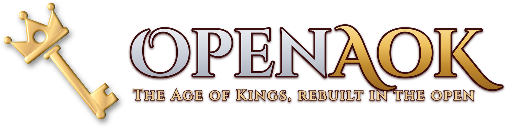

  <b>A free, open-source engine for Age of Empires II: The Age of Kings, on your desktop and in your pocket.</b>

  <a href="https://zaydme.github.io/openaok/"><b>Documentation</b></a> ·
  <a href="https://zaydme.github.io/openaok/guide/"><b>Getting started</b></a> ·
  <a href="https://github.com/Zaydme/openaok/releases"><b>Download</b></a>

  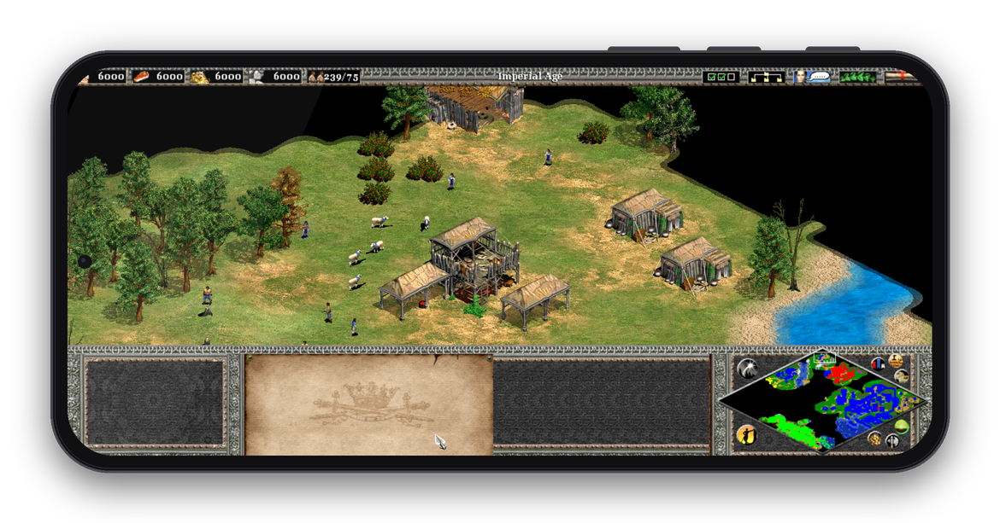

## Why

Playing Age of Empires II on a phone has been a dream of mine since I was a
kid. Microsoft was never going to make that happen, so I did it myself.

OpenAoK is a new engine, written from scratch, that plays the original 1999
game from your own copy of its CD: the same units, maps, art, sounds, music,
movies and campaigns, on Windows, macOS, Linux, Android phones, iPhones and
iPads, and the Nintendo Switch.

## What it is

- **Written from scratch.** OpenAoK contains no code or data from the original
  game. It is modern C++20 on SDL 2, data-oriented (EnTT), with a deterministic
  fixed-point simulation, and it reads the original's data files from your own
  copy and implements their rules.
- **The original, faithfully.** Every unit's numbers, every technology,
  civilisation and map script come from the 1999 data. The interface is drawn
  from the original art, laid out as the game laid it out, in its own fonts and
  words.
- **Your copy, your data.** The repository contains no game files. You copy
  your CD into a folder, and OpenAoK prepares everything it needs from it.

## Screenshots

<table>
  <tr>
    <td>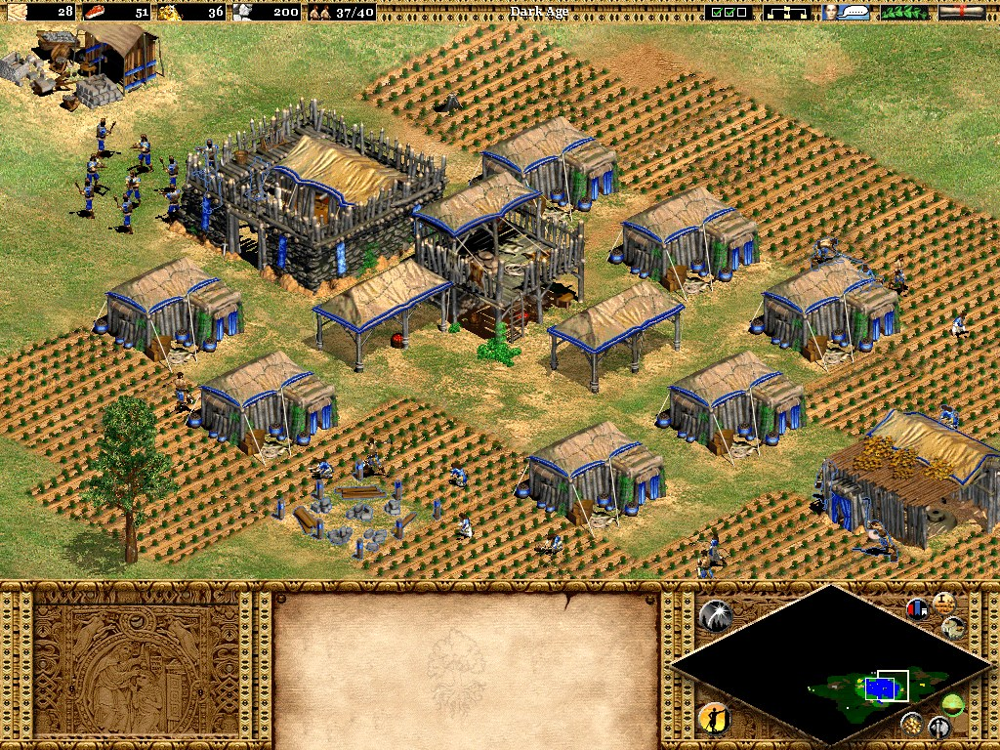</td>
    <td>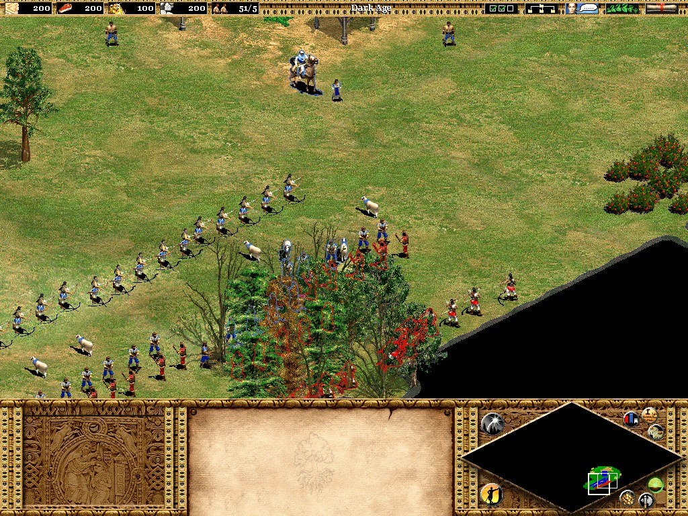</td>
  </tr>
  <tr>
    <td>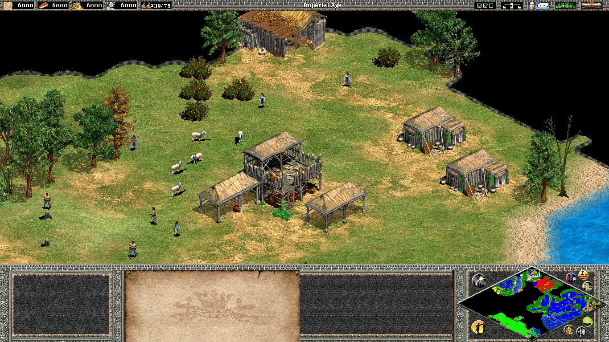</td>
    <td>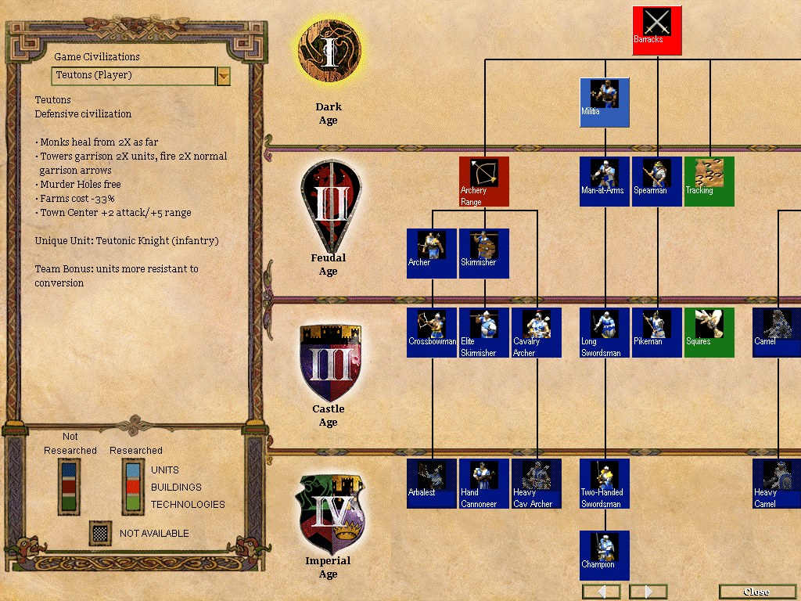</td>
  </tr>
  <tr>
    <td>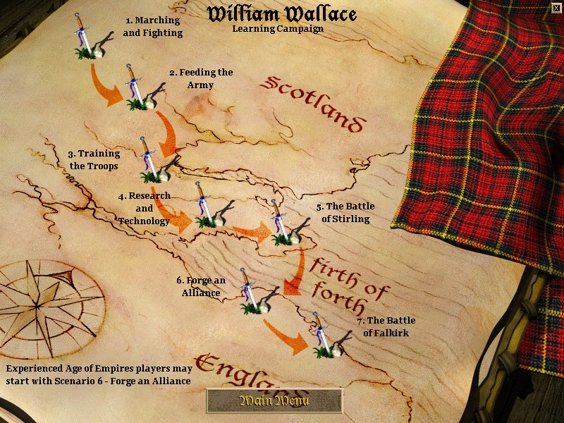</td>
    <td>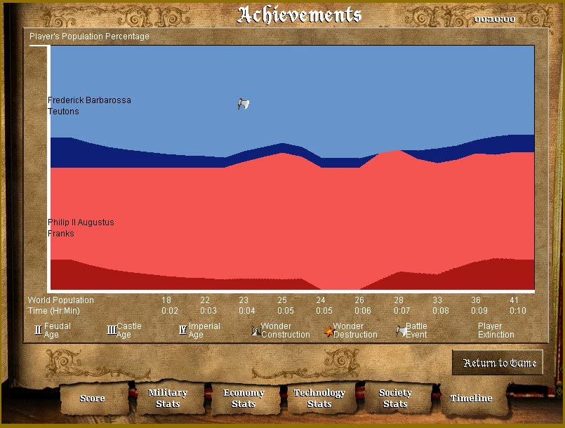</td>
  </tr>
</table>

### On a phone

  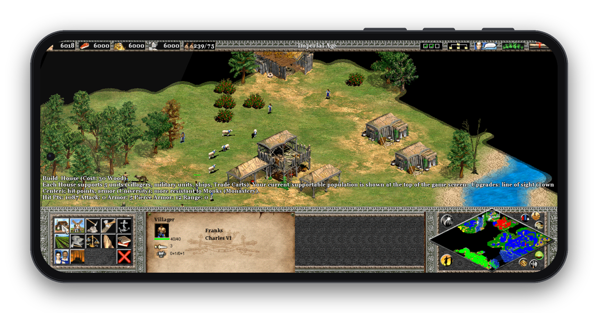
  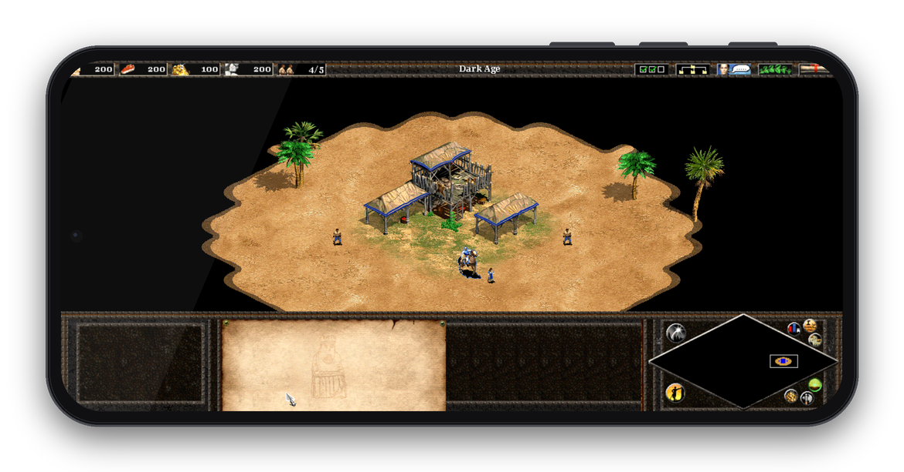

  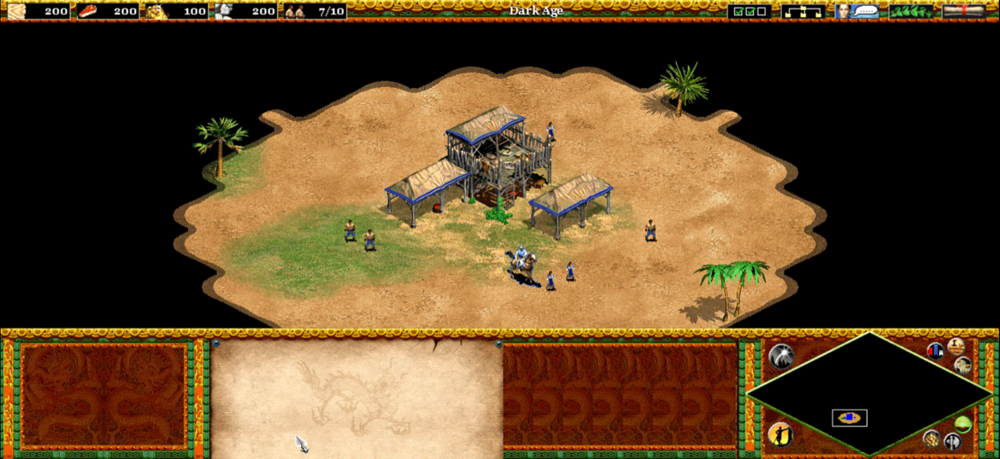

## Controls

With a mouse and keyboard, the controls are the original's: left-click and
drag to select, right-click to order, the command panel and its hotkeys for the
rest. The mouse wheel also zooms the view, which the original could not.

On a touch screen the game is played as with a mouse, and it is surprisingly
comfortable: tap to click, hold to right-click, drag one finger to select, two
fingers to scroll the map, pinch to zoom. This is the same on Android phones,
iPhones and iPads. The top bar, the panel and the text can each be drawn
larger, and in widescreen the interface reaches the screen's edges.

On the Nintendo Switch the controller plays as a mouse and the game's hotkeys:

  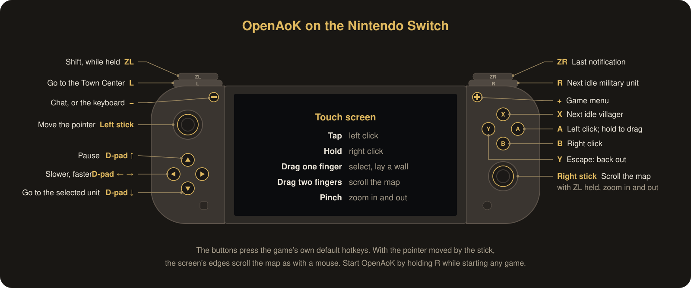

Every control, the options and what OpenAoK adds to the original are in the
guide: [Controls](https://zaydme.github.io/openaok/guide/controls),
[Options](https://zaydme.github.io/openaok/guide/options),
[Improvements on the original](https://zaydme.github.io/openaok/guide/improvements).

## What works

- **Random maps** from the original map scripts: lands, terrain, elevation,
  cliffs, shores, objects, at every map size.
- **The rules**: every unit's numbers, all 426 technologies and their effects,
  each civilisation's tech tree and bonuses, the four ages.
- **Economy**: gathering, drop sites, construction, farms, housing, production
  and research queues, the Market, trade carts and cogs, tribute.
- **War**: attack and armour classes, missiles, splash damage, formations and
  stances, garrisons and the town bell, monks and relics, siege, walls and gates.
- **Water**: docks, fishing, the warship lines, transports landing on any shore.
- **Computer players** running the original AI scripts in an interpreter of the
  script language, at every difficulty.
- **Campaigns and scenarios**, with their triggers, narration and pictures; the
  scenario editor; saved and recorded games.
- **Victory** by conquest, Wonder or relics, and a scenario's score, time limit
  or custom conditions; Regicide and Death Match; diplomacy, allied victory,
  chat, taunts, flares and the cheat codes.
- **Presentation**: sprites straight from the original SLPs with player colours
  and shadows, terrain blending, fog of war, the original interface, sounds,
  music and the start-up movies.
- **Multiplayer** in lockstep over TCP, with desync detection: games on the
  local network found by themselves, others joined by address, and the lobby
  with its chat and ready checks.

What comes next, and the known issues, are on the
[Roadmap](https://zaydme.github.io/openaok/development/roadmap).

## How it works

A deterministic simulation on 32.32 fixed point at a fixed 60 Hz, so the same
orders give the same world on every machine, read by a renderer that draws the
original's sprites straight from its archives. The documentation explains it
all, from the CD's file formats to the computer players:

- [How the engine is put together](https://zaydme.github.io/openaok/engine/)
- [The game's data](https://zaydme.github.io/openaok/engine/data) and [random maps](https://zaydme.github.io/openaok/engine/random-maps)
- [Fixed point and determinism](https://zaydme.github.io/openaok/engine/determinism) and [lockstep multiplayer](https://zaydme.github.io/openaok/engine/multiplayer)
- The game: [units](https://zaydme.github.io/openaok/engine/units), [movement](https://zaydme.github.io/openaok/engine/pathfinding), [the economy](https://zaydme.github.io/openaok/engine/economy), [buildings](https://zaydme.github.io/openaok/engine/construction), [training and research](https://zaydme.github.io/openaok/engine/production), [combat](https://zaydme.github.io/openaok/engine/combat), [armies and the navy](https://zaydme.github.io/openaok/engine/war), [victory](https://zaydme.github.io/openaok/engine/victory), [scenarios](https://zaydme.github.io/openaok/engine/scenarios), [computer players](https://zaydme.github.io/openaok/engine/ai)
- [Rendering](https://zaydme.github.io/openaok/engine/rendering/), [the interface](https://zaydme.github.io/openaok/engine/interface) and [sound](https://zaydme.github.io/openaok/engine/audio)

## Getting started

OpenAoK needs **your own, legally obtained copy** of *Age of Empires II: The
Age of Kings* (1999, the original CD), not The Conquerors or the HD and
Definitive editions. [Your game files](https://zaydme.github.io/openaok/guide/game-files)
explains what to copy. The downloads hold none of the game's data; the data is
prepared from your CD.

| Platform | | |
|---|---|---|
| **Windows** 10 and 11, 64-bit | A folder to unzip; the data is prepared on first start | [Guide](https://zaydme.github.io/openaok/guide/windows) |
| **macOS and Linux** | Built from source in one step | [Guide](https://zaydme.github.io/openaok/guide/desktop) |
| **Android** 10 or later, arm64 | An APK, with a data folder made on a computer | [Guide](https://zaydme.github.io/openaok/guide/android) |
| **iPhone and iPad**, iOS 15 or later | An IPA to sideload, or built with Xcode | [Guide](https://zaydme.github.io/openaok/guide/ios) |
| **Nintendo Switch**, homebrew | An `.nro` and a data folder on the SD card | [Guide](https://zaydme.github.io/openaok/guide/switch) |

Downloads are on the [releases](https://github.com/Zaydme/openaok/releases)
page. Help with problems is in
[Troubleshooting](https://zaydme.github.io/openaok/guide/troubleshooting).

## Building and contributing

[Building from source](https://zaydme.github.io/openaok/development/) covers
every platform's build. Every change is checked by a headless self-check, a
bit-exact determinism hash and over a hundred scenarios
([Self-checks](https://zaydme.github.io/openaok/development/verification)), and
[Contributing](https://zaydme.github.io/openaok/development/contributing) says
how to work on the project.

## AI-assisted development

I didn't build this alone, and it would be a lie to say so. I worked on OpenAoK
with Claude, and it wrote a big share of the code, the tools and these
docs. My part was knowing what the game should feel like: deciding what to
build next, and how to build it, and let Claude do what it does best.
[CLAUDE.md](CLAUDE.md) is the guide it works from, if you'd like to work on the
project the same way.

## License and credits

OpenAoK is released under the [MIT license](LICENSE). The Indeo 5 movie
decoder follows FFmpeg's and is under the LGPL 2.1 or later, and the vendored
libraries keep their own licenses: see
[THIRD_PARTY_NOTICES.md](THIRD_PARTY_NOTICES.md).

Thanks to the [openage](https://openage.dev) project for its documentation of
the game's file formats and mechanics, and to
[genieutils](https://github.com/sandsmark/genieutils) for reading the dat.

## Disclaimer

OpenAoK is a free, non-commercial fan project. It is not affiliated with,
endorsed by or sponsored by Microsoft or Nintendo, and it contains no game
assets: you need your own copy of the game to play.

*Age of Empires II: The Age of Kings* © Microsoft Corporation. *Age of Empires*
is a trademark of Microsoft Corporation. Nintendo Switch is a trademark of
Nintendo. The screenshots in this README were
created under Microsoft's
[Game Content Usage Rules](https://www.xbox.com/en-US/developers/rules) using
assets from *Age of Empires II: The Age of Kings*, and they are not endorsed by
or affiliated with Microsoft.
