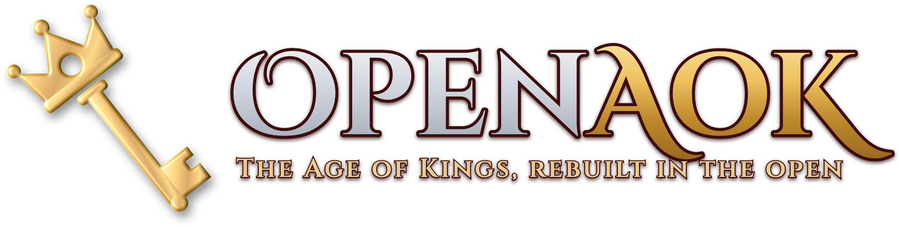
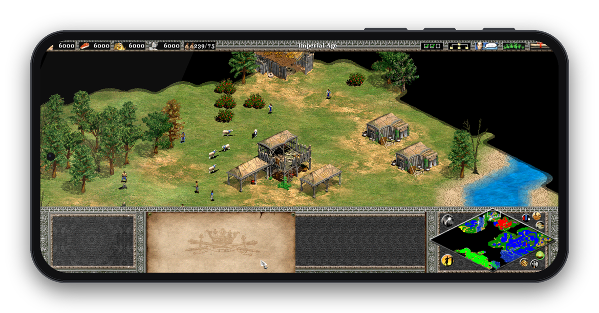
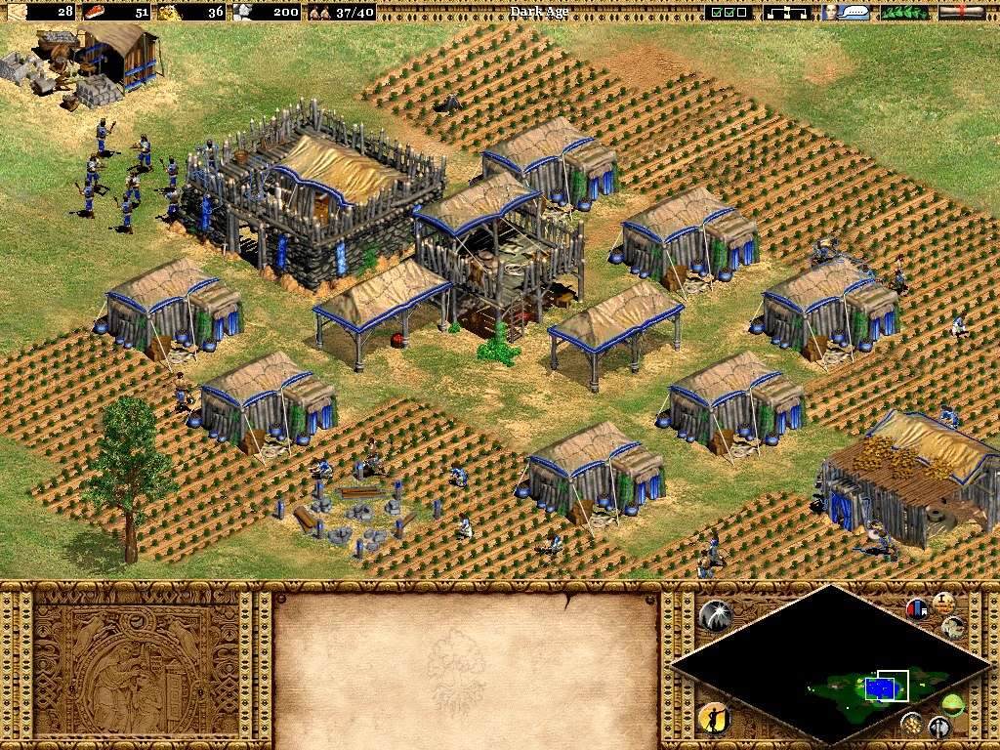
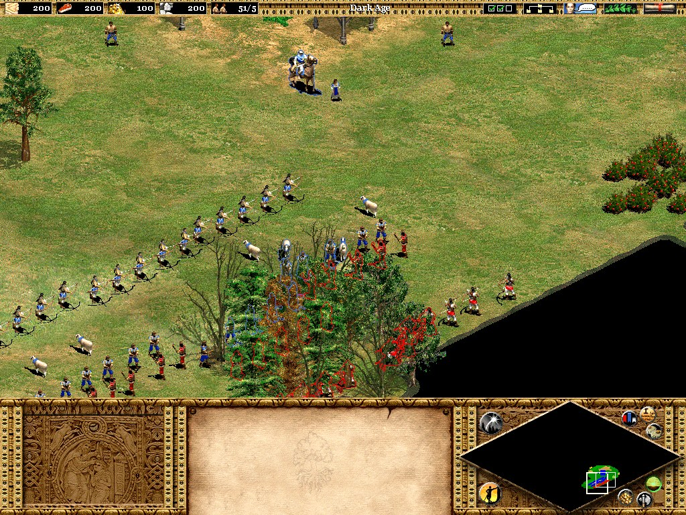
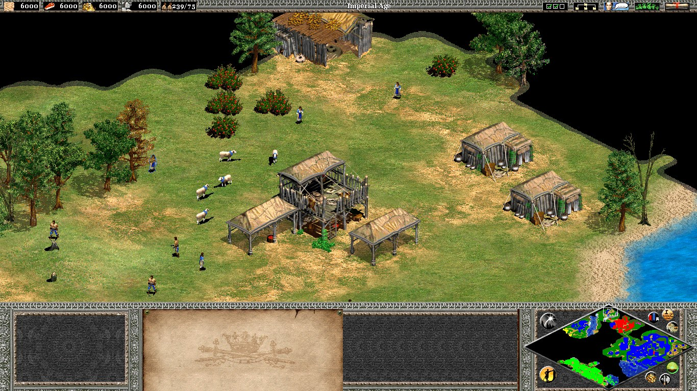
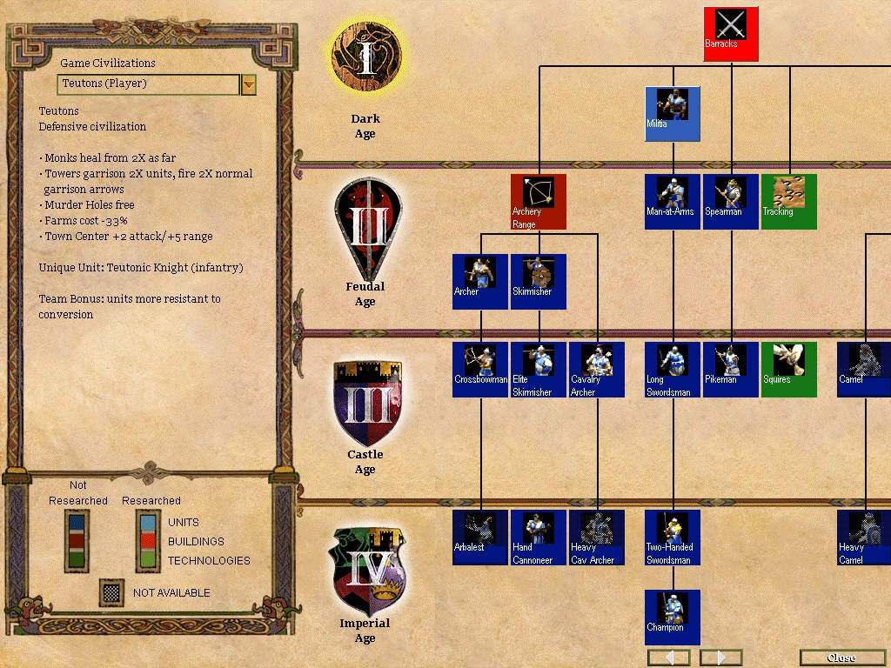
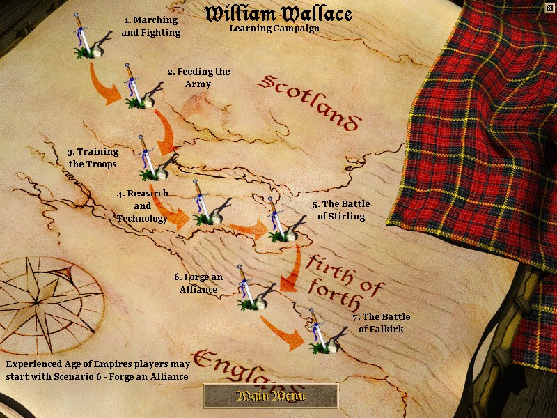
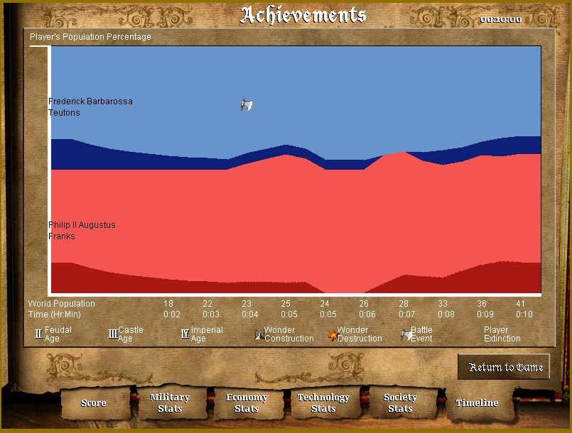
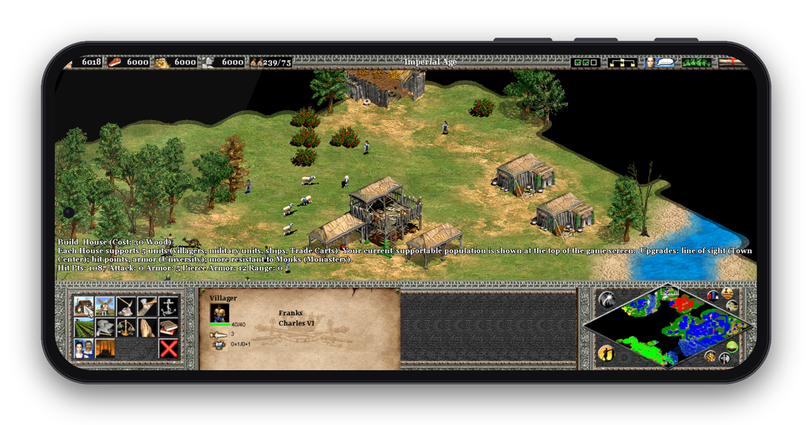
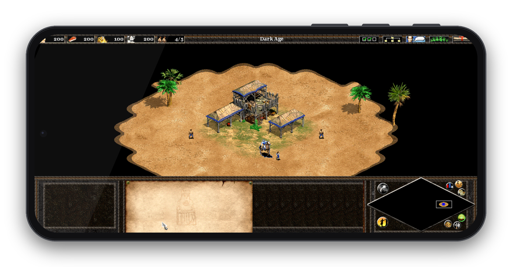

<p align="center">
  
</p>

<p align="center">
  <b>A free, open-source engine for Age of Empires II: The Age of Kings, on your desktop and in your pocket.</b>
</p>

<p align="center">
  
</p>

## Why

Playing Age of Empires II on a phone has been a dream of mine since I was a
kid. Microsoft was never going to make that happen, so I did it myself.

OpenAoK is a new engine, written from scratch, that plays the original 1999
game from your own copy of its CD: the same units, maps, art, sounds, music,
movies and campaigns, on macOS, Linux, Android phones and the Nintendo Switch.

## What it is

- **Written from scratch.** OpenAoK contains no code or data from the original
  game. It is modern C++20 on SDL 2, data-oriented (EnTT), with a deterministic
  fixed-point simulation, and it reads the original's data files from your own
  copy and implements their rules.
- **The original, faithfully.** Every unit's numbers, every technology,
  civilisation and map script come from the 1999 data. The interface is drawn
  from the original art, laid out as the game laid it out, in its own fonts and
  words.
- **Your copy, your data.** The repository contains no game files. You copy
  your CD into a folder, and the build prepares everything it needs from it.

## Screenshots

<table>
  <tr>
    <td></td>
    <td></td>
  </tr>
  <tr>
    <td></td>
    <td></td>
  </tr>
  <tr>
    <td></td>
    <td></td>
  </tr>
</table>

### On a phone

<p align="center">
  
  
</p>

On a touch screen the game is played as with a mouse, and the controls are
surprisingly comfortable: tap to click, hold to right-click, drag one finger to
select, two fingers to scroll the map. The top
bar, the panel and the text can each be drawn larger (Options → Top Bar Size,
Panel Size, Text Size), and in widescreen the interface reaches the screen's
edges.

## What works

- **Random maps** from the original map scripts: lands, terrain, elevation,
  cliffs, shores, objects, at every map size.
- **The rules**: every unit's numbers, all 426 technologies and their effects,
  each civilisation's tech tree and bonuses, the four ages.
- **Economy**: gathering, drop sites, construction, farms, housing, production
  and research queues, the Market, trade carts and cogs, tribute.
- **War**: attack and armour classes, missiles, splash damage, formations and
  stances, garrisons and the town bell, monks and relics, siege, walls and gates.
- **Water**: docks, fishing, the warship lines, transports landing on any shore.
- **Computer players** running the original AI scripts in an interpreter of the
  script language, at every difficulty.
- **Campaigns and scenarios**, with their triggers, narration and pictures; the
  scenario editor; saved and recorded games.
- **Victory** by conquest, Wonder or relics; Regicide and Death Match; diplomacy,
  allied victory, chat, taunts, flares and the cheat codes.
- **Presentation**: sprites straight from the original SLPs with player colours
  and shadows, terrain blending, fog of war, the original interface, sounds,
  music and the start-up movies.
- **Multiplayer** in lockstep over TCP, with desync detection.

What's left, and the known issues, are in [ROADMAP.md](ROADMAP.md).

## How it works

The simulation runs on 32.32 fixed point at a fixed 60 Hz, so the same orders
produce the same world on every machine. Lockstep multiplayer and the
self-check rely on this. Rendering, audio and the interface only read the
simulation; orders reach it as commands. Units move at continuous positions;
the tile grid holds buildings, terrain and path search.

At run time the engine reads the original DRS archives directly: SLP sprites,
terrain, interface art, sounds, map scripts and AI scripts. The rule tables in
the dat and LANGUAGE.DLL are converted to JSON once, at build time, by the tools
in `tools/data`. The movies are decoded by the engine's own Indeo 5 decoder.

More in [docs/ARCHITECTURE.md](docs/ARCHITECTURE.md).

## Getting the game files

OpenAoK needs **your own, legally obtained copy** of *Age of Empires II: The
Age of Kings* (1999, version 1.0, the original CD). It does not work with The
Conquerors expansion or the HD and Definitive editions, which use different
data.

Copy the CD's files into a folder named `original_game_1999` at the top of the
repository. From a disc or a mounted image on macOS, for example:

```sh
cp -R /Volumes/AOE2/. original_game_1999/
```

The folder should then hold `GAME/`, `SYSTEM/` and `GOODIES/`. That's all: the
build unpacks and converts what it needs. Everything taken from your copy stays
on your machine and is ignored by git. Please don't share it, or the builds you
make from it: a build, the Android APK included, contains your game data.
The Switch's `OpenAoK.nro` holds none of it; the folder made beside it does.

## Building for desktop (macOS, Linux)

Install the tools:

```sh
# macOS (with the Xcode command-line tools)
brew install cmake sdl2 freetype cabextract

# Debian / Ubuntu
sudo apt install build-essential cmake python3 libsdl2-dev libfreetype-dev zlib1g-dev cabextract
```

Then build and run:

```sh
./build.sh          # prepares the game data on the first run, then builds
./build.sh --run    # build and play
```

The first build takes about a minute longer while it unpacks and converts your
game files. Run the game from `build/`:

```sh
cd build && ./OpenAoK
```

## Building for Android

The APK is built on a desktop machine with the Android SDK and NDK; the game
data is prepared the same way and packed into it. See
[android/README.md](android/README.md). In short:

```sh
cd android
./fetch_deps.sh
./gradlew assembleRelease
```

Then install `android/app/build/outputs/apk/release/app-release.apk` on a phone
running Android 10 or later. The first launch copies the game data to the phone.
The APK carries your game data, so keep it to your own devices.

## Building for the Nintendo Switch

OpenAoK runs as homebrew on a Switch that runs custom firmware. The `.nro` is
built with devkitPro's toolchain or its Docker image, and the game's data is a
folder made from your CD and copied to the SD card. See
[switch/README.md](switch/README.md). In short:

```sh
switch/build.sh                                  # build-switch/OpenAoK.nro
python3 switch/package.py --out /path/to/sd/card # switch/openaok/ on the card
```

Then hold R while starting any game, and choose OpenAoK in the Homebrew Menu.

## Playing

Start from the main menu, or straight into a game from the command line:

| Option | |
|---|---|
| `--game` | Straight into a random map game against the computer |
| `--map NAME` | Arabia, Archipelago, Baltic, BlackForest, Coastal, Continental, CraterLake, Fortress, GoldRush, Highland, Islands, Mediterranean, Migration, Nomad, Rivers, TeamIslands |
| `--size S`, `--seed N` | tiny, small, medium, normal, large, giant; the map's seed |
| `--resources R`, `--age A`, `--reveal V` | Starting resources, age and map visibility |
| `--ai-only`, `--no-ai` | The computer plays every seat, or none |
| `--host PORT --players N`, `--join HOST:PORT` | A network game |
| `--windowed`, `--fullscreen`, `--widescreen`, `--mute`, `--no-movies` | |

The controls are the original's: left-click and drag to select, right-click to
order, the command panel and hotkeys for the rest, the arrow keys, the screen's
edges and the minimap to move the view.

## Checking changes

```sh
bash tools/check_determinism.sh
```

runs the headless self-check: a bit-exact determinism hash and dozens of
scenarios covering movement, economy, combat, the computer players, networking,
water, trade, diplomacy, scenarios and the editor. See
[docs/VERIFY.md](docs/VERIFY.md) and [CONTRIBUTING.md](CONTRIBUTING.md).

## Documentation

- [docs/ARCHITECTURE.md](docs/ARCHITECTURE.md): how the engine is put together
- [docs/DATA.md](docs/DATA.md): the game files it reads, and how they are prepared
- [docs/VERIFY.md](docs/VERIFY.md): the self-check
- [docs/MULTIPLAYER.md](docs/MULTIPLAYER.md): lockstep networking
- [android/README.md](android/README.md): the Android build and touch controls
- [switch/README.md](switch/README.md): the Switch build, the SD card and the controller
- [ROADMAP.md](ROADMAP.md): what's next, and known issues

## AI-assisted development

I didn't build this alone, and it would be a lie to say so. I worked on OpenAoK
with Claude, and it wrote a big share of the code, the tools and these
docs. My part was knowing what the game should feel like: deciding what to
build next, and how to build it, and let Claude do what it does best.
[CLAUDE.md](CLAUDE.md) is the guide it works from, if you'd like to work on the
project the same way.

## License and credits

OpenAoK is released under the [MIT license](LICENSE). The Indeo 5 movie
decoder follows FFmpeg's and is under the LGPL 2.1 or later, and the vendored
libraries keep their own licenses: see
[THIRD_PARTY_NOTICES.md](THIRD_PARTY_NOTICES.md).

Thanks to the [openage](https://openage.dev) project for its documentation of
the game's file formats and mechanics, and to
[genieutils](https://github.com/sandsmark/genieutils) for reading the dat.

## Disclaimer

OpenAoK is a free, non-commercial fan project. It is not affiliated with,
endorsed by or sponsored by Microsoft or Nintendo, and it contains no game
assets: you need your own copy of the game to play.

*Age of Empires II: The Age of Kings* © Microsoft Corporation. *Age of Empires*
is a trademark of Microsoft Corporation. Nintendo Switch is a trademark of
Nintendo. The screenshots in this README were
created under Microsoft's
[Game Content Usage Rules](https://www.xbox.com/en-US/developers/rules) using
assets from *Age of Empires II: The Age of Kings*, and they are not endorsed by
or affiliated with Microsoft.
