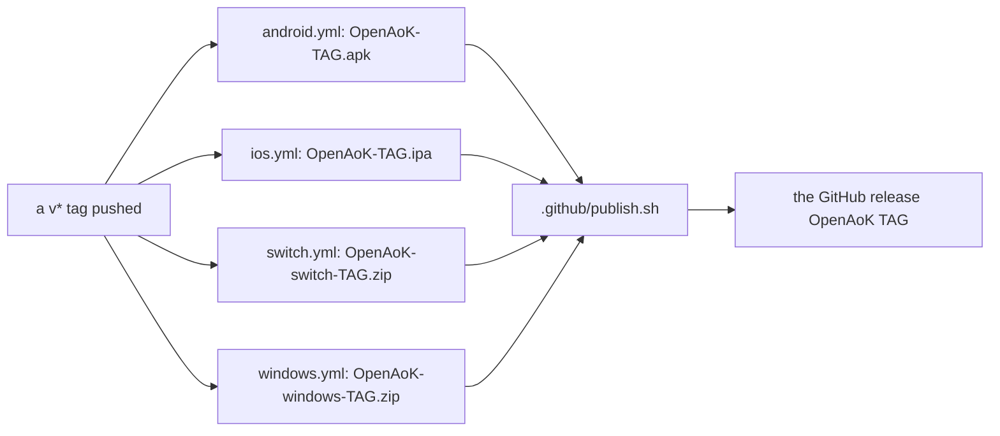

# Building from source

OpenAoK builds for macOS and Linux, Android, iPhone and iPad, the Nintendo
Switch and Windows, all from the same engine sources in `src/`. The
repository holds none of the game: its data is prepared from your own copy of
the 1999 CD, by the desktop build itself or by a packaging script that makes a
data folder for a phone or the Switch.

This page lists what each build needs, how to run it, how the data is
prepared on the first build, and how GitHub builds and publishes releases.

::: warning Your game files stay yours
Everything taken from the CD (`original_game_1999/`, what is prepared from it
in `assets/`, the data folders made for phones and the Switch) is ignored by
git. Never commit it, and do not share a desktop build or a data folder: they
contain your copy of the game.
:::

## The game's files

Every build starts from the CD. Copy its files into a folder named
`original_game_1999` at the top of the repository, so that it holds `GAME/`,
`SYSTEM/` and `GOODIES/`. From a disc or a mounted image on macOS, for example:

```sh
cp -R /Volumes/AOE2/. original_game_1999/
```

OpenAoK plays *The Age of Kings* 1.0 only. The data preparation checks that
`GAME/DATA/EMPIRES2.DAT` is that version's dat and stops on The Conquerors or
a later edition. More on which files are needed in
[Your game files](/guide/game-files).

## macOS and Linux

The desktop build needs a C++20 compiler, CMake 3.20 or later, SDL 2, FreeType,
Python 3 and `cabextract`, and zlib for the data tools:

```sh
# macOS (with the Xcode command-line tools)
brew install cmake sdl2 freetype cabextract

# Debian / Ubuntu
sudo apt install build-essential cmake python3 libsdl2-dev libfreetype-dev zlib1g-dev cabextract
```

Then build:

```sh
./build.sh          # prepares the game data on the first run, then builds (Release)
./build.sh --run    # build, then play
```

| Option | Does |
|---|---|
| `--debug` | A Debug build instead of Release |
| `--release` | A Release build (the default) |
| `--clean` | Wipes `build/` first |
| `--run` | Starts the game once it is built |

`build.sh` checks for its tools (on macOS, that Homebrew has SDL 2 and
FreeType), runs `tools/data/prepare_data.py`, then configures CMake in `build/`
(with Ninja when it is installed) and builds on every core. A CMake cache
written for another checkout path is noticed and `build/` wiped. The same by
hand:

```sh
python3 tools/data/prepare_data.py
cmake -S . -B build -DCMAKE_BUILD_TYPE=Release
cmake --build build --parallel 4
```

The build compiles every `.cpp` under `src/` into one executable,
`build/OpenAoK`, with strict warnings as errors
(`-Wall -Wextra -Wpedantic -Werror`), `-O3`, and link-time optimisation where
the toolchain supports it.
The vendored libraries in `third_party/` are system includes, so the warnings
apply only to the engine's own code.

### Run from `build/`

The engine names its files relative to `build/` (`../assets/...`,
`../original_game_1999/...`), so it is always run from there:

```sh
cd build && ./OpenAoK
```

The command line is in [Command line](/guide/command-line). Before and after
every change, run the self-check: `bash tools/check_determinism.sh` (see
[Self-checks](/development/verification)).

### Preparing the data

`tools/data/prepare_data.py` turns the CD into what the engine reads. It
writes, all ignored by git:

| Output | What it is |
|---|---|
| `assets/original/` | The installed game, unpacked from `GAME/EMPIRES2.CAB` |
| `assets/extracted_data/` | The dat's and LANGUAGE.DLL's tables, as JSON |
| `assets/sprites/terrain/blendmasks.png` | The terrain's blending masks |

It needs `GAME/EMPIRES2.CAB`, `GAME/DATA/EMPIRES2.DAT`, `GAME/LANGUAGE.DLL`,
`GAME/EMPIRES2.EXE` and `SYSTEM/FONTS`. When the movies, the music, the
campaigns' narration or the bonus scenario are missing, it says so, and the
game runs without them. The dat is read by a small C++ helper, `dump_dat`,
built on first use into `build/data-tools/` with CMake. The cabinet is unpacked
with `cabextract`, or on Windows with the system's own `extrac32`, `tar` or
`expand` when `cabextract` is not there.

The first build takes about a minute longer while this runs. Later runs do
nothing unless the CD's files change, the preparation's version moves, or
`--force` is given: a stamp in `assets/.prepared` records what was prepared.
What the data is and how it is read is in [The game's data](/engine/data).

## Android

The Android build makes an APK for arm64 phones and tablets with Android 10
(API 29) or later, built against API 36. It needs no game files to build.

You need:

- JDK 21. Gradle runs on it whichever JDK `java` is
  (`gradle/gradle-daemon-jvm.properties`).
- The Android SDK with `platforms;android-36`, `build-tools;35.0.0`,
  `ndk;28.2.13676358` and `cmake;3.31.6`, named by `android/local.properties`
  (`sdk.dir=/path/to/Android/sdk`) or by `ANDROID_HOME`.

```sh
cd android
./fetch_deps.sh            # SDL 2.32.10 and FreeType 2.13.3 into android/deps
./gradlew assembleRelease
```

The APK is `android/app/build/outputs/apk/release/app-release.apk`; install it
with `adb install -r`, and `adb logcat -s OpenAoK` shows what the engine
prints. The engine's sources are built unchanged as `libmain.so` by
`android/app/jni/CMakeLists.txt`, against SDL 2 (a shared library, which SDL's
Java activity loads first) and FreeType built from source. `OPENAOK_CCACHE`
set compiles the native code through ccache.

The APK is signed with the debug key unless a release key is given, by
`OPENAOK_KEYSTORE`, `OPENAOK_KEYSTORE_PASSWORD`, `OPENAOK_KEY_ALIAS` and
`OPENAOK_KEY_PASSWORD` in the environment, or by `openaok.keystore`,
`openaok.keystorePassword`, `openaok.keyAlias` and `openaok.keyPassword` in
`~/.gradle/gradle.properties`. Android installs one APK over another only when
both are signed with the same key. `OPENAOK_VERSION` names the version shown
in Android's settings.

The game's data is a folder made on a computer and chosen on the phone:

```sh
python3 android/package.py     # writes android/build/OpenAoK-data/; --out DIR for another place
```

How the app copies and checks it is in [Platforms](/engine/platforms#the-data-folder-for-phones-and-the-switch);
installing it is in [Android](/guide/android).

## iPhone and iPad

The iOS build needs a Mac with Xcode 15 or later (opened once, so its licence
is accepted), CMake 3.25 or later, and for the data Python 3 and `cabextract`.
It builds for `arm64`, iOS 15 and later.

```sh
ios/build.sh                    # the simulator: ios/build-sim/, no signing needed
ios/build.sh --device           # a device: ios/build/, unsigned without a team
ios/build.sh --device --ipa     # and ios/build/OpenAoK.ipa, for AltStore to sign
ios/build.sh --project          # only write the Xcode project
```

`ios/build.sh` fetches SDL 2.32.10 and FreeType 2.13.3 into `ios/deps` with
`ios/fetch_deps.sh` when they are missing, writes an Xcode project from
`ios/CMakeLists.txt` and builds it. The two projects are not interchangeable:
`ios/build-sim/OpenAoK.xcodeproj` targets the simulator only, and
`ios/build/OpenAoK.xcodeproj` a device. Environment variables steer it:

| Variable | Does |
|---|---|
| `OPENAOK_TEAM_ID` | The Apple team to sign a device build with |
| `OPENAOK_JOBS` | How many files compile at once (4 by default) |
| `OPENAOK_CCACHE` | Set to 1, compiles through ccache |
| `OPENAOK_VERSION` | The app's version (`v0.6.0` style); 0.0.0 when unset |

SDL 2 and FreeType are linked in statically, and the engine's code compiles
with warnings as errors, as on the desktop. The data folder is made with
`python3 ios/package.py`, which writes `ios/data/OpenAoK-data/`. Installing and
sideloading are in [iPhone and iPad](/guide/ios).

## Nintendo Switch

The Switch build makes `OpenAoK.nro`, homebrew started from the Homebrew Menu.
It needs either Docker or devkitPro's Switch toolchain (`switch-dev`,
`switch-sdl2`, `switch-freetype`, installed with devkitPro's pacman):

```sh
switch/build.sh            # writes build-switch/OpenAoK.nro
switch/build.sh --clean    # wipes build-switch/ first
```

With `DEVKITPRO` set it uses the installed toolchain; otherwise it runs the
same steps in devkitPro's Docker image, `devkitpro/devkita64`, as your own
user. On a Mac, Docker can be `brew install colima docker && colima start`.
With the toolchain installed, the same by hand:

```sh
cmake -S . -B build-switch -DCMAKE_TOOLCHAIN_FILE=$DEVKITPRO/cmake/Switch.cmake
cmake --build build-switch
```

The top-level `CMakeLists.txt` packs the executable into an `.nro` with its
name, version and icon (`switch/icon.jpg`), and builds the test agent,
`OpenAoKAgent.nro`, beside it. The SD card's folder, the game and its data, is
made by `python3 switch/package.py --out "/Volumes/SWITCH SD"` (or into
`build-switch/sd/` without `--out`). Running a build from a computer over
Wi-Fi (`switch/send.py`) and the test agent are described in
`switch/README.md`; installing is in [Nintendo Switch](/guide/switch).

## Windows

The Windows build is cross-compiled on Debian or Ubuntu with MinGW-w64:

```sh
sudo apt install mingw-w64 cmake ninja-build curl xz-utils
windows/build.sh
```

It downloads SDL 2.32.10's MinGW development files, FreeType 2.13.3 and
win-iconv 0.0.10, each checked against its SHA-256, and builds FreeType, the
data tools' dat dumper (`dump_dat.exe`) and `OpenAoK.exe` with the toolchain
file `windows/mingw-w64.cmake`. It then lays out `windows/build/OpenAoK`, the
folder a release zips:

| In the folder | What it is |
|---|---|
| `build\OpenAoK.exe`, `build\SDL2.dll` | The game, which needs only SDL 2 beside it |
| `build\data-tools\dump_dat.exe`, `tools\data\` | The data tools |
| `original_game_1999\` | Where the CD's files go |
| `OpenAoK.bat` | Prepares the data with Python the first time, then starts the game in `build\` |
| `README.md`, `LICENSE`, `THIRD_PARTY_NOTICES.md`, `LICENSES\` | The read-me and the licences |

On a Mac the same runs in a Debian container
(`brew install colima docker && colima start`). Playing it is in
[Windows](/guide/windows).

## The documentation site

This site is VitePress, its pages the Markdown in `docs/`. To see it while
writing:

```sh
cd docs
npm install
npm run dev
```

`npm run build` writes the site to `docs/.vitepress/dist/` and fails on a link
to a page that does not exist. The `Docs` workflow
(`.github/workflows/pages.yml`) builds it on every push to `main` that changes
`docs/` and publishes it on GitHub Pages.

## Continuous integration

GitHub Actions builds four of the platforms on every push to `main`, on every
pull request and on every version tag. None of them needs the game's data, so
none can run the self-check: run `bash tools/check_determinism.sh` on your own
machine.

| Workflow | Runs on | Builds | Artifact |
|---|---|---|---|
| `.github/workflows/android.yml` | `ubuntu-latest`, JDK 21 | `./gradlew assembleRelease`, signed with the release key when the repository's secrets hold one | `OpenAoK-android` |
| `.github/workflows/ios.yml` | `macos-latest` | `ios/build.sh --device --ipa`, unsigned | `OpenAoK-ios` |
| `.github/workflows/switch.yml` | The `devkitpro/devkita64` container | `OpenAoK.nro`, laid out as `switch/openaok/` with the licences | `OpenAoK-switch` |
| `.github/workflows/windows.yml` | `ubuntu-latest` with MinGW-w64 | `windows/build.sh` | `OpenAoK-windows` |

The Switch's workflow also runs on pushes to a branch named `switch`. Each
workflow keeps its compiler cache (ccache) between runs, keyed by platform.

## Releases

A release is made by pushing a tag that starts with `v`. Each workflow then
runs a second job, `release`, which takes the build's artifact and hands one
file to `.github/publish.sh`:



The script adds its file to the tag's release, making the release if it is not
there yet, so whichever workflow finishes first makes it. Versions before 1.0
(`v0.*`) are published as pre-releases. The notes are written for the release
afterwards.

```sh
# Versions before 1.0 are published as pre-releases.
prerelease=""
case "$tag" in v0.*) prerelease="--prerelease" ;; esac

if gh release view "$tag" --repo "$repo" >/dev/null 2>&1; then
    gh release upload "$tag" "$file" --repo "$repo" --clobber
elif ! gh release create "$tag" "$file" --repo "$repo" --title "OpenAoK $tag" $prerelease --notes ""; then
    # Made by the other workflow in the meantime.
    gh release upload "$tag" "$file" --repo "$repo" --clobber
fi
```

A release holds the APK, the `.ipa`, the Switch's zip (to unpack onto the SD
card's root) and the Windows zip. There is no macOS or Linux download; those
are built from source as above.

## Where it lives in the code

- [`build.sh`](https://github.com/Zaydme/openaok/blob/main/build.sh): the desktop build
- [`CMakeLists.txt`](https://github.com/Zaydme/openaok/blob/main/CMakeLists.txt): the desktop, Windows and Switch builds
- [`tools/data/prepare_data.py`](https://github.com/Zaydme/openaok/blob/main/tools/data/prepare_data.py): the data preparation
- [`android/app/build.gradle`](https://github.com/Zaydme/openaok/blob/main/android/app/build.gradle), [`android/app/jni/CMakeLists.txt`](https://github.com/Zaydme/openaok/blob/main/android/app/jni/CMakeLists.txt): the Android build
- [`ios/build.sh`](https://github.com/Zaydme/openaok/blob/main/ios/build.sh), [`ios/CMakeLists.txt`](https://github.com/Zaydme/openaok/blob/main/ios/CMakeLists.txt): the iOS build
- [`switch/build.sh`](https://github.com/Zaydme/openaok/blob/main/switch/build.sh): the Switch build
- [`windows/build.sh`](https://github.com/Zaydme/openaok/blob/main/windows/build.sh): the Windows build
- [`.github/workflows/`](https://github.com/Zaydme/openaok/blob/main/.github/workflows): the CI workflows
- [`.github/publish.sh`](https://github.com/Zaydme/openaok/blob/main/.github/publish.sh): adding a file to a release
