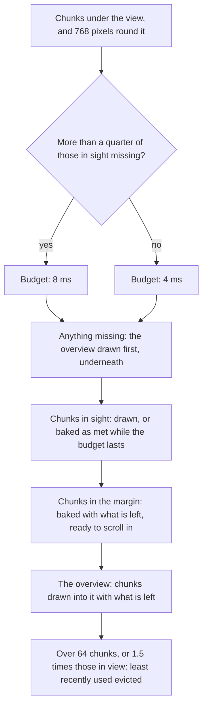
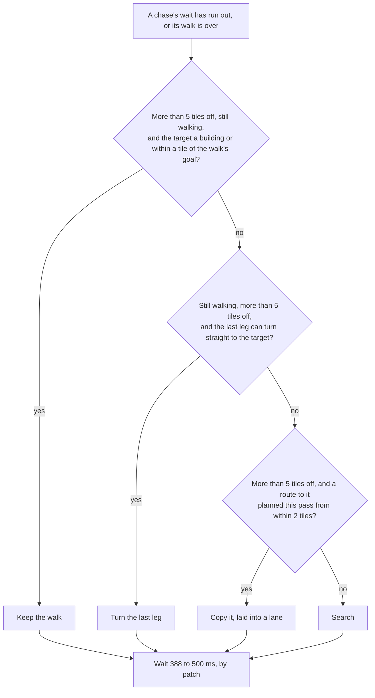

# Optimizations

A late game of *The Age of Kings* puts thousands of things on the map at once:
units walking, fighting and planning routes, buildings shooting, computer
players weighing every target they know of, and a screen full of sprites over
baked ground and fog. OpenAoK has to run all of that on a phone and the
Switch as well as on a desktop, and nothing it does to save time changes how
the game plays: the simulation's shortcuts give the same answers on every
machine, and the drawing's give the same picture.

[Performance](/development/performance) sets out the rules the code keeps to
and how to measure a change. This page goes one technique at a time: what
costs time or memory, what the engine does about it, the figures it works
with, and where the code is. The engine pages it links to explain each part of
the game in full.

## At a glance

The figures are the code's own constants, or the bounds its self-checks hold
it to (see [Self-checks](/development/verification)).

| Technique | What it saves | Figures |
|---|---|---|
| [Shared texture pages](#texture-pages-shared-by-many-graphics) | A texture change, and so a new batch, between neighbouring sprites | Pages start 1,024 square and grow to 4,096 (art) or 2,048 (shadows, outlines); the `pages` check holds 300 graphics' art to at most 8 textures |
| [Texture tie-break](#the-texture-tie-break) | Batches broken between sprites that tie on depth | |
| [Colour baked per player](#colour-baked-per-player) | A tint per sprite, which would end a batch at every change of owner | One block per colour worn; one for all players when a graphic has no player colour |
| [Culling first](#culling-before-render-state) | Render entries built for what is off screen or unseen | Rough test with 384 by 192 pixels of slack, then a 200 pixel margin |
| [Bounded searches through the sorted list](#searches-bounded-by-the-sorted-list) | Testing every pair of sprites for cover | 12 tiles of depth ahead; occluders over 64 pixels tall |
| [Chunks baked once](#chunks-baked-once) | Drawing every tile and blend every frame | 8 by 8 tiles a chunk, up to 512 blends; one copy per chunk a frame |
| [Bake budget](#the-bake-budget) | Hitches while scrolling | 4 ms a frame, 8 ms after a jump |
| [Half-size bakes](#half-size-bakes) | Memory and fill zoomed out | Below zoom 0.6: 432 by 264 pixels instead of 864 by 528 |
| [The overview](#the-overview) | Holes in the ground after a jump | The whole map at an eighth of its size |
| [Eviction](#eviction-and-stale-chunks) | Texture memory | 64 chunks, or 1.5 times those in view |
| [Fog in two batches](#one-atlas-two-batches) | A draw per tile of fog | 94 masks on one texture; two triangle batches and two copies a frame |
| [The heap key](#the-heap-key) | Comparisons in the route search | One 64-bit compare per heap step |
| [Scratch never cleared](#scratch-that-is-never-cleared) | Wiping the search's arrays for every route | A generation stamp; 24 bytes a tile |
| [Landmarks](#the-estimate) | Searches flooding the near shore of a lake | 8 landmarks, the best 3 per search |
| [Search budget](#the-search-budget) | Runaway searches | 256 + 64 a tile under 16 tiles, else 20,000 |
| [Regions and layers](#regions-and-passability-layers) | Searching for routes that cannot exist | Labels made again only when a layer changes |
| [Shared walks](#units-sent-together) | A search for each unit of a block | `sharedwalk`: 100 soldiers search at most 1,500 tiles |
| [Chases planned less](#chases) | A whole army replanning in one tick | 8 patch slots 16 ms apart; `replanspread`: 160 soldiers, at most 4,000 tiles a tick |
| [Crowd at the goal](#a-crowd-at-the-goal) | Searching round an army one is walking into | Crowds over 32 tiles cost nothing to cross; `crowdgoal`: at most 1,000 tiles |
| [The survey](#the-survey-of-standing-units) | Scanning every unit for each route and arrival | One array by tile, mostly re-sorted by insertion |
| [Buckets](#buckets-by-map-square) | Every fighter testing every target | 8 by 8 tile buckets |
| [Scans spread out](#scans-spread-over-ticks) | Spikes when a crowd looks round at once | 500 to 612 ms; herds every 8 ticks |
| [Sight stamped on change](#sight-stamped-only-where-it-changes) | Every seer's circle stamped every tick | Only seers that moved a tile or changed |
| [Rules as flat arrays](#rules-compiled-into-flat-arrays) | Name lookups and tree walks in the rules pass | Subtrees skipped by size |
| [Brains staggered](#brains-staggered-across-ticks) | Every computer player thinking on one tick | Once a second, seats 125 ms apart |
| [Target scoring](#target-scoring) | Strike rates worked out again for every pair | One rate per pair of unit tables |
| [Art on first use](#read-from-the-archives-decoded-on-first-use) | Decoding art no game uses, and memory for it | Only the world's art, decoded before the first frame on every platform but the Switch |
| [The minimap](#the-minimap) | Redrawing thousands of cells a frame | The ground on change, the fog every 250 ms |

## Drawing the world

### Texture pages shared by many graphics

SDL joins consecutive copies from one texture, drawn in the same state, into
one batch for the GPU; a change of texture ends the batch. If every graphic
had a texture of its own, a screen of soldiers, trees and buildings would be
nearly a batch a sprite.

`HAL::GraphicCache` lays each graphic's frames out as one block and puts the
blocks of many graphics on shared texture pages, packed by skyline (each block
at the lowest place along the page's filled edge where it fits). When no page
has room, the pool's last page is grown before a new one is begun, so the art
in use together tends to sit on one texture:

```cpp
    auto& list = pages[static_cast<size_t>(pool)];
    for (Page& page : list) {
        if (Fit(page, w, h, at)) {
            texture = page.texture;
            break;
        }
    }
    // A pool fills its last page, growing it, before it starts another: the
    // more on one page, the more sprites draw in one batch.
    while (texture == nullptr && !list.empty() && Grow(list.back(), most)) {
        if (Fit(list.back(), w, h, at)) texture = list.back().texture;
    }
    if (texture == nullptr && w <= most && h <= most) {
        // Big enough for the block, as small as it may be.
        int side = grows ? first_side : most;
        while (side < w || side < h) side *= 2;
        // ...
```

A page starts 1,024 pixels square (`kFirstPageSide`) and doubles a side at a
time: up to 4,096 for art (`kLargestPageSide`), up to 2,048 for shadows and
outlines (`kPageSide`), which are fewer or seldom drawn. Growing copies the
old page on the GPU, so nothing is decoded again. A block is only as wide as
its frames reach, plus a pixel of border, so little of a page is empty
padding. Shadows and outlines draw with alpha and colour mods of their own,
and a mod holds for a whole texture, so each has its own pool and its own
pass. The `pages` self-check places 300 graphics' art and fails if it takes
more than 8 textures. How a block is shelved, and how pages grow on every
renderer, is on [Sprites and texture pages](/engine/rendering/sprites).

### The texture tie-break

The world is drawn back to front, sorted by depth, then sort bias, then
texture, then entity id (the comparator is on [The frame](/engine/rendering/#depth-order)).
The two keys that matter for batching are set as the entry is built: the depth
from where the thing stands, the texture from the page its frame lies on.

```cpp
        RenderEntry e{};
        e.depth = lx + ly;
        // ...
            e.tex_ptr = art.PageOf(gf.rect);
```

Trees, mines and the map's other objects stand on whole tiles, so their
depths are whole numbers and many tie exactly: every tile along one diagonal
of the map has the same `x + y`. Among ties the texture comes before the
entity id, so everything of one tie that lies on one page is drawn in a run,
as one batch.
The order is never loosened to batch more: depths are compared exactly, never
banded, since a band would let the texture decide what is in front.

### Colour baked per player

Every unit and building has pixels in its owner's colour, shades along that
player's ramp of the palette. Drawing them grey and tinting each sprite would
set a colour mod per sprite; the mod holds for the whole texture, so every
change of owner would end a batch, and a tint only comes near the palette's
own colours.

Instead `GraphicCache::Art` bakes the ramp into the pixels, once for each
colour that is worn, the first time a graphic is asked for in it. A graphic
without player-coloured pixels has one block for everyone:

```cpp
ArtPlace GraphicCache::Art(uint32_t slp_id, int player) {
    const GraphicAtlas* geometry = GetAtlas(slp_id);
    if (geometry == nullptr) return {};
    // Keyed by the colour the player wears, which the lobby may change from
    // game to game.
    const uint64_t key = (static_cast<uint64_t>(slp_id) << 8) |
                         (geometry->coloured ? static_cast<uint8_t>(ColourSlot(player) + 1) : 0);
    auto it = arts.find(key);
    if (it != arts.end()) return it->second;
    const ArtPlace place = LayerPlace(Pool::Art, slp_id, Layer::Art, player);
    arts.emplace(key, place);
    return place;
}
```

The cost is memory: a graphic seen in four players' colours is four blocks.
Only the colours actually asked for are made. A flat tint is used only for
the outline drawn behind cover, from white outline pages.

### Culling before render state

Most of the map is off screen at any moment. `EntityRenderer` rejects an
entity before it looks up anything about its art, in three tests, cheapest
first. The first needs only the interpolated position:

```cpp
        // Off the screen to either side, or above it, whatever its art's
        // offset and however high its ground (which only lifts it): not
        // looked at further.
        {
            const float slack_x = 2.0f * kMostArtOffset * (Core::IsometricMath::TILE_WIDTH / 2.0f);
            const float slack_y = 2.0f * kMostArtOffset * (Core::IsometricMath::TILE_HEIGHT / 2.0f);
            const float px = (lx - ly) * (Core::IsometricMath::TILE_WIDTH / 2.0f) - cx;
            const float py = (lx + ly) * (Core::IsometricMath::TILE_HEIGHT / 2.0f) - cy;
            if (px + slack_x < cull_min_x || px - slack_x > cull_max_x || py + slack_y < cull_min_y) return;
        }
```

`kMostArtOffset` is 4 tiles, the most a building's art is ever set off its
position, so the slack is 384 pixels across and 192 up. Nothing is dropped
for lying below the view here, since a hill only lifts what stands on it. What
passes is placed exactly, with its art offset and the ground's height, and
tested against the view with a margin of 200 pixels; only then does
`ECS::Vision::Shows` ask whether the player at this machine sees it. The order
markers and the fire and flags laid over buildings are culled against the
same rectangle. The tests are described on
[The frame](/engine/rendering/#gathering-and-culling).

### Searches bounded by the sorted list

Two passes over the standing sprites ask what is in front of what, and both
use the sorted order to look at few entries.

- **Outlines behind cover.** Only entries drawn later can hide a unit, so its
  test runs forward from it and stops at 12 tiles of depth ahead
  (`kDepthWindow`). Only entries taller than 64 pixels (`kOccluderHeight`)
  count, and then only where their coverage bits (one bit a pixel, made when
  the graphic is first laid out) are set at one of three points down the
  unit. See [Outlines behind cover](/engine/rendering/#outlines-behind-cover).
- **Objects in the fog.** What stands in the fog is drawn in black into the
  fog's layer, and seen sprites drawn after it wipe the layer. The wiping
  starts at the first fogged entry, and a seen sprite outside the box round
  all the fogged ones is skipped:

```cpp
            const bool wipe = !e.fogged;
            if (wipe && (e.dest.x >= box.x + box.w || e.dest.x + e.dest.w <= box.x ||
                         e.dest.y >= box.y + box.h || e.dest.y + e.dest.h <= box.y)) {
                continue;
            }
            DrawInto(sdl_r, static_cast<SDL_Texture*>(e.tex_ptr), e, wipe);
```

### Decided once for drawing

What the drawing needs to know about a graphic, and which never changes, is
worked out once and kept. Whether an SLP lies on the ground (the dat's layer 5 or
under: farms, rubble, cliffs) is one table, built on first use from every
graphic id and read with an index from then on:

```cpp
bool GroundLevel(int slp_id) {
    static const std::vector<uint8_t> table = [] {
        std::vector<uint8_t> t;
        auto& cfg = Core::ConfigManager::Get();
        constexpr int kGraphicIds = 8192;   // the dat holds 5,577
        for (int id = 0; id < kGraphicIds; ++id) {
            const auto info = cfg.GetGraphic(id);
            if (!info.Valid()) continue;
            const auto slp = static_cast<size_t>(info.slp_id);
            if (slp >= t.size()) t.resize(slp + 1, 0);
            // 1 ground, 2 standing; a standing use wins.
            t[slp] = std::max<uint8_t>(t[slp], info.layer <= 5 ? 1 : 2);
        }
        return t;
    }();
    return slp_id >= 0 && static_cast<size_t>(slp_id) < table.size() &&
           table[static_cast<size_t>(slp_id)] == 1;
}
```

The same goes for a sprite's companion shadow graphic (looked up once and
kept on the `Sprite`), a composite graphic's pieces (`SpritePieces`, resolved
from the dat when the animation changes, so the renderer only indexes
atlases), and a graphic's frame layout and coverage bits (`GetAtlas`, kept for
the run).

## The ground

### Chunks baked once

A tile of ground is a diamond from its terrain's tiling pattern, with up to
eight blends over it where higher-priority ground spills in through
`blendomatic.dat`'s masks, and on a hill a fan of lit triangles. Drawing all
that for every tile on screen every frame would be many masked copies a
tile.

`TerrainRenderer` bakes the ground into chunks of 8 by 8 tiles, each a texture
of its own, and draws a frame's ground as one copy for each chunk in sight.
Even the bake is arranged to change target seldom: every blend of the chunk is
drawn through its mask into one sheet first, then the chunk is laid from it.

```cpp
// A chunk's blends are each drawn through their mask into a slot of the blend
// sheet, and its tiles on hills drawn flat into slots of the hill sheet, all
// before the chunk itself is drawn: the renderer changes target a few times
// a chunk, not twice for every blend. A tile has at most eight blends, one
// for each neighbour.
constexpr int kBlendsAcross = 20;
constexpr int kBlendSlots = TerrainRenderer::CHUNK_SIZE * TerrainRenderer::CHUNK_SIZE * 8;
```

That is 512 slots, 20 across: a blend sheet 1,960 by 1,300 pixels, made once
and reused by every bake, as are the lists the bake collects its tiles and
blends in. A chunk's box covers its 64 diamonds with room above for hills,
864 by 528 pixels. A chunk is kept until its ground changes or it is evicted.
How tiles, blends and hills are drawn is on [Terrain](/engine/rendering/terrain).

### The bake budget

Baking is the dear part, and a scroll or a jump across the map can put many
unbaked chunks in sight at once. So bakes share a time budget each frame,
measured with SDL's performance counter around each one:

```cpp
    const uint64_t bake_budget = SDL_GetPerformanceFrequency() * kBakeBudgetUs / 1000000 *
                                 (missing * kJumpedShare > in_sight ? 2 : 1);
    uint64_t spent = 0;
    auto bake = [&](int cx, int cy) {
        const uint64_t start = SDL_GetPerformanceCounter();
        TerrainChunk chunk = BakeChunk(sdl_r, grid, cx, cy, half);
        spent += SDL_GetPerformanceCounter() - start;
        if (!chunk.texture) return chunks.end();
        chunk.last_used = g_frame;
        return chunks.emplace(ChunkKey(cx, cy, half), chunk).first;
    };
```

The budget is 4 ms (`kBakeBudgetUs`), doubled to 8 ms when more than a quarter
of the chunks in sight have nothing baked (`kJumpedShare`), as after a click
on the minimap. It is spent in order of need:



The margin is a chunk's width, 768 pixels (`TILE_WIDTH * CHUNK_SIZE`). The
budget is presentation only: the simulation never waits on it.

### Half-size bakes

Zoomed out, a chunk shows at less than its baked size, and its full-size
texture is memory and fill spent on detail the screen cannot show. Below a zoom
of 0.6 (`kHalfZoom`) chunks are baked at half size, a quarter of the memory
and of the pixels drawn:

```cpp
    const int shrink = half ? 2 : 1;
    chunk.texture = SDL_CreateTexture(sdl_r, SDL_PIXELFORMAT_RGBA8888, SDL_TEXTUREACCESS_TARGET,
                                      (box.w + shrink - 1) / shrink, (box.h + shrink - 1) / shrink);
    // ...
    // A half-size chunk is baked whole at full size into a scratch, then
    // shrunk into its own texture, so it is as seamless as a full one.
    SDL_Texture* bake = half ? FullScratch(sdl_r, box.w, box.h) : chunk.texture;
```

A half-size chunk is 432 by 264 pixels. The full-size scratch it is composed
in is one texture, made once, since every chunk's box is the same size.
Shrinking takes four copies (`TerrainRenderer::Halve`) so that the pixel of
overlap between neighbouring chunks survives. The chunk map keys each size
apart, and a chunk not yet baked at the size wanted is drawn at the other
meanwhile, so crossing the threshold never leaves a hole.

### The overview

After a jump, the budget cannot bake a whole screen of chunks in one frame.
What is missing shows the overview instead: the whole map drawn once at an
eighth of its size (`kOverviewShrink`), drawn under the chunks, filtered, and
only on frames when a chunk in sight is missing. On a giant map it is 2,892 by
1,458 pixels; where the renderer's largest texture is smaller, the shrink
doubles until it fits. It is filled a chunk at a time, round the map in turn,
with whatever each frame's budget has left:

```cpp
    // What is left of the budget fills in the overview.
    if (overview) {
        Overview& o = g_overview;
        const size_t count = o.drawn.size();
        for (size_t looked = 0; looked < count && spent < bake_budget; ++looked) {
            const size_t i = o.next;
            o.next = (o.next + 1) % count;
            if (o.drawn[i]) continue;
            // ...
            o.drawn[i] = 1;
        }
    }
```

See [The overview](/engine/rendering/terrain#the-overview).

### Eviction and stale chunks

A full-size chunk is about 1.8 MB of texture, so the chunks are kept to what
is in use. Once there are more than 64 (`kMaxLiveChunks`), or half as many
again as the chunks in and about the view when that is more, the least
recently used go, and never one used this frame:

```cpp
    // Evict the least recently seen chunks once the cache is over budget.
    const size_t budget = std::max(kMaxLiveChunks, in_view + in_view / 2);
    if (chunks.size() > budget) {
        static std::vector<std::pair<uint64_t, uint64_t>> aged; // last_used, key
        aged.clear();
        for (const auto& entry : chunks) {
            aged.emplace_back(entry.second.last_used, entry.first);
        }
        std::sort(aged.begin(), aged.end());
        const size_t excess = chunks.size() - budget;
        for (size_t i = 0; i < excess; ++i) {
            if (aged[i].first == g_frame) break;   // never evict what is on screen
            // ...
        }
    }
```

When the ground changes (a farm laid, a foundation begun), only the chunks the
change touches are dropped, with their neighbours, whose blends reach a tile
over. The renderer reads the changes from a log the grid keeps of its last
1,024 (`Grid::kTerrainLogSize`), stamped with a revision, so it never asks
the simulation for anything and never scans the map for differences; only a
reader fallen behind the log throws every chunk away. The ground a player
remembers in the fog keeps a log of its own, read the same way.

## The fog

### One atlas, two batches

The fog's soft edges are masks from `TileEdge.Dat` and `BlkEdge.Dat`, one of
47 shapes for each pattern of a tile's neighbours, in a dithered and a black
form. Drawn a tile at a time with a texture each, the fog would be hundreds of
draws a frame.

`FogRenderer` paints the masks it uses into one atlas when it first draws: 94
cells of 99 by 51 pixels (a mask with a clear pixel round it), 12 across, a
texture 1,188 by 408. The 256 neighbour patterns fold onto the 47 shapes
through a table built at the same time. Each frame the states of the tiles
under the view, with a ring of neighbours, are read once into a local array,
and every tile adds its mask to one of two lists of triangles, dithered or
black. Each list is one `SDL_RenderGeometry` call; with the screen's
checkerboard and the copy of the layer onto the frame, the fog is two batches
and two copies, and the lists are kept between frames:

```cpp
struct State {
    bool tried = false;
    bool masks_ok = false;
    SDL_Texture* atlas = nullptr;
    SDL_Texture* checker = nullptr;
    SDL_Texture* layer = nullptr;
    int layer_w = 0;
    int layer_h = 0;
    uint8_t pattern[256] = {};
    // Reused every frame: no allocation once warm.
    std::vector<uint8_t> tiles;
    std::vector<SDL_Vertex> dither_vertices;
    std::vector<int> dither_indices;
    std::vector<SDL_Vertex> black_vertices;
    std::vector<int> black_indices;
};
```

The layer and the checkerboard, each the frame's size, are made once and again
only when the game's size changes. With everything visible the fog draws
nothing at all. See [Composing the fog](/engine/rendering/fog#composing-the-fog).

## Routes

Every route in play is an A\* search over tiles, eight ways round, with
integer costs so that every machine finds the same one. A battle asks for
many of them. How routes are found and walked is on
[Movement and routes](/engine/pathfinding); this section is about what keeps
the searches few and cheap.

### The heap key

The open list orders nodes by their estimated total cost, then their estimate,
then their tile index, so that ties fall the same way on every machine.
Comparing three fields costs up to three comparisons at every step of a
binary heap; packing them into one 64-bit key makes the order a single
integer comparison:

```cpp
    auto push = [](int32_t g, int32_t heuristic, int32_t index) {
        open.push_back((static_cast<uint64_t>(g + heuristic) << 40) | (static_cast<uint64_t>(heuristic) << 20) |
                       static_cast<uint64_t>(index));
        std::push_heap(open.begin(), open.end(), std::greater<uint64_t>());
    };
    // ...
        const auto index = static_cast<int32_t>(key & kKeyField);
        const auto heuristic = static_cast<int32_t>((key >> 20) & kKeyField);
        const int32_t g = static_cast<int32_t>(key >> 40) - heuristic;
```

The index and the estimate take 20 bits each (`kKeyField`), the total the 24
above; a giant map is 240 by 240, 57,600 tiles, well inside 20 bits. The
cost so far is not stored at all: it is the total less the estimate. The heap
is a plain vector, kept between searches.

### Scratch that is never cleared

A search keeps, for every tile it touches, its best cost, its parent, whether
it is closed, whether it lies beside closed ground and how many units stand
on it. Clearing arrays the size of the map before each search would cost more
than a short search does. So the scratch is one array kept for the run, and a
search counts as having touched a tile only if the tile carries the search's
generation number:

```cpp
    bool Visited(int32_t i) const { return cells[i].seen == generation; }
    void Touch(int32_t i) {
        Cell& c = cells[i];
        if (c.seen != generation) {
            c.seen = generation;
            c.g_score = INT32_MAX;
            c.came_from = -1;
            c.closed = 0;
            c.beside = 0;
        }
    }
```

A tile's fields sit together in one 24-byte cell, so a search reaching a tile
touches one cache line; on a giant map the array is about 1.4 MB, allocated
once. Whether a tile lies beside closed ground is worked out the first time a
search reaches it and kept in the cell for the rest of that search, and the
units standing about the way are counted onto their tiles once before it
starts.

### The estimate

A\* expands fewer tiles the closer its estimate is to the true cost. The plain
estimate, the octile distance, knows nothing of a lake or a long cliff, and a
search guided by it floods the near shore before it finds the way round.

Each layer therefore keeps landmarks: eight tiles round the map's edge, and
for each the distance of every tile from it over the terrain alone. The
difference between two tiles' distances from a landmark never overestimates
the way between them, yet knows about the water in between. At the start of a
search the three landmarks (`kLandmarksUsed`) whose bound is largest for that
start and goal are chosen, so the estimate at each tile costs three lookups
rather than eight:

```cpp
        for (; chosen_count < kLandmarksUsed; ++chosen_count) {
            int best = -1;
            for (int k = 0; k < kLandmarks; ++k) {
                if (bound[k] >= 0 && (best < 0 || bound[k] > bound[best])) best = k;
            }
            if (best < 0) break;
            chosen[chosen_count] = best;
            bound[best] = -1;
        }
```

Distances are kept as 16-bit numbers, eight to a tile together with a byte for
whether the tile's terrain is the layer's: 17 bytes a tile, about 1 MB a layer
on a giant map. They are measured when a map is set up and again only when a
tile's terrain changes whether that layer may cross it; `Pathfinding::Prepare`
checks for that at the top of every tick by reading the grid's log of changes,
which costs nothing when there are none. Buildings, trees and crowds never
touch them. See [The estimate and landmarks](/engine/pathfinding#the-estimate-and-landmarks).

### The search budget

A search whose goal lies behind a crowd, or far round an obstacle, could
expand a great many tiles before it ends. Each search has a budget of
expansions, small for a short route:

```cpp
    const int span = std::max(std::abs(end_x - start_x), std::abs(end_y - start_y));
    const int budget = span < kShortRoute ? kShortBudget + kShortBudgetPerTile * span : kMaxExpansions;
```

A route shorter than 16 tiles (`kShortRoute`) gets 256 expansions and 64 more
for each tile of its length: 896 for one 10 tiles long. Any other gets
20,000 (`kMaxExpansions`). A search that runs out returns the way to the tile
it found nearest the goal, so the unit walks as far as the search got and
plans again on the way, rather than searching round the whole crowd.

### Regions and passability layers

Two things are worked out ahead so the search never asks them tile by tile.

**Passability layers.** Each tile holds a flag for land and a bit for each
other layer of ground (the sea, and any other set of terrains the dat's movers
allow, up to eight layers in all), kept up to date as the ground and what
stands on it change. "May this mover stand here" is then an inline test of
one flag or one bit, with no terrain lookup in the search's inner loop:

```cpp
inline bool Grid::Passable(Layer layer, int x, int y) const {
    const Layer base = BaseLayer(layer);
    if (base == kLand) {
        if (IsWalkable(x, y)) return true;
        // A gate is land, open to the key it opens for.
        const Core::PlayerId key = KeyOf(layer);
        return key != 0 && GateOpensFor(x, y, key);
    }
    if (!InBounds(x, y)) return false;
    return (tiles[static_cast<size_t>(y * width + x)].passable >> base) & 1u;
}
```

Restrictions that allow the same terrains share a layer, so a fishing ship, a
galley and a transport share one sea and its work. Each layer counts its own
changes (`Grid::WalkRevision`), so a tree felled on land leaves what was
worked out for the sea standing.

**Regions.** For each layer every tile is labelled with the connected stretch
of ground it belongs to. A route between two regions cannot exist, and is
refused with two array reads instead of a search that would expand everything
reachable. The labels are made again only when the layer's revision has
moved:

```cpp
    if (regions.serial == grid.Serial() && regions.revision == grid.WalkRevision(layer) &&
        regions.label.size() == static_cast<size_t>(grid.GetWidth()) * grid.GetHeight()) {
        return regions;
    }
```

Labels and landmarks are kept for up to four grids per layer (`kGridsCached`),
the least recently used giving way, so two worlds run side by side (a host and
its client) do not keep throwing each other's away.

### Searches that never start

`AStar::FindRoute` tries the cheap answers before any search:

```cpp
    if (walker.Clear(from, to)) return finish({to});
    if (start_x == end_x && start_y == end_y && grid.Passable(layer, end_x, end_y)) return finish({to});
    if (!grid.Passable(layer, end_x, end_y)) return path;
    {
        const auto& region = RegionsOf(grid, layer);
        // ...
```

A goal in plain sight for the body is one waypoint and no search; so is a goal
on the tile the unit stands on. A closed goal tile, or a goal in another
region, is no route at once. A move order's point has already been turned by
`Navigation::Toward` into the nearest one the unit can stand on and reach, so
searches are not spent on goals in the sea.

### Units sent together

A block of soldiers sent to one point would otherwise search a hundred times
across the same ground. `Navigation::RouteBeside` keeps every walk planned in
the tick and hands a copy of one to a unit going to exactly the same point, on
the same layer, with a body no wider, starting within two tiles of it across
and along, and able to walk straight to its first bend. The list lasts one
tick:

```cpp
// The walks planned this tick, for RouteBeside.
struct SharedWalk {
    Components::Vector2D from, to;
    Physics::Layer layer;
    Core::Fixed32 radius;
    Components::Path path;
};
struct SharedWalks {
    std::vector<SharedWalk> walks;
};
// Within this many tiles of a shared walk's start, across and along, a unit
// takes it.
const Core::Fixed32 kShareReach(2);

} // namespace

void Survey(entt::registry& registry, const Physics::Grid& grid) {
    registry.ctx().emplace<SharedWalks>().walks.clear();
```

A group sent at once is also marked as marching (`Navigation::Marching`), so
none plans round the others as though they stood still. The `sharedwalk`
self-check sends 100 soldiers standing in a 10 by 10 block to one point and
fails if the tick's searches expand more than 1,500 tiles between them. See
[Units sent together](/engine/pathfinding#units-sent-together).

### Chases

A soldier closing on a moving enemy plans again as the enemy moves: about
every half a second, or at once when its walk runs out. A big battle has a
chase for nearly every soldier in it, and three things keep their searches
down.

**Planning less.** A chaser more than five tiles from its target
(`kChaseNear`) keeps its walk while the target is a building or stays within a
tile (`kChaseDrift`) of where the walk is going; failing that, its last leg is
turned straight at the target if the body can go there. Only then is the
chase searched again:

```cpp
            if (combat.chase_ms <= 0 || !walking) {
                const int32_t wait = ReplanWait(registry.get<Components::Transform>(self).position);
                if (walking && (StillThere(registry, self, combat.target, *path) ||
                                TurnLastLeg(registry, grid, self, combat.target, *path))) {
                    combat.chase_ms = wait;
                    break;
                }
                combat.chase_ms = wait;
                if (PlanChase(registry, grid, self, combat.target, *rules)) {
                    combat.chase_failures = 0;
                } else if (++combat.chase_failures >= kChaseGiveUp) {
                    // ...
                }
            }
```

**Sharing.** A far chaser takes a route planned in this tick's combat pass by
another far chaser of the same target, on the same ground, for a body at least
as wide, starting within two tiles of it (`SharedRoute`), and lays it into its
own lane when it marches with others (`KeepLane`).

**Patch by patch.** The wait is not the same everywhere. The map is cut into
patches four tiles square (`kChasePatch`), each given one of eight places in a
cycle, and the wait is 500 ms less 16 ms for each place, so from 388 to
500 ms. Soldiers standing together share a patch, plan on the same tick and
can share routes; an army spread over many patches plans over eight ticks
instead of one.



The `replanspread` self-check sets 160 spearmen at one enemy and fails if any
tick afterwards searches more than 4,000 tiles. See
[Chases](/engine/pathfinding#chases).

### A crowd at the goal

Sending an army to where another army stands is common. Each unit standing on
a tile adds to the cost of stepping onto it, so a search into a big crowd
would look all round it for a cheaper way in, and there is none. Before the
search, the occupied tiles joined to the goal's are gathered; if there are
more than 32 (`kGoRoundCrowd`), they cost nothing to cross:

```cpp
        const bool big = joined.size() > kGoRoundCrowd;
        for (const int32_t tile : joined) sc.cells[tile].standing = big ? 0 : -sc.cells[tile].standing;
```

Round a small crowd, such as villagers at a mine, the costs stand and the route
still finds the open side. The `crowdgoal` self-check routes to a spot inside
a crowd 13 tiles across, two bodies to a tile, from 16 tiles beyond its edge,
and fails if the search expands more than 1,000 tiles.

### Testing a straight line

Pulling a route straight, cutting corners on the walk and sharing a route all
ask whether a body can go straight from one point to another. `AStar::BodyClear`
first follows the line's middle tile by tile, then tests the body's box every
quarter of a tile along it. Consecutive tests over the same open tiles are
skipped, and the points along the line are stepped on by a quotient and a
remainder (`Along`) rather than divided each time, with the same fixed-point
values:

```cpp
    // A test over the same tiles as the one before, which were all open,
    // finds them open again.
    TileSpan open{1, 1, 0, 0};
    for (int i = 0; i <= samples; ++i, along_x.Next(), along_y.Next()) {
        const Vector2D p{a.x + along_x.Now(), a.y + along_y.Now()};
        const TileSpan under = Under(p, reach);
        if (under.x0 == open.x0 && under.y0 == open.y0 && under.x1 == open.x1 && under.y1 == open.y1) continue;
```

The walk itself, which tests every step, uses the cheaper `AStar::MiddleClear`,
which follows the middle alone.

## The simulation

### The survey of standing units

Routes go round units standing still, arrivals stop against them, walkers keep
apart from them, and villagers find their places among them. Each of those
asking every unit in the world would be a pass over thousands of entities for
each question.

At the start of every tick `Navigation::Survey` files every unit's body (its
middle, its radius, whether it is on its way) in one array, sorted by tile and
then by entity, with the index of each tile's first body. A small example of
the layout, with bodies A and B on tile 1 and C on tile 3:

| | tile 0 | tile 1 | tile 2 | tile 3 | tile 4 | end |
|---|---|---|---|---|---|---|
| `first` | 0 | 0 | 2 | 2 | 3 | 3 |

Tile t holds the bodies from `first[t]` up to `first[t + 1]`, and a row of
tiles from x0 to x1 is one run of the array. A box of the map is a few runs:

```cpp
        for (int ty = y0; ty <= y1; ++ty) {
            const size_t row = static_cast<size_t>(ty) * traffic->width;
            for (int32_t i = traffic->first[row + x0]; i < traffic->first[row + x1 + 1]; ++i) {
                const Body& b = traffic->bodies[static_cast<size_t>(i)];
                if (b.entity == entity || b.entity == target || b.moving || Marches(b.entity)) continue;
                standing.push_back({b.x - b.radius, b.y - b.radius, b.x + b.radius, b.y + b.radius});
            }
        }
```

From one tick to the next most units are on the same tile, so the survey is
sorted from last tick's order: the bodies still present keep it, are put right
by insertion as the few that changed tile move along, and those new since are
sorted and merged in. If the order has changed too much, it falls back to a
full sort:

```cpp
    // Insertion, given up for a full sort if the order has changed a lot.
    const size_t budget = head.size() * 8 + 1024;
    size_t moves = 0;
    for (size_t i = 1; i < head.size() && moves <= budget; ++i) {
        const auto key = head[i];
        size_t j = i;
        while (j > 0 && key < head[j - 1]) {
            head[j] = head[j - 1];
            --j;
            ++moves;
        }
        head[j] = key;
    }
    if (moves > budget) std::sort(head.begin(), head.end());
    std::sort(tail.begin(), tail.end());
    std::merge(head.begin(), head.end(), tail.begin(), tail.end(), keys.begin());
```

Every key is different (the tile above the entity id), so there is only one
sorted order however it is reached, and every machine gets the same survey.
See [Who stands in the way](/engine/pathfinding#who-stands-in-the-way).

### Buckets by map square

Combat asks, for each fighter looking for a target, what stands within reach;
herdables ask who is near enough to claim them; gates ask who is at them.
`ECS::Nearby` sorts the entities of a view into buckets 8 tiles square
(`Buckets::kTiles`) with a counting sort, two passes over the entities and one
over the buckets:

```cpp
    for (auto e : view) {
        if (!take(e)) continue;
        const auto& at = view.template get<const Components::Transform>(e).position;
        const uint32_t b = static_cast<uint32_t>(BucketCoordinate(at.y, buckets.rows) * buckets.columns +
                                                 BucketCoordinate(at.x, buckets.columns));
        buckets.bucket_of.push_back(b);
        buckets.taken.push_back(e);
        ++buckets.start[b + 1];
    }
    for (size_t b = 0; b < count; ++b) buckets.start[b + 1] += buckets.start[b];
    buckets.entities.resize(buckets.taken.size());
    buckets.next.assign(buckets.start.begin(), buckets.start.end() - 1);
    for (size_t i = 0; i < buckets.taken.size(); ++i) {
        buckets.entities[buckets.next[buckets.bucket_of[i]]++] = buckets.taken[i];
    }
```

`ForEachNear` then visits only the buckets overlapping a square round the
point. Combat builds its buckets once at the top of its pass, since nothing
moves during it, and keeps them between ticks so they reuse their memory.
Herdables build theirs only on a tick when one of them is due to look about
it.

### What a unit looks for

Which dat classes a kind of unit looks for (a wolf goes after villagers and
soldiers, never a building) is a 64-bit mask, one bit a class, built at
compile time. Testing a candidate is one shift:

```cpp
constexpr Mask Of(std::initializer_list<int> classes) {
    Mask mask = 0;
    for (int c : classes) mask |= Mask{1} << c;
    return mask;
}
// ...
bool Holds(uint64_t classes, int cls) {
    return cls >= 0 && cls <= kHighestClass && ((classes >> cls) & 1) != 0;
}
```

`FindTarget` also rejects a candidate by a box test on its two axes before it
measures any distance.

### Scans spread over ticks

An idle soldier looks round for a fight every half a second. If a whole army
looked on the same tick, that tick would cost many times the others. Each
scan's wait is set off by the entity's id, so a crowd's scans spread over eight
ticks, from 500 to 612 ms:

```cpp
            combat.scan_ms = kScanMs + static_cast<int32_t>(entt::to_integral(self) % 8) * 16;
```

Herdables look about them every eighth tick (`kHerdCheckTicks`), each on one
of the eight by its id:

```cpp
        if ((tick + entt::to_integral(animal)) % kHerdCheckTicks != 0) continue;
```

A wild predator looks round every three quarters to five quarters of 6
seconds (`kHuntMs`), the wait drawn from the world's own seeded generator.

### Sight stamped only where it changes

Every unit and building sees a circle of tiles, and the world keeps a bit per
player per tile for what is visible now. Stamping every circle afresh each
tick would be a great deal of work on a full map.

`Vision::Update` keeps, for each player, how many of its seers see each tile,
and each seer as it was last stamped. A seer that has not moved a tile and has
not changed is passed over; one that has is counted out where it was and in
where it is:

```cpp
        Map::Slot& slot = map->slots[index];
        if (slot.pass != 0) {
            if (slot.seer == seer) {
                slot.pass = pass;
                continue;
            }
            Remove(*map, slot.seer);
        } else {
            map->stamped.push_back(static_cast<uint32_t>(index));
        }
        Add(*map, seer);
```

A tile's bit only changes when its count goes from 0 to 1 or back, and the
circle is walked a row's run at a time. Shared sight (Cartography, Spies) is
skipped entirely when nobody shares, which is nearly always; when someone
does, each tile's players are found through two 256-entry tables, one for
each byte of the tile's mask, rather than a loop over players:

```cpp
    uint16_t Of(uint16_t mask) const { return static_cast<uint16_t>(mask | low[mask & 0xFF] | high[mask >> 8]); }
```

The fog's memory works the same way: each building keeps the players who saw
it last tick, and a picture is taken only for those who have just stopped.
See [What a player sees](/engine/rendering/fog#what-a-player-sees).

### Categories decided at spawn

What kind of thing an entity is (whether it works, fights or converts, which
graphics it plays) is decided once, when it is made, and stored on its
components; the systems walk views of those components and never ask the
rules again (see [Categories decided at spawn](/development/performance#categories-decided-at-spawn)).
A unit's animations are one example: every graphic it plays is looked up by
name once in `Units::Spawn` (and again only when it becomes another unit)
and kept in parallel arrays on its `Animation`, from which the animation
system picks by index every tick:

```cpp
    // Every animation is its own graphic, with its own frame timing from the
    // dat; the animation system takes it from here.
    const bool villager = rules->cls == kVillagerClass;
    Components::Animation anim{};
    Systems::AnimationSystem::LoadSet(anim, dat_name);
```

The same holds the other way: a unit's speed, attack and armour are not
copied onto it, but read from its owner's copy of the rules
(`Players::UnitOf`, an index into a vector), so a technology reaches every
unit already on the map without touching any of them.

### Fixed arrays inline

A component that holds a short list holds it as a fixed array inside the
component, not as a vector pointing elsewhere: no allocation when it is made
or copied, and its items next to the rest of the component in the storage.
The production queue is one:

```cpp
// What a building has been told to make, in order. A fixed array, inline
// with the building: a queue is short and bounded.
struct ProductionQueue {
    // How many items one building's queue holds.
    static constexpr int kCapacity = 15;

    QueueItem items[kCapacity] = {};   // front first
    int count = 0;
    // ...
};
```

A unit's waypoints are a `std::array` of 10 (`Waypoints::kMax`), a
composite graphic's pieces 8 (`SpritePieces::kMax`). The rules are built the
same way: `Core::Rules::UnitRules` holds its attacks and armours (12 each,
`kMaxClassEntries`), costs (3), tasks (12) and the rest in fixed arrays of
plain values, and names are kept apart in `UnitText`, so each player's copy of
the whole unit table is one flat vector with no strings in it. A missile
copies its shooter's attack into its own fixed array when it is loosed.

### Containers kept and lookups hoisted

Code that runs every tick keeps its working containers alive and clears them,
so after the first ticks they allocate nothing. The route's list of standing
units is one:

```cpp
Components::Path Route(const entt::registry& registry, const Physics::Grid& grid,
                       entt::entity entity, Components::Vector2D from,
                       Components::Vector2D to, entt::entity target, Core::Fixed32 range) {
    static std::vector<Pathfinding::Standing> standing;
    standing.clear();
```

The search's heap and scratch, the survey's keys, the buckets, the lists of
spots a crew has taken and the fog's list of buildings just lost from sight
are kept the same way.

Lookups that would be the same for every entity of a loop are made once before
it. An EnTT `try_get` finds the component's storage each time, and the
registry's context is a lookup by type, so the busy systems fetch the storages
and the players' table first and ask them directly:

```cpp
    const Navigation::Traffic* traffic = Navigation::TrafficOf(registry);
    const auto& identities = registry.storage<Components::Identity>();
    const auto& owners = registry.storage<Components::Owner>();
    const auto& makers = registry.storage<Components::RulesOf>();
    const auto& workers = registry.storage<Components::Worker>();
    const auto& bodies = registry.storage<Components::Transform>();
    const Players::Table* table = Players::TableOf(registry);
```

That is the start of `MovementSystem::Update`; `Combat::Update`, the survey
and `Vision::Update` begin the same way, and the fog renderer finds the sight
map once for all its tiles (`Vision::MapOf`).

### Sorting only where order matters

The simulation must visit things in the same order on every machine (see
[A defined order](/engine/determinism#a-defined-order)), but sorting every
list it walks would cost a sort a loop. An EnTT view walks a component's
packed storage in an order every machine shares already, and the copy of every
position into `previous_position` each tick runs straight down that storage.
A sort is made only where a list is built in an order that could differ, or
is to be searched.

Where the question is only which one is best, the comparison itself breaks
every tie, so the order the candidates are visited in cannot change the
answer and nothing needs sorting. Combat's choice of target falls to the
higher combat level, then the nearer, then the lower entity id:

```cpp
        const int level = rules->combat_level;
        const bool better =
            best == entt::null || level > best_level ||
            (level == best_level &&
             (gap < best_gap || (gap == best_gap && other < best)));
```

So the buckets can be visited in any order. Some sorts are there so that a
list can be searched: the marching group is sorted once, and
`Navigation::Marches` is then a binary search for every standing unit a
route looks at.

## The computer players

### Rules compiled into flat arrays

A computer player's scripts are many rules, tried in order once a second.
`ai/Script` compiles them when the game starts into three flat arrays: every
rule's facts in prefix order, its actions, and where each rule's facts and
actions lie. Every argument is resolved to a number then; nothing is looked
up by name while the game runs (see
[What the compiler produces](/engine/ai#what-the-compiler-produces)).

Each node of a rule's facts records the size of its subtree, so the evaluator
steps over an operand it does not need without walking it, and stops a rule
at its first fact that fails:

```cpp
bool Holds(Turn& turn, size_t rule) {
    const Script::Rule& r = turn.program->rules[rule];
    ResetVariables(turn);
    uint32_t at = r.first_expr;
    for (int f = 0; f < r.expr_count; ++f) {
        if (!Evaluate(turn, at)) return false;
        at += turn.program->exprs[at].size;
    }
    return true;
}
```

Within `and` and `or`, the same: an operand is evaluated and the next found by
adding its size, and the loop ends as soon as the answer is known. A rule
switched off by `disable-self` is passed over with one byte's test.

### One snapshot a pass

The rules' facts ask about the player's villagers, buildings, soldiers and
stockpile, and about every seat's counts of each unit. Each pass takes one
snapshot of each: `ai/Census` of the player's own things, `ai/World` of every
seat's counts, kept by unit form in arrays indexed by unit id:

```cpp
// A player's things by form: standing (finished buildings, units out in the
// world) and in all (with foundations, and units queued in its buildings).
struct Counts {
    std::vector<int16_t> units;
    std::vector<int16_t> units_total;
    std::vector<int16_t> buildings;
    std::vector<int16_t> buildings_total;
    int unit_count = 0;
    int unit_total = 0;
    int building_count = 0;
    int building_total = 0;
};
```

A count fact is then an array read. The actions keep the snapshot in step as
they act rather than taking it again: a building given something to make is
marked busy, a unit queued is counted, and the stockpile and population are
read back:

```cpp
void Refresh(Turn& turn) {
    Census& c = *turn.census;
    if (const ECS::Players::Player* seat = ECS::Players::Find(*turn.registry, turn.player)) {
        for (int r = 0; r < 4; ++r) c.stock[r] = ECS::Players::Stock(*seat, static_cast<Core::ResourceType>(r));
    }
    c.population = ECS::Population::Used(*turn.registry, turn.player);
    c.capacity = ECS::Population::Capacity(*turn.registry, turn.player);
}
```

A fact that stays true once true, `resource-found`, is latched in the
player's memory, so the scan of the map's resources behind it stops for good
once it has found what it looks for.

### Brains staggered across ticks

Each computer player thinks once a second of game time: a census, a rules
pass and the executor's work. Eight of them thinking on the same tick would
make one tick in every second far dearer than the rest. Each seat's first
think is set off by 125 ms for its seat number:

```cpp
// How often a brain runs a rules pass and its executor, and the stagger
// between seats so they do not all think on the same tick.
constexpr int32_t kThinkMs = 1000;
// ...
constexpr int32_t kStaggerMs = 125;
// ...
        brain.think_ms = kStaggerMs * seat;
```

With eight seats, each thinks in its own eighth of the second, about eight
ticks from the next. The brains run inside the tick on every machine, on
their own seeded streams, so the stagger is part of the deterministic game.

### Target scoring

An attack group picks its target by the game's target evaluation: every enemy
thing the player knows of is scored for how quickly the group would destroy it
and how quickly the defences round it would destroy the group. Done naively
that is every target against every defender against every soldier, with an
attack-against-armour calculation for each pair.

`Weigh` in `ai/Military` cuts it down. The group's soldiers that are alike (one
unit table, the same hit points, open to the same Monks) are merged into one
entry with a count. Defenders are counted by their unit table. The rate at
which one table strikes another is worked out the first time that pair is met
and kept for the rest of the evaluation:

```cpp
    // Each striking table's rate against each of the group's, filled as met.
    std::vector<Core::Fixed32> rates(striking.size() * tables.size());
    std::vector<uint8_t> rated(rates.size(), 0);
    // ...
            for (int k : met) {
                const size_t cell = static_cast<size_t>(k) * tables.size() + t;
                if (!rated[cell]) {
                    rates[cell] = StrikeRate(*striking[static_cast<size_t>(k)], *tables[t]);
                    rated[cell] = 1;
                }
                rate = rate + Core::Fixed32(near[static_cast<size_t>(k)]) * rates[cell];
            }
```

The group's own rate against each defending table is cached the same way.
A defender is tested against a target by its two axes before its range is
measured. How the scores are made is on [The military](/engine/ai#the-military).

## The data

### Converted once, when the data is prepared

Some of what the engine reads from the CD would be slow or awkward to read
while it runs, so `tools/data/prepare_data.py` converts it once, before the
first build:

- the dat's tables (units, technologies, graphics, terrains, sounds) to JSON,
  through `tools/data/dump_dat.cpp`;
- LANGUAGE.DLL's strings to `strings.json`;
- the blend masks of `blendomatic.dat` to one sheet, `blendmasks.png`;
- which graphic's shadow is which other graphic, to `shadows.json`, found by
  scanning every SLP in `graphics.drs` for shadow pixels.

It writes a fingerprint of its own version and the CD files' sizes
(`assets/.prepared`), and a later run with the fingerprint matching and
every output in place does nothing. At start-up the engine turns the tables'
fractional figures into fixed point once (`Core::Rules`), so the simulation
only ever sees fixed point. See [The game's data](/engine/data).

### Read from the archives, decoded on first use

Everything else is read from the CD's own files as the game runs. The DRS
archives are read whole into memory and indexed by file id (`graphics.drs` is
about 70 MB), so a graphic, a sound or a script is found with one hash lookup
and no file access.

An SLP is decoded only when its graphic is first asked for. Its layout needs
only the frame headers (`SlpReadHeaders`, no pixels decoded), and its
coverage bits are one bit a pixel. A graphic that is missing or fails is
remembered as such, so it is not tried again every frame:

```cpp
    auto it = cache.find(key);
    if (it != cache.end()) {
        return it->second.valid ? &it->second : nullptr;
    }

    GraphicAtlas atlas;
    // Insert even on failure, so a missing graphic is not retried every frame.
    const std::vector<SlpFrameHeader> headers = SlpReadHeaders(src, slp_id);
    if (headers.empty()) {
        cache.emplace(key, atlas);
        return nullptr;
    }
```

Decoding a graphic the first time it comes into view takes time out of that
frame, so while the loading screen is up `Renderer::Warm` decodes the art of
every sprite in the world at the start, in its owner's colour, with its
outline and shadow:

```cpp
    for (auto e : sprites) {
        const auto& sprite = sprites.get<ECS::Components::Sprite>(e);
        if (sprite.slp_id < 0) continue;
        const auto slp = static_cast<uint32_t>(sprite.slp_id);
        if (graphics.GetAtlas(slp) == nullptr) continue;
        int owner = 0;
        if (const auto* o = registry.try_get<ECS::Components::Owner>(e)) owner = o->player_id;
        graphics.Art(slp, owner);
        graphics.Outline(slp);
        const int shadow = cfg.GetShadowSlp(sprite.slp_id);
        if (shadow >= 0) graphics.Shadow(static_cast<uint32_t>(shadow));
    }
```

`HAL::Platform::WarmArt` says whether to; on the Switch art is decoded as it
first comes into view instead. Whatever is trained or built later is decoded
when it first appears. `--frames` reports the worst of the first 60 frames
apart from the rest, which is where decoding on first use shows.

The rest follows the same rule: an interface graphic is built once per palette
it is drawn in, a menu's palette is read from the archive the first time the
menu names it, the computer players' scripts are compiled once at the start of
a game, and a sound is decoded the first time it plays.

## Elsewhere

### The minimap

The minimap is the whole map in a few hundred pixels: thousands of cells of
ground, the fog over them, and a dot for everything on the map. Its ground is
rasterised once into a texture the size of the minimap's well and drawn again
only when the ground changes (the grid's terrain revision) or a new game
starts. The fog over it is redrawn every 250 ms rather than every frame. The
cells and dots are filled rectangles, and runs of one colour go to SDL in one
call:

```cpp
    void Add(uint8_t r, uint8_t g, uint8_t b, uint8_t a, const SDL_FRect& rect) {
        auto& rects = Rects();
        if (!rects.empty() && (r != r_ || g != g_ || b != b_ || a != a_)) Flush();
        r_ = r;
        g_ = g;
        b_ = b;
        a_ = a;
        rects.push_back(rect);
    }
```

See [The interface](/engine/interface).

### Text

Text is drawn from glyphs that FreeType renders the first time each is needed,
shelved into one texture 2,048 pixels square, so a screen of text draws from
one texture. Each face keeps its first 256 characters in a plain array and the
rest in a hash map:

```cpp
    std::array<Glyph, 256> latin{};
    std::unordered_map<uint32_t, Glyph> other;
```

### Sound

A sound is decoded and converted to the device's own rate and layout once,
the first time it plays, and kept, so the mixer only adds samples. Failures
are kept too:

```cpp
    auto cached = g_device.clips.find(file_id);
    if (cached != g_device.clips.end()) {
        return cached->second.samples.empty() ? nullptr : &cached->second;
    }
    Clip& clip = g_device.clips[file_id];   // an empty entry marks a failure too
```

The mixer is integer throughout (levels out of 256, `kUnity`) over 24 voices,
and its buffer is kept between calls. Music is not decoded whole: the main
thread decodes about a second ahead of where it plays into an SDL audio
stream. See [The mixer](/engine/audio#the-mixer).

### The network

A network game sends no world state at all. Every machine runs the whole
simulation, and only the players' orders travel, grouped into turns of 8 ticks
and carried out two turns after they are given:

```cpp
constexpr int kTicksPerTurn = 8;
constexpr uint32_t kDelayTurns = 2;
```

What travels grows with what the players order, not with the size of the
armies on the map. See [Lockstep multiplayer](/engine/multiplayer).

## Where it lives in the code

- [`src/hal/GraphicCache.cpp`](https://github.com/Zaydme/openaok/blob/main/src/hal/GraphicCache.cpp): texture pages and their growth, colour baked per player, graphics laid out and decoded on first use
- [`src/hal/SlpFile.cpp`](https://github.com/Zaydme/openaok/blob/main/src/hal/SlpFile.cpp): DRS archives held in memory, SLP headers read without decoding
- [`src/rendering/EntityRenderer.cpp`](https://github.com/Zaydme/openaok/blob/main/src/rendering/EntityRenderer.cpp): culling, render entries kept between frames, the sort keys, outline and fog tests bounded by the sorted list, `GroundLevel`
- [`src/rendering/Renderer.cpp`](https://github.com/Zaydme/openaok/blob/main/src/rendering/Renderer.cpp): `Warm`, the world's art decoded before the first frame
- [`src/hal/Platform.cpp`](https://github.com/Zaydme/openaok/blob/main/src/hal/Platform.cpp): `WarmArt`, which platforms warm the art
- [`src/rendering/TerrainRenderer.cpp`](https://github.com/Zaydme/openaok/blob/main/src/rendering/TerrainRenderer.cpp): chunk bakes, the bake budget, half-size chunks, the overview, eviction and stale chunks
- [`src/rendering/FogRenderer.cpp`](https://github.com/Zaydme/openaok/blob/main/src/rendering/FogRenderer.cpp): the masks' atlas, the pattern table, two batches of triangles
- [`src/rendering/UIRenderer.cpp`](https://github.com/Zaydme/openaok/blob/main/src/rendering/UIRenderer.cpp): the minimap's cached ground and fog, `FillBatch`
- [`src/rendering/Text.cpp`](https://github.com/Zaydme/openaok/blob/main/src/rendering/Text.cpp): glyphs rendered on first use into one atlas
- [`src/pathfinding/Pathfinder.cpp`](https://github.com/Zaydme/openaok/blob/main/src/pathfinding/Pathfinder.cpp): the heap key, the scratch and its generation stamp, landmarks, the search budget, regions, the crowd at the goal, `BodyClear`
- [`src/physics/Grid.h`](https://github.com/Zaydme/openaok/blob/main/src/physics/Grid.h): passability bits per layer, revisions, the log of changes to the ground
- [`src/ecs/Navigation.cpp`](https://github.com/Zaydme/openaok/blob/main/src/ecs/Navigation.cpp): the survey and its incremental sort, `Route`, shared walks
- [`src/ecs/Combat.cpp`](https://github.com/Zaydme/openaok/blob/main/src/ecs/Combat.cpp): chases planned less, shared chases, patch-by-patch waits, staggered scans, candidates by bucket
- [`src/ecs/Nearby.h`](https://github.com/Zaydme/openaok/blob/main/src/ecs/Nearby.h): buckets by map square
- [`src/ecs/Search.cpp`](https://github.com/Zaydme/openaok/blob/main/src/ecs/Search.cpp): the classes each kind looks for, as masks
- [`src/ecs/Animals.cpp`](https://github.com/Zaydme/openaok/blob/main/src/ecs/Animals.cpp): herdables' staggered checks, buckets built only when needed
- [`src/ecs/Vision.cpp`](https://github.com/Zaydme/openaok/blob/main/src/ecs/Vision.cpp): sight counted per tile and stamped only on change, shared sight through lookup tables
- [`src/ecs/Units.cpp`](https://github.com/Zaydme/openaok/blob/main/src/ecs/Units.cpp): what a unit is, decided as it is made
- [`src/ecs/components/ProductionQueue.h`](https://github.com/Zaydme/openaok/blob/main/src/ecs/components/ProductionQueue.h): a fixed array inline in a component
- [`src/core/Rules.h`](https://github.com/Zaydme/openaok/blob/main/src/core/Rules.h): unit rules as plain values in fixed arrays
- [`src/ecs/systems/MovementSystem.cpp`](https://github.com/Zaydme/openaok/blob/main/src/ecs/systems/MovementSystem.cpp): storages and tables looked up once per pass
- [`src/ai/Script.h`](https://github.com/Zaydme/openaok/blob/main/src/ai/Script.h), [`Interpreter.cpp`](https://github.com/Zaydme/openaok/blob/main/src/ai/Interpreter.cpp): rules compiled to flat arrays, subtrees skipped by size
- [`src/ai/World.h`](https://github.com/Zaydme/openaok/blob/main/src/ai/World.h), [`Census.h`](https://github.com/Zaydme/openaok/blob/main/src/ai/Census.h), [`Executor.cpp`](https://github.com/Zaydme/openaok/blob/main/src/ai/Executor.cpp): one snapshot a pass, kept in step by the actions
- [`src/ai/Brain.cpp`](https://github.com/Zaydme/openaok/blob/main/src/ai/Brain.cpp): brains thinking once a second, staggered by seat
- [`src/ai/Military.cpp`](https://github.com/Zaydme/openaok/blob/main/src/ai/Military.cpp): target scoring with merged soldiers and cached strike rates
- [`src/hal/Audio.cpp`](https://github.com/Zaydme/openaok/blob/main/src/hal/Audio.cpp): sounds decoded once, the integer mixer, music decoded ahead
- [`src/net/Lockstep.h`](https://github.com/Zaydme/openaok/blob/main/src/net/Lockstep.h): turns of ticks, orders only
- [`tools/data/prepare_data.py`](https://github.com/Zaydme/openaok/blob/main/tools/data/prepare_data.py): the data converted once
- [`src/verify/PagesCheck.cpp`](https://github.com/Zaydme/openaok/blob/main/src/verify/PagesCheck.cpp), [`SharedWalkCheck.cpp`](https://github.com/Zaydme/openaok/blob/main/src/verify/SharedWalkCheck.cpp), [`ReplanSpreadCheck.cpp`](https://github.com/Zaydme/openaok/blob/main/src/verify/ReplanSpreadCheck.cpp), [`CrowdGoalCheck.cpp`](https://github.com/Zaydme/openaok/blob/main/src/verify/CrowdGoalCheck.cpp): self-checks that hold texture pages, shared walks, spread replanning and crowds at a goal to their bounds
