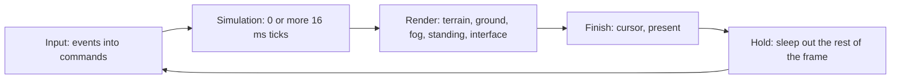

# Performance

A late game of *The Age of Kings* is a crowded thing: eight players, armies
marching and fighting, fleets at sea, towers shooting, and OpenAoK allows
populations far past the original's 200. The engine has to draw that at a
steady frame rate on a phone and the Switch as well as on a desktop, without
changing how the game plays to save time.

This page explains the rules the code keeps to for that, and how to measure a
change.

## The frame

The simulation and the drawing run at different paces. The simulation runs a
fixed 16 ms tick behind an accumulator kept in microseconds; each frame runs as
many ticks as the time since the last frame calls for, then draws the world
once, interpolating every position between the last two ticks.



| Constant (`src/main.cpp`) | Value | Does |
|---|---|---|
| `kTickMs` | 16 | The simulation's fixed tick, about 60 a second |
| `kMaxFrame` | 250 ms | The most time one frame may add to the accumulator |
| `kSimBudget` | 25 ms | Offline, the most a frame spends on the simulation: a machine that cannot keep up plays the game slower, rather than showing it seldom |
| `kFpsCap` | 120 | The most frames drawn a second; faster frames gain nothing, since the simulation runs a fixed step |

The game speeds (Slow, Normal, Fast) feed the accumulator at 1, 1.5 and 2
times real time. The simulation's cost is per tick and its rate is fixed; the
drawing's cost is per frame, and that is where a slow change usually shows
first.

## No allocation in per-frame loops

Allocating memory in a loop that runs every frame costs time in the allocator
and scatters what the loop reads. The per-frame code keeps its containers
alive between frames and clears them, so after the first frames they hold the
capacity they need and allocate nothing. The renderer's list of what to draw
is one such container:

```cpp
std::vector<RenderEntry>& Entries() {
    static std::vector<RenderEntry> entries;
    return entries;
}
// ...
    auto& entries = Entries();
    entries.clear();
```

Where a size is known up front, the container is reserved once instead: the
movie player reserves its buffer for the AVI's largest chunk when a movie
opens, not as each frame is read. Per frame, nothing builds strings to name
what it draws: a `Sprite` names its
graphic by `slp_id` and `slp_frame`, and `HAL::GraphicCache` answers with a
texture and a rectangle, never with a file name or a hashed path.

## Categories decided at spawn

What kind of thing an entity is (whether it gathers, fights, converts, casts a
shadow) is decided once, when it is made, and stored as components or fields.
The systems then iterate views of those components and never ask again by
looking up names or scanning rules each tick. `Units::Spawn` reads the unit's
rules once:

```cpp
    if (rules->attack_count > 0 && rules->reload.value > 0) {
        registry.emplace<Components::Combat>(unit);
        Combat::FirstLook(registry, unit);
    }
    // Anything whose tasks convert or heal is a monk, with its faith.
    for (int t = 0; t < rules->task_count; ++t) {
        if (rules->tasks[t].action == 104 || rules->tasks[t].action == 105) {
            registry.emplace<Components::Monk>(unit);
            break;
        }
    }
```

From then on `ecs/Monks` walks
`registry.view<Components::Monk, Components::Transform>()` and `ecs/Combat`
its view of `Combat`; neither
looks at the rules' tasks again. The same goes for drawing. A unit's
animations (each graphic's SLP, frame count, angles and frame timing) are
looked up by name once, when it is made or upgraded
(`AnimationSystem::LoadSet`), and kept on its `Animation`; the animation
system picks from those arrays every tick. A sprite's companion shadow graphic
is looked up once and kept on the `Sprite` (`shadow_slp`, `shadow_resolved`).

## Cull before building render state

Most of the world is off screen at any moment. `EntityRenderer` rejects an
entity as early as it can, before it assembles anything to draw it with:
first a cheap test of its ground position with room for the largest art
offset, then the exact test once its art offset and the hill under it are
known, then whether the player at this machine sees it at all. Only what
passes becomes a `RenderEntry`:

```cpp
        // Fast frustum culling
        if (sx < cull_min_x || sx > cull_max_x || sy < cull_min_y || sy > cull_max_y) {
            return;
        }
        // What the player at this machine cannot see is not drawn.
        if (!ECS::Vision::Shows(registry, Core::LocalPlayer(), entity)) return;

        RenderEntry e{};
        e.depth = lx + ly;
```

The terrain does the same at the scale of chunks: only the chunks in the view
and a margin round it are baked and kept (see below).

## Batching

SDL sends consecutive draws from one texture, in the same state, to the GPU
as one batch (`SDL_HINT_RENDER_BATCHING` is on). The fewer times the texture
changes between sprites, the fewer batches a frame takes. Two things keep it
low.

**Shared texture pages.** `HAL::GraphicCache` packs each graphic's frames into
one block, in each player colour worn, and puts the blocks on texture pages
that many graphics share. A pool fills and grows its last page before it
starts another: the more on one page, the more sprites draw in one batch. Art,
shadows and outlines are drawn with different colour and alpha mods, so each
has pages of its own. The `pages` check proves that many graphics' art shares
a page or two, and that a villager drawn from its page is its SLP frame in its
player's colours, before and after the page grows.

**The depth sort's texture tie-break.** The world is drawn back to front.
Depth is `world_x + world_y`, compared exactly; ties fall to the sprite's
`sort_bias`, then to the texture, then to the entity id:

```cpp
    std::sort(entries.begin(), entries.end(), [](const RenderEntry& a, const RenderEntry& b) {
        if (a.depth != b.depth) return a.depth < b.depth;
        if (a.sort_bias != b.sort_bias) return a.sort_bias < b.sort_bias;
        if (a.tex_ptr != b.tex_ptr) return a.tex_ptr < b.tex_ptr;
        return a.ent < b.ent;
    });
```

Static map objects stand on whole tiles, so many of them tie exactly on depth
and then come out grouped by texture, which batches them; the entity id last
keeps the order the same from frame to frame. The order is never loosened for
speed: depths are not banded, since that would draw things in front of what
should hide them. A change to the sort must keep the texture tie-break. See
[Sprites and texture pages](/engine/rendering/sprites).

## The terrain's bake budget

The ground is drawn from chunks of 8 by 8 tiles, each baked into a texture of
its own (its tiles and their blends) and then drawn as one copy per frame; a
chunk whose ground changes (a farm laid, say) is dropped and baked again. Baking is the
expensive part, so it gets a time budget each frame:

```cpp
// Chunks are baked as the viewport first touches them, within a few
// milliseconds a frame so scrolling never hitches, and chunks out of view are
// evicted once the budget is exceeded: kMaxLiveChunks, or half as many again
// as are in view when that is more.
constexpr uint64_t kBakeBudgetUs = 4000;
// The view counts as jumped when more than one in this many of the chunks in
// sight have nothing baked.
constexpr int kJumpedShare = 4;
constexpr size_t kMaxLiveChunks = 64;
```

Within the 4 ms, the chunks in sight are baked first, then those in the margin
round the view, so they are ready as they scroll in. When the view jumps (by a
click on the minimap, say) and more than a quarter of what is in sight is
missing, the budget doubles. Whatever is not baked yet shows the overview
meanwhile: the whole map drawn once at an eighth of its size under the chunks,
filled in with what is left of each frame's budget. Zoomed out past 0.6, the
chunks are baked at half size, a quarter of the memory and the drawing. The
least recently seen chunks are evicted once there are more than 64, or half as
many again as are in view, and never one on screen. This is a budget on
presentation only; the simulation never waits on it. See
[Terrain](/engine/rendering/terrain).

## Measuring

Measure with the same build, the same game and the same view before and after
a change:

- **A Release build.** `./build.sh` builds Release (`-O3`, link-time
  optimisation where supported). Never measure a Debug build.
- **The same seed and camera.** The cost of a frame follows what is on screen,
  so fix both: `--map`, `--size` and `--seed N` for the game, `--look X Y` for
  the tile the first frame is centred on, `--zoom` for its zoom.
- **Vsync off.** With vsync the frame rate stops at the display's;
  `--no-vsync` lets it run up to `kFpsCap`.

The tools for it are flags of the game itself:

| Flag | Shows |
|---|---|
| `--fps` | The frame rate, counted each second, drawn under the top bar |
| `--perf` | Once a second, what the frames cost, stage by stage, and what the simulation's ticks cost, system by system |
| `--frames N` | With `--screenshot`, runs N frames before the image is written. When the game ends, prints the frames' average and worst cost, how many took over 16.7 ms, and apart from them the worst of the first 60 (the art being decoded on first use) |
| `--stress` | The self-check's stress scenario played in the window: eight computer players on a giant map in the Imperial Age, armies and fleets sent at one another |

A typical measurement of a late game:

```sh
cd build
./OpenAoK --stress --perf --no-vsync --windowed
```

`--perf` prints two lines a second. The first comes from this format:

```cpp
std::printf("[Perf] %d fps, %.1f ms a frame: %.1f simulation (%.1f ticks), "
            "%.1f terrain, %.1f ground, %.1f fog, %.1f standing, %.1f interface, "
            "%.1f shown; %zu entities\n",
```

Each figure is a frame's average over the second, in milliseconds: the whole
frame (its sleep aside), the simulation and how many ticks it ran, then the
drawing's stages as `Renderer::Cost` times them. `shown` is the cursor and the
frame handed over and presented. These are the CPU's times on the main thread;
the GPU's own work is not in them. The second line is the simulation's: a
tick's average and worst, the six dearest systems with their average and worst
(`Core::Costs`, which `--perf` switches on), and the routes searched with the
nodes their searches expanded. Nothing in the simulation reads these costs, so
measuring never changes what happens.

The headless `stress` self-check runs the same scenario for a minute of ticks
and prints every system's average and worst microseconds a tick on its
`stress=` line, which compares two builds without a window. See
[Self-checks](/development/verification).

## Where it lives in the code

- [`src/main.cpp`](https://github.com/Zaydme/openaok/blob/main/src/main.cpp): the frame loop, `--perf`, `--fps`, `--frames`, `--no-vsync`
- [`src/rendering/Renderer.cpp`](https://github.com/Zaydme/openaok/blob/main/src/rendering/Renderer.cpp): the frame's stages and their costs
- [`src/rendering/EntityRenderer.cpp`](https://github.com/Zaydme/openaok/blob/main/src/rendering/EntityRenderer.cpp): culling, the depth sort
- [`src/rendering/TerrainRenderer.cpp`](https://github.com/Zaydme/openaok/blob/main/src/rendering/TerrainRenderer.cpp): terrain chunks and the bake budget
- [`src/hal/GraphicCache.cpp`](https://github.com/Zaydme/openaok/blob/main/src/hal/GraphicCache.cpp): texture pages
- [`src/ecs/Units.cpp`](https://github.com/Zaydme/openaok/blob/main/src/ecs/Units.cpp): what a unit is, decided as it is made
- [`src/core/Costs.h`](https://github.com/Zaydme/openaok/blob/main/src/core/Costs.h): the tick's costs, system by system
- [`src/verify/Stress.cpp`](https://github.com/Zaydme/openaok/blob/main/src/verify/Stress.cpp): the stress scenario
