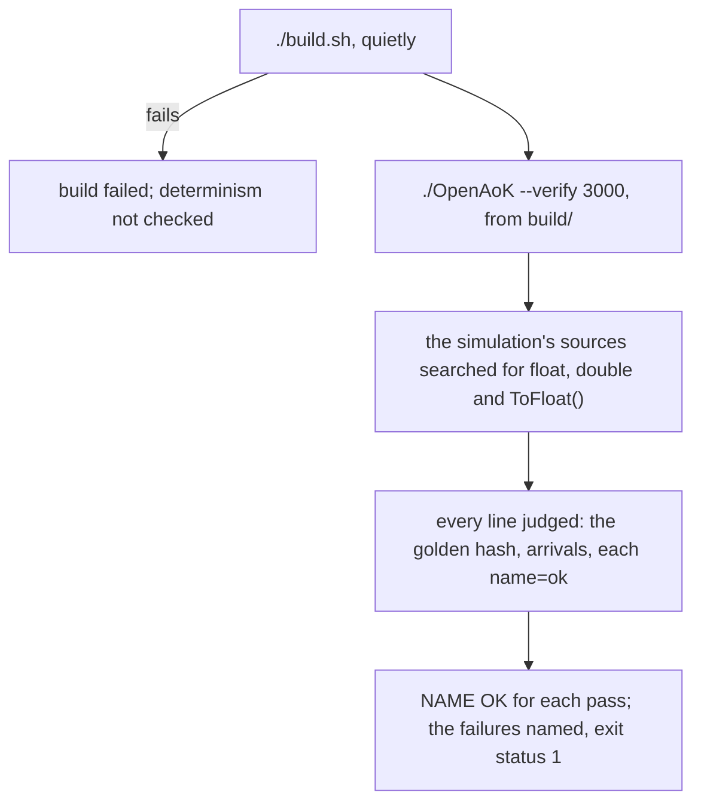

# Self-checks

A game like *The Age of Kings* goes wrong quietly: a villager that stops one
tile short of a mine, a tower that never shoots, two network games that drift
apart a minute in. OpenAoK proves itself with a headless self-check. Run as
`OpenAoK --verify TICKS`, the engine builds dozens of small worlds, plays each
one without a window, and prints one machine-readable line per scenario.
`tools/check_determinism.sh`, the gate, builds the game, runs the self-check
and judges every line.

Run the gate before and after every change. This page covers what it runs,
how to run single checks, what each check proves, the golden hash, and how a
new check is written.

## The gate

```sh
bash tools/check_determinism.sh
```

It needs your CD in `original_game_1999/`, since the scenarios read the game's
data and the build prepares it (see [Building from source](/development/)).
Then, in order:



1. It builds with `./build.sh`, and stops if the build fails.
2. It runs `./OpenAoK --verify 3000` in `build/` and keeps everything it
   prints. Its exit status is ignored: every line is judged instead.
3. It searches `src/ecs`, `src/pathfinding`, `src/physics` and `src/ai` for
   `float`, `double` and `ToFloat()`, skipping comment lines, and prints
   `fixed point OK` when there are none.
4. It compares the `entities=` line with the golden hash, `GOLDEN`, and prints
   `determinism OK`.
5. It reads `arrived=A/B` and prints `movement OK` only when every unit sent
   somewhere reached it.
6. For every other scenario it looks for its line, `name=ok` (some carry
   figures after the `ok`), and prints `name OK`. Anything else is printed in
   capitals with the line that failed, and the gate exits with status 1.

Every scenario runs even after one fails, so a single pass reports everything
that is broken.

## Running single checks

While working on one part, run only its scenarios. Build first, then from
`build/`:

```sh
AOE_VERIFY_ONLY=water,fishing ./OpenAoK --verify 10
```

`AOE_VERIFY_ONLY` takes a comma-separated list of the words the scenarios'
lines start with. The determinism scenario's word is `entities`, and the number
after `--verify` is its count of ticks; the other scenarios run as long as
they need. `--verify` exits with status 0 when every scenario run passed, and
3 otherwise. The gate never sets `AOE_VERIFY_ONLY`.

Some checks read more of the environment, for tuning; the gate sets none of
them:

| Variable | Does |
|---|---|
| `AOE_AI_TRACE=1` | Prints the computer players' goals, gatherer shares, escrow and town minute by minute in the `ai`, `pace` and `seven` games (and in a game run ahead with `--advance`) |
| `AOE_AI_DIFFICULTY`, `AOE_AI_MAP`, `AOE_AI_SEED`, `AOE_AI_MINUTES` | Another difficulty, map, seed or length for the `ai` game |
| `AOE_SCENARIO_SWEEP=SECONDS` | Every scenario on the disc built and played that long with the computer at its seats, one line each |

## What it checks

Each scenario builds its own world from a fixed seed and prints one line that
the gate reads. The names below are those the gate prints.

| Line | Checks |
|---|---|
| `fixed point` | No `float`, `double`, `ToFloat()` or float literal in the simulation's sources |
| `determinism` | A golden hash of the world through 3000 ticks of a standard game |
| `movement` | Every unit given an order reaches it |
| `planner` | Standing spots spread along a building's sides |
| `gathering` | A villager's round trip to a resource and a drop site; farms |
| `unfinisheddrop` | A load goes to a finished drop site, never to a Lumber Camp still a foundation |
| `farmfield` | A farmer works standing on its Farm's field, at one spot after another |
| `farmorder` | A Farm is worked once built and only by its owner; a right-click on another player's strikes it |
| `dropoff` | A villager sent to drop off: its whole load, part units included, and then it stands; only at its own finished building that takes it; the load banked on going into the Town Center, not a tower |
| `felling` | A lumberjack's felling stroke with no wood cut, then the tree lying as its felled graphic, then wood cut from it |
| `herding`, `crowd`, `spread` | Villagers sent at a sheep kill it, take its food and bring it home, walking no further than they must; a crowd at one sheep works side by side, the rest standing by; villagers sent together to a point stand about it side by side |
| `sequence`, `collapse` | Graphics run their dat sequences (a standing scout rests between plays of its idle); a destroyed building falls in its dying graphic over its rubble |
| `shipangles`, `turning` | A ship shows the nearest of its graphic's sixteen angles, a soldier of eight; a ship or a trebuchet turns to its target an angle at a time before it shoots |
| `spies` | Spies' price for each enemy villager and the enemy sight it gives; none in Death Match or Regicide, where Treason marks the enemy Kings for ten seconds; a computer player's spy, Treason with 400 gold over its escrow |
| `flag`, `capture` | A player's flag in a scenario seeing round itself and drawn; Gaia's villagers and buildings taken by the first player to see them, its animals and relic carts not |
| `foundations` | Foundations as the original lays them: no ground held, shown only to their side and nobody's target until begun; what placing runs into; overlapping foundations; footprint sight while going up; refunds on delete; the hill rules for uneven ground; a dock half ashore |
| `fog` | What a player keeps of what it does not see: no building drawn that it never saw; a picture of one gone out of sight, its alone, kept after the building is destroyed until its ground is seen; a picture of a mine used up unseen; ground laid unseen remembered as it was |
| `notices` | The news the interface notifies the player of: a sheep claimed, a farm run out, a Wonder begun and seen by every player, production halted, research finished, a building site found taken, a relic picked up |
| `building` | A crew raising a Town Center; demolition |
| `backtowork` | A builder that fought off a wolf goes back to its site, not to the bush it gathered before; a repairer the bell called in goes back to mending |
| `production` | Prices, refusals, births beside the building, the population cap, cancelling, rally points |
| `queuesplit`, `queueoverview` | Units ordered at several selected buildings shared out among the finished ones; the production overview listing what is made, then what waits, by kind, a click going round the buildings making an entry |
| `techs` | Civilisation bonuses and tech trees, ages, research, upgrades in place |
| `combat` | Damage, reach between the dat's boxes, a duel, arrows, towers, stances, formations, hunting, splash damage |
| `strayarrow` | A stray arrow wounds an enemy and never an ally |
| `search`, `hunt` | What a unit picks a fight with on sight (a wolf a villager, never a building, a ram, a Monk or a Trade Cart); how near a wolf lets people come, by difficulty |
| `wolves` | A computer player's scout and two wolves in its town: every swing it begins lands |
| `answer` | What a struck unit does: a villager fights off a wolf and runs from a soldier, idle ones near come to help, a soldier at a wall turns on its striker unless a person sent it at the wall, and a computer player's units answer ranged attackers and back off as its difficulty parameters say |
| `pocket`, `clearing`, `passing`, `carryon`, `step`, `walledtree` | Villagers give up an animal no walk reaches; a soldier sent into a clearing walled in by trees goes to the trees' edge; one sent past an archer that shoots at it walks on; soldiers whose target falls carry on to where it fell; a route across the tile a unit stands on, someone in the way; a lumberjack goes on to a tree it can come up to, not a nearer walled-in one |
| `setoff`, `crowdgoal`, `sharedwalk`, `replanspread` | A hundred soldiers set on one enemy all have routes the tick after the order and all reach it; a route into a crowd goes straight in; a hundred sent to one place in one tick share their routes; an army's chases plan again over several ticks, not all in one |
| `vision` | Fog per player, explored ground, buildings remembered in the fog |
| `garrison` | Entering and leaving, refusals, garrison arrows, healing, the town bell; the count inside told for our own only |
| `garrisonfall` | A walled-in tower destroyed: its garrison stands on the ground the tower held |
| `animals`, `duties`, `monks` | Herding, fleeing, grazing; patrol, follow, guard; conversion, facing whom they convert, healing, relics |
| `maps` | Islands, continents, beaches, cliffs and fish across several map scripts |
| `connections` | A map script's connections: on Black Forest and Rivers, every start reaches every other by land, Town Centers stepped over |
| `script` | The computer players' rule language: reading, rule passes, every original script loading for every civilisation, difficulty and map, strategic numbers scaled for the difficulty and kept in bounds, civilian explorers, retasking, mining camps and forward builders as the game reckons them, the Hardest's gift of resources, an ally turned on after too many blows, explore groups of one soldier, the scout sent on as sn-consecutive-idle-unit-limit says, Monks fetching relics |
| `ai`, `pace`, `seven` | Twenty-four minutes of the computer against itself at its hardest, with a twin game that must come out identical; each difficulty's pace; seven computer players, every town grown in three minutes |
| `crossing`, `landing`, `water`, `fishing`, `navy` | Transport ships, passability on water maps, docks and fishing, warships |
| `deadtrap` | A fish trap run out leaves its dead unit, which a Fishing Ship builds a new trap over |
| `boats` | A computer player's boats: fishing ships keep near a Dock as the rules ask, a spare warship explores the water, boat attack groups attack a known enemy or explore |
| `attackgroups` | A computer player's attack groups: made, filled, gathered and sent on their own once the enemy is known, as the game does; blows answered by a share of the idle soldiers near, none for explorers; allied computer players sharing what they find and answering calls for help; idle soldiers gathered at the Town Center as sn-gather-defense-units asks; attack-soldier-count counting the soldiers of every attack group, out or not |
| `targets` | The game's target evaluation, which an attack group goes for first: each known enemy thing scored out of 100 for how soon the group would destroy it and how near it is, taken in tiers, the economic buildings after the rest and walls last; a Monastery first with sn-special-attack-type1 |
| `zoom` | The view's zoom, which the original does not have: a step keeps the point under the pointer, the limits hold, and a pinch zooms at once |
| `march` | Soldiers keep their room: forty sent over open ground keep their width with none over another, through the town they squeeze without stacking, and twenty sent at one enemy stand round it |
| `aggression` | Ten archers set at one enemy together loose their first arrows over a spread of ticks; an aggressive archer helps one of its side struck within its sight, a defensive one only within three tiles |
| `walkers` | Villagers reach their places: four computer players for ten minutes on Arabia and on Islands, no villager stands still on its way to work for ten seconds |
| `selection` | The selection limit, off by default: a box round sixty of the player's units selects them all, and forty with the limit on, as in the original |
| `population` | The population limits offered, 25 to 1000 with the original's 25 to 200 among them; a game at the largest supports more than 200, one at 200 stops there |
| `stress` | A late game measured: eight computer players on a giant map in the Imperial Age, armies marching and fighting, fleets at sea, towers shooting; what each system costs a tick, on average and at worst, and the routes searched (`core/Costs`). It fails only if it did not run |
| `colours` | A computer player never plays in a person's colour: it takes the lowest colour nobody chose |
| `buttons`, `help`, `helpbox` | The command buttons with the original's hotkeys (Convert, Heal, Unload, Set Gather Point, Pack and Unpack); a button's rollover help ends with its hotkey; the help's box is as tall as its lines |
| `pages`, `smalltextures`, `halve` | Many graphics' art shares a page or two, a villager drawn from its page its SLP frame in its player's colours; graphics too tall for a small renderer's textures still draw; halved chunks of ground meet with no gap |
| `terraincell` | A tile draws its terrain's own pattern cell for its place, and draws the new terrain's cell once its terrain changes |
| `minimapdead`, `marks`, `outline`, `cursor`, `fogedge` | A soldier struck down leaves the minimap as it falls; a selected thing's outline and hit point bar show zoomed far out; a trebuchet's silhouette shows behind a Castle, not in the open; the pointer over a mine's foot shows a villager's hand zoomed out; black covers the map's unexplored edge, zoomed out |
| `corpsecolour` | A converted unit's body lies in its new owner's colour |
| `idlemilitary` | The idle military button never finds a soldier on guard, patrol or follow |
| `net` | A host and a client in lockstep over loopback, and a desync caught; a client of another version put out of a direct game with the lobby's message |
| `options` | The Options that change play: Scroll Speed's pace at its slowest, middle and fastest; no taunt sound with Allow Audio Taunts off; with one mouse button a left click over open ground orders a selected villager there |
| `lobby` | The multiplayer lobby over loopback: the game found, joined, rows, ready checks and chat, a refused start, the game started from the table |
| `victory`, `modes` | Conquest, Wonders, relics; Regicide, Death Match, starting options |
| `scenariovictory` | A scenario's Score, Time Limit and Custom victories reach its game and are won as they say |
| `wondercount` | Two players' Wonders count side by side and the first finished wins at its time; the relics' count goes on when they pass to an ally |
| `trade`, `tribute`, `market` | Trade routes and their pay; tribute and its fee; market prices |
| `diplomacy`, `chat`, `cheats` | Stances, teams and shared sight, a stance told only when it changes; chat and flares; the cheat codes |
| `score`, `save`, `recording` | Each scoring element's figure as its event happens, the Achievements' statistics; a saved game loaded into a fresh world runs on as the one that never stopped, a damaged save refused; a recorded game played back is the game recorded at every digest it noted |
| `savecheats` | The cheats left on, aegis and natural wonders, come back with a saved game, for their players only |
| `repair`, `packing`, `converted` | Repairing; siege engines packing, their icons from the units' sheet, placed as units from a scenario; converted units keeping their maker's rules |
| `stanceside` | Repairs and the black death cheat follow the stances in play: an ally's House mended, an enemy's not; black death spares an ally |
| `formations` | Locked formations: kept wherever one of the group is sent, lit on the panel, Disband Formation, another formation for some, a member lost |
| `walls`, `waypoints` | Walls, gates going up as their site units, and locking; queued waypoints |
| `gateplace` | A gate is placed as any building: refused on ground never explored and over a foundation of its own |
| `scenario`, `editor` | Every scenario on the CD read; triggers; saving and loading; the scenario editor's edits, Map Copy, garrisons and personalities, its view zooming about a point; campaign files written |
| `scenarioversion` | A scenario read at an older version is written again labelled 1.18, player data 1.20 and triggers 1.6, and reads back so |

## The golden hash

The `determinism` scenario (`Verify::CheckDeterminism` in
`src/verify/Determinism.cpp`) builds the standard game's world: the default
lobby, with its fixed seed. Every other unit is left standing and the rest are
sent at them or across twenty tiles of open map, so the hash covers the
pathfinder, crowding and separation as well as map generation. It then runs
the ticks and folds every entity's fixed-point position, in entity order,
into an FNV-1a hash, sampled every 25 ticks and once at the end: units reach
their destinations well before the last tick, so the final state alone could
not tell two ways of getting there apart. It prints:

```text
entities=N ticks=3000 hash=HHHHHHHHHHHHHHHH
arrived=A/B worst=W tiles
```

The gate compares the first line with `GOLDEN` in
`tools/check_determinism.sh`. The hash is the same on every machine, compiler
and platform; a Windows build plays this game to the same hash as a Mac.

- **A change meant to alter the simulation moves it.** Run the gate, and if
  the hash moved as intended, run it again: only when the second run gives the
  same new hash, update `GOLDEN` to it.
- **A hash that moves when nothing was meant to change is a bug.** A change to
  rendering, sound or the interface never moves it, since none of them writes
  to the simulation.

Other checks compare whole worlds rather than this hash: `Verify::Fingerprint`
is the world's digest (`ECS::Digest`, every entity's identity, place, hit
points and owner, the stockpiles, the Market's prices and the stances), which
the `ai` check's twin game, the `net`, `save` and `scenario` checks compare.

## Writing a check

A new behaviour gets a new scenario:

1. **A file of its own** in `src/verify/`, named for it, defining
   `bool Verify::CheckName()`.
2. **Its own world.** It makes an `ECS::Simulation` and calls `Init()`, with
   the default lobby or a `Core::GameSetup` of its own, from a fixed seed, so
   it does not depend on any other scenario or on the order they run in.
3. **Plays it** with `sim.Update(16)`, a tick at a time, giving orders as the
   game does.
4. **One line out**: `name=ok`, or `name=` followed by what went wrong in
   words. Figures may follow the verdict on the same line, for whoever reads
   it.
5. **Registered** in `src/verify/Harness.h`, with a comment saying what it
   proves and the line it prints, and called from `Verify::Run` in
   `src/verify/Harness.cpp`.
6. **Judged** in `tools/check_determinism.sh`: a `grep` for its line and a
   verdict block.
7. **Seen to fail.** Put back the bug it guards against, rebuild, run it with
   `AOE_VERIFY_ONLY=name`, and confirm its line names the failure. Then take
   the bug out again.

The lines' wording must not change once the gate reads them. A small real
check, `src/verify/MinimapDeadCheck.cpp`, kills a spearman and watches his dot
leave the minimap as he falls:

```cpp
bool CheckMinimapDead() {
    ECS::Simulation sim;
    sim.Init();
    auto& reg = sim.GetRegistry();
    auto& grid = sim.GetGrid();
    const char* verdict = nullptr;
    const int spear = Core::ConfigManager::Get().GetUnitIdByName("SPRMN");
    const entt::entity soldier = ECS::Units::Spawn(reg, spear, 1, {Core::Fixed32(20), Core::Fixed32(20)});
    bool dying = false, corpse = false;
    if (!Rendering::UIRenderer::OnMinimap(reg, soldier)) {
        verdict = "a living soldier had no dot on the minimap";
    } else {
        ECS::Mortality::Kill(reg, grid, soldier);
        for (int t = 0; t < 30 * kTicksPerSecond && verdict == nullptr; ++t) {
            // ...
            sim.Update(16);
        }
        if (verdict == nullptr && (!dying || !corpse)) verdict = "the soldier never fell and lay dead";
    }
    std::printf("minimapdead=%s dying=%d corpse=%d\n", verdict == nullptr ? "ok" : verdict, dying ? 1 : 0, corpse ? 1 : 0);
    return verdict == nullptr;
}
```

It is declared in `Harness.h`:

```cpp
// A soldier struck down leaves the minimap as it falls. Prints
// "minimapdead=".
bool CheckMinimapDead();
```

called from `Verify::Run`:

```cpp
    if (runs("minimapdead")) ok &= CheckMinimapDead();
```

and judged by the gate, which takes any line that starts `minimapdead=ok`:

```sh
MINIMAPDEAD="$(echo "$OUTPUT" | grep '^minimapdead=')"
# ...
# A soldier struck down leaves the minimap as it falls.
case "$MINIMAPDEAD" in
    minimapdead=ok*) echo "minimapdead OK: ${MINIMAPDEAD#minimapdead=ok }" ;;
    *) echo "MINIMAPDEAD FAILED" >&2; echo "  $MINIMAPDEAD" >&2; STATUS=1 ;;
esac
```

## Where it lives in the code

- [`tools/check_determinism.sh`](https://github.com/Zaydme/openaok/blob/main/tools/check_determinism.sh): the gate, and `GOLDEN`
- [`src/verify/Harness.h`](https://github.com/Zaydme/openaok/blob/main/src/verify/Harness.h): every scenario, what it proves and the line it prints
- [`src/verify/Harness.cpp`](https://github.com/Zaydme/openaok/blob/main/src/verify/Harness.cpp): `Verify::Run` and `AOE_VERIFY_ONLY`
- [`src/verify/Determinism.cpp`](https://github.com/Zaydme/openaok/blob/main/src/verify/Determinism.cpp): the golden hash
- [`src/verify/MinimapDeadCheck.cpp`](https://github.com/Zaydme/openaok/blob/main/src/verify/MinimapDeadCheck.cpp): the example above
- [`src/ecs/Digest.cpp`](https://github.com/Zaydme/openaok/blob/main/src/ecs/Digest.cpp): the world's digest
- [`src/main.cpp`](https://github.com/Zaydme/openaok/blob/main/src/main.cpp): `--verify`
