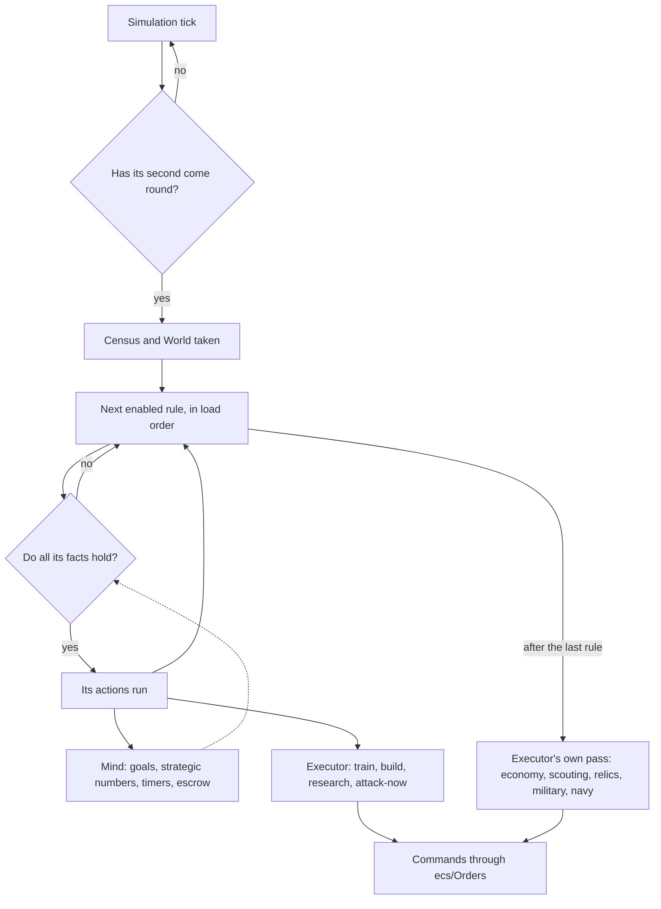

# Computer players

In *The Age of Kings* a computer player is a set of rule scripts: `.per` files
written in a small expert-system language that the CD's `DOCS/CPSB.DOC`
documents. Each rule says "when these facts hold, do these things": train a
villager, build a house, put more gatherers on wood, attack now. The scripts
decide what to do; the game underneath decides how, choosing where a building
goes, which villager builds it and which soldiers march.

OpenAoK plays the original scripts. It reads them from `gamedata.drs`, compiles
them for each computer seat, and runs them in an interpreter of the language.
What the rules ask for is carried out by an executor that gives the same orders
a person's clicks give. This page covers the language, how the scripts are
loaded, the computer player's memory and its pass once a second, the
executor's economy and military, and the difficulty levels.

## The script language

A script is a list of top-level forms. Comments run from `;` to the end of the
line, words are separated by spaces and parentheses, and strings are in double
quotes.

| Form | What it does |
|---|---|
| `(defrule facts => actions)` | A rule: if every fact on the left holds, the actions on the right run |
| `(defconst name value)` | A named integer, usable wherever a number is |
| `(load "file")` | Reads another file in place |
| `(load-random 20 "a" 30 "b" "c")` | Loads at most one of the files by percentage chance, the last one alone being the default |
| `#load-if-defined SYMBOL` | What follows, up to `#else` or `#end-if`, is read only if the game defines the symbol |
| `#load-if-not-defined SYMBOL` | The same, when the symbol is not defined |

Facts can be combined with `and`, `or`, `not`, `nand`, `nor` and `xor`.
Comparisons take `<`, `<=`, `>`, `>=`, `==`, `!=` or their spelled-out forms
(`less-than` and so on). A player argument can be a seat number, a constant, or
a wildcard: `any-enemy` holds if the fact holds for one enemy and remembers
which one in the rule variable `this-any-enemy` for the actions; `every-enemy`
holds only if it holds for all of them.

A short illustration of the syntax, written for this page rather than taken
from the game's scripts:

```text
; Illustration only.
(defconst my-villager-target 25)

#load-if-defined DIFFICULTY-EASIEST
(defrule
    (true)
=>
    (set-strategic-number sn-percent-civilian-builders 10)
    (disable-self))
#end-if

(defrule
    (civilian-population < my-villager-target)
    (can-train villager)
=>
    (train villager))
```

The vocabulary lives in `ai/Language`: 107 facts (`true` and `false`
included), 54 actions, 130 strategic numbers, every parameter kind, and the
`<unit>`, `<building>` and `<research-item>` words with the dat entry each
stands for. Those bindings are checked against the dat's own names by the
self-check, so a word cannot quietly point at the wrong unit.

## Loading a seat's scripts

At the start of a game `AI::Setup` gives every computer seat a brain and loads
its scripts. The master file is "randomgame", the computer player of a random
map game; it loads the rest. The AI files are gamedata.drs entries 60001 to
60027, and `AI::FileId` turns the name a `load` gives into its entry.

The scripts are loaded under the symbols the game defines for that seat, which
is what makes `#load-if-defined` choose. `AI::Symbols` builds them from the
lobby:

- the difficulty: `DIFFICULTY-HARDEST` to `DIFFICULTY-EASIEST`;
- the map type and size: `ARABIA-MAP`, `TINY-MAP`, ...;
- the population cap: `POPULATION-CAP-75` and so on, a limit above 200 loaded
  as 200;
- the starting age, the starting resources (or `DEATH-MATCH`), `REGICIDE`,
  the victory condition, `TEAMS-LOCKED`;
- the seat's own civilisation: `BRITON-CIV` and the rest.

Two constants are defined before anything is read: `my-player-number` and
`my-civ`. At a population limit above 200 the constants the scripts define in
proportion to the population (eight of them, listed in `ai/Brain.cpp`) are
scaled by the limit over 200 as they are defined.

`load-random` rolls a die from 0 to 99 on the brain's own random stream, which
is seeded from the game's seed and the seat. The same game therefore loads the
same files for the same seat on every machine.

### What the compiler produces

`ai/Script` compiles everything into flat arrays, so nothing is looked up by
name while the game runs. Each rule is a range of facts and a range of actions.
Facts are stored in prefix order; a logic node is followed by its operands, and
each node knows how many nodes its subtree takes, so the evaluator can skip one
without walking it:

```cpp
struct Expr {
    // A logic node, or a fact.
    bool fact = false;
    uint8_t logic = 0;      // Lang::Logic
    uint8_t operands = 0;   // a logic node's direct operands
    uint16_t id = 0;        // Lang::Fact
    uint16_t size = 1;      // nodes in this subtree, itself included
    int32_t args[Lang::kMaxArgs] = {0, 0, 0, 0};
};
```

Every argument is resolved at compile time: a constant to its value, a unit
word to its index in the table of things, a strategic number to its slot,
a wildcard or rule variable to a code above the seat numbers. String arguments
go into a table of their own.

Rules are kept in load order, which is the order they are tried in. Rules in a
branch that is not taken are skipped, not compiled. `load` nests ten deep and
conditional loading fifty. A constant may be defined twice only with the same
value.

Errors use the language's own codes ("ERR2003: Invalid keyword", "ERR5001: File
open failed") with the file and line. A rule with an error is dropped and the
rest play on; the number of errors and the first of them are printed when the
game starts. The self-check loads every shipped file for every civilisation,
difficulty and map, Death Match and Regicide, and every file a `load-random`
can pick, and expects no errors.

### Scenarios

In a scenario, a seat the file gives a script of its own plays that script as
its master file instead of "randomgame" (`AI::UseScenario`). What it loads
comes from the game's own files. Campaign scripts load helper files whose names
start with "scenario" that the game data does not contain; those errors are
dropped and the rest plays.

## What a computer player remembers

The rules' state between passes is `AI::Mind`, plain data kept in the brain:

| Field | Holds |
|---|---|
| `enabled` | Which rules are still on (`disable-self` turns one off) |
| `goals` | Goals 1 to 40, set by `set-goal` and read by `goal` |
| `sn` | Every strategic number, starting at its default |
| `timers` | Timers 1 to 10, each off or due at a game time |
| `random_number` | The last number `generate-random-number` drew |
| `escrow_percent`, `escrow` | The share of each resource's income set aside, and how much is |
| `taunts`, `events`, `signals` | Taunts heard from each player, a scenario's AI goals, signals raised |
| `stance` | The player's stance toward each seat |
| `difficulty_parameters`, `doctrine` | What `set-difficulty-parameter` and `set-doctrine` set |

Shared goals (`set-shared-goal`, 256 of them) belong to every computer player
together and live in `AI::Brains`.

A timer armed by `enable-timer` for N seconds is triggered from N seconds of
game time later until it is disabled. Escrow takes its share of whatever has
come in since the last pass. The plain `can-train`, `can-build` and
`can-research` facts and the actions behind them may not spend escrowed
resources; the `-with-escrow` forms may.

### Strategic numbers and difficulty

Strategic numbers are the scripts' tuning knobs for the executor: how many
villagers build, how the gatherers divide, how big an attack group is, how far
the town reaches. `AI::SetStrategic` stores a value as the game takes it,
whether it comes from a script or is the default.

Below Hardest (at Hard, only in a scenario), a positive value of a few
military numbers is scaled down for the difficulty (to a whole number, never
below 1), and the initial attack delay is lengthened. A script can turn this
off with `sn-do-not-scale-for-difficulty-level` set to 1.

| Difficulty | Attack group sizes | Numbers of attack groups | Enemy-sighted response | Percent sent by `attack-now` | Initial attack delay |
|---|---|---|---|---|---|
| Hardest | 100% | 100% | 100% | 100% | as set |
| Hard | 100% (80% in a scenario) | 100% (80%) | 100% (80%) | 100% | as set |
| Moderate | 75% | 60% | 60% | 75% | +240 s (+600 s in a scenario) |
| Easy | 50% | 40% | 40% | 50% | +900 s (+1200 s) |
| Easiest | 25% | 20% | 20% | 25% | +1260 s (+1800 s) |

The scaled numbers are the minimum and maximum attack group sizes (land and
boat), the numbers of attack groups (land and boat), the enemy-sighted response
and its distance, and `sn-percent-attack-soldiers` and
`sn-percent-attack-boats`. A few values are also kept in range at every
difficulty: the gatherer percentages to 0 to 100, the enemy-sighted response
distance to at most 50, the group form distance to at most 30, the boar hunting
party to at most 8, and a positive explore group size to 1.

## The brain's tick

`AI::Update` runs inside the simulation's tick, after the players' orders
(see [the architecture](/engine/)). Each brain thinks once per second of game
time; the seats are staggered by 125 ms so they do not all think on the same
tick:

```cpp
    for (Brain& brain : table->brains) {
        brain.think_ms -= dt_ms;
        if (brain.think_ms > 0) continue;
        brain.think_ms += kThinkMs;
        if (brain.resigned) continue;
        Think(registry, grid, *table, brain);
    }
```

One think is:

1. **A census** of the player's own things (`ai/Census`): villagers and what
   they are on, buildings and whether each is busy, soldiers, ships, the
   stockpile and the population. A player with nothing left does not think.
2. **Diplomacy, events and taunts**: the stance toward each seat from the
   game's diplomacy, a scenario's AI goal effects, taunts typed by people.
3. **The world as the rules see it** (`ai/World`): every seat's counts.
4. **Escrow** takes its share of the income since the last pass.
5. **The rules pass** (`ai/Interpreter`).
6. **The executor's own work** (`ai/Executor`).

The rules pass tries every enabled rule in load order. A rule whose facts all
hold has its actions carried out there and then, so a goal one rule sets is
what the next rule reads:

```cpp
void Pass(Turn& turn) {
    const Script::Program& program = *turn.program;
    Mind& mind = *turn.mind;
    for (size_t r = 0; r < program.rules.size(); ++r) {
        if (!mind.enabled[r]) continue;
        if (!Holds(turn, r)) continue;
        const Script::Rule& rule = program.rules[r];
        bool disable = false;
        for (uint32_t a = 0; a < rule.action_count; ++a) {
            Actions::Run(turn, program.actions[rule.first_action + a], disable);
        }
        if (disable) mind.enabled[r] = 0;
        ++turn.fired;
    }
}
```

`disable-self` switches its rule off after the actions have run; the rule's
other actions still run that once. Rule variables are reset before each rule's
facts are tested.



## Facts

`AI::Facts::Test` answers each fact from one source: the player's census, the
world's counts, the mind, or the lobby. Facts about other players come in
three kinds:

- **the timeline** (`players-population`, `players-current-age` ...): exact;
- **what the player has seen** (`players-unit-type-count`,
  `players-building-type-count` ...): only what it has seen, except for itself
  and its allies, which are counted in full;
- **the cheating facts** (`cc-players-unit-type-count` and the rest):
  everything, fog or not.

Units are counted by their form. An upgraded unit keeps its identity (the
line's first unit), while its owner's slot for it wears the upgrade; so a
count of `man-at-arms` counts units that are Men-at-Arms now, and a count of
`militiaman-line` counts every member. Villagers count as the villager
whatever job they are doing.

A few facts with more behind them:

- `can-train` holds when the player can afford the unit with escrow set
  aside, has room in its population, and has a finished building of the kind
  that trains it with nothing queued. `can-build` and `can-research` check the
  same way.
- `town-under-attack` holds for ten seconds after an enemy last struck
  something of the player's within the town.
- `resource-found` stays true once true: a forage site seen for food, a mine
  for gold or stone, and for wood `sn-minimum-forest-tiles` trees uncovered.
- Wildcards never match the player itself, nor a seat that is empty or
  defeated.

## Actions and commands

Actions either change the rules' own memory or ask for something in the
world. Goals, strategic numbers, timers, escrow, the random number, taunts,
events and signals are written straight into the mind. Everything that changes
the world becomes a command (`core/Command.h`) given through `ecs/Orders`, the
same function a person's orders go through, with the same ownership and cost
checks.

`train`, `research`, `build`, `build-forward`, `attack-now`, `delete-unit`,
`delete-building` and `resign` go through the executor, which applies the same
criteria as the matching `can-*` fact and keeps the census in step, so a rule
later in the same pass sees the order:

```cpp
bool Train(Turn& turn, int slot) {
    const R::UnitRules* rules = ECS::Players::UnitOf(*turn.registry, turn.player, slot);
    if (rules == nullptr) return false;
    // The same criteria as the can-train fact.
    if (!Things::Affords(*turn.census, *turn.mind, rules->costs, rules->cost_count, false)) return false;
    if (!ECS::Population::HasRoom(*turn.registry, turn.player, ECS::Population::CostOf(*rules))) return false;
    const entt::entity at = Things::IdleAt(*turn.census, rules->train_loc);
    if (at == entt::null) return false;
    Give(*turn.registry, *turn.grid, Core::TrainCommand{at, slot, turn.player});
    MarkBusy(*turn.census, at);
    // ...
    Refresh(turn);
    return true;
}
```

The other world actions give their commands directly:

| Action | Command |
|---|---|
| `set-stance` | `DiplomacyCommand`, refused while teams are locked |
| `set-difficulty-parameter` | `DifficultyCommand` |
| `buy-commodity`, `sell-commodity` | `MarketCommand`, one lot at the player's Market |
| `tribute-to-player` | `TributeCommand`, refused as a person's is |
| `spy` | `TreasonCommand` at one of the player's Castles |
| `build-wall`, `build-gate` | `WallCommand` for a stretch of wall, `BuildCommand` for a gate, on the player's perimeter (`ai/Walls`) |
| `chat-to-*`, `taunt` | `ChatCommand` |
| `cc-add-resource` | `ComputerResourceCommand`, which `ecs/Orders` accepts only from a computer seat |

A chat line that is a number is a taunt, and every computer player it reaches
detects it with `taunt-detected`; a person typing a number does the same.
`log`, `log-trace` and `chat-trace` are for a script's author and are written
nowhere.

The orders are carried out at once, inside the tick. They are not sent over
the network: every machine runs every brain, on the same random streams, and
gets the same orders (see [lockstep multiplayer](/engine/multiplayer)).

## The executor

After the rules pass the executor does the work the scripts leave to the game.
`Executor::Run` takes its parts in a fixed order:

```cpp
void Run(Turn& turn) {
    // The rules' own orders this pass may have taken things out.
    Prune(*turn.registry, *turn.census);
    News(turn);
    Economy::Run(turn);
    Scouting::Claim(turn);
    Relics::Run(turn);
    Military::Run(turn);
    Navy::Run(turn);
    Scouting::Run(turn);
}
```

`News` reads the event log since the last think: tribute received, blows
struck in the town (for `town-under-attack` and the defenders), and blows from
an ally. At `sn-hits-before-alliance-change` such blows, with teams not locked,
the player turns on that ally.

### The economy

`ai/Economy` divides the villagers as the strategic numbers ask:

1. **Builders**: `sn-percent-civilian-builders` of the villagers, rounded up
   and capped by `sn-cap-civilian-builders`, go to foundations still to be put
   up, one builder to each first and then more to the larger ones.
2. **Explorers**: as many as `sn-percent-civilian-explorers` and its minimum
   and cap allow; `ai/Scouting` walks them.
3. **Forward builders**: villagers kept aside for `build-forward`, as
   `sn-number-forward-builders` asks.
4. **Gatherers**: the rest, capped by `sn-cap-civilian-gatherers`, shared out
   by `sn-food-gatherer-percentage` and the wood, gold and stone ones.

An idle villager goes to the resource furthest below its share. While one
resource has more than its share and another fewer, up to two villagers a pass
that have just dropped their loads are moved across; a gatherer may be moved
only once it has handed in what it was sent for (`sn-retask-gather-amount`,
or by resource with `sn-use-by-type-max-gathering`).

A gatherer takes the source of its kind that costs it least, in tiles of
walking: the walk from the source to the nearest drop site counts three times,
the walk to the source once, and every villager already on the source adds a
penalty for crowding. Sources further from a drop site than the matching
`sn-maximum-*-drop-distance` are ignored, and only ground the player has
explored counts.

| Source | Crowding, per villager on it | Bias |
|---|---|---|
| Deer and other prey, alive | 30 | +4 |
| Sheep | 8 | |
| A carcass | 2 | -4 |
| Forage | 2 | |
| A tree | 4 | |
| A mine | 1 | |

A farm takes one farmer, and an idle villager beside an unworked farm farms
it. The player's sheep are walked in to the Town Center. A boar is hunted only
by a party of `sn-minimum-boar-hunt-group-size` food gatherers, who cut the
carcass after; ordinary gatherers leave boars and wolves alone.

### Buildings and the Town Center

The scripts keep no separate build list: what to build and in what order is
their `build` actions, tried in load order each pass. `Economy::Build` lets one
foundation of a kind wait at a time (two for farms), asks `ai/Placement` for a
site, and gives the nearest free villager the build order.

The player's town is measured from its Town Center, the first finished
building villagers are trained at; "home" is the middle of its footprint and
the town reaches `sn-maximum-town-size` tiles from it (at least 8).
`ai/Placement` chooses each site by what the building is for, as the data
says:

| Building | Where it goes |
|---|---|
| A wood drop site | At the edge of the nearest forest seen, within `sn-camp-max-distance` of home |
| A gold or stone drop site | Beside the nearest gold mine; beside stone instead when the stone miners walk further than `sn-stone-dropsite-distance` and the gold miners no further than `sn-gold-dropsite-distance` |
| The Mill | Beside forage within `sn-mill-max-distance`; failing that, near home for farms |
| A farm | Packed against the Town Center, then against a Mill |
| A Dock | On the shore of water of at least `sn-minimum-water-body-size-for-dock` tiles |
| Another Town Center | 14 to 40 tiles from home |
| Anything else | In town; for `build-forward`, two thirds of the way toward the nearest enemy building |

Each spot is the nearest open ground to its anchor, searched ring by ring in
the same order every time, with a clear tile all round so a town never walls
its villagers in. A player that has lost its Town Center builds about its
villagers.

### The military

`ai/Military` makes **attack groups** of the land soldiers, as the game does.
Up to `sn-number-attack-groups` groups each want
`sn-minimum-attack-group-size` soldiers and a random few more
(`sn-attack-group-size-randomness`), at most `sn-maximum-attack-group-size`.
An idle group short of soldiers takes free ones where most stand within
`sn-group-form-distance` of one another, then gathers on its leader within
`sn-attack-group-gather-spacing`; after ten passes of gathering it counts as
gathered even if some of its soldiers are still on their way.

A full, gathered group attacks once the player knows its enemy and attacks are
allowed. The initial attack delay is over at `sn-initial-attack-delay` seconds
of game time, or when another player first strikes, as
`sn-initial-attack-delay-type` says (types 0 and 1 allow attacks at once).
The target is chosen by the game's target evaluation: every enemy thing the
player knows of is scored out of 100 for how quickly the group would destroy
it, how near it is and whether it stands on the group's own ground. A
Regicide King or a Wonder counting down to victory scores 100 outright.
Targets on the group's ground come first, economic buildings after the rest
and walls and gates last. A target reachable only across water is reached by
boarding the player's idle transports. A group with nothing to attack walks
off at random after five seconds to look. When its target falls, a group goes
idle and gathers again.

`attack-now` makes groups of its own from `sn-percent-attack-soldiers` percent
of the free soldiers (and `sn-percent-attack-boats` of the free warships),
which go at once, whether or not attacks are allowed yet. Warships form boat
attack groups by the same rules with the boat numbers.

The soldiers in no group, and those whose group is at home, **defend**:

- A blow struck at the player's things anywhere is answered by
  `sn-percent-enemy-sighted-response` percent (rounded down) of the idle
  defenders within `sn-enemy-sighted-response-distance` of it. Blows at
  explorers go unanswered, and with `sn-ignore-attack-group-under-attack` so
  do blows at an attack group on its way.
- An enemy that strikes in town, or stands in it, is met by that percent
  (rounded up) of the idle defenders near it.
- Idle warships attack enemies that come within 14 tiles and that they can
  reach.
- With `sn-gather-defense-units` set to 1, once a minute while no enemy is in
  or near the town, the idle soldiers in no group that stand more than seven
  tiles from the Town Center walk back to it.

Soldiers walking to one place go together. `SendTogether` marks them as one
marching group while their move orders are given, so none plans its route
round the others as though they stood still:

```cpp
void SendTogether(Turn& turn, const std::vector<entt::entity>& units, Vector2D at) {
    static std::vector<entt::entity> group;
    group.assign(units.begin(), units.end());
    std::sort(group.begin(), group.end());
    ECS::Navigation::Marching(&group);
    for (entt::entity u : units) Give(*turn.registry, *turn.grid, Core::MoveCommand{u, at.x, at.y, turn.player});
    ECS::Navigation::Marching(nullptr);
}
```

It is used when a group gathers on its leader, when a group is disbanded to
the muster point, and by `GatherDefense`. Routes themselves are covered in
[movement and routes](/engine/pathfinding).

Allied computer players help one another with `sn-coop-share-attacking`: a
player struck by another calls on its allies at most every
`sn-coop-share-attacking-interval` seconds, and each one whose attacks are
allowed goes for the striker's things first. With `sn-coop-share-information`
they also see what their allies see (`ai/Knowledge`).

### Exploring, relics, ships and walls

- **Scouting** (`ai/Scouting`): the scout and the exploring villagers go to
  the next unexplored point on widening rings round home; explore groups of
  soldiers (`sn-number-explore-groups`) go to the unexplored point nearest
  home; spare warships explore the water.
- **Relics** (`ai/Relics`): with a finished Monastery, idle Monks fetch the
  relics lying on explored ground, nearest home first, and carry them to the
  nearest Monastery.
- **Ships** (`ai/Navy`): each idle fishing ship goes to the fish that costs it
  least, the sail from the fish to the nearest Dock counting three times.
- **Walls** (`ai/Walls`): the two perimeters the scripts name are square rings
  of tiles 14 (perimeter 1) and 21 (perimeter 2) tiles out from where the
  first Town Center stood. Ground already closed by trees, cliffs, water or
  buildings counts as walled; the rest is laid a side's open stretch at a
  time, and a gate goes in the middle of a straight stretch.

## Difficulty levels

The lobby has five difficulties, numbered from Hardest (0) to Easiest (4).
They reach the computer players in several ways:

- **The scripts choose by them.** The seat's scripts are loaded under
  `DIFFICULTY-HARDEST` ... `DIFFICULTY-EASIEST`, and the `difficulty` fact
  compares against the lobby's level. The harder levels load more of the
  scripts' rules.
- **Strategic numbers are scaled**, as in [the table above](#strategic-numbers-and-difficulty).
- **The executor holds back.** At Easy and Easiest, Monks stay out of the
  attack groups; at Easiest the computer players leave relics alone.
- **Difficulty parameters.** `set-difficulty-parameter` sets two percentages
  for the player's units, both 100 to begin with:
  `ability-to-dodge-missiles`, the chance a unit does not answer a ranged
  attacker until it is struck, and `ability-to-maintain-distance`, the chance
  a ranged soldier does not back off to its own range from one who sets on
  it. `ecs/Combat` applies them.

## Watching it work

`AOE_AI_TRACE=1` with `--advance SECONDS` prints each computer player's goals,
gatherer shares, escrow and town minute by minute while the game runs ahead.
The self-checks of the computer players, `AICheck` and `ScriptCheck` among
them, are described in [self-checks](/development/verification).

## Where it lives in the code

- [`src/ai/Brain.h`](https://github.com/Zaydme/openaok/blob/main/src/ai/Brain.h), [`Brain.cpp`](https://github.com/Zaydme/openaok/blob/main/src/ai/Brain.cpp): the brains, their setup and tick, the AI files and the symbols a seat is loaded under
- [`src/ai/Script.h`](https://github.com/Zaydme/openaok/blob/main/src/ai/Script.h), [`Script.cpp`](https://github.com/Zaydme/openaok/blob/main/src/ai/Script.cpp): reading and compiling `.per` files
- [`src/ai/Language.h`](https://github.com/Zaydme/openaok/blob/main/src/ai/Language.h), [`Language.cpp`](https://github.com/Zaydme/openaok/blob/main/src/ai/Language.cpp): the language's facts, actions, parameters, strategic numbers and their defaults
- [`src/ai/Interpreter.cpp`](https://github.com/Zaydme/openaok/blob/main/src/ai/Interpreter.cpp): the rules pass
- [`src/ai/Mind.h`](https://github.com/Zaydme/openaok/blob/main/src/ai/Mind.h), [`Mind.cpp`](https://github.com/Zaydme/openaok/blob/main/src/ai/Mind.cpp): the rules' memory and the scaling of strategic numbers
- [`src/ai/Facts.cpp`](https://github.com/Zaydme/openaok/blob/main/src/ai/Facts.cpp): the facts, tested against the world
- [`src/ai/Actions.cpp`](https://github.com/Zaydme/openaok/blob/main/src/ai/Actions.cpp): the actions, carried out
- [`src/ai/Census.cpp`](https://github.com/Zaydme/openaok/blob/main/src/ai/Census.cpp), [`World.cpp`](https://github.com/Zaydme/openaok/blob/main/src/ai/World.cpp): the player's own things, and every seat's counts by form
- [`src/ai/Things.cpp`](https://github.com/Zaydme/openaok/blob/main/src/ai/Things.cpp), [`Catalog.cpp`](https://github.com/Zaydme/openaok/blob/main/src/ai/Catalog.cpp): what a unit, building or research word means for a player now; buildings found by what they do
- [`src/ai/Executor.cpp`](https://github.com/Zaydme/openaok/blob/main/src/ai/Executor.cpp): the executor's actions and its pass
- [`src/ai/Economy.cpp`](https://github.com/Zaydme/openaok/blob/main/src/ai/Economy.cpp): villagers, gathering, building, hunting
- [`src/ai/Placement.cpp`](https://github.com/Zaydme/openaok/blob/main/src/ai/Placement.cpp): where buildings go
- [`src/ai/Military.cpp`](https://github.com/Zaydme/openaok/blob/main/src/ai/Military.cpp): attack groups, target evaluation, defence, `GatherDefense`, `SendTogether`
- [`src/ai/Scouting.cpp`](https://github.com/Zaydme/openaok/blob/main/src/ai/Scouting.cpp), [`Relics.cpp`](https://github.com/Zaydme/openaok/blob/main/src/ai/Relics.cpp), [`Navy.cpp`](https://github.com/Zaydme/openaok/blob/main/src/ai/Navy.cpp), [`Walls.cpp`](https://github.com/Zaydme/openaok/blob/main/src/ai/Walls.cpp), [`Knowledge.cpp`](https://github.com/Zaydme/openaok/blob/main/src/ai/Knowledge.cpp): exploring, relics, fishing, walls, shared sight
- [`src/verify/ScriptCheck.cpp`](https://github.com/Zaydme/openaok/blob/main/src/verify/ScriptCheck.cpp), [`AICheck.cpp`](https://github.com/Zaydme/openaok/blob/main/src/verify/AICheck.cpp): the self-checks of the language and of whole games
