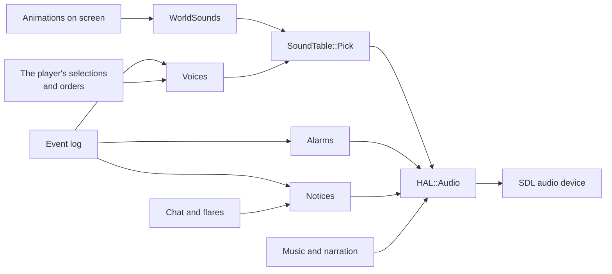
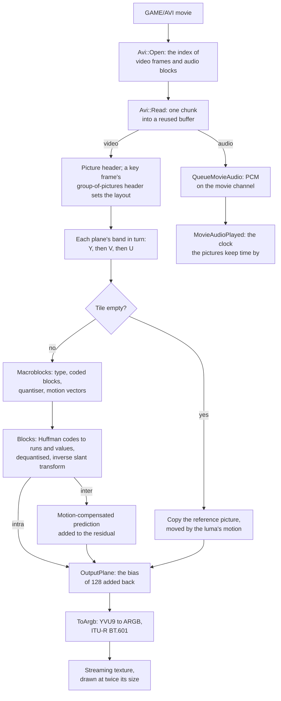

# Sound, music and movies

The original game's sounds are short WAV files kept inside its DRS archives:
the units' voices and the sounds of fighting and work in `sounds.drs`, the
interface's clicks, bells and horns in `interfac.drs`. The dat decides which
one plays: a sound is a list of files with their chances, most of them for one
civilisation, so a unit answers in its own people's voice. Sounds are tied to
graphics and their frames, so a sword rings on the frame its blow lands. The
music is MP3 on the CD, the taunts are MP3s beside the archives, and the three
start-up movies are AVI files in Intel's Indeo Video 5.

This page covers OpenAoK's sound system (`src/audio/` over the device layer
`src/hal/Audio`), the units' voices, the alarms and notices, where a sound is
heard from, the music and narration, and the movies, which play through the
engine's own Indeo 5 decoder.

## The sound system

Sound is a presentation layer beside the renderer: it reads the simulation and
never writes it. Once a frame `Audio::Update` hears the world's animations,
then every event in the simulation's event log since the last frame, then the
chat lines and flares sent to this machine's player. What the player does at
the interface (a selection, an order, a building laid out) is voiced by the
interface calling `Audio::Voices` directly.



A loaded game first catches up (`Audio::CatchUp`), so what happened before it
was saved is not heard again.

### Choosing a file

The dat's sound table, loaded as `Core::Media`, gives each sound id its files
in `sounds.drs`, each with a probability and a civilisation (or every
civilisation). `Audio::SoundTable::Pick` is given the civilisation of whoever
makes the sound; it takes that civilisation's own items when the sound has
any, else the generic ones, and rolls among them by their probabilities:

```cpp
int Pick(int sound_id, int civ) {
    const Core::Media::Sound* sound = Core::Media::SoundById(sound_id);
    if (sound == nullptr) return -1;

    bool own = false;
    for (const auto& item : sound->items) {
        if (item.civ == civ) { own = true; break; }
    }
    const int wanted = own ? civ : -1;
    // ...
    int roll = static_cast<int>(g_rng() % static_cast<unsigned>(total));
    for (const auto& item : sound->items) {
        if (item.civ != wanted) continue;
        if (roll < item.probability) return item.resource;
        roll -= item.probability;
    }
    return -1;
}
```

The roll comes from the sound module's own generator, never the simulation's,
so hearing a sound cannot change the game.

## Sounds of the world

The dat ties the world's sounds to graphics rather than to events: a graphic
can play a sound as it starts (a dying graphic carries its death cry), and
attack and work graphics carry sounds on particular frames, up to three for
each facing. `Audio::WorldSounds` watches what is being shown. For each
animated entity in earshot that the player can see, it compares the graphic
and frame with those of the frame before:

- a new graphic plays its own sound, and the sounds of its frames up to the
  current one;
- frames passed since the last look play their sounds, at most one whole
  cycle's worth;
- an entity first coming into earshot plays nothing until its animation moves
  on, so scrolling over a battlefield does not replay every death cry on it;
  something that appears already falling, a building's collapse, is heard as
  it appears;
- the same file already playing is not started again on top of itself, so
  twenty lumberjacks chop as a steady rhythm rather than one crack.

## Where a sound is heard

Sounds belong to what the player is looking at. The listener is the view's
rectangle in world pixels (`Audio::Listener`), and a sound's volume and pan
come from where its source is drawn relative to it:

```cpp
Placement placement;
if (reach <= 1.0f) {
    placement.volume = 1.0f - kEdgeSoftening * reach;
} else if (reach < 1.0f + kCarry) {
    placement.volume = (1.0f - kEdgeSoftening) * (1.0f + kCarry - reach) / kCarry;
}
placement.pan = std::clamp(dx, -1.0f, 1.0f) * kPanWidth;
```

`reach` is how far the source is from the view's middle, in half-views, on
whichever axis is further. A sound in the view plays at full volume in the
middle and 35% softer at the edges (`kEdgeSoftening`); past the edge it fades
to nothing over another 40% of half the view (`kCarry`); a fight further off is
silent. The pan follows the source across the view, up to 0.75 at the edge
(`kPanWidth`). The mixer turns the pan into two levels, the near side holding
and the far side fading, to a quarter of the level at the edge.

## Voices

`Audio::Voices` speaks for the player's own units, from each unit's sound slots
in the dat, in the owner's civilisation's voice:

- **A selection** is answered by the first selected unit of the player's (or
  one of Gaia's, a sheep).
- **An order** is acknowledged by the unit's move or attack sound. A villager
  sent to work answers as the worker it is about to become: told to cut a tree
  it is a lumberjack, and the lumberjack's attack slot holds its
  acknowledgement.
- **A building laid out** plays the building's own sound.
- **A unit trained** for the player announces itself, heard from the event
  log.

One voice line plays at a time: a new one is not started while the last is
still being spoken.

## Alarms and notices

`Audio::Alarms` sounds the alarm when the player is attacked: once per battle,
a battle being a 20x20-tile area round where the first blow fell, quiet again
once the fighting there has stopped for ten seconds. A horn for military
units, a bell for villagers and buildings, a horn and a wolf for a wild animal
(never for a boar, which only answers a hunter), and the conversion warning
for a Monk at work on the player's units. Each alarm also raises a notice on
the minimap (`Alarms::TakeRaised`, drawn by `rendering/Alerts`).

`Audio::Notices` plays the interface's sounds for what passes between players
and for the player's own news, by their file ids in `interfac.drs`
(`audio/InterfaceSounds.h`): a trade at the Market, a tribute received, a chat
line, a flare, research finished (one sound for an age, another for anything
else), an enemy's Spies or Treason, a sheep found, a farm or fish trap run out,
a relic picked up, production halted for want of houses, a building site found
taken, one of Gaia's taken over. These are heard only by the player they
concern; a Wonder begun, finished or destroyed is heard by everyone.

The taunts are loose MP3s in the `Taunt` folder beside the archives, each file
named from its two-digit number. A chat line that is a taunt's number, 1 to 30,
plays that file, decoded by minimp3. A scenario's own sounds (what its Play
Sound effects and its instructions carry) are MP3s in `Sound/scenario`,
spoken on the narration channel.

## The mixer

`HAL::Audio` is the sound device. It knows nothing of units or rules: it is
given a file id, a volume and a pan, and mixes the file with whatever else is
playing.

- **The device** is SDL's default output, asked for 44100 Hz, 16-bit stereo,
  1024 samples a buffer. A machine with none stays silent and every play is a
  no-op.
- **Files are decoded on first use and kept**: a WAV straight from its
  archive's bytes with `SDL_LoadWAV_RW`, an MP3 with minimp3, each converted
  once to the device's own format with an `SDL_AudioStream`, so the mixer only
  ever adds samples.
- **Twenty-four voices** play at once. A new sound takes a free voice, or the
  quietest one if it is louder than that.
- **The mix is integer**, levels in fixed point out of 256, clamped to 16 bits
  at the end.
- **Three channels of their own** play beside the voices, each streamed by the
  main thread a little ahead of the mixer: the music at the music volume, the
  narration at the sound volume, and a movie's soundtrack at full level,
  outside both.

## Music

`Audio::Music` streams the CD's MP3s from `GAME/SOUND/STREAM`, one track at a
time on the music channel:

| When | What plays |
|---|---|
| The menus | The menu's track, looping |
| A civilisation chosen in the game setup screen | That civilisation's theme, or the random one's |
| The credits | The credits' track |
| A game won or lost | The victory or the defeat track |
| In a game | A playlist of numbered tracks (`MUSIC1.MP3`, `MUSIC2.MP3`, ...) in the same folder, from the first again after the last |

The CD carries no playlist tracks, so a game plays in silence unless they are
put in that folder. A track is decoded a second or so ahead of where it plays
(`HAL::Audio::PumpMusic`, once a frame), and the Options' music volume, 0 to
10, sets the channel's level.

The campaigns' slide shows are narrated by MP3s in `GAME/SOUND/CAMPAIGN`, named
by each show's script, and played on the narration channel: one at a time, a
new one stopping the last.

## Movies

The CD's `GAME/AVI` holds three movies, the Microsoft and Ensemble Studios
logos and the intro, which play at start-up, one after another, before the
main menu and its music (`Screens::Movies`):

- each 320x240 picture is shown at twice its size, 640x480, centred on black;
  full screen, the game's frame is made 640x480, so the movie fills the
  screen; in a window it sits in the middle of the game's frame;
- a left or right click, Enter or Space skips to the next movie; Escape skips
  them all; `--no-movies` plays none;
- losing the window's focus pauses the movie, and regaining it resumes it;
- the end is noticed at the next whole second after the last picture, so the
  last picture stands until then;
- a movie whose file is missing is passed over as if it had played.

### Decoding them

The movies are RIFF AVI files with an Indeo Video 5 (`IV50`) video stream and
a PCM soundtrack. `HAL::Avi` reads the headers and builds an index of where
every video frame and audio block lies, from the file's `idx1` index or by
walking its `movi` list; it keeps only the index in memory and reads one chunk
at a time into a buffer the caller keeps. `HAL::Indeo5` decodes the pictures.



The decoder follows the bitstream as the format defines it, as plain data and
free functions. A picture is YVU9: luma at full size, each chroma plane a
quarter of it each way. The game's files have one band per plane, one tile and
a key frame every frame, but inter frames and tiles are decoded too; the
scalable (wavelet) mode, with four luma bands, is refused. Each band keeps two
pictures, the one being decoded and the one it predicts from, and swaps them
as frame types require. Nothing is allocated per frame once the first key
frame has set the layout up.

```cpp
Frame Decode(Decoder& d, const uint8_t* data, size_t size, Picture& out) {
    d.error.clear();
    if (size == 0) return Frame::Repeat;
    d.bits = Bits{data, size, 0};
    if (!ReadPictureHeader(d)) return Frame::Failed;
    // ...
    SwitchBuffers(d);
    if (d.frame_type == kNull) {
        // Nothing to decode, and nothing new to show.
        return d.planes[0].band.buf != nullptr ? Frame::Repeat : Frame::Failed;
    }
    d.buf_invalid[d.dst_buf] = true;
    for (Plane& plane : d.planes) {
        if (!DecodeBand(d, plane.band)) return Frame::Failed;
    }
    d.buf_invalid[d.dst_buf] = false;
    // ...
    OutputPlane(d.planes[0], out.y);
    OutputPlane(d.planes[1], out.v);
    OutputPlane(d.planes[2], out.u);
    return Frame::Picture;
}
```

An empty chunk in the AVI, or a null frame in the stream, is a repeat: the
last picture stands.

### Keeping time

The soundtrack is queued about a second ahead of the playing, and the
pictures keep time by it: the movie's clock is how much of the soundtrack the
mixer has played. Past the soundtrack's end, or for a silent movie, the wall
clock carries on, and both stop while the focus is away.

```cpp
double Now(Player& p) {
    const double wall = Wall(p);
    if (!p.audio) return wall;
    const bool running = p.next_audio < p.file.audio.size() || HAL::Audio::MovieAudioQueued() > 0.0;
    if (running) {
        p.audio_mark = HAL::Audio::MovieAudioPlayed();
        p.wall_mark = wall;
        return p.audio_mark;
    }
    return p.audio_mark + (wall - p.wall_mark);
}
```

Each loop decodes every picture whose time has come, shown or not, since a
predicted picture needs the one before it, and uploads the newest into the
texture. The loop runs sixty times a second; the pictures change fifteen.

::: info Licence
The Indeo Video 5 decoder (`src/hal/Indeo5.h`, `Indeo5.cpp`, `Indeo5Tables.h`)
follows the decoder of FFmpeg's libavcodec and is licensed, as FFmpeg is, under
the GNU Lesser General Public License 2.1 or later (`LICENSES/LGPL-2.1.txt`).
The rest of OpenAoK is MIT; see `THIRD_PARTY_NOTICES.md`.
:::

## Where it lives in the code

- [`src/audio/SoundSystem.cpp`](https://github.com/Zaydme/openaok/blob/main/src/audio/SoundSystem.cpp): the frame's sound, from the animations and the event log
- [`src/audio/SoundTable.cpp`](https://github.com/Zaydme/openaok/blob/main/src/audio/SoundTable.cpp): which file a dat sound plays
- [`src/audio/WorldSounds.cpp`](https://github.com/Zaydme/openaok/blob/main/src/audio/WorldSounds.cpp): sounds tied to graphics and frames
- [`src/audio/Listener.cpp`](https://github.com/Zaydme/openaok/blob/main/src/audio/Listener.cpp): volume and pan from the view
- [`src/audio/Voices.cpp`](https://github.com/Zaydme/openaok/blob/main/src/audio/Voices.cpp): the units' answers
- [`src/audio/Alarms.cpp`](https://github.com/Zaydme/openaok/blob/main/src/audio/Alarms.cpp): the attack alarms
- [`src/audio/Notices.cpp`](https://github.com/Zaydme/openaok/blob/main/src/audio/Notices.cpp): interface sounds, taunts and scenario sounds
- [`src/audio/InterfaceSounds.h`](https://github.com/Zaydme/openaok/blob/main/src/audio/InterfaceSounds.h): the interface's sounds by file id
- [`src/audio/Music.cpp`](https://github.com/Zaydme/openaok/blob/main/src/audio/Music.cpp): the music
- [`src/hal/Audio.cpp`](https://github.com/Zaydme/openaok/blob/main/src/hal/Audio.cpp): the device, the mixer and its channels
- [`src/core/Media.h`](https://github.com/Zaydme/openaok/blob/main/src/core/Media.h): the sound table and the sounds on graphics
- [`src/screens/Movies.cpp`](https://github.com/Zaydme/openaok/blob/main/src/screens/Movies.cpp): the start-up movies
- [`src/screens/Slides.cpp`](https://github.com/Zaydme/openaok/blob/main/src/screens/Slides.cpp): the campaigns' narrated slide shows
- [`src/hal/Avi.cpp`](https://github.com/Zaydme/openaok/blob/main/src/hal/Avi.cpp): the AVI reader
- [`src/hal/Indeo5.cpp`](https://github.com/Zaydme/openaok/blob/main/src/hal/Indeo5.cpp): the Indeo Video 5 decoder
