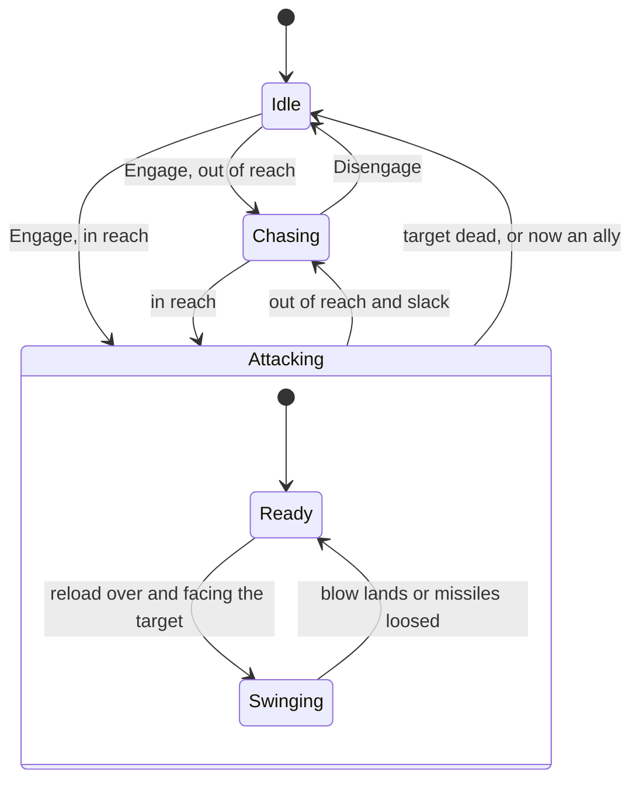

# Combat

In the original game every unit carries a list of attacks and a list of
armours, each by class: so much pierce, so much melee, a bonus against cavalry
or buildings. A blow does what each attack has left after the defender's armour
of the same class. Soldiers look about them for enemies and go after them by
their stance; archers loose missiles that can miss; towers and castles shoot,
with more arrows for archers inside; monks convert the enemy and heal their
own; a trebuchet packs up to move and sets up to shoot.

This page covers how OpenAoK plays all of that: the damage formula, reach, a
soldier's attack cycle, missiles and splash damage, choosing targets, stances
and answering an attack, chases, buildings that shoot, garrisons and the town
bell, monks and conversion, and siege engines that pack. The routing of chases
is on [movement and routes](/engine/pathfinding#chases).

## Attacks and armour

A unit's numbers are its owner's copy of the dat's unit rules
(`Players::RulesFor`), which technologies change. Among them:

- `attacks` and `armours`: lists of (class, amount);
- `base_armour`: the armour against any class the defender has no entry for;
- `reload`, `max_range`, `min_range`, `accuracy`, `dispersion`, `frame_delay`;
- `projectile` and `secondary_projectile`: the missile units it looses;
- `blast_width` and `blast_level`: splash damage;
- `combat_level` and `search_radius`: its priority as a target, and how far it
  looks.

A unit fights by its `FightingRules`, which for a villager at a job are that
job's unit (so a hunter throws a spear where a villager would punch), and is
defended by its `DefendingRules`, its own identity's. A converted unit plays by
the table of the side that made it, not its new owner's (see
[conversion](#converting-and-healing)).

### The damage formula

For each attack class the attacker has, the defender's armour of that class is
taken off, never below zero, and what is left of each is added up. The total is
never less than one. A class the defender has no armour entry for meets its
base armour, which for nearly everything is so high that the class does
nothing: that is how a spearman's bonus against cavalry hurts a knight and not
an archer.

The total is then raised by a quarter when the attacker stands on higher ground
than its target, and lowered by a quarter from lower ground, again never below
one; a stray missile that hits someone it was not aimed at does half.

A unit's `terrain_defense`, the dat's table of terrain defence bonuses, is
kept on its rules as the dat and the technologies set it, but the ground a
unit stands on does not weight the damage it takes: the formula reads attacks
and armours alone.

```cpp
int Damage(const R::ClassAmount* attacks, int attack_count, const R::UnitRules& defender) {
    int total = 0;
    for (int i = 0; i < attack_count; ++i) {
        const int armour = R::ClassValue(defender.armours, defender.armour_count,
                                         attacks[i].cls, defender.base_armour);
        total += std::max(0, attacks[i].amount - armour);
    }
    return std::max(1, total);
}

Core::Fixed32 Blow(int damage, int attacker_level, int target_level, bool stray) {
    Core::Fixed32 amount(damage);
    if (attacker_level > target_level) amount = amount * Core::Fixed32(5) / Core::Fixed32(4);
    if (attacker_level < target_level) amount = amount * Core::Fixed32(3) / Core::Fixed32(4);
    if (amount < Core::Fixed32(1)) amount = Core::Fixed32(1);
    if (stray) amount = amount / Core::Fixed32(2);
    return amount;
}
```

The level is the elevation of the tile under each one's middle
(`Combat::LevelOf`). Hit points are kept with fractions: `Combat::Hurt` adds the
blow to the target's `wound`, takes the whole hit points off, and carries what
is left to the next blow.

::: info A worked example (made-up numbers)
These figures are invented to show the arithmetic; they are not any real
unit's. Say an attacker has two attack entries, **melee 3** and **anti-cavalry
15**, and both defenders have a base armour of **1000**.

| Defender | Its armours | Melee | Anti-cavalry | Damage |
|---|---|---|---|---|
| A horseman | melee 2, anti-cavalry 0 | 3 − 2 = 1 | 15 − 0 = 15 | 16 |
| An archer | melee 0, no anti-cavalry entry | 3 − 0 = 3 | 15 − 1000, so 0 | 3 |
| A wall | melee 8, no anti-cavalry entry | 0 | 0 | 1 (the least) |

Struck from higher ground, the horseman takes 16 × 5/4 = 20; from lower ground,
16 × 3/4 = 12. The archer struck from higher ground takes 3 × 5/4 = 3.75: three
hit points come off and 0.75 is kept, so the next such blow makes 4.5, four come
off and 0.5 is kept. A stray arrow that would have done 6 does 3.
:::

## Reach

Distances in a fight are measured edge to edge (`Combat::Gap`): between the
boxes the two cover, zero where they touch. A building's box is its footprint;
anything else's is the box its dat size spans each way about its middle, turned
a quarter as the dat's axes are (its y size along the grid's x). So a swordsman
hits a building from its wall, and an archer's range is its range to the
target's edge, not its middle.

- **Ranged**: a unit with a missile and a range strikes from up to `max_range`,
  and no nearer than `min_range`.
- **Hand to hand**: `max_range` plus the work range of its combat or hunt task,
  how far past touching its blow reaches.

Once attacking, a unit keeps on while the target is within its reach and 0.3 of
a tile more (`kDisengageSlack`), so a target drifting on the spot does not make
its attacker start and stop.

A unit that fights hand to hand only goes for what stands on, or beside, ground
of its own layer (`CanReach`): a swordsman does not set off after a galley at
sea, nor a demolition ship after a villager inland. One that shoots reaches
anything in range.

## The attack cycle

Each fighter has a `Components::Combat`: its state, its stance, its target,
whether that target was ordered, and its timers. `Combat::Update` runs once a
tick, after movement, workers, garrisons, standing orders, monks, relics and
animals, and before missiles fly and the dead are taken off.



**Engaging.** `Combat::Engage` sets a unit on a target. It remembers where the
unit stood (its post, for a defensive unit to come back to) and goes straight
to attacking when the target is already in reach. A fresh target's first blow
waits up to 600 ms (`kFirstSwingSpreadMs`), each attacker its own share from
its entity and the tick, so a crowd that comes into reach together does not
all strike in one tick.

**Attacking.** A unit swings or shoots only once it faces its target. Most
units turn at once; a ship or a trebuchet, whose rules give a rotation speed,
turns one angle of its graphic at a time (`Turning::Toward`). When its reload
is over it starts a swing: the attack animation from its first frame, the
reload counted from now, and the blow landing on the dat's frame delay into the
animation.

```cpp
void StartSwing(entt::registry& registry, entt::entity self, Combat& combat,
                const R::UnitRules& rules) {
    combat.reload_ms = std::max<int32_t>(1, (rules.reload * Core::Fixed32(1000)).ToInt());
    combat.strike_ms = 0;
    combat.swing_ms = 0;
    if (auto* anim = registry.try_get<Components::Animation>(self)) {
        const int attack = static_cast<int>(Components::AnimState::Attack);
        if (anim->slp[attack] >= 0 && anim->frames[attack] > 0) {
            combat.strike_ms = rules.frame_delay * anim->frame_ms[attack];
            combat.swing_ms = anim->frames[attack] * anim->frame_ms[attack];
            anim->needs_apply = true;   // from the first frame
        }
    }
}
```

A blow begun lands: a target that has stepped off since the swing began takes
it all the same, as a loosed arrow flies on. A unit that shoots looses its
volley instead (see [missiles](#missiles)). Blows, volleys and deaths are
applied after the pass over every fighter, since a death destroys entities and
a missile creates them.

**Leaving a fight.** `Disengage` returns a unit to idle when its target has
died, has gone over to an ally of its owner, or slipped away under its stance,
or when three routes to it in a row come back empty (`kChaseGiveUp`). A
defensive unit then walks back to its post if it is more than a tile from it.

## Choosing a target

Only military units (the dat's combat level 4) and armed buildings that shoot
look for fights of their own (`SeeksFights`); villagers, sheep and the boar
only answer one. An idle fighter looks about it every 500 ms (`kScanMs`), plus
up to 112 ms more by its entity, so a crowd does not all look in one tick. A
unit walking where a person sent it pays no heed to what it passes until it
gets there; a computer player's units answer to their own script on the way.

It looks as far as its search radius; a building as far as its range; a unit
on stand ground only as far as it can reach. Among what it finds, the target
(`FindTarget`) is:

1. hostile: its owner's enemy by diplomacy (`ecs/Diplomacy`), or one of
   Gaia's that hunts (a wolf; a deer is never attacked on sight, only on an
   order);
2. of a class its kind looks for (`ecs/Search`): a soldier, a ship of war and a
   building look for people, soldiers, ships, buildings and walls, but a wolf
   only for villagers, soldiers and prey; a tower, or a building with a missile
   of its own, looks for wolves too, and a soldier only when a computer plays
   it;
3. begun: a foundation not yet started is nobody's target;
4. within reach of where it stands (`CanReach`, above).

Of those, the highest combat level first (military before villagers before
buildings), then the nearest, then the lowest entity id, so the choice is the
same on every machine.

**Wild predators** hunt on their own clock: a wolf looks round every 4.5 to 7.5
seconds (`kHuntMs` give or take a quarter, from a random stream of their own so
their looking does not shift every other roll in the world). It sees as far as
its line of sight and goes first for the nearest villager there: at Moderate or
harder wherever it sees one, at Easy once within half its sight, at Easiest
within a third. With no villager in sight it goes for the nearest of anything
else it hunts within a third of its sight. It gives up a chase that has got
further from it than it sees.

## Stances

| Stance | Looks for a fight | Goes after what it finds | Comes to help | Struck |
|---|---|---|---|---|
| Aggressive | within its search radius | as far as the chase goes | from as far as it sees, up to 12 tiles | turns on the attacker |
| Defensive | within its search radius | up to twice its search radius from its post, then back | within 3 tiles | turns on the attacker |
| Stand ground | within its reach | never moves to it | within 3 tiles, if the attacker is in its reach | strikes back if the attacker is in its reach |
| No attack | never | never | never | never answers |

A target given by an order is pursued whatever the stance, and only another
order drops it. Setting no attack drops the fight a unit is in.

## Answering an attack

Every blow and every missile goes through `Combat::Hurt`, which writes a
`Struck` event (the owner's alarm reads it), takes the hit points, and, if the
target lives, lets it answer (`Answer`). Nothing answers its own side or an
ally.

**Calling for help.** A new attacker brings help first (`CallForHelp`): every
idle unit of the victim's side or an ally's that would take the attacker on and
can get at it comes, within three tiles of the victim, or an aggressive one
from as far as it sees, up to twelve. Units on their way somewhere, villagers at
work, and those set to no attack do not come, nor ever do monks, trade carts
and boats, fishing ships, transports, relic carts, buildings, walls and gates.
Villagers come only against Gaia's attackers.

**Villagers** fight off Gaia's attacker (a wolf), unless they are walking where
they were sent. They run from anyone else's, unless already walking somewhere:
twice what they walk in a second, straight away from the attacker, or about
there when that ground is closed. Either way the job is kept
(`Components::Interrupted`), and once the fight or the run is over the villager
goes back to the resource or the site it left. A villager repairing, or already
fighting, keeps at it; so does one hunting a boar when an animal strikes it.

**Anything else armed**, if idle, turns on whoever hurt it (a boar on its
hunter, a soldier on a neutral's unit), unless it is busy at a job, on its way
into a building, walking where a person sent it, or set to no attack. One
already fighting keeps its target, but for a building it came upon on its own
(a wall): then it turns on whoever strikes it, where one a person sent at the
building keeps on. A computer player's turns on its striker either way.
Buildings never answer; they shoot at whatever their own search finds.

**Prey** runs instead (`Animals::Flee`).

**Computer players' units** are also told when an enemy sets on them, before
any blow (`Warn`). Against a ranged attacker a unit answers at once unless a
roll on its player's missile-dodging parameter says it waits to be struck; and
a ranged soldier of its, already attacking something other than a building,
backs off to its own range from the attacker unless a roll on its player's
distance-keeping parameter says otherwise. Both are difficulty parameters the
computer player's script sets.

**Standing orders** use the same fights: a patrol fights what it meets by its
stance before walking on, and a guard turns on whoever strikes its charge
(`ecs/Duties`).

## Chases

A unit chasing walks a route that ends as soon as the target is within reach,
wherever it has got to. Each tick of a chase:

- in reach: it attacks;
- not ordered, and on stand ground or unable to move (a building, a trebuchet
  set up): it lets the target go;
- not ordered, defensive, and further from its post than twice its search
  radius (`kDefensiveLeash`): it lets the target go and walks back;
- otherwise it plans its route again about every half a second, patch by patch
  across the map, reusing routes planned beside it and keeping lanes in a group
  (all on [movement and routes](/engine/pathfinding#chases)).

A unit ordered at an enemy that falls before it gets there carries on to where
the enemy fell (`CarryOn`), rather than stopping where its walk was going. A
defensive unit does not.

## Missiles

A ranged attack looses missiles, each a unit of the dat's own (an arrow, a
javelin, a stone) with its own speed, arc and graphic. A unit looses one. A
building looses its own missile, if it has one, and its secondary missile for
the rest of its missile count (see [buildings that shoot](#buildings-that-shoot)).

**Accuracy is rolled when the missile is loosed**, from the world's seeded
generator. A hit flies at where the target stands then. A miss flies at a point
off it, in one of sixteen directions, by up to the shot's length times the
shooter's dispersion, so a near miss at short range can still find its mark:

```cpp
    auto& rng = registry.ctx().get<Core::Random>();
    const bool on_target = static_cast<int>(rng.NextInt(100)) < rules.accuracy;
    if (!on_target) {
        const int direction = static_cast<int>(rng.NextInt(16));
        const Core::Fixed32 distance =
            Core::FixedMath::Distance(to.x - from.x, to.y - from.y);
        const Core::Fixed32 off = distance * rules.dispersion *
            Core::Fixed32(static_cast<int>(rng.NextInt(101))) / Core::Fixed32(100);
        to.x = to.x + off * Core::Fixed32(kCos[direction]) / Core::Fixed32(1024);
        to.y = to.y + off * Core::Fixed32(kSin[direction]) / Core::Fixed32(1024);
    }
```

**The flight** (`Components::Projectile`) is a straight ground track from the
shooter to that point at the missile's speed in tiles per second (5 when the
dat gives none). Its height is a parabola peaking halfway, the peak its arc
(at least a tenth) times the shot's length, and is only drawn; the flight
itself is on the ground. It flies to the point, not after the target, so a unit
that walks on is missed.

**Landing.** When it comes down:

1. a missile with a blast hurts everything in it (see [splash damage](#splash-damage));
2. otherwise its target is hit if the point is within a quarter of a tile of
   its body (`kHitSlack`), whether the shot was true or a near miss;
3. otherwise the first unit standing on the point that is not its owner's is
   hit, a stray, for half damage. Buildings take no strays.

Damage is worked out as it lands: from the shooter's rules as they are now (a
technology finished while it flew counts), and from the hill the shooter
stands on, if it is still alive. A dead shooter's missile keeps the attack it
was loosed with and loses the hill. The kill is credited to the missile's owner.
A stone bursts where it comes down with the missile's dying graphic; an arrow
has none.

## Splash damage

The dat's blast level says what else a blow or a missile hurts: 3 the target
alone, below it whatever stands within the attacker's blast width of the
target, each by the attacker's attack against its own armour.

- **A blow that blasts** (a ram's, a demolition ship's) hurts every unit and
  building within the blast width of its target but its own side's and its
  allies', and of Gaia's only what hunts. A demolition ship is spent in its
  blow (`SpentInBlow`); a ram is not.
- **A missile that blasts** (a mangonel's stone) hurts every unit and building
  within the blast width of where it lands, whosever they are, the shooter's
  own side too, but never the shooter. At blast level 1 or below it also fells
  the trees there.

## Buildings that shoot

A building fights when its rules give it a missile, its own or a secondary one,
and it has something to loose. It looks as far as its range, for the classes a
soldier looks for. It never moves, so it never chases: a target it picked up
that leaves its range is let go.

How many missiles it looses at once is `Missiles::VolleyOf`: its own missile,
if it has one, then its secondary missile for the rest of its missile count.
That count is the dat's (a Castle's five) plus what its garrison lends, whole
missiles only, up to the dat's most. The count's first missile is the
building's own, which a Town Center does not have: an empty Town Center has
nothing to loose and does not fight at all.

What a garrison lends (`Garrisons::LentMissiles`) is, added up, the firepower
of each unit inside over the building's own. Firepower is damage a second
(`Garrisons::Firepower`):

| Inside | Firepower |
|---|---|
| A villager | 2.5, whatever its attack |
| An archer, cavalry archer or hand cannoneer | its secondary missile's pierce, or with none its own pierce and melee attack, over its reload |
| Anyone else (a swordsman, a monk, a knight) | lends nothing |

The building's own firepower is reckoned the same way.

## Garrisons and the town bell

A unit that goes into a building or aboard a transport gives up its
`Transform`: being in the world is having a place in it, so nothing draws it,
sees with it, moves it or targets it (`Combat::Alive` is false for it). The dat
says who may go where, from both sides: the unit's garrison task names the
building's class, and the building's garrison type and capacity say which kinds
it takes (villagers, foot soldiers, cavalry, monks) and how many. Inside, units
heal at the building's own garrison heal rate and add to its arrows; turned
out, or when the building falls, they step out at the door.

**The town bell** is the Town Center's (`Garrisons::RingBell`; a building has a
bell when its owner's villagers are trained there). Rung, every villager of its
owner within 25 tiles of it (`kBellReach`) runs to the nearest finished
building of its owner that takes villagers and has room, within 25 tiles of
both the bell and itself; those nearest a shelter go first, so each building
fills with those closest to it. Each remembers the job it left. Rung again,
the shelters in its reach that hold anyone it sent are emptied, those still
running turn round, and the bell's villagers go back to what they were doing.

## Converting and healing

A unit converts if its rules have a convert task and heals if they have a heal
task (`ecs/Monks`). A monk's attack order is a conversion when it can convert
the target. It walks until the target is within its range, replanning every
half a second, then stops and faces whoever it works on.

**Faith.** A monk needs full faith, 100 (`kFullFaith`, a figure the dat does
not carry), to convert, and spends all of it in converting; one sent to convert
without it waits in range until it is full. Faith comes back at the
civilisation's faith recharging rate, a resource of its player's.

**How long a conversion takes.** At least the convert task's work value in
seconds. From then on it takes with a 28% chance once a second
(`kChancePercent`), and at ten seconds (`kLongestConversionMs`) it takes for
certain. Both figures are the module's own constants.

```cpp
        if (state.elapsed_ms == 0) began.push_back(monk);
        state.chanting = true;
        state.elapsed_ms += dt_ms;
        if (state.elapsed_ms < shortest) continue;
        state.roll_ms -= dt_ms;
        if (state.roll_ms > 0 && state.elapsed_ms < kLongestConversionMs) continue;
        state.roll_ms = kRollMs;
        const bool takes = state.elapsed_ms >= kLongestConversionMs ||
                           static_cast<int>(rng.NextInt(100)) < kChancePercent;
```

**What can be converted** (`Monks::Convertible`): an enemy's or a neutral's,
never an ally's nor Gaia's. Monks only once the player's resources say so
(Atonement sets it); buildings and siege weapons only with Redemption. Never,
Redemption or not: walls, gates, towers, farms and fish traps, Town Centers,
Castles, Monasteries and Wonders.

**Healing.** A healer with nothing to do looks about it once a second for the
nearest wounded unit of its own side or an ally's within its search radius, not
a building, and restores the heal task's work value in hit points a second until
it is whole. It does not look while walking or on a relic errand.

### Changing sides

A conversion takes effect through `Allegiance::Change`, the same as anything
changing hands:

- what it gives its owner moves with it: a villager's place in the population,
  a finished House's headroom;
- it leaves its old side's formation;
- it goes on playing by the table of the side that made it (`Components::RulesOf`):
  its maker's technology, not its new owner's, and back with its maker it is
  simply its own again;
- whatever it was doing stops: its route, its standing order, its fight, its
  job, a trader's route and load;
- a transport changes sides with those aboard.

**A converted building** abandons its production queue, turns its garrison
out at the door (the units inside are not converted with it), loses its rally
point, and has its pieces drawn in the new owner's colour.

## Siege engines that pack

The trebuchet is two of the dat's units joined by their transform unit: one
set up, which shoots and cannot move, and one packed, which moves and cannot
shoot (`ecs/Packing`). Packing turns one into the other where it stands
(`Units::Become`), keeping its wounds in proportion. It takes four seconds
(`kPackMs`, a figure the dat does not carry), and while it is at it the engine
neither walks nor shoots; a stop order part way leaves it as it was.

A packed trebuchet sent at an enemy (its unpack-and-attack task) does not chase
like a soldier. It asks the approach planner for a spot a tile inside the
set-up engine's range, walks there, planning again every second and giving up
after three empty routes, and once the target is within the set-up range it
unpacks and is set on the target as by an order. Set up, it turns to the target
an angle at a time, at its rules' rotation speed, before it shoots.

## Where it lives in the code

- [`src/ecs/Combat.cpp`](https://github.com/Zaydme/openaok/blob/main/src/ecs/Combat.cpp): damage, reach, targets, the attack cycle, answering, help, chases, melee blasts
- [`src/ecs/components/Combat.h`](https://github.com/Zaydme/openaok/blob/main/src/ecs/components/Combat.h): a fighter's state, stance and timers
- [`src/ecs/Missiles.cpp`](https://github.com/Zaydme/openaok/blob/main/src/ecs/Missiles.cpp): volleys, accuracy, flight, landing, strays and blasts
- [`src/ecs/components/Projectile.h`](https://github.com/Zaydme/openaok/blob/main/src/ecs/components/Projectile.h): a missile in flight
- [`src/ecs/Search.cpp`](https://github.com/Zaydme/openaok/blob/main/src/ecs/Search.cpp): the classes each kind of unit looks for
- [`src/ecs/Turning.cpp`](https://github.com/Zaydme/openaok/blob/main/src/ecs/Turning.cpp): turning to face a target at the dat's rotation speed
- [`src/ecs/Garrisons.cpp`](https://github.com/Zaydme/openaok/blob/main/src/ecs/Garrisons.cpp): garrisons, firepower, lent missiles, healing inside, the town bell
- [`src/ecs/Monks.cpp`](https://github.com/Zaydme/openaok/blob/main/src/ecs/Monks.cpp): faith, conversion and healing
- [`src/ecs/Allegiance.cpp`](https://github.com/Zaydme/openaok/blob/main/src/ecs/Allegiance.cpp): changing sides
- [`src/ecs/Packing.cpp`](https://github.com/Zaydme/openaok/blob/main/src/ecs/Packing.cpp): packing, unpacking and setting up within range
- [`src/ecs/Orders.cpp`](https://github.com/Zaydme/openaok/blob/main/src/ecs/Orders.cpp): attack, stance and town bell orders
- [`src/ecs/Duties.cpp`](https://github.com/Zaydme/openaok/blob/main/src/ecs/Duties.cpp): patrol, guard and follow
- [`src/ecs/components/Health.h`](https://github.com/Zaydme/openaok/blob/main/src/ecs/components/Health.h): hit points and the fraction carried between blows
- [`src/core/Rules.h`](https://github.com/Zaydme/openaok/blob/main/src/core/Rules.h): the unit rules the figures come from
- [`src/verify/Combat.cpp`](https://github.com/Zaydme/openaok/blob/main/src/verify/Combat.cpp), [`AnswerCheck.cpp`](https://github.com/Zaydme/openaok/blob/main/src/verify/AnswerCheck.cpp), [`AggressionCheck.cpp`](https://github.com/Zaydme/openaok/blob/main/src/verify/AggressionCheck.cpp), [`CarryOnCheck.cpp`](https://github.com/Zaydme/openaok/blob/main/src/verify/CarryOnCheck.cpp), [`GarrisonCheck.cpp`](https://github.com/Zaydme/openaok/blob/main/src/verify/GarrisonCheck.cpp), [`MonksCheck.cpp`](https://github.com/Zaydme/openaok/blob/main/src/verify/MonksCheck.cpp), [`ConversionCheck.cpp`](https://github.com/Zaydme/openaok/blob/main/src/verify/ConversionCheck.cpp), [`PackingCheck.cpp`](https://github.com/Zaydme/openaok/blob/main/src/verify/PackingCheck.cpp), [`TurningCheck.cpp`](https://github.com/Zaydme/openaok/blob/main/src/verify/TurningCheck.cpp): the self-checks that hold this behaviour
