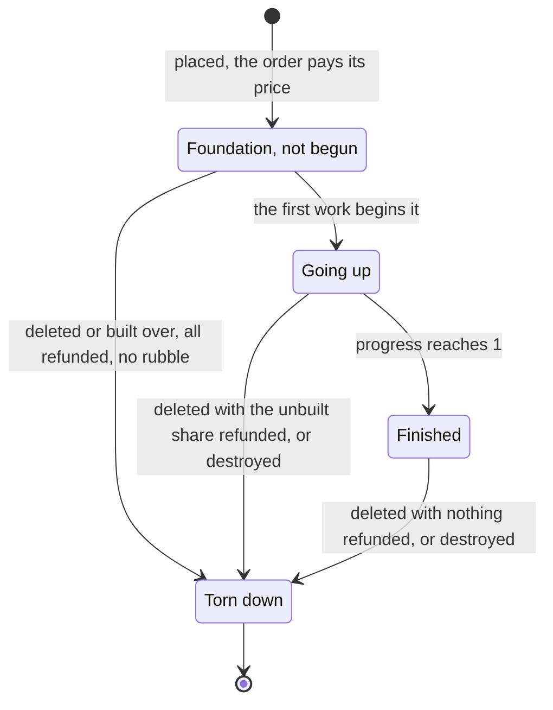

# Buildings and construction

In the original game a villager given a building to put up first lays its
foundation: the player picks the spot, pays the whole price at once, and the
outline of the building appears on the ground. The villager walks to it and
starts hammering, and the building rises out of its scaffolding until it
stands. More villagers build faster, though each one adds less than the last.
Walls are dragged out as a line of foundations; a gate is put over a wall. A
damaged building is repaired by villagers for part of its price, a House gives
room for more people, and a building deleted or destroyed comes down in dust
and leaves rubble.

This page covers where a building may stand, the foundation and its price,
builders and how a crew speeds the work, hit points rising as it goes up,
finishing, buildings made of several pieces, walls and gates, repairing,
population room, deleting and the refund, and rubble. Training units and
researching technologies at a finished building are on
[Training and research](/engine/production).

## A building's life

A building is one entity with a `Building` component, an `Identity` (the dat
unit id), an `Owner`, `Health` and a `Transform` on its origin tile. Its stage
is the component's state:

```cpp
struct Building {
    BuildingState state = BuildingState::Complete;
    // How far a site is through its construction, from 0 to 1. Kept apart
    // from hit points because the two diverge: a site that is attacked while
    // it goes up loses hit points without losing the work done on it.
    Core::Fixed32 progress{};
    // ...
    bool begun = true;
    // ...
};
```

Everything it is comes from its owner's copy of the unit rules
(`Players::UnitOf`): its hit points, its time, its art, what it gives while it
stands. A House placed in the Feudal Age is the owner's slot for the House,
which by then holds the Feudal Age House (see
[effects on the rules](/engine/production#effects-on-the-rules)).



## Where a building may stand

In the original the building to be placed follows the cursor, drawn as it will
stand, and shows red where it cannot go: over trees or other buildings, on
water, on a slope too steep for it, on ground the player has never explored.
A Dock must stand in the water against a beach.

OpenAoK answers with two functions in `ecs/Buildings`. `CanPlace` looks at the
ground alone. `Check` adds what stands on the ground and what the player knows
of it; the outline under the cursor, the build order and the first builder to
set to work all ask it, so they always agree.

### The footprint

A building covers a rectangle of tiles worked out from the dat's clearance by
`ecs/BuildingGeometry` (`FootprintOf`): most buildings are square, a gate is
four tiles along its wall and one across. The dat's axes lie a quarter turn
from the grid's, so the dat's x extent is the grid's y extent
(`FromDatAxes`). How the tiles and the ground's limits in world units are
worked out is on [Movement and routes](/engine/pathfinding#footprints).
`ForEachFootprintTile` visits every tile of a footprint, and every rule below
that speaks of "every tile" goes through it.

### The ground

`CanPlace` asks three things of the tiles under the footprint, all from the
dat:

1. **Open and buildable.** Every tile is on the map, has nothing standing on
   it, and suits the building's terrain restriction. The dat gives each
   restriction a figure for each terrain; a unit may cross a terrain whose
   figure is above zero (`Rules::Passable`), and a building may stand only
   where it is above 0.05 (`Rules::Buildable`; the figures are kept in
   thousandths, so above 50).
2. **Placement terrains.** A building with placement terrains, the Dock, must
   have its middle tile on one of them (water or shallows), and one of its side
   terrains, the beach, straight beside that tile: the Dock stands half on the
   shore. With a side terrain alone, the side terrain must lie straight beside
   the footprint. Corners do not count.
3. **The hill rule.** The dat's hill mode says how level the ground must be:

| Hill mode | Rule |
|---|---|
| 2 | Every tile flat: none of the eight round it one level higher (a Town Center) |
| 3 | Only the two front edges, the rows running from the corner nearest the bottom of the screen, within a level of that corner; the rest may lie as it will |
| 0 | Anywhere |

```cpp
    const int hill_mode = rules != nullptr ? rules->hill_mode : 0;
    constexpr int kFlatOnly = 2;
    constexpr int kFrontWithinALevel = 3;
    const Footprint f = FootprintOf(placed);
    const int front_x = tile_x + f.x.high;
    const int front_y = tile_y + f.y.high;
    bool fits = true;
    if (hill_mode == kFlatOnly) {
        ForEachFootprintTile(placed, tile_x, tile_y, [&](int x, int y) {
            fits = fits && Flat(grid, x, y);
        });
    } else if (hill_mode == kFrontWithinALevel) {
        const int corner = grid.GetTile(front_x, front_y).elevation;
        ForEachFootprintTile(placed, tile_x, tile_y, [&](int x, int y) {
            if (x != front_x && y != front_y) return;
            fits = fits && std::abs(grid.GetTile(x, y).elevation - corner) <= 1;
        });
    }
    return fits;
```

### What stands there

`Check` answers with a `Site`, and is asked in one of two ways:

```cpp
enum class Site : uint8_t { Clear, Ground, Unexplored, Foundation, Unit };
enum class Ask : uint8_t { Placing, Beginning };
```

| `Site` | Meaning |
|---|---|
| `Clear` | It may go there |
| `Ground` | Placing, the ground fails `CanPlace`; beginning, a tile of it is blocked |
| `Unexplored` | Placing, no tile of it has been explored by the player |
| `Foundation` | A foundation not yet begun, the player's own or an ally's, overlaps it |
| `Unit` | A unit of a player not on the player's side stands on it (never for a farm, which is laid under whoever walks there) |

An enemy's foundation not yet begun does not count, since the player cannot
see it, and nor do the player's own units or its allies': they step aside
when the work begins. A button whose unit only places another (the Town
Center's button names the Town Center as its stack unit) is resolved first by
`Buildings::PlacedUnit`.

The build order and the interface both ask `Walls::SiteOpen`, which sends a
gate to `Walls::CanPlaceGate` (below) and anything else to `Check`.

### The building waiting to be placed

`Rendering::Placement` draws the building waiting to be placed on the tile
that puts its middle nearest the cursor (`OriginTile`), in the world's own
depth order and in the player's colours, every piece resolved as the finished
building's would be. It asks `Walls::SiteOpen`, so the preview never shows a
site clear that the order would refuse. Where the building cannot go, half its
pixels pulse through a red with game time (`BlockedColour`). A wall is shown
segment by segment along the line being dragged, each segment checked on its
own; a gate is shown turned to the wall under the cursor; a Farm and a Fish
Trap show their outline on the ground. How it is drawn is on
[The frame](/engine/rendering/).

## The foundation

A build order is a `BuildCommand` naming the villager, the build button's unit
and the tile. `Orders::Build` carries it out:

- if the same building of the player's is already going up on that tile, the
  villager joins it, at no cost;
- otherwise the player must have the button enabled, the worker must be one
  that builds it (the dat trains a villager's buildings at the builder
  villager, and a Fish Trap at the fishing ship), the site must be open
  (`Walls::SiteOpen`) and the price met;
- the price is paid, a gate clears the wall segments under it, and
  `Buildings::Place` lays the foundation; the villager is put to work on it.

An order that fails a check is refused outright and changes nothing.

`Buildings::Place` with `complete` false creates a site: `UnderConstruction`,
progress 0, not begun, at one hit point, seeing only its own ground
(`Sight::footprint`). It wears the dat's construction graphic, whose frames
the animation system steps with the progress; a House's site stays on its
graphic's first frame for the whole build. The Farm has no construction art on
the disc, so its site shows only farmland in three stages, a third of the work
each. The same function with `complete` true puts down a finished building, as
the starting Town Center is.

### Not yet begun

A foundation not yet begun does not hold its ground: units walk across it,
nothing may be ordered to attack it, and only its owner's side sees it. Its
ground is taken at the first work, by `Buildings::Begin`, which answers one of
three ways:

| `Start` | When | The builder |
|---|---|---|
| `Taken` | Its ground is not clear (`Check` asked as `Beginning`) | Is turned away, and the player is told the site is obstructed |
| `Crowded` | Units of its owner's side or Gaia's still stand on it after being told to step off | Waits |
| `Begun` | Otherwise | Builds |

Begun, the footprint is blocked on the grid and everyone on it steps to the
nearest spot beside it (`Buildings::StepAside`); a farm's ground stays open,
and nobody need step off it. Every other foundation not yet begun that
overlaps it, whoever's, is torn down with its price refunded in full. Two
enemies can lay foundations on the same ground without either seeing the
other's; the first to begin work keeps it.
The first work on a Wonder also shows its ground to every player (see
[Victory and diplomacy](/engine/victory)).

## Builders

In the original, each villager added to a site raises it faster, but by less
than the one before. OpenAoK's worker system counts, at the start of each
tick, how many builders are swinging at each site, and each of them adds its
share of the crew's pace:

```cpp
// How much a crew of builders is worth, as a multiple of one: every builder
// after the first adds a third of a builder, so a crew of n raises a building
// ...
Core::Fixed32 CrewRate(int crew) {
    return Core::Fixed32(crew + 2) / Core::Fixed32(3);
}
```

```cpp
                    const int build_ms =
                        std::max(1, rules != nullptr ? rules->train_time : 1) * 1000;
                    const int crew = crew_on(worker.target_building);
                    // ...
                    const Core::Fixed32 share = instant ? Core::Fixed32(1)
                        : CrewRate(crew) * Core::Fixed32(fixed_dt_ms) /
                              (Core::Fixed32(crew) * Core::Fixed32(build_ms));
                    const Core::Fixed32 before = raising->progress;
                    raising->progress =
                        Core::FixedMath::Min(Core::Fixed32(1), raising->progress + share);
```

A crew of n is worth (n + 2) / 3 villagers, so a building whose construction
time in the dat is T seconds goes up in 3T / (n + 2):

| Builders | Time | Worth |
|---|---|---|
| 1 | T | 1 villager |
| 2 | 0.75 T | 1.33 |
| 3 | 0.6 T | 1.67 |
| 4 | 0.5 T | 2 |
| 6 | 0.375 T | 2.67 |
| 10 | 0.25 T | 4 |

A House, 25 seconds in the dat, takes three villagers 15. The time is game
time: a tick is 16 ms of it at any game speed (see
[Entities and systems](/engine/simulation#the-world-and-its-tick)). Where the
dat gives the building a head unit, the head unit's time is the one used; a
gate's head unit is the gate button of its orientation. With the `aegis` cheat
a site goes up at the first blow (`instant`).

A builder works from beside the footprint, never on it, within the dat's work
range for the build task (a tenth of a tile, near enough to touch the wall),
at a spot found for it among its crew (see
[standing spots](/engine/pathfinding#standing-spots)). It turns to face the
building, so a ring of builders all swing inward. After 40 failed approaches
(`kMaxBuildAttempts`) it gives up.

When the site is finished, its builders move on. Those who built a Farm farm
it, unless another farmer has it; those who built a Mill, a Lumber Camp or a
Mining Camp take up the nearest of what it takes in, within the villager's
search radius of its walls. The rest go to the nearest unfinished foundation
of their owner's within about nine and a half tiles, which is how one order
raises a whole line of wall, or stand.

## Hit points as it goes up

A foundation starts at one hit point. Each tick a builder's share of the work
adds the same share of the building's hit points, counted in whole points:

```cpp
                    const int gained = (raising->progress * Core::Fixed32(health.max_hp)).ToInt() -
                                       (before * Core::Fixed32(health.max_hp)).ToInt();
                    health.current_hp = std::min(health.max_hp, health.current_hp + gained);
```

Because progress and hit points are kept apart, a site struck while it goes up
loses hit points but none of the work done: it finishes damaged, and is
repaired like any finished building.

## Finishing

`Buildings::Update` runs once a tick after the builders (step 20 of the tick):
it moves farm sites' ground through its stages and finishes every site whose
progress has reached 1. The sites are collected first and finished after the
view is walked, since finishing creates entities. `Buildings::Complete` does
the finishing:

```cpp
    if (!state.begun) Hold(registry, grid, building);
    if (auto* sight = registry.try_get<Components::Sight>(building)) sight->footprint = false;
    state.state = Components::BuildingState::Complete;
    state.progress = Core::Fixed32(1);
    // ...
    DestroyPieces(registry, building);
    registry.remove<Components::Sprite>(building);
    SpawnArt(registry, building);
    Arm(registry, building);
    // ...
    Players::Contribute(registry, owner, unit_id, R::StorageMode::WhileStanding, +1);
    Score::BuildingFinished(registry, owner, unit_id);
    // ...
    Techs::BuildingFinished(registry, owner, unit_id);
    Walls::RefreshAround(registry, building);
```

In order:

- it holds its ground if it never did, and sees its full line of sight;
- a gate's arch becomes its owner's gate on the grid;
- the construction art goes and the finished art is composed (below);
- a building whose rules give it an attack and a missile is armed: towers and
  castles shoot, a Town Center only with units inside (see
  [buildings that shoot](/engine/combat#buildings-that-shoot));
- the dat's foundation terrain is laid under it: dirt under a Town Center, a
  farm's crop;
- what it gives while it stands is added, such as a House's room;
- the score counts it, and a `Built` event goes into the log;
- its own technology is researched (`Techs::BuildingFinished`), which is how
  the ages wait on buildings (see [the four ages](/engine/production#the-four-ages));
- the walls round it are brought up to date.

## Buildings of several pieces

A large building in the original is drawn from several pieces, so that units
can walk behind its front and in front of its back: a Town Center is four. The
dat lists them as annexes, each a unit with its own graphic at an offset from
the building.

`tools/data/extract_annexes.py` writes the dat's annexes to
`annexes.dat.json`, and `generate_annex_overrides.py` turns them into
compositions by three rules applied to every building alike: a piece the dat
puts at (dx, dy) stands at (dy, -dx); the building's own piece sits on its
position and each annex at its offset from there; and each left-hand piece
gains its right-hand counterpart, a graphic of its own that no unit owns. The
engine loads both files (`ConfigManager::GetAnnexes`), the second over the
first.

When a building is finished, `SpawnArt` makes each piece its own entity, with
a `Transform`, a `Sprite`, the building's `Owner` and a `PartOf` naming the
building; the first piece at no offset is drawn by the building entity itself.
Each piece's `sort_bias` is its place in the list, which orders pieces that
share a tile (see [depth order](/engine/rendering/#depth-order)). The shadow is
whichever piece has a companion shadow graphic.

Which graphic a piece wears is `Buildings::PieceGraphic`: a piece naming a
unit wears whatever the owner's slot for that unit has become, so an age
upgrades a Town Center's annex units along with its body; a right-hand piece is
the counterpart of that. A building without a composition is a single graphic,
chosen from the building art table by the owner's age and civilisation; one
standing before its own age, such as a Castle in a Regicide game's Dark Age,
wears its first age's art. A converted building keeps its maker's age and
architecture and takes its new owner's colour. `Buildings::RefreshArt`
rebuilds a finished building's art after an upgrade, and tearing a building
down destroys every entity whose `PartOf` names it.

## Walls and gates

### Laying a wall

In the original a wall is dragged out from one tile to another and laid as a
line of one-tile foundations, each paid for, and the villagers given it build
them one after another.

A `WallCommand` carries the line and the villagers. `Orders::LayWall` checks
the button as a build order does, then `Walls::Lay` lays the line:

- `Walls::Line` gives the tiles from the first to the last: a straight line
  along an axis or a diagonal, otherwise the nearest staircase of tiles, each
  touching the last by a side or a corner (an integer Bresenham line);
- each tile in order whose `Check` comes back `Clear` gets a foundation,
  charged its price, until the player can pay for no more; a tile already
  holding one of the player's segments, or anything blocked, is passed over;
- each villager is sent to the segment nearest it, and builders move on along
  the line by themselves as each segment is finished.

### Which piece each segment shows

The dat marks walls, gates and towers with an adjacent mode: the buildings
beside one choose which angle of its graphic it draws. A wall's graphic has
five: a run along each axis, a post, and the two diagonals. A segment with one
neighbour on each side of it along one line, and nothing touching it across
that line, is that line's run; anything else is a post. A tower or a gate
counts as a wall, which is how a tower sits in a wall.

```cpp
int PieceFrom(const Occupancy& occ, int x, int y) {
    const bool n = occ.At(x, y - 1), s = occ.At(x, y + 1);
    const bool w = occ.At(x - 1, y), e = occ.At(x + 1, y);
    const bool ne = occ.At(x + 1, y - 1), sw = occ.At(x - 1, y + 1);
    const bool se = occ.At(x + 1, y + 1), nw = occ.At(x - 1, y - 1);
    // A run: one on each side of it along one line, and nothing touching it
    // across that line.
    if (n && s && !w && !e) return kAlongY;
    if (w && e && !n && !s) return kAlongX;
    const bool orthogonal = n || s || w || e;
    if (!orthogonal && ne && sw && !se && !nw) return kAcross;
    if (!orthogonal && se && nw && !ne && !sw) return kDown;
    return kPost;
}
```

`Occupancy` is a mask of the owner's joining buildings over a small rectangle,
so the pieces are worked out without asking every building about every tile.
Whenever a joining building is placed, finished or torn down, `Walls::Refresh`
brings the segments round it up to date: a finished segment's art, a site's
construction stages at its piece's angle. A wall wears its own age's art
whatever age its owner is in: a palisade standing in the Feudal Age is still a
palisade.

### Gates

The original's Gate is built over a stretch of wall and turns to it. OpenAoK
has the Gate button turn to the wall under the cursor (`Walls::GateFor`): of
the dat's gate buttons of the same grade, the one whose line from post to post
covers most of the player's walls within two tiles either side of the tile.
`Walls::CanPlaceGate` wants every tile of it buildable and either open or one
of the player's own wall segments; `Walls::ClearForGate` takes those segments
down, leaving no rubble, and the gate's foundation takes their place.

Finished, a gate's arch (the gate unit's own size about its middle, two tiles
of the four) is marked on the grid as its owner's gate. Its posts at either
end are annexes and block like any wall. The arch stays blocked to everyone
but the owner and its allies, whose routes pass through it (see
[passability layers](/engine/pathfinding#passability-layers));
`Walls::SetAllies` updates whom each player's gates open for at step 5 of
every tick, from the diplomatic stances. A `GateCommand` locks or unlocks a
finished gate (`Walls::SetLocked`): locked, it opens for nobody, and anyone
standing in it steps out. Each tick `Walls::Update` draws a gate with its
portcullis raised while a living unit it opens for is within a step and a half
of it (`kOpenReach`), and shut otherwise.

## Repairing

In the original, villagers mend damaged buildings, and ships and trebuchets
too, for part of what the thing cost, faster with more of them at it.

A `RepairCommand` sends villagers at a target. At a site of their own still
going up they carry on building it; otherwise `Repairs::CanRepair` decides,
and they turn to repairing if it says yes. A villager may mend something that:

- the repairer villager's repair tasks name: one task naming no class means
  any building-type object (buildings, and the trebuchet, which the dat makes
  one); others name the ship classes; no other siege weapon is named, so a ram
  is never mended;
- is its own side's (its own, a team-mate's) or Gaia's;
- is finished, alive and short of hit points.

The pace is the repairer's work rate from the dat, 12.5 hit points a second,
for the first villager, and half that for each one after; ships and the
trebuchet mend at a quarter of a building's pace:

```cpp
    // The first villager at the full rate, each after it at half.
    Core::Fixed32 rate = repairer->work_rate * Core::Fixed32(crew + 1) / Core::Fixed32(2);
    if (!registry.all_of<Components::Building>(target)) rate = rate * kUnitShare;
```

Each hit point costs half the thing's price, of each resource it costs,
spread over its hit points, so mending a building from nothing costs about
half of what it cost to build:

```cpp
        // Half the build cost, spread over the hit points.
        price.amount[cost.resource] =
            Core::Fixed32(cost.amount) / Core::Fixed32(2 * health->max_hp);
```

Each repairer adds its share of the crew's rate to its own count of work done,
kept in thousandths of a hit point (hit points a second times milliseconds),
so a tick's share adds up exactly. Each whole hit point is paid for out of the
owner's stockpile as it is mended (`Repairs::Mend`); when the owner cannot pay
for the next one, or the target is whole, the repair stops. Mended to full, a
`Repaired` event goes into the log.

## Houses and population room

In the original every unit takes one place in its player's population, and a
unit cannot be made unless there is room for it. A Town Center and each House
give room for five, a Castle for twenty, and the room never goes past the
game's population limit.

OpenAoK keeps the population as two of the player's resources, which the units
themselves keep up through the dat's storage: current population (resource 11)
and headroom (resource 4). Each storage entry adds its amount to a resource of
its owner's for as long as its mode says:

| Mode | `StorageMode` | Added |
|---|---|---|
| 0 | `Gatherable` | Nothing: a stock to gather from, a tree's wood |
| 1 | `Permanent` | Once, for good |
| 2 | `WhileAlive` | From when it appears until it goes |
| 4 | `WhileStanding` | From when a building is finished until it goes |

A House adds five headroom while it stands, so its room comes only once it is
finished; a unit takes one headroom and adds one to the current population
while it lives. Their sum is the room the buildings give, which
`Population::Capacity` holds to the lobby's limit (from 25 to 1000):

```cpp
int Capacity(const entt::registry& registry, Core::PlayerId player) {
    const Players::Player* p = Players::Find(registry, player);
    if (p == nullptr) return 0;
    const int supported =
        Players::Resource(*p, R::Res::CurrentPopulation).ToInt() +
        Players::Resource(*p, R::Res::PopulationHeadroom).ToInt();
    return std::clamp(supported, 0, Players::PopulationLimit(registry));
}
```

`Players::Contribute` applies a unit's storage when it comes and takes it back
when it goes. How production waits for room is on
[Training and research](/engine/production#population-is-booked-when-a-unit-starts).

## Deleting a building

The player's Delete order (`DeleteCommand`) brings one of its own buildings
down. `Orders::Delete` refunds it with `Buildings::Refund`, then tears it down
with `Buildings::Destroy`, leaving rubble only if the foundation was begun.

```cpp
void Refund(entt::registry& registry, entt::entity building) {
    // ...
    Core::Fixed32 share{};
    if (state->state != Components::BuildingState::Complete) {
        share = !state->begun ? Core::Fixed32(1)
                              : Core::FixedMath::Min(Core::Fixed32(1), Core::Fixed32(1) - state->progress);
    }
    if (health != nullptr && health->current_hp < 1) share = Core::Fixed32(0);
    if (share.value <= 0) return;
    // ...
    for (int i = 0; i < rules->cost_count; ++i) {
        const R::Cost& cost = rules->costs[i];
        if (cost.resource < 0 || !cost.paid || cost.amount <= 0) continue;
        Players::AddResource(*player, cost.resource, Core::Fixed32(cost.amount) * share);
    }
}
```

| The building | Paid back |
|---|---|
| A foundation not yet begun | All of its price |
| A site going up | The share not yet built: half its price at half its progress |
| Finished | Nothing |
| Without hit points | Nothing |

The same refund pays back a foundation not yet begun that another's is begun
over. `Buildings::Destroy`, the end of every building however it comes down
(deleted, destroyed in battle, a farm run out), then:

- takes its worth out of the economy score;
- abandons its production queue, refunding everything in it
  (`Production::Abandon`), turns out its garrison and drops its relics;
- stops everyone building or repairing it;
- frees its ground, clears a gate's marks from the grid, and leaves a farm's
  field harvested out;
- takes back what it gave while it lived, and while it stood if it was
  finished;
- leaves its rubble and plays its fall;
- destroys its pieces, and brings the walls beside it up to date: an end
  becomes a post.

## Rubble

What a building leaves is the dat's dead unit for it, its rubble. OpenAoK
places the rubble's art where the building stood as a drawable alone: a
`Transform` and a `Sprite`, casting no shadow, with no hit points, owner or
identity, so nothing selects it, targets it or walks round it. Rubble lies on
the ground and is drawn under the fog with it (see
[two passes either side of the fog](/engine/rendering/#two-passes-either-side-of-the-fog)).
Over it the dat's dying graphic plays once, a collapse in dust with its sound
(`Mortality::PlayOnce`).

A Farm's remains, its dead farm, also keep an `Identity` and an `Owner`: a
villager sent to it puts up a new Farm there, and the new Farm's foundation
takes the dead one's place (see [Gathering and the economy](/engine/economy)).
A foundation deleted or built over before it was begun, and a wall segment a
gate is put over, leave nothing.

## Where it lives in the code

- [`src/ecs/Buildings.h`](https://github.com/Zaydme/openaok/blob/main/src/ecs/Buildings.h), [`Buildings.cpp`](https://github.com/Zaydme/openaok/blob/main/src/ecs/Buildings.cpp): placing and its checks, `Begin`, `Complete`, `Update`, `Destroy`, `Refund`, a building's art and pieces, the doorstep
- [`src/ecs/BuildingGeometry.h`](https://github.com/Zaydme/openaok/blob/main/src/ecs/BuildingGeometry.h), [`BuildingGeometry.cpp`](https://github.com/Zaydme/openaok/blob/main/src/ecs/BuildingGeometry.cpp): footprints, their axes and bounds
- [`src/ecs/components/Building.h`](https://github.com/Zaydme/openaok/blob/main/src/ecs/components/Building.h), [`PartOf.h`](https://github.com/Zaydme/openaok/blob/main/src/ecs/components/PartOf.h), [`Gate.h`](https://github.com/Zaydme/openaok/blob/main/src/ecs/components/Gate.h): a building's stage and progress, its pieces, a gate's state
- [`src/ecs/systems/WorkerSystem.cpp`](https://github.com/Zaydme/openaok/blob/main/src/ecs/systems/WorkerSystem.cpp): builders and repairers at work, `CrewRate`, moving on to the next site
- [`src/ecs/Orders.cpp`](https://github.com/Zaydme/openaok/blob/main/src/ecs/Orders.cpp): the build, wall, repair, gate and delete orders
- [`src/ecs/Walls.h`](https://github.com/Zaydme/openaok/blob/main/src/ecs/Walls.h), [`Walls.cpp`](https://github.com/Zaydme/openaok/blob/main/src/ecs/Walls.cpp): wall lines, each segment's piece, gates, locking
- [`src/ecs/Repairs.h`](https://github.com/Zaydme/openaok/blob/main/src/ecs/Repairs.h), [`Repairs.cpp`](https://github.com/Zaydme/openaok/blob/main/src/ecs/Repairs.cpp): who may mend what, the pace, the price of a hit point
- [`src/ecs/Population.h`](https://github.com/Zaydme/openaok/blob/main/src/ecs/Population.h), [`Population.cpp`](https://github.com/Zaydme/openaok/blob/main/src/ecs/Population.cpp): population used and room
- [`src/ecs/Players.cpp`](https://github.com/Zaydme/openaok/blob/main/src/ecs/Players.cpp): `Contribute`, paying and refunding
- [`src/core/Rules.h`](https://github.com/Zaydme/openaok/blob/main/src/core/Rules.h): the dat's placement fields, hill mode, storage modes, costs
- [`src/rendering/Placement.h`](https://github.com/Zaydme/openaok/blob/main/src/rendering/Placement.h), [`Placement.cpp`](https://github.com/Zaydme/openaok/blob/main/src/rendering/Placement.cpp): the building waiting to be placed
- [`tools/data/extract_annexes.py`](https://github.com/Zaydme/openaok/blob/main/tools/data/extract_annexes.py), [`generate_annex_overrides.py`](https://github.com/Zaydme/openaok/blob/main/tools/data/generate_annex_overrides.py): the compositions of buildings made of several pieces
- [`src/verify/Construction.cpp`](https://github.com/Zaydme/openaok/blob/main/src/verify/Construction.cpp), [`FoundationsCheck.cpp`](https://github.com/Zaydme/openaok/blob/main/src/verify/FoundationsCheck.cpp), [`WallsCheck.cpp`](https://github.com/Zaydme/openaok/blob/main/src/verify/WallsCheck.cpp), [`RepairCheck.cpp`](https://github.com/Zaydme/openaok/blob/main/src/verify/RepairCheck.cpp), [`CollapseCheck.cpp`](https://github.com/Zaydme/openaok/blob/main/src/verify/CollapseCheck.cpp): self-checks for building, foundations, walls and gates, repairs and a building's fall
