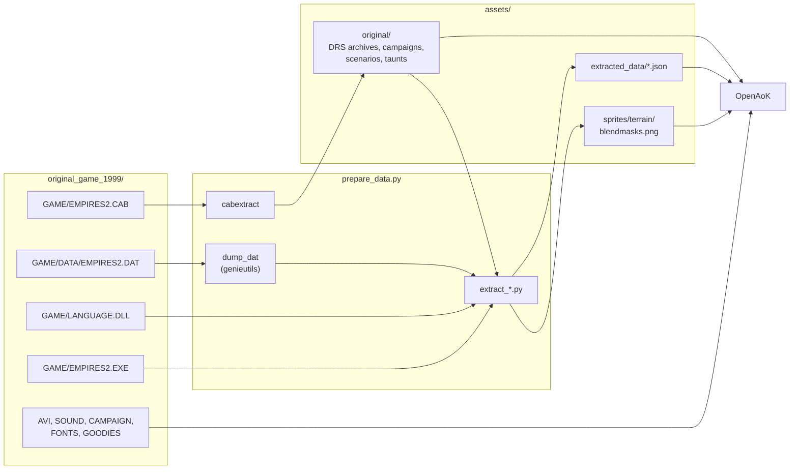

# The game's data

*Age of Empires II: The Age of Kings* keeps nearly everything that makes the
game in a handful of files: archives of sprites and sounds, one binary file of
rules, a DLL of every string the game shows, and the scenarios and campaigns.
OpenAoK plays from those files, read from your own copy of the CD. None of
them is in the repository.

This page covers what is on the CD, how a build prepares it, the formats of
the files the engine reads, and the conventions of the data that the code
relies on. For copying the CD in the first place, see
[Your game files](/guide/game-files).

## What is on the CD

The engine needs the files of the original Age of Kings CD (version 1.0),
copied into `original_game_1999/` at the top of the repository: the whole CD,
or a mounted image of it. The Conquerors expansion and the HD and Definitive
editions use different data and are not supported.

| Path | Holds | Needed |
|---|---|---|
| `GAME/EMPIRES2.CAB` | The installed game: the DRS archives, campaigns, scenarios, sounds, taunts, the History screen's texts | yes |
| `GAME/DATA/EMPIRES2.DAT` | The rules: units, technologies, effects, civilisations, terrains, graphics, sounds | yes |
| `GAME/LANGUAGE.DLL` | Every string the game shows, and the font table | yes |
| `GAME/EMPIRES2.EXE` | The default hotkeys | yes |
| `SYSTEM/FONTS` | The interface's fonts | yes |
| `GAME/AVI` | The start-up movies | optional |
| `GAME/SOUND` | The music, and the campaigns' narration | optional |
| `GAME/CAMPAIGN` | The campaigns' slide shows: pictures, scripts, palettes | optional |
| `GOODIES/DEMO.SCN` | The bonus scenario | optional |
| `DIRECTX/DPLAY.INF` | The name the multiplayer menu gives the TCP/IP connection | optional |

Names are matched in any case. The `GAME`, `SYSTEM` and `GOODIES` folders are
renamed to the CD's upper case throughout, so a copy made on a case-sensitive
disk reads the same as the CD.

Arial, which the CD leaves to Windows, comes from the machine: macOS's own,
the Microsoft core fonts or Liberation Sans (drawn to Arial's metrics) on
Linux, or a copy laid beside the data in a folder made for a phone or the
Switch.

## From the CD to the engine



Three kinds of data reach the engine:

- **The original archives and files**, unpacked from the cabinet but otherwise
  untouched: sprites, terrain, interface art and sounds are decoded from the
  DRS archives as the game runs, and the map and AI scripts are read from them
  as text.
- **Tables** written once from the dat, LANGUAGE.DLL, the executable and the
  archives: JSON, and the terrain blending masks as a PNG. The engine loads
  them at start-up.
- **Loose files on the CD** that the cabinet does not hold: the movies, the
  music, the campaigns' slide shows, the fonts and the bonus scenario, read
  from `original_game_1999/` directly.

## Preparing the data

```sh
python3 tools/data/prepare_data.py [--force]
```

`build.sh` runs it before every build, the Windows download's `OpenAoK.bat`
on its first start, and the packaging scripts for Android, iOS and the Switch
before they lay out their folders. It:

1. checks for the required files, and notes which optional ones are missing;
2. unpacks `GAME/EMPIRES2.CAB` into `assets/original/` with `cabextract`, or on
   Windows with its own `extrac32`, `tar` or `expand`;
3. writes the game's palette, entry 50500 of `interfac.drs`, to
   `assets/original/interfac_extracted/50500.bina`;
4. builds the dat dumper (`tools/data/dump_dat.cpp`, against
   `third_party/genieutils`) and checks that the dat is the 1999 data
   (`VER 5.7`);
5. runs the extractors below, which write `assets/extracted_data/` and
   `assets/sprites/terrain/blendmasks.png`.

It then writes `assets/.prepared`: a fingerprint of the preparation's own
version and the sizes of the cabinet, the dat and LANGUAGE.DLL. A later run
does nothing while that fingerprint matches and every output is in place, unless
`--force` is given. Everything it writes is ignored by git.

| Script | Writes | Holds |
|---|---|---|
| `extract_tables.py` | `graphics.json`, `units.json` | The dat's graphic table and Gaia's unit table |
| `extract_language.py` | `strings.json` | LANGUAGE.DLL's strings by id |
| `extract_rules.py` | `rules.json`, `media.json` | Units' numbers (attack and armour by class, speed, range, costs, storage, tasks), technologies, effects, civilisations, terrain restrictions; graphics' deltas and sounds; the sound table |
| `extract_terrain_data.py` | `terrain.json` | Terrain art, minimap colours, blend priorities, map-script constants, map objects' art and stock, player colours |
| `extract_interface_data.py` | `interface.json` | Icons, command-panel slots, names and help text |
| `extract_animation_data.py` | `animations.json` | Attack and work graphics, frame timing |
| `extract_slp_shadows.py` | `shadows.json` | Each graphic's separate shadow graphic |
| `extract_annexes.py`, `generate_annex_overrides.py` | `annexes.dat.json`, `annexes.overrides.json` | Buildings made of several pieces, and each piece's offset |
| `extract_building_art.py` | `buildings.json` | Building art per architecture set and age |
| `extract_blendmasks.py` | `blendmasks.png` | The terrain blending masks |
| `extract_ai.py` | `ai.json` | Villager targets by age, gatherers' shares and fishing figures from the computer players' scripts |
| `extract_techtree.py` | `techtree.json` | The tech tree screen's layout |
| `extract_hotkeys.py` | `hotkeys.json` | The default hotkeys |
| `extract_connections.py` | `connections.json` | The TCP/IP connection's name in the multiplayer menu, from `DIRECTX/DPLAY.INF` |

At start-up `LoadData` in `src/main.cpp` reads the tables into the modules
that serve them: `Core::ConfigManager` (units, graphics, shadows, annexes,
animations, interface, terrain, building art), `Core::Rules`, `Core::Media`,
`AI::Doctrine`, `Core::Strings` and `Core::Hotkeys`. The multiplayer menu
reads `connections.json` as the screens start, and the tech tree screen reads
`techtree.json` the first time it is shown.

## DRS archives

A DRS archive is a flat container of numbered files: the sprites (SLP), the
sounds (WAV), and plain text such as palettes, screen descriptions and
scripts. The game's five are `graphics.drs`, `terrain.drs`, `interfac.drs`,
`sounds.drs` and `gamedata.drs`, in `assets/original/Data/` once prepared.

| Offset | Size | Field |
|---|---|---|
| 0 | 40 | Copyright text |
| 40 | 4 | Version |
| 44 | 12 | Archive type |
| 56 | 4 | Number of tables |
| 60 | 4 | Offset of the first file |
| 64 | 12 per table | Each table: its file type, the offset of its entries, how many |

Each table's entries are 12 bytes: the file's id, its offset in the archive and
its size. Ids are unique across an archive's tables, so a reader keeps one map
from id to entry. The tools read archives with `read_drs` in
`tools/data/slp.py`:

```python
def read_drs(path):
    """Return (blob, {file_id: (offset, size)}) for a DRS archive."""
    blob = open(path, 'rb').read()
    # copyright[40] version[4] type[12] num_tables[4] first_file[4]
    num_tables, _first = struct.unpack_from('<II', blob, 56)
    entries = {}
    for t in range(num_tables):
        _ftype, toff, nfiles = struct.unpack_from('<4sII', blob, 64 + t * 12)
        for i in range(nfiles):
            fid, foff, fsize = struct.unpack_from('<III', blob, toff + i * 12)
            entries[fid] = (foff, fsize)
    return blob, entries
```

The engine's reader is `HAL::DrsOpen` in `src/hal/SlpFile.cpp`, the same walk
with bounds checks. It reads a whole archive into memory (`graphics.drs` is
about 70 MB) and indexes it, and `HAL::DrsReadText` hands out an entry's bytes
as text. `HAL::GraphicCache` holds `graphics.drs`, `interfac.drs`,
`terrain.drs` and `gamedata.drs` open for the whole run; the sound device
opens `sounds.drs` itself and borrows the interface archive for the interface's
sounds.

| Archive | What the engine reads from it |
|---|---|
| `graphics.drs` | Every sprite of the world: units, buildings, trees, missiles, their shadows |
| `terrain.drs` | The ground tiles, one SLP per terrain |
| `interfac.drs` | The interface art, the palettes, the screens' `.sin` descriptions, the cursors, the interface's sounds |
| `sounds.drs` | The units' voices, combat and work sounds |
| `gamedata.drs` | The random map scripts and the computer players' rule scripts (`.per`), as text |

## SLP graphics

An SLP is one graphic: a run of frames, each with its size and its hotspot,
the pixel that stands on the object's place in the world. Its pixels are
palette indexes coded as commands per row (copies, runs, skips), with commands
of their own for player-colour pixels, shadow pixels and the outline drawn
where a unit stands behind a building. Both readers keep those classes apart
rather than flattening a frame to colours: `HAL::SlpDecodeFrame` in the engine,
`decode_frame` in `tools/data/slp.py` for the extractors.
[Sprites and texture pages](/engine/rendering/sprites) explains how the engine
decodes, colours and packs them.

## The palettes

Every SLP is drawn through a palette of 256 colours. The game's own, entry
50500 of `interfac.drs`, is a JASC-PAL text file (a header, a version, a count,
then one `r g b` line per colour). It is written out during preparation and
read by `HAL::LoadJascPalette`; the world and the in-game interface are drawn
in it.

The menus are not. Each screen's `.sin` file in `interfac.drs` names its own
palette by file id, with its background art, cursors, button art, bevel and
text colours (`Screens::LoadStyle`), and `GraphicCache::InterfacePalette` reads
that palette from the archive on first use, keeping one texture atlas per art
and palette. A button's darkened inside uses the same palette darkened by the
`.sin`'s percentage, each colour snapped to the palette's nearest, so it stays
in the screen's 256 colours. The campaigns' slide shows bring palettes of their
own in `GAME/CAMPAIGN/MEDIA`.

Player colours are ranges of the game's palette: the dat gives where each
player's ramp starts (`player_ramps` in `terrain.json`), and the sprites' player
pixels are shaded into it.

## The dat file

`EMPIRES2.DAT` holds the rules: every unit with its numbers, tasks, graphics
and sounds; technologies and their effects; civilisations, each with its own
copy of the unit table; terrains and terrain restrictions; the graphic and
sound tables; the tech tree screen's own table.

OpenAoK does not parse it itself. `tools/data/dump_dat.cpp` loads it with
genieutils (vendored in `third_party/genieutils`, used only by the data tools)
as Age of Kings data and prints the tables the extractors use as one JSON
document on standard output. `tools/data/datfile.py` builds the dumper with
CMake into `build/data-tools/` when it is missing or older than its source,
runs it, and keeps the parse for the rest of the process; each extractor then
writes its own table from that document. A figure the engine needs from the
dat is added to `dump_dat.cpp` and an extractor, not read by a second parser.

Fractional figures (speeds, ranges, rates) are written to thousandths, and the
engine turns them into fixed point once, at load, in `src/core/Rules.cpp`:

```cpp
Core::Fixed32 Thousandths(double value) {
    const long long scaled = std::llround(value * 1000.0);
    return Core::Fixed32(static_cast<int>(scaled)) / Core::Fixed32(1000);
}
```

From then on the simulation sees only fixed point (see
[Fixed point and determinism](/engine/determinism)).

## LANGUAGE.DLL

Every name, description, label and message the game shows is a Win32 string
resource in `LANGUAGE.DLL`, numbered; the dat and the scenarios refer to them
by number. `tools/data/extract_language.py` walks the DLL as a plain PE image:
the resource directory, then every leaf under the string type (6). A string
block holds sixteen consecutive strings, each a length and that many UTF-16
characters, and block `n` covers ids `(n - 1) * 16` to `(n - 1) * 16 + 15`. An
entry of length zero is a hole, not an empty string, and is left out. The
result is `strings.json`, every string by id, in UTF-8.

In the engine `Core::Strings::Get(id)` returns a string, or an empty one when
the DLL has no such id. The interface's text comes from here rather than being
typed into the code; `Core::Strings::Id` names the ids the command buttons and
messages use. A few things worth knowing:

- **The font table is strings too.** From string 110, three strings per font
  give its face, its size in points and its style; `Rendering::Text` opens the
  faces they name (see [The interface](/engine/interface)).
- **Help texts are offset.** The dat names a unit's or a technology's help
  text by an id 79000 above the one LANGUAGE.DLL holds it under.
- **Help texts are templates.** They carry markup (`<b>`, `<i>`) and
  placeholders (`<cost>`, `<hp>`, `<attack>`) that the interface fills with the
  player's own figures.
- **Scenarios prefer the DLL.** A campaign scenario names a string for its
  instructions and hints; the engine shows the DLL's string when there is one,
  and the file's own text otherwise (`Scenario::Show`).

## Hotkeys from EMPIRES2.EXE

The default hotkeys are not in any data file: the executable sets them up in
code. `tools/data/extract_hotkeys.py` reads them out of `EMPIRES2.EXE` by
looking, in the stretch of code that builds the table, for every call to the
two set-up routines and the immediate values pushed before it. One routine
names an item by its LANGUAGE.DLL string; the other gives the item its key, a
Windows virtual-key code with its Ctrl, Alt and Shift, and the string that
spells the key's letter. A complete read finds 120 default bindings for 121
named items.

Each item is addressed as (group, item): group 0 is the unit commands, 1 the
game commands, 2 scrolling, 3 building, then the Town Centre, the Dock, each
military building, the Monastery, the Market, the military commands and the
Castle, fourteen groups in all (`Core::Hotkeys::Group`). Key codes 251, 252 and
253 stand for the wheel down, the wheel up and the middle button.

::: warning SafeDisc
A copy of the game protected by SafeDisc keeps the executable's code encrypted
on the disc, so none of this can be read. The extractor recognises the
encrypted sections, writes an empty table and says why; the game then plays
without default hotkeys, every button still working with the mouse.
:::

## Sounds and music

The sounds are WAV files inside the archives, by id: the units' voices,
combat and work in `sounds.drs`, the interface's clicks, bells and alarms in
`interfac.drs`. The dat never names a file directly. Its sound table maps a
sound id to a list of files, each with a probability and most of them for one
civilisation only, and units and graphics name sound ids:

- **Sounds hang on graphics.** A graphic can play a sound as it starts (a dying
  graphic carries its death cry), and attack and work graphics carry sounds on
  particular frames, up to three for each facing.
- **Units have sound slots.** Each unit names what it says when selected, when
  moved, when sent to attack and when trained; a building names the sound it
  makes as it is laid out.

Outside the archives, the taunts are loose MP3s in the cabinet's `Taunt`
folder, the scenarios' spoken lines MP3s in `Sound/scenario`, the music MP3s on
the CD in `GAME/SOUND/STREAM` and the campaigns' narration in
`GAME/SOUND/CAMPAIGN`. The movies are AVI files in `GAME/AVI`.
[Sound, music and movies](/engine/audio) covers how each is played.

## Scenarios and campaigns

`src/scenario/` reads and writes the scenario (`.scn`) and campaign (`.cpn`)
files as plain data, and `ecs/ScenarioWorld` builds a world from one. The
game's own scenarios, the bonus scenario and the 31 in the five campaigns, are
all version `1.18`, with player data 1.20 and triggers 1.6, and each is read
to its last byte.

A scenario file starts with a short plain header, which the game's lists read
without unpacking the rest; everything after it is raw deflate (zlib's
compression without its header or checksum), inflated with the decoder of the
vendored stb_image.

| Part | What it holds |
|---|---|
| Version | Four characters, such as `1.18` |
| Header length | 32 bits: the size of the plain header that follows |
| Plain header | The save type, the time saved, the instructions, the number of players |
| *Raw deflate from here* | |
| Next unit id, player data version | The id the editor gives the next unit placed; a float |
| Player data | Sixteen slots of names, string ids, civilisations and who plays them; the texts and their string ids; the map picture; each slot's computer player and its script; the stances |
| Map | Width and height, then for each tile its terrain, its elevation and an unused byte |
| Units | The stockpiles each player starts with, then each player's units |
| Player settings | Each player's camera, stances towards Gaia and the others, colour and victory conditions |
| Triggers | Each trigger's flags, texts, effects and conditions |
| AI files | From 1.18: the AI error table and any AI files the scenario includes |

A unit is a position (x, y and z, floats), an instance id, its unit id, a
state, a rotation, its frame and the instance it is garrisoned in. Floats are
turned into fixed point exactly, from their bits (`Encoding::FixedFromBits`),
with no float arithmetic, so every machine reads the same values. Text is
Windows-1252 in the file and UTF-8 in the engine.

What the game does not play by (the editor's own copies, the unused eight of
the sixteen player slots, fields nobody has named) is kept as read, so
`Scenario::Write` gives back the file it read, byte for byte once inflated. The
writer compresses with its own deflate (`scenario/Deflate`, the fixed Huffman
tables in one block), whose bytes differ from zlib's; two files are compared by
their inflated bytes (`Scenario::Expand`).

A campaign file is a table of contents followed by the scenarios themselves,
end to end: a version (`1.00`), the campaign's name in 256 bytes, a count, then
for each scenario its size, its offset in the file, its name (255 bytes) and
its file name (257 bytes). `Scenario::LoadCampaign` reads the table and
`Scenario::ReadCampaignScenario` one scenario's bytes; the game's campaign
names and descriptions are LANGUAGE.DLL strings, in blocks of thirty per
campaign (`Scenario::StringsOf`).

## Read at run time

| File | Holds |
|---|---|
| `assets/original/Data/graphics.drs` | Every sprite (SLP) |
| `assets/original/Data/terrain.drs` | Terrain tiles |
| `assets/original/Data/interfac.drs` | Interface art, the palettes, the screens' `.sin` files, interface sounds |
| `assets/original/Data/sounds.drs` | Unit and combat sounds |
| `assets/original/Data/gamedata.drs` | Random map scripts and the computer players' rule scripts (`.per`) |
| `assets/original/Data/TileEdge.Dat`, `BlkEdge.Dat` | The fog of war's edge masks |
| `assets/original/interfac_extracted/50500.bina` | The game's palette |
| `assets/original/Campaign`, `Scenario`, `Sound`, `Taunt`, `History` | Campaigns, scenarios, scenario sounds, taunts, the History screen's texts |
| `assets/sprites/terrain/blendmasks.png` | The terrain blending masks |
| `original_game_1999/GAME/AVI`, `GAME/SOUND`, `GAME/CAMPAIGN`, `SYSTEM/FONTS`, `GOODIES` | Movies, music, campaign narration and slide shows, fonts, the bonus scenario |
| `assets/extracted_data/*.json` | The tables above |

All of these are named relative to `build/` (`../assets/...`), which is why
the game runs from there.

## A data folder for phones and the Switch

A phone, a tablet or the Switch plays from a folder of the prepared data,
made on a computer by `android/package.py`, `ios/package.py` or
`switch/package.py`, all through `tools/data/package_data.py`. Each first
prepares the data as `build.sh` does. The folder is laid out as the source
tree is:

- `assets/` (the extracted tables, the unpacked game and the blending masks);
- `original_game_1999/` with the CD's fonts, bonus scenario, movies, music and
  campaign media;
- `fonts/` with Arial, from the computer (or Liberation Sans);
- an empty `build/` for the game to run in;
- `version.txt`, the preparation's version, which the Android and iOS apps
  check against the version they were built for;
- `manifest.txt`, one line per file: its CRC-32, its size and its path.

Files already in the destination with the same size and time (to FAT's two
seconds) are not copied again. The Android and iOS apps check every file
against the manifest as they copy the folder into their own storage; the
Switch build checks the SD card's copy once on its first start after each
copy, and names any file that is missing or damaged.

## Conventions in the data

- **Resource ids are the dat's.** Food is 0, wood 1, stone 2 and gold 3 (the
  reverse of the stockpile order for the last two), and costs, storage and
  effects share that numbering, with bookkeeping figures above them (4
  population headroom, 6 the current age, and so on). `Rules::DatResource`
  and `Rules::StockpileOf` convert to and from the engine's
  `Core::ResourceType`, never a cast. Only `interface.json`'s costs and
  `terrain.json`'s map-object stock are written in the engine's order.
- **Every player plays from its own copy of the unit rules.** Effects change
  the copy (`Players::UnitOf`). An entity's rules are `Players::RulesFor`: its
  owner's, or for a converted unit its maker's.
- **An upgrade keeps identity.** `Identity` holds the base unit id for an
  entity's whole life; the owner's rules for that slot take the new unit's
  numbers and art.
- **A villager at work is a different unit** (`VMLUM` for a lumberjack, and so
  on), with its own graphics, gather rate and sounds.
- **Walkability is a terrain restriction.** Each mover's restriction gives a
  figure per terrain (0 impassable, above 0 passable); the grid keeps one
  passability layer for each distinct restriction
  (`MapGenerator::SetUpLayers`). Buildings and map objects are placed by
  theirs.
- **Fish store resource 17**, which the fishing ship's and the fisherman's
  gather tasks take in and hand out as food (0).
- **A gather task's work value multiplies the gatherer's rate**: a fishing ship
  gathers faster at deep-sea fish than at a fish trap.
- **A tree is felled before it is cut.** The lumberjack's task names a
  proceeding graphic, the felling stroke, and a working graphic, chopping the
  trunk on the ground. The felled tree lies as its dying graphic and keeps its
  wood; when that runs out it becomes its dead unit, the stump.
- **A fish trap is a farm with no foundation terrain**: it has the farm's
  class, and stands in the water as it is.
- **A transport carries whatever has a Garrison task naming its class (20).**
- **A trader's task names where it trades**: the trade cart the Market, the cog
  the Dock.
- **A wall's piece is chosen by its neighbours** (the dat's adjacent mode): a
  run along either axis, a post, or a diagonal.
- **A gate is a placing unit** that stacks an arch between two posts, in four
  orientations; its arch's transform unit is the gate opened.
- **The trebuchet is a building-type unit**, which is why it can be repaired.
- **The dat's axes are a quarter turn from the grid's.** A piece the dat places
  at (dx, dy) from a building's middle stands at (dy, -dx) on the grid, and
  scenario positions and cliff pieces are in that frame too
  (`ecs/ScenarioWorld` turns a scenario's map as it builds the world):

```cpp
Components::Vector2D FromDatAxes(Core::Fixed32 dx, Core::Fixed32 dy) {
    return {dy, Core::Fixed32(0) - dx};
}
```

## Where it lives in the code

- [`tools/data/prepare_data.py`](https://github.com/Zaydme/openaok/blob/main/tools/data/prepare_data.py): checks the CD, unpacks the cabinet, writes the palette, runs the extractors
- [`tools/data/dump_dat.cpp`](https://github.com/Zaydme/openaok/blob/main/tools/data/dump_dat.cpp): prints the dat's tables as JSON through genieutils
- [`tools/data/datfile.py`](https://github.com/Zaydme/openaok/blob/main/tools/data/datfile.py): builds and runs the dumper, once per process
- [`tools/data/slp.py`](https://github.com/Zaydme/openaok/blob/main/tools/data/slp.py): the tools' DRS and SLP reader
- [`tools/data/extract_language.py`](https://github.com/Zaydme/openaok/blob/main/tools/data/extract_language.py): LANGUAGE.DLL's strings
- [`tools/data/extract_rules.py`](https://github.com/Zaydme/openaok/blob/main/tools/data/extract_rules.py): the rules and the sound table
- [`tools/data/extract_hotkeys.py`](https://github.com/Zaydme/openaok/blob/main/tools/data/extract_hotkeys.py): the default hotkeys from EMPIRES2.EXE
- [`tools/data/package_data.py`](https://github.com/Zaydme/openaok/blob/main/tools/data/package_data.py): the data folder for phones and the Switch, with its manifest
- [`src/hal/SlpFile.cpp`](https://github.com/Zaydme/openaok/blob/main/src/hal/SlpFile.cpp): the engine's DRS, SLP and palette readers
- [`src/hal/GraphicCache.cpp`](https://github.com/Zaydme/openaok/blob/main/src/hal/GraphicCache.cpp): the archives held open, the interface palettes
- [`src/core/ConfigManager.h`](https://github.com/Zaydme/openaok/blob/main/src/core/ConfigManager.h): the unit, graphic, interface and terrain tables
- [`src/core/Rules.cpp`](https://github.com/Zaydme/openaok/blob/main/src/core/Rules.cpp): the rules, in fixed point
- [`src/core/Media.h`](https://github.com/Zaydme/openaok/blob/main/src/core/Media.h): graphic deltas, frame sounds and the sound table
- [`src/core/Strings.cpp`](https://github.com/Zaydme/openaok/blob/main/src/core/Strings.cpp): LANGUAGE.DLL's strings by id
- [`src/core/Hotkeys.cpp`](https://github.com/Zaydme/openaok/blob/main/src/core/Hotkeys.cpp): the default hotkeys
- [`src/scenario/Scenario.cpp`](https://github.com/Zaydme/openaok/blob/main/src/scenario/Scenario.cpp): reading scenario files
- [`src/scenario/Writer.cpp`](https://github.com/Zaydme/openaok/blob/main/src/scenario/Writer.cpp): writing them back
- [`src/scenario/Campaign.cpp`](https://github.com/Zaydme/openaok/blob/main/src/scenario/Campaign.cpp): campaign files and the player's progress
- [`src/main.cpp`](https://github.com/Zaydme/openaok/blob/main/src/main.cpp): `LoadData`, the tables loaded at start-up
