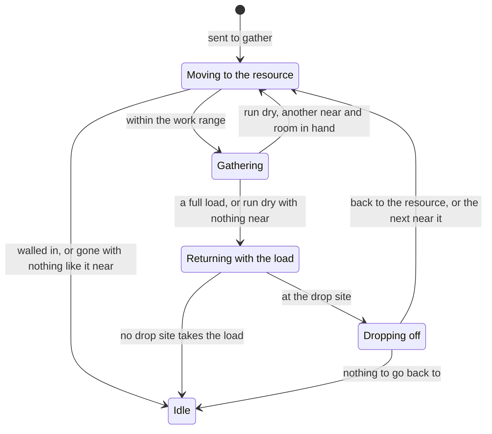
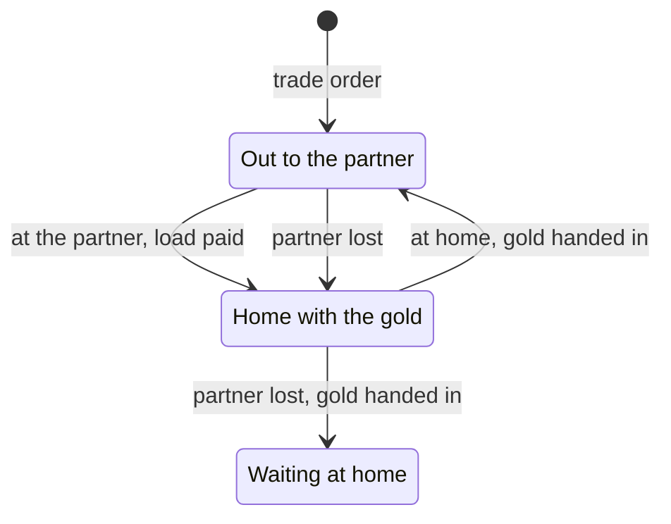

# Gathering and the economy

Everything in Age of Kings is paid for in four resources: food, wood, gold and
stone. Villagers gather them from what lies on the map (trees, berry bushes,
gold and stone mines, animals, fish) and from the Farms they build, and carry
each load to a building that takes it, where it joins the player's stockpile.
Fishing ships do the same at sea. Trade carts and cogs earn gold by going back
and forth between their owner's Market or Dock and another player's; the
Market turns one resource into another; and players can give each other
resources as tribute.

This page covers how OpenAoK does all of it: the stockpiles, how a villager
chooses its job and goes round its cycle of walking out, gathering, carrying
and dropping off, what is particular to trees, mines, animals, fish and Farms,
the technologies that change gathering, and the Market, trade and tribute.
How a worker walks and where it stands are on [Movement and routes](/engine/pathfinding);
the tick it all runs in is on [Entities and systems](/engine/simulation).

## The four resources

### The player's table

A player's resources are one list of fixed-point numbers,
`Players::Player::resources`, kept with the rest of the players' table in the
registry's context. The list is indexed by the dat's resource id, and it holds
far more than the four stockpiles: the bookkeeping figures that the dat's
effects read and change live in the same list.

| Dat id | What it holds |
|---|---|
| 0 | Food |
| 1 | Wood |
| 2 | Stone |
| 3 | Gold |
| 4 | Population headroom |
| 6 | The current age |
| 36 | The food a new Farm holds |
| 46 | The tribute fee |
| 78 | The Market's commission |
| 88 | The food a new fish trap holds |
| 101 | The gold the player's trade has earned |

The dat numbers stone 2 and gold 3. The engine's own order for the four
stockpiles (`Core::ResourceType`, used by the interface and by
`Components::Resource`) is food, wood, gold, stone, so the two orders disagree
on the last two. They are converted by meaning, never by a cast:

```cpp
namespace Res {
constexpr int Food = 0;
constexpr int Wood = 1;
constexpr int Stone = 2;
constexpr int Gold = 3;
// ...
} // namespace Res

// The dat resource behind one of the four stockpiles.
constexpr int DatResource(Core::ResourceType type) {
    switch (type) {
    case Core::ResourceType::Food:  return Res::Food;
    case Core::ResourceType::Wood:  return Res::Wood;
    case Core::ResourceType::Gold:  return Res::Gold;
    case Core::ResourceType::Stone: return Res::Stone;
    default:                        return -1;
    }
}
```

`Rules::StockpileOf` converts the other way, and answers `ResourceType::COUNT`
for a bookkeeping figure. Costs, a unit's storage and every effect use the
dat's ids (see [the game's data](/engine/data)).

The stockpiles are fixed point, so they can hold part of a unit: a trade
cart's gold and a tribute's fee are not rounded. The interface prints the
whole units (`Players::Stock`). A price is up to three slots of resource and
amount (`Rules::Cost`). `Players::CanPay` and `Players::Pay` look only at the
slots marked paid; an unpaid slot is a requirement checked elsewhere, such as
a unit's population cost (see [Training and research](/engine/production)).

### Starting stockpiles

A random map game opens each stockpile at the lobby's starting resources
(`Core::StartingStock`); a scenario sets its own from its file.

| Setting | Food | Wood | Gold | Stone |
|---|---|---|---|---|
| Low (and Standard) | 200 | 200 | 100 | 200 |
| Medium | 500 | 500 | 300 | 300 |
| High | 1000 | 1000 | 700 | 700 |
| Death Match | 20,000 | 20,000 | 20,000 | 20,000 |

### What can be gathered

Everything with something to gather carries a `Components::Resource`: which
stockpile it fills and how much is left, in whole units. Trees, bushes, mines,
fish and animals are given theirs when the map is set up; a Farm or a fish trap
when it is placed; a carcass takes its animal's.

```cpp
struct Resource {
    Core::ResourceType type = Core::ResourceType::Wood;
    int current_amount = 100;
};
```

When the last of it is taken, `Resources::Exhaust` replaces the thing with its
remains. It stops blocking its tile; the dat's dead unit for it is left in its
place, when the dat names one (a tree's stump); and a player who does not see
it go goes on seeing it as it was (see [the fog of war](/engine/rendering/fog)).
A Farm is a building, and is torn down as one ([below](#farms)).

## Villager jobs

In the original game a villager sent to a tree becomes a lumberjack: it
carries an axe, the panel names it a Lumberjack, and it gathers at a
lumberjack's pace. In the dat each job is a separate unit (`VMLUM` is the male
lumberjack, `VFFAR` the female farmer), with its own graphics, gather rate,
carry capacity and tasks.

OpenAoK keeps the villager's `Identity` as the base villager for its whole life
and works the job out from what it is doing (`ecs/VillagerJobs`). When a
villager is sent to gather, `Villagers::JobForTarget` looks through the job
units' task lists, in a fixed order, for the first gather or hunt task that
names the target's unit or its class:

```cpp
        static const Components::VillagerJob kJobs[] = {
            Components::VillagerJob::Forage, Components::VillagerJob::Farm,
            Components::VillagerJob::Hunt,   Components::VillagerJob::Lumber,
            Components::VillagerJob::Mine,   Components::VillagerJob::Gold,
            Components::VillagerJob::Shepherd, Components::VillagerJob::Fish,
        };
        for (const auto job : kJobs) {
            const Core::Rules::UnitRules* worker = Core::Rules::Unit(UnitId(job, false));
            if (worker == nullptr) continue;
            for (int i = 0; i < worker->task_count; ++i) {
                const auto& task = worker->tasks[i];
                if (task.action != Core::Rules::TaskAction::Gather &&
                    task.action != Core::Rules::TaskAction::Hunt) {
                    continue;
                }
                if (!task.Targets(identity->unit_id, cls)) continue;
                hunt = task.action == Core::Rules::TaskAction::Hunt;
                return job;
            }
        }
```

A hunt task means the target has to be killed before it can be gathered. The
dat counts a tree as hunted too, since it is felled before it is cut. When no
task names the target, the job follows the resource it holds.

The gather order (`Orders::GatherFrom`) sets the job at once, so a villager
sent to a tree walks out as a lumberjack. A Farm or a fish trap is worked
only once it stands and only by its owner: an order at one still a
foundation, or at another player's, is refused, and a right-click on another
player's Farm strikes it, as the cursor there shows. From then on everything about its
gathering comes from that job's unit in its owner's copy of the rules
(`GathererRules` in the worker system): its gather rate (the dat's work rate,
in units a second), its carry capacity, the work range it gathers from and the
radius it searches when its target is gone. A converted villager gathers by
its maker's rules (`Players::RulesFor`). The animation system and the
interface ask the same module, so the villager wears the job's graphics, a
loaded one walking home wears the job's carrying graphic, and the panel shows
the job's name and icon (`Villagers::DisplayUnit`).

Anything else that gathers, which in the dat is the fishing ship, gathers as
itself: `Units::Spawn` gives it a `Components::Worker` whose `gatherer` is its
own unit id, and it goes by its own rules, its own tasks and its own drop
sites. It can be sent only at what one of its gather tasks names: fish and
fish traps, not a tree on the shore.

## The gathering cycle

`Systems::WorkerSystem` moves every worker on once a tick, after movement. A
gatherer goes round the states of `Core::UnitState`:



Dropping off is not a state of its own: it happens in the tick the worker
reaches the drop site, and the worker sets off again in the same tick.

### To the resource

While `Moving`, the worker walks up to the resource's box (a tree's tile, a
mine's, a carcass's body, a Farm's footprint) until it is within its job's work
range of it. The walk goes through `ApproachGround`, which asks the approach
planner for a standing spot beside the box, facing the worker, clear of its
crew: the others at the same job, counted where they stand at work or where
they are walking to, and anyone else standing still about it. Workers at one
job stand side by side, a body's width apart; when every spot is taken, a
newcomer waits a body's width further out and takes the first spot to come
free. How the spot is found is on [Movement and routes](/engine/pathfinding#standing-spots).

A resource walled in, with no open ground beside it, ends the order. A target
that goes while the worker walks (gathered out by someone else) is replaced by
the next of the same near where it stood (see [going on to the next](#going-on-to-the-next)).
A living animal is hunted first ([below](#hunting)).

### Gathering

On arriving the worker turns to face the resource (at once for a villager; a
ship turns at its rotation speed, `ecs/Turning`) and works. Each tick it adds
its rate's share of the tick to `gather_progress`, a fixed-point fraction, and
moves each whole unit from the resource into its hands:

```cpp
                const Core::Fixed32 per_second =
                    ((job && job->work_rate.value > 0) ? job->work_rate : Core::Fixed32(1)) *
                    TaskValue(registry, job, worker.target_resource);

                worker.gather_progress = worker.gather_progress +
                    per_second * Core::Fixed32(fixed_dt_ms) / Core::Fixed32(1000);
                // ...
                if (worker.gather_progress >= Core::Fixed32(1)) {
                    const int whole = worker.gather_progress.ToInt();
                    worker.gather_progress =
                        worker.gather_progress - Core::Fixed32(whole);

                    // Into this resource's own slot, leaving anything else the
                    // villager is already holding untouched.
                    const int slot = static_cast<int>(resource.type);
                    // How much this job can shoulder, from the dat: ten for a
                    // villager, thirty-five for a hunter carrying meat.
                    const int capacity =
                        (job && job->carry > 0) ? job->carry : worker.max_carry;
                    const int room = capacity - worker.carried[slot];
                    const int taken = std::min(
                        std::min(whole, resource.current_amount),
                        std::max(0, room));
                    worker.carried[slot] += taken;
                    resource.current_amount -= taken;
```

The rate is the job's work rate times the gather task's work value for that
target (`TaskValue`). Every villager task states a work value of one; a
fishing ship's differ by target, 1.75 at deep-sea fish and 0.75 at a fish trap.
A forager, whose work rate in the dat is 0.31 food a second, fills its hands
with ten food in about 32 seconds.

What a worker carries is kept per resource (`Worker::carried`), and the
capacity is per resource too: ten wood fills a lumberjack's hands even when it
still carries gold from an earlier job. A full load of the resource being
gathered sends the worker home.

### Carrying home

A worker with a load and no drop site chosen takes the nearest finished
building of its owner's, by straight-line distance, that takes something it
carries and whose footprint borders the ground the worker stands in (a camp on
the same land, a Dock on the same sea). A camp still going up takes nothing. Which building takes what is the dat's: each villager
job unit lists the buildings it may hand a load to, and the fishing ship lists
the Dock.

```cpp
bool Accepts(int building_unit_id, Core::ResourceType resource, int gatherer) {
    if (building_unit_id < 0) return false;
    if (gatherer < 0) gatherer = Villagers::UnitId(JobForResource(resource), false);
    if (gatherer < 0) return false;

    const auto* ui = Core::ConfigManager::Get().GetUnitInterface(gatherer);
    if (ui == nullptr) return false;
    return std::find(ui->drop_sites.begin(), ui->drop_sites.end(),
                     building_unit_id) != ui->drop_sites.end();
}
```

For a villager the list is that of the job that gathers the resource, so a
Lumber Camp's taking wood is stated by the lumberjack, not by the camp. In the
dat:

| Load | Taken at |
|---|---|
| Food (forager, hunter, shepherd, farmer, fisherman) | Town Center, Mill |
| Wood | Town Center, Lumber Camp |
| Gold, stone | Town Center, Mining Camp |
| A fishing ship's catch | Dock |

The worker walks up against the nearest point of the building's wall (no crew
spot: a drop site takes a load at once) and hands over everything that building
takes (`DropSites::Deposit`). Anything it does not take stays in hand for the
next one that does. What is handed over also counts as collected for the
Achievements (`ecs/Score`). The worker then goes straight back to the same
resource, so a villager keeps to one job until its resource runs dry. A drop
site it finds no way to is given up and the choice made again on the next
tick; with none that takes its load, the worker stands.

Two other ways hand a load in:

- **An ordered drop-off.** A player can send a worker to drop off at one of its
  own finished buildings (`Core::DropOffCommand`). The order is refused unless
  the building takes something the worker holds (`DropSites::Takes`). The
  worker hands over its load and the part of a unit it had gathered toward the
  next (`DropSites::DepositAll`), and then stands rather than going back to
  work.
- **Going inside.** A villager that goes into a building other than a tower or
  the Castle banks everything it holds, each resource rounded to the nearest
  whole unit, whatever the building (`DropSites::Bank`, from `ecs/Garrisons`).

### Going on to the next

In the original, a villager whose tree is used up goes on to the next tree
rather than standing idle. Every gather task of the villager jobs and of the
fishing ship has the dat's auto-search flag set, and `NextResource` in the
worker system finds the replacement within the gatherer's search radius (the
dat's, for the job) of where the last target stood. It takes the nearest that
is:

- named by one of the gatherer's own auto-searching tasks, so a lumberjack
  finds a tree and a shepherd the next sheep (the tasks name living animals,
  never carcasses);
- Gaia's or the gatherer's owner's, never another player's;
- on ground the owner has explored, with open ground of the gatherer's region
  beside one of its sides, so a tree deep in a forest is passed over;
- for a Farm, a finished one nobody else is on.

Ties go to the lower entity, the same on every machine. When the resource runs
dry in the worker's hands, it goes straight to the next if it has room left, or
by way of the drop site if its hands are full; with nothing near, it carries
what it has home and stands.

A villager that finishes building a Mill, Lumber Camp or Mining Camp gathers
beside it: the nearest of what the camp takes in (bushes, trees, gold or
stone) within its search radius of the walls (`WorkAt`), never game or a herd.
One that finishes a Farm farms it. A Town Center, which takes everything, and
a Dock, which no villager job hands a load to, put nobody to gathering.

## Trees and felling

In the original game a lumberjack first chops a standing tree down, then cuts
wood from the trunk lying on the ground, and when the wood is gone a stump is
left.

The dat has it the same way: the lumberjack's task on trees is a hunt task,
with a felling stroke (the lumberjack's attack graphic) and a working graphic
for the trunk on the ground. A tree still standing (`Felling::Standing`: one of
the dat's trees, class 15, that has a felled graphic and is not yet felled) is
felled before any wood is cut:

```cpp
                // A standing tree is felled first: its strokes, then it lies
                // on the ground, and only then is its wood cut.
                if (Felling::Standing(registry, worker.target_resource)) {
                    if (worker.felling != worker.target_resource) {
                        worker.felling = worker.target_resource;
                        worker.fell_ms = Felling::FellingMs(job);
                    }
                    worker.fell_ms -= fixed_dt_ms;
                    if (worker.fell_ms > 0) break;
                    Felling::Fell(registry, worker.target_resource);
                }
```

The felling lasts the lumberjack's reload time for each stroke, and a tree
takes one stroke (`kStrokes`, a figure the dat does not give). `Felling::Fell`
then marks the tree `Components::Felled` and draws it as its dying graphic, the
trunk on the ground, without the standing tree's shadow. That graphic's frames
are shapes, one to a tile as a forest's are, and the shape is chosen from the
tile's coordinates, so trunks side by side differ. The felled tree keeps all
its wood and goes on blocking its tile; when the wood runs out,
`Resources::Exhaust` opens the tile and leaves the stump. A lumberjack sent to
a tree already felled goes straight to cutting.

## Mines and forage bushes

Gold, stone and berry bushes are the plainest resources: the miners' and the
forager's tasks are gather tasks that name the unit, so there is nothing to
kill or fell. A crew stands round the mine side by side, and a mine or bush
gathered out leaves nothing behind (the dat names no dead unit for them) and
opens its tile. Gold and stone share their drop site, the Mining Camp; forage
goes to the Mill.

## Hunting and herding

### Animals

In the original, deer wander and run when struck; wild boar and wolves fight
back; and sheep belong to whoever finds them, changing hands when another
player's unit comes near while none of the owner's is about. `ecs/Animals`
reads all of this from the animals' task lists, once a tick:

- **Grazers.** An animal with a graze task wanders about where it was put: a
  step of three quarters of a tile in one of sixteen directions every 4 to 12
  seconds, drawn halfway back home when the step would take it more than two
  tiles from home. Only Gaia's wander; a sheep a player owns stands where it is
  put.
- **Prey.** A grazer with no attack and no herding task (a deer) runs from a
  blow: three times its line of sight straight away from the attacker, for six
  seconds, and where it ran to becomes its home.
- **Herdables.** An animal with the dat's auto-convert task (a sheep) looks
  about every eight ticks, staggered by entity. A unit of its owner's within
  its line of sight keeps it; failing that, the nearest unit of another
  player's within sight takes it. Only a living unit that fights or works
  claims one, never a building or another herdable.

Wolves and boar are armed, and fight as any other armed unit does (see
[Combat](/engine/combat)).

### Hunting

In the original, a hunter brings a deer or a boar down with spears and then
cuts meat from the carcass, which slowly rots; a shepherd does the same to a
sheep. In OpenAoK, while a villager's target is a living animal, the worker
system hands it to the combat module (`Combat::Engage`, as an order), and the
villager fights with its job's attack. A target the combat module drops,
having found no way to it, ends the hunt. While the animal is dying, the
hunter waits for its body.

When the dying is done, `ecs/Mortality` lays down the dat's dead unit, and for
an animal that still holds food that is a carcass: it takes the animal's food,
becomes something to gather, and everyone who was after the animal is turned
to it.

```cpp
    // An animal's food stays with its carcass, which can be gathered and rots.
    if (const auto* food = registry.try_get<Components::Resource>(dead)) {
        if (food->current_amount > 0) {
            registry.emplace<Components::Resource>(body, *food);
            registry.emplace<Components::Identity>(body, rules->dead_unit);
            // ...
            corpse.rot_per_second = rules->decay;
            corpse.remaining_ms = 0;
            // Whoever was after the animal goes on to the carcass.
            auto workers = registry.view<Components::Worker>();
            for (auto worker : workers) {
                auto& job = workers.get<Components::Worker>(worker);
                if (job.target_resource == dead) job.target_resource = body;
            }
        }
    }
```

The carcass rots at the living animal's decay figure, so much food a second,
carried as a fixed-point fraction until whole units are lost. When nothing is
left it is gone, and whoever was working it or walking to it looks for the
next, as when any resource runs out. The hunter carries meat home like any
other load, and a hunter's job carries more than the others.

## Fishing

In the original, fish are caught two ways: villagers fish from the shore for
fish near enough to reach, and fishing ships, built at the Dock, fish at sea,
land their catch at a Dock and lay fish traps.

- **Villagers at the shore.** The fisherman is a villager job like any other:
  its gather tasks name the fish, and a villager sent at one walks to a
  standing spot on its own land beside the fish, within the task's work range.
  A fish too far out has no spot on land beside it, and the order ends. The
  catch is food, taken to a Town Center or a Mill.
- **Fishing ships.** A fishing ship gathers as itself (see [villager jobs](#villager-jobs)),
  at its own work rate times its task's work value for the target, and holds
  its own capacity. It turns to face a fish before it fishes, takes its catch
  to a Dock on the same sea, and searches a far wider radius than a villager
  for the next fish.
- **Fish traps.** A fish trap is a building of the dat's farm class that lays
  no crop. Fishing ships build them on the water and villagers cannot; each
  holds its owner's Fish Trap Food Amount (resource 88) from when it is placed,
  and a fishing ship works it at its fish trap work value.

## Farms

In the original game a villager builds a Farm on open ground. It holds a set
amount of food, which the Mill's farming technologies raise; one farmer works
it; and when its food is gone the field lies harvested out, to be built again
at the price of a new Farm.

- **What it is.** A Farm is a building of the dat's farm class (49) with a
  foundation terrain, planted farmland (`LaysCrop` in `ecs/Buildings`). Its
  footprint never blocks the grid, so units walk across it, and it can be laid
  under anyone standing there.
- **Its food.** When it is placed it is given a `Components::Resource`
  (`Farmland`). Its food is not the amount in the Farm's own storage but its
  owner's Farm Food Amount, resource 36 of the player's table, at that moment;
  a fish trap's is resource 88.

  ```cpp
  bool Farmland(const entt::registry& registry, Core::PlayerId owner,
                const R::UnitRules& rules, Components::Resource& out) {
      for (int i = 0; i < rules.storage_count; ++i) {
          const R::Storage& store = rules.storage[i];
          if (store.mode != R::StorageMode::Gatherable) continue;
          const Core::ResourceType kind = R::StockpileOf(store.resource);
          if (kind == Core::ResourceType::COUNT) continue;
          int amount = store.amount.ToInt();
          if (rules.cls == kFarmClass) {
              if (const Players::Player* p = Players::Find(registry, owner)) {
                  amount = Players::Resource(*p, LaysCrop(rules) ? R::Res::FarmFoodAmount
                                                                 : R::Res::FishTrapFoodAmount)
                               .ToInt();
              }
          }
          if (amount <= 0) return false;
          out = Components::Resource{kind, amount};
          return true;
      }
      return false;
  }
  ```

  A technology that raises resource 36 reaches the Farms laid after it; a Farm
  already laid keeps what it was given.
- **Building it.** A Farm going up shows only its ground, which passes through
  three stages of farmland, a third of the work each, and its crop comes up
  when it is finished (see [Buildings and construction](/engine/construction)).
  The villager that finishes it farms it.
- **On the field.** A farmer works standing on the field, not beside it, as
  in the original: it walks to a spot inside the Farm, works there until it
  has taken a unit of food, then walks a tile or so to another spot and works
  again, gathering nothing while it walks. Each spot is drawn from the
  farmer, the Farm and the count of spots so far (`FieldSpot`), so it is the
  same on every machine and draws on no random stream.
- **One farmer.** A Farm takes one farmer. One sent to a Farm that someone else
  is farming, or walking food home from, goes on to the nearest free Farm, or
  stands. Of two that arrive in the same tick, the one that came later (the
  higher entity) goes on.
- **Running out.** A Farm gathered out is torn down as a building
  (`Buildings::Destroy`): its ground is laid harvested out, and a dead farm is
  left in its place, an entity with the dat's dead unit for the Farm and the
  Farm's owner. The farmer goes on to the nearest free, finished Farm within
  its search radius, or home.
- **Rebuilding.** A dead farm is built on again with an ordinary build order
  for a new Farm on its tile, paid for as any Farm; a right-click with
  villagers on it gives that order. `Buildings::Place` clears the dead farm
  from under the new one.
- **Fish traps.** A fish trap run out leaves its dead unit (`FTRAP_D`) the
  same way, which Fishing Ships right-clicked on it build over with a new
  trap.

## Technologies that change gathering

In the original, the Mill, the Lumber Camp, the Mining Camp and the Town
Center research technologies that make gatherers faster, let them carry more,
or make Farms hold more food.

Each technology applies one of the dat's effects (`ecs/Effects`): a list of
commands, each of which changes either a unit's rules in the player's own copy
or a figure in its resource table.

```cpp
void ModifyAttribute(R::UnitRules& unit, Op op, const R::EffectCommand& c) {
    // ...
    case R::Attribute::WorkRate:        unit.work_rate = Combine(unit.work_rate, op, d); break;
    case R::Attribute::CarryCapacity:   unit.carry = CombineInt(unit.carry, op, d); break;
    // ...
    case R::Attribute::SearchRadius:    unit.search_radius = Combine(unit.search_radius, op, d); break;
    // ...
}
// ...
    case R::EffectType::Resource:
        if (c.b == 0) {
            Players::SetResource(*player, c.a, c.d);
        } else {
            Players::AddResource(*player, c.a, c.d);
        }
        break;
```

| What changes | How the dat does it | Technologies |
|---|---|---|
| A job's gather rate | Multiplies the job units' work rate | Double-Bit Axe, Bow Saw and Two-Man Saw for lumberjacks; Gold Mining, Gold Shaft Mining, Stone Mining and Stone Shaft Mining for miners |
| What a villager carries | Multiplies the carry capacity of every unit of the villager class | Wheelbarrow, Hand Cart (which also make villagers faster) |
| What a farmer carries | Adds to the farmers' carry capacity | Heavy Plow |
| A new Farm's food | Adds to resource 36 | Horse Collar, Heavy Plow, Crop Rotation |
| The Market's commission | Sets resource 78 | Guilds |
| The tribute fee | Sets resource 46 | Coinage, Banking |

The worker system reads a gatherer's rules from its owner's copy every tick,
so a villager already at work gathers faster from the tick the research
completes, without anything on the map being touched. How research completes
and its effect reaches the player is on [Training and research](/engine/production).

## The Market

In the original game the Market buys and sells food, wood and stone for gold,
a hundred at a time. The prices are the same for every player: each sale
lowers the price of what was sold and each purchase raises it, and the Market
keeps a commission on every deal, which Guilds reduces.

`ecs/Market` keeps one base price for each commodity for the whole game, in
the registry's context (`Market::Prices`), starting at 100 gold a lot for food
and wood and 130 for stone. A player sells a lot for the base price less its
commission and buys one for the base price plus it, both rounded up to whole
gold. The commission is the player's resource 78, 0.3 in the dat until Guilds.
Each lot sold takes 3 off its base price and each lot bought puts 3 on, the
base kept between 20 and 9999.

```cpp
// `base` times (1000 + `per_mille`) / 1000, rounded up, in whole numbers: the
// price on the button, with no fixed-point dust to tip a 70 into a 71.
int RoundedUp(int base, int per_mille) {
    const int64_t scaled = static_cast<int64_t>(base) * (1000 + per_mille);
    return static_cast<int>((scaled + 999) / 1000);
}
// ...
            if (Players::Resource(*seat, dat_resource) < Core::Fixed32(kLot)) break;
            const int price = SellPrice(registry, player, dat_resource);
            Players::AddResource(*seat, dat_resource, Core::Fixed32(-kLot));
            Players::AddResource(*seat, R::Res::Gold, Core::Fixed32(price));
            Move(registry, dat_resource, -kPriceStep);
```

An order (`Core::MarketCommand`) is for one to five lots (`kMostLots`), each at
the price of the moment, so the price moves between them. It is refused,
changing nothing, unless the Market named is a finished one of the player's
(`Market::IsMarket`) and the first lot can be paid for, and it stops at the
first lot that cannot. Selling five lots of food from the starting price of
100 brings in 70, 68, 66, 64 and 62 gold, 330 in all, and leaves the base
price at 85 for everyone.

## Trade carts and cogs

In the original, a trade cart goes from its owner's Market to another
player's, picks up gold there and brings it home, over and over; a trade cog
does the same between Docks. The further apart the two buildings, the more
gold each trip brings.

Who trades where is the dat's: a unit trades if its tasks hold a trade task,
and the task names the building it trades at, the Market for a trade cart and
the Dock for a cog. `Trade::CanTrade` lets a unit trade with a finished
building of that kind belonging to any other player (ally, neutral or enemy,
but not Gaia), as long as its owner has one of its own to bring the gold home
to. A trade order (`Core::TradeCommand`), or a rally point
set on a foreign Market or Dock, puts it on the route (`Trade::Start`); any
other order takes it off, and it keeps whatever gold it carries.

`Trade::Update` moves every trader on once a tick, right after the workers:



- **At the partner**, the load is worked out (`Trade::Pay`) and the trader
  turns round. A trade cart becomes the dat's full cart: its trade task names
  what it wears coming back, the full cart's walking graphic, so the cart
  becomes the unit that walks with it (`Units::Become`), and turns back into
  the empty one when it hands the gold in. A cog's task names nothing, and it
  stays as it is.
- **At home**, the gold goes into the stockpile as it is, unrounded, and into
  the player's trade earnings (resource 101) and its collected gold for the
  Achievements. Then the trader sets out again.
- **A partner lost** (destroyed, or now belonging to the trader's owner) sends
  the trader home to hand in what it carries and wait. With its own building
  gone it makes for the nearest other of its own; with none left it stops, and
  the gold is lost.
- **No way there.** Eight approaches in a row that find no route to the
  building (`kMostAttempts`) take the trader off the route.

### The gold a load pays

The pay is worked out from the middles of the two buildings, apart along each
of the map's two axes, in tiles:

```text
d    = sqrt(max(0, dx - 4)^2 + max(0, dy - 4)^2)
gold = (d / size + 0.3) * d * 0.46 + 0.5
```

where `size` is the map's width in tiles. The first four tiles along each axis
count for nothing, and the gold grows faster than the distance: twice as far
pays more than twice as much. Carts and cogs are paid alike.

```cpp
Core::Fixed32 Pay(const entt::registry& registry, const Physics::Grid& grid,
                  entt::entity home, entt::entity partner) {
    if (!registry.valid(home) || !registry.valid(partner)) return Core::Fixed32(0);
    const auto a = Middle(registry, home);
    const auto b = Middle(registry, partner);
    const Core::Fixed32 dx = Core::FixedMath::Abs(a.x - b.x) - kDeadZone;
    const Core::Fixed32 dy = Core::FixedMath::Abs(a.y - b.y) - kDeadZone;
    const Core::Fixed32 ax = dx.value > 0 ? dx : Core::Fixed32(0);
    const Core::Fixed32 ay = dy.value > 0 ? dy : Core::Fixed32(0);
    const Core::Fixed32 d = Core::FixedMath::Distance(ax, ay);
    const Core::Fixed32 size(grid.GetWidth() > 0 ? grid.GetWidth() : 1);
    return (d / size + kBase) * d * kRate + kFloor;
}
```

::: info A worked example, with made-up positions
On a map 120 tiles wide, a trade cart's home Market has its middle at
(30, 40), and the foreign Market it trades with has its middle at (74, 74).

| Step | Value |
|---|---|
| Apart along each axis | dx = 44, dy = 34 |
| Less the four tiles that count for nothing | 40 and 30 |
| `d` | 50 |
| `d / size + 0.3` | 50 / 120 + 0.3 = 0.7167 |
| Times `d` times 0.46 | 0.7167 × 50 × 0.46 = 16.48 |
| Plus 0.5 | about 16.98 gold a load |

The same two Markets on a map 200 tiles wide pay about 13.15 gold a load. A
partner twice as far away (`d` = 100) on the 120-tile map pays about 52.63,
more than three times as much. Two Markets within four tiles of each other
along both axes pay the bare 0.5.
:::

## Tribute

In the original, a player with a Market can give food, wood, gold or stone to
another player, and pays a fee on top, which Coinage lowers and Banking
removes.

`Tribute::Send` takes the amount and its fee from the giver and gives the
amount to the recipient. The fee is the giver's resource 46: 0.3 in the dat,
set to 0.2 by Coinage and to 0 by Banking. It is read in thousandths, so a
tribute of 100 costs exactly 130:

```cpp
Core::Fixed32 Cost(const entt::registry& registry, Core::PlayerId player, int amount) {
    // The fee in thousandths, as the dat states it (0.3, 0.2, 0), so that
    // 100 costs 130 to the gold and not a hair under.
    const int per_mille =
        (Fee(registry, player) * Core::Fixed32(1000) + Core::Fixed32(1) / Core::Fixed32(2)).ToInt();
    return Core::Fixed32(amount) +
           Core::Fixed32(amount * per_mille) / Core::Fixed32(1000);
}
```

A tribute (`Core::TributeCommand`) is refused, changing nothing, when:

- it is to the giver itself or to Gaia, or either player is defeated;
- teams are locked and the recipient is not the giver's ally;
- it is not one of the four stockpiles, or the amount is nothing or less;
- the giver has no finished Market;
- the amount and its fee come to more than the giver holds.

What a player has given is kept in its table (resource 53 in all, and from 102
on for each recipient), the score counts it (`Score::Tributed`), and the event
log carries it for the interface and for the computer players, who take note
of the tribute they receive.

## Computer players

The computer players gather through the same orders and the same worker
system as a person. How they share their villagers among the four resources,
choose what to gather and where to put camps and Farms is on
[Computer players](/engine/ai#the-economy).

## Checks

The self-checks (see [verification](/development/verification)) that hold this
behaviour include `gathering` (a villager's round trip, drop sites, Farms from
laying to rebuilding, the next tree), `dropoff` (ordered drop-offs and
banking), `felling`, `herding` (a shepherd's sheep), `animals` (grazing, prey
and herdables), `fishing` (fishing ships, Docks and fish traps), `market`,
`trade` and `tribute`:

```sh
cd build && AOE_VERIFY_ONLY=gathering,dropoff,felling,herding,animals,fishing,market,trade,tribute ./OpenAoK --verify 10
```

## Where it lives in the code

- [`src/ecs/Players.h`](https://github.com/Zaydme/openaok/blob/main/src/ecs/Players.h), [`src/ecs/Players.cpp`](https://github.com/Zaydme/openaok/blob/main/src/ecs/Players.cpp): each player's resource table, the stockpiles, paying and refunding
- [`src/core/Rules.h`](https://github.com/Zaydme/openaok/blob/main/src/core/Rules.h): the dat's resource ids, `DatResource` and `StockpileOf`, tasks and storage
- [`src/core/GameSetup.h`](https://github.com/Zaydme/openaok/blob/main/src/core/GameSetup.h): the starting stockpiles (`StartingStock`)
- [`src/ecs/components/Resource.h`](https://github.com/Zaydme/openaok/blob/main/src/ecs/components/Resource.h): what something holds to be gathered
- [`src/ecs/components/Worker.h`](https://github.com/Zaydme/openaok/blob/main/src/ecs/components/Worker.h): a worker's state, targets, load and progress
- [`src/ecs/VillagerJobs.cpp`](https://github.com/Zaydme/openaok/blob/main/src/ecs/VillagerJobs.cpp): the job a target calls for, and the job's dat unit
- [`src/ecs/systems/WorkerSystem.cpp`](https://github.com/Zaydme/openaok/blob/main/src/ecs/systems/WorkerSystem.cpp): the gathering cycle, `ApproachGround`, `NextResource`, `WorkAt`, one farmer to a Farm
- [`src/ecs/DropSites.cpp`](https://github.com/Zaydme/openaok/blob/main/src/ecs/DropSites.cpp): which buildings take which load; depositing and banking
- [`src/ecs/Orders.cpp`](https://github.com/Zaydme/openaok/blob/main/src/ecs/Orders.cpp): `GatherFrom`, `DropOff`, and the trade, Market and tribute orders
- [`src/ecs/Units.cpp`](https://github.com/Zaydme/openaok/blob/main/src/ecs/Units.cpp): a `Worker` for villagers and for fishing ships
- [`src/ecs/Resources.cpp`](https://github.com/Zaydme/openaok/blob/main/src/ecs/Resources.cpp): what a used-up resource leaves
- [`src/ecs/Felling.cpp`](https://github.com/Zaydme/openaok/blob/main/src/ecs/Felling.cpp), [`src/ecs/components/Felled.h`](https://github.com/Zaydme/openaok/blob/main/src/ecs/components/Felled.h): felling a tree before it is cut
- [`src/ecs/Animals.cpp`](https://github.com/Zaydme/openaok/blob/main/src/ecs/Animals.cpp), [`src/ecs/components/Grazer.h`](https://github.com/Zaydme/openaok/blob/main/src/ecs/components/Grazer.h): grazing, prey and herdables
- [`src/ecs/Mortality.cpp`](https://github.com/Zaydme/openaok/blob/main/src/ecs/Mortality.cpp), [`src/ecs/components/Mortal.h`](https://github.com/Zaydme/openaok/blob/main/src/ecs/components/Mortal.h): carcasses and their rotting
- [`src/ecs/Buildings.cpp`](https://github.com/Zaydme/openaok/blob/main/src/ecs/Buildings.cpp): Farms and fish traps: their food, their ground, the dead farm
- [`src/ecs/Effects.cpp`](https://github.com/Zaydme/openaok/blob/main/src/ecs/Effects.cpp): technologies' effects on the player's rules and resources
- [`src/ecs/Market.h`](https://github.com/Zaydme/openaok/blob/main/src/ecs/Market.h), [`src/ecs/Market.cpp`](https://github.com/Zaydme/openaok/blob/main/src/ecs/Market.cpp): prices, commission and lots
- [`src/ecs/Trade.h`](https://github.com/Zaydme/openaok/blob/main/src/ecs/Trade.h), [`src/ecs/Trade.cpp`](https://github.com/Zaydme/openaok/blob/main/src/ecs/Trade.cpp), [`src/ecs/components/Trader.h`](https://github.com/Zaydme/openaok/blob/main/src/ecs/components/Trader.h): trade routes and the pay formula
- [`src/ecs/Tribute.h`](https://github.com/Zaydme/openaok/blob/main/src/ecs/Tribute.h), [`src/ecs/Tribute.cpp`](https://github.com/Zaydme/openaok/blob/main/src/ecs/Tribute.cpp): tribute and its fee
- [`src/ecs/Garrisons.cpp`](https://github.com/Zaydme/openaok/blob/main/src/ecs/Garrisons.cpp): a villager banking its load as it goes inside
- [`src/verify/Gathering.cpp`](https://github.com/Zaydme/openaok/blob/main/src/verify/Gathering.cpp), [`src/verify/FishingCheck.cpp`](https://github.com/Zaydme/openaok/blob/main/src/verify/FishingCheck.cpp), [`src/verify/TradeCheck.cpp`](https://github.com/Zaydme/openaok/blob/main/src/verify/TradeCheck.cpp): some of the checks above
