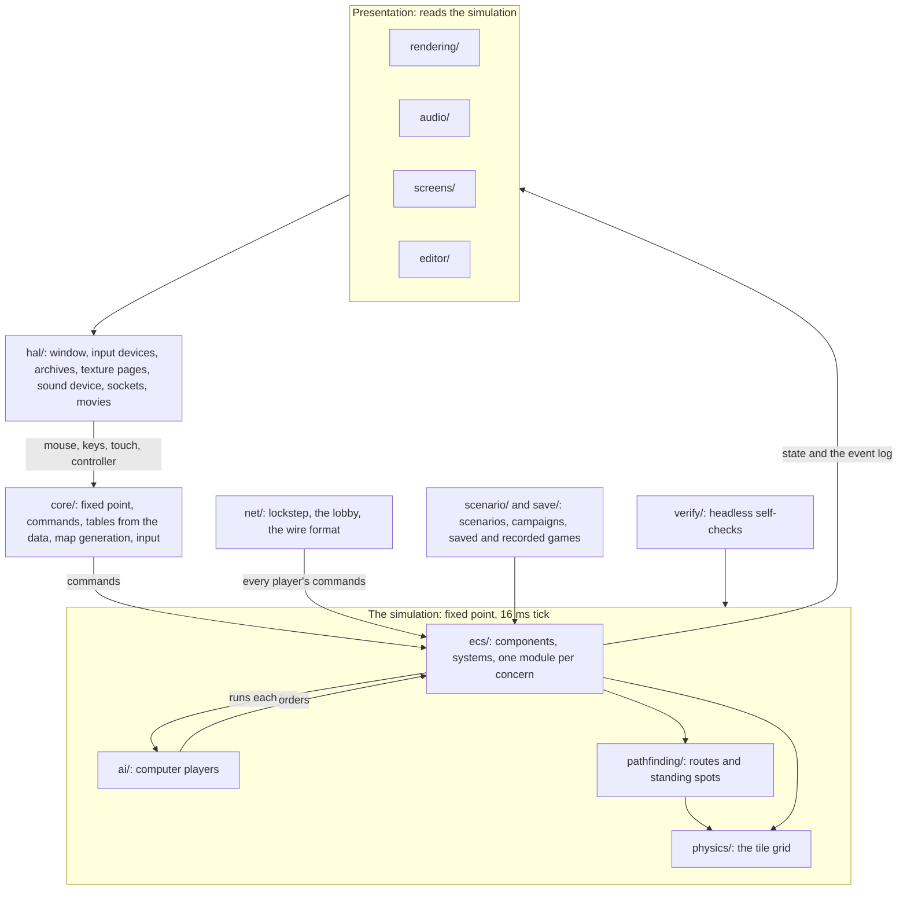

# Overview

OpenAoK is an engine for *Age of Empires II: The Age of Kings* written from
scratch in C++20 on SDL 2. It holds no code from the original game: it reads
the original's data files from the player's own CD and carries out the rules
they describe, so that the game plays and looks as the 1999 release does.

This page is the engine's map: the principles every module keeps to, the
directories under `src/` and how they depend on one another, what one tick of
the simulation does, and which module owns what. The pages listed under
[Read on](#read-on) go into each part.

## Principles

**Data-oriented.** Components are plain structs of data (EnTT 3.12, vendored
as a single header in `third_party/entt`); behaviour lives in free functions in
modules that act on them, one module per concern. There are no entity classes,
no virtual dispatch for game objects and no getters wrapping fields.

**A deterministic simulation.** The simulation runs on 32.32 fixed point
(`Core::Fixed32`) on a fixed 16 ms tick, about 60 a second. It draws randomness
only from seeded generators held in the world (`Core::Random`, an
`xorshift64*` generator) and iterates in a defined order. The same orders on the same ticks produce the
same world, bit for bit, on every machine; lockstep multiplayer, saved and
recorded games and the self-checks depend on it. Floating point is not allowed
inside the tick (`src/ecs`, `src/pathfinding`, `src/physics`, `src/ai`), and the
gate checks the sources for it. See [Fixed point and determinism](/engine/determinism).

**One-way presentation.** Rendering, audio and the interface read the
simulation; the simulation never reads them. Orders reach the simulation only
as commands (`core/Command.h`), each stamped with the player who gave it and
checked by `ecs/Orders` against what that player owns.

**The data decides.** Every figure the dat, the DRS archives, LANGUAGE.DLL, the
random map scripts or the AI scripts state is read from them. The few figures
the data does not hold are named constants in the module that uses them. See
[The game's data](/engine/data).

**Continuous positions.** Units stand and move at fixed-point positions. The
tile grid holds building footprints, terrain and the path search; nothing a
unit does is snapped to it, and "in reach" is a distance. See
[Movement and routes](/engine/pathfinding).

**Passability per terrain restriction.** The dat gives every unit a terrain
restriction: for each terrain, whether a unit of it may go there. The grid
keeps one passability layer for each set of grounds the data's movers use, each
with its own connected regions. Restrictions that allow the same grounds share
a layer (a galley, a fishing ship and a transport are three restrictions in the
dat and one sea), and layer 0 is always land, the villager's. `ecs/Navigation`
answers which layer a unit moves on, and every route goes through
`Navigation::Route`. A layer can carry the asking player's key in its upper
bits (`Physics::Keyed`), so a gate is open to its owner and allies and shut to
everyone else.

## The module map

Each directory under `src/` is one part of the engine. Arrows show which way
information flows: input becomes commands, commands change the simulation, and
the presentation reads what the simulation holds.

`src/main.cpp` ties them together: it starts the platform, loads the data,
parses the command line, opens the window and runs the menus and the game's
frame loop.

| Directory | Role |
|---|---|
| `src/core/` | Types, fixed point, the lobby (`GameSetup`), commands, the loaded tables (`Rules`, `Media`, `Strings`, `ConfigManager`), map generation (`RMSParser`, `MapGenerator`, `LandGenerator`, `Cliffs`, `Elevation`), input (`InputManager`, `Hotkeys`), the player's profile, the tick's cost counters (`Costs`) |
| `src/ecs/` | The simulation: `Simulation` owns the registry and runs the tick; one module per concern |
| `src/ecs/components/` | Plain data, one concern per file |
| `src/ecs/systems/` | Bulk systems: movement, workers, animation |
| `src/ai/` | Computer players: the script reader and interpreter, and the executor under them |
| `src/net/` | Lockstep multiplayer, the lobby and finding games, the wire format |
| `src/physics/` | The tile grid: terrain, passability per layer, occupancy |
| `src/pathfinding/` | A* over connected regions per layer, and the approach planner |
| `src/rendering/` | The draw layer: terrain, sprites, fog of war, the battlefield interface |
| `src/audio/` | Sound and music, beside rendering |
| `src/screens/` | Menus, the game setup screens and the multiplayer lobby, the campaigns, in-game dialogs |
| `src/editor/` | The scenario editor |
| `src/scenario/` | Scenario (`.scn`) and campaign (`.cpn`) files: reading and writing |
| `src/save/` | Saved games and recorded games |
| `src/hal/` | The platform layer: window, start-up and folders per machine, touch and controller input played as the mouse, the system keyboard, DRS archives and SLP decoding, texture pages, the sound device, sockets, the AVI reader and Indeo 5 decoder |
| `src/verify/` | The headless self-check, one scenario per file |
| `tools/data/` | Prepares the game data from the original CD |
| `android/`, `ios/`, `switch/`, `windows/` | The builds for each platform and the data folders made for them |

## One tick

`ECS::Simulation::Update` runs one tick, in this order:

1. The event log and the score's clock begin the tick.
2. **Navigation** takes stock of where everyone stands, before anything plans
   a route or takes a step.
3. **Orders**: every command queued for this tick, through `ecs/Orders`.
4. **Computer players** (`AI::Update`): each runs a pass of its rule scripts
   and its executor once a second, the seats staggered so they do not all
   think on the same tick, giving ordinary orders through `ecs/Orders`. Then
   gates learn whom they open for, as the stances now stand.
5. Every `Transform` copies its position into `previous_position`, for the
   renderer to interpolate between ticks.
6. **Movement**: waypoints walked on to, siege engines packing and unpacking,
   routes, separation and arrival.
7. **Workers**: gathering, carrying, building, repairing; then trade,
   garrisons, standing orders, monks, relics and animals.
8. **Combat**, **missiles** in flight, **mortality** (dying units, corpses,
   carcasses).
9. **Buildings** finishing, **walls** and gates, Spies' price, **production**
   queues.
10. **Animation**, a scenario's **triggers**, **victory**.
11. **Vision**, then the **fog**'s memory of what each player stops seeing,
    Gaia's villagers and buildings taken by the first player to see them, and
    the score.

Every tick also writes the **event log** (`ecs/Events`): units born, blows
struck, buildings finished, technologies researched, deaths, conversions. The
simulation only writes it; sound, the interface and the checks read it. Each
step is timed by `Core::Costs` when costs are switched on (see
[Performance](/development/performance)). The tick is described in full in
[Entities and systems](/engine/simulation).

## Modules

| Module | Owns |
|---|---|
| `ecs/Players` | Each player's resources (the dat's whole table), its own copy of the unit rules, its art and technology statuses |
| `ecs/Effects`, `ecs/Techs` | Technologies' effects on a player's copy of the rules; research progression and the ages |
| `ecs/Buildings`, `ecs/BuildingGeometry` | A building's life (placement, completion, destruction, art) and its footprint |
| `ecs/Production`, `ecs/Population` | Unit and research queues; population and housing |
| `ecs/Units` | Assembling a unit (`Spawn`) and turning one into another (`Become`) |
| `ecs/VillagerJobs`, `ecs/DropSites`, `ecs/Resources`, `ecs/Felling` | The job unit a villager becomes at work; where loads may be dropped; what a depleted resource leaves; a tree felled before it is cut |
| `ecs/Combat`, `ecs/Missiles`, `ecs/Mortality` | Attack and armour by class; missiles; death |
| `ecs/Search`, `ecs/Turning` | What each kind of unit picks a fight with on sight; turning to face a target at the dat's rotation speed |
| `ecs/Formations`, `ecs/Duties` | Group moves; patrol, guard and follow |
| `ecs/Garrisons`, `ecs/Monks`, `ecs/Relics`, `ecs/Animals` | Garrisons, the town bell and transport ships; conversion and healing; relics; grazing, herding and fleeing |
| `ecs/Navigation` | A unit's passability layer, its routes and region, the nearest reachable ground |
| `ecs/Walls` | Walls laid as dragged lines, each segment's piece chosen by its neighbours; gates and locking |
| `ecs/Repairs` | Who may repair what, the pace, the cost per hit point |
| `ecs/Packing` | Siege engines packing and unpacking |
| `ecs/Cheats` | The cheat codes typed in chat |
| `ecs/Allegiance` | Changing an entity's owner; a converted unit keeps its maker's rules (the `RulesOf` component) |
| `ecs/Vision` | Each player's visible and explored ground |
| `ecs/Fog` | What each player keeps of what it does not see: pictures of buildings and map objects, the ground as last seen |
| `ecs/Victory` | Conquest, Wonders and relics; who is defeated and who has won |
| `ecs/Spies` | Spies' price and the enemy sight it gives; Treason, which marks the enemy Kings in Regicide |
| `ecs/Market`, `ecs/Trade`, `ecs/Tribute` | Commodity prices and trading; trade carts and cogs; tribute and its fee |
| `ecs/Chat`, `ecs/Flares` | Chat lines and flares, carried in lockstep, written to a log the interface reads |
| `ecs/Diplomacy` | Stances between players, allied victory, Lock Teams, team bonuses |
| `ecs/Score`, `ecs/Timeline` | The score and the Achievements figures; each player's history for the Achievements' Timeline |
| `ecs/Selection` | What the player has selected: what it looks at, and what it may give orders to |
| `ecs/ScenarioWorld`, `ecs/Triggers` | A scenario's world, and its triggers, evaluated once a second |
| `ecs/Events`, `ecs/Digest` | The event log; a digest of the world for desync detection |
| `scenario/Scenario`, `scenario/Campaign`, `scenario/Writer` | Scenario files (1.18) and campaigns as plain data; writing scenarios back |
| `editor/` | The scenario editor: `Editor` (the screen), `Document` (edits to the file and its world), `Panels` and `TriggerPanel` (the tabs), `Ui` (immediate-mode controls). It never ticks the simulation |

Conventions the modules share:

- **A garrisoned unit has no `Transform`.** Removing the component takes the
  unit out of every view: drawing, sight, movement, targeting.
- **An upgrade keeps identity.** `Identity` holds the base unit id for an
  entity's whole life; the owner's rules for that slot change with research.
- **An entity's rules come from `Players::RulesFor`**: its owner's table, or
  for a converted unit its maker's.
- **Footprints use the dat's clearance turned a quarter**: a piece the dat
  places at (dx, dy) from a building's middle stands at (dy, -dx) on the grid
  (`BuildingGeometry::FromDatAxes`).
- **Hostility is diplomacy's.** `Combat::Hostile` and `Combat::Friendly` read
  `ecs/Diplomacy`; victory, shared sight and tribute ask the same table.

## Maps

`core/RMSParser` reads a random map script from `gamedata.drs`, with its
includes and constants. `MapGenerator::SetUpLayers` first builds the grid's
passability layers from the dat. `core/MapGenerator` then runs the script's
passes in this order: lands (`core/LandGenerator`), terrain clumps, beaches,
hills (`core/Elevation`), cliffs (`core/Cliffs`), and the objects placed by
the script's rules. Hills run before cliffs because a cliff only runs over
ground of one height. Hills and cliffs each draw from a random stream of
their own. See [Random maps](/engine/random-maps).

## Presentation

`rendering/` draws the simulation's state each frame, interpolating positions
between ticks. Sprites come straight from the SLPs in `graphics.drs` through
`hal/GraphicCache`, each graphic's frames a block packed onto texture pages
that many graphics share, so the sprites on screen draw in a few batches.
Player colour, shadows and outlines are the SLP's own pixel classes; a graphic
is drawn once for each colour worn, its colour pixels and player colour
together. No texture is asked for past the renderer's limit: a block taller
than a page may be goes on in bands of whole shelves, and a graphic drawn from
a texture of its own is shelved wider. Terrain is drawn in chunks and blended
with the masks of `blendomatic.dat`. The fog of war is a checkerboard over
explored ground with the TileEdge and BlkEdge masks at its edges. See
[The frame](/engine/rendering/), [Sprites and texture pages](/engine/rendering/sprites),
[Terrain](/engine/rendering/terrain) and [Fog of war](/engine/rendering/fog).

The interface uses the original interface art and LANGUAGE.DLL's text, in the
CD's fonts rasterised by FreeType. The game draws into a frame of one of the
three original screen sizes (or a widescreen frame of that height), scaled to
the window. In a widescreen frame the top bar and the bottom panel reach the
frame's edges; each can be drawn larger (`UIRenderer::HudSpace`). See
[The interface](/engine/interface).

`audio/` reads the same state: sounds tied to graphics (a death cry, a sword's
ring on the frame the blow lands), unit voices, alarms, chat and taunts, and
the music. `hal/Audio` mixes the original WAVs, and MP3s through minimp3. The
start-up movies are the original AVIs, read by `hal/Avi` and decoded by
`hal/Indeo5`, an Indeo Video 5 decoder. See [Sound, music and movies](/engine/audio).

## Computer players

The computer players are the original rule scripts (the `.per` files in
`gamedata.drs`) run by the engine:

- **The rules.** `ai/Script` reads the scripts (`defrule`, `defconst`, `load`,
  `load-random`, conditional loading) and compiles them to flat arrays per
  computer seat, under the symbols the lobby defines for that player's
  civilisation, difficulty, map and population cap. `ai/Language` holds the
  language's facts, actions, parameters and strategic numbers.
  `ai/Interpreter` runs a rules pass; `ai/Facts` and `ai/Actions` evaluate them
  against the world; `ai/Mind` holds goals, strategic numbers, timers and
  escrow.
- **The executor** carries out what the rules ask: `ai/Economy` (villagers,
  builders, farms, hunting), `ai/Placement` (where buildings go), `ai/Walls`
  (the two perimeters, walls and gates), `ai/Military` (attack groups,
  defence), `ai/Navy`, `ai/Scouting` (the scout, explore groups), `ai/Relics`
  (Monks fetching relics) and `ai/Knowledge` (what a computer player knows of
  the world, its allies' finds among it), behind `ai/Executor`.

Every decision ends as an ordinary order through `ecs/Orders`, with the same
checks a person's orders get; the one exception is the script action
`cc-add-resource`, which adds resources outright. The computer players run
inside the tick, on their own random streams, so every machine in a network
game runs them identically. See [Computer players](/engine/ai).

## Read on

- [The game's data](/engine/data): the files the engine reads, and how they are prepared
- [Random maps](/engine/random-maps): the map scripts and the generator's passes
- [Entities and systems](/engine/simulation): components, systems and the tick
- [Fixed point and determinism](/engine/determinism): `Core::Fixed32`, the seeded generators, the golden hash
- [Movement and routes](/engine/pathfinding): passability layers, A*, standing spots
- [Combat](/engine/combat): attack, armour, missiles and death
- [Computer players](/engine/ai): the script interpreter and the executor
- [Lockstep multiplayer](/engine/multiplayer): turns, the lobby, desyncs
- [The frame](/engine/rendering/): what is drawn each frame, in what order
- [Sprites and texture pages](/engine/rendering/sprites): SLPs, hotspots, player colour, batching
- [Terrain](/engine/rendering/terrain): chunks, blending, hills
- [Fog of war](/engine/rendering/fog): the checkerboard and its edge masks
- [The interface](/engine/interface): the panels, the command grid, text
- [Sound, music and movies](/engine/audio): sounds, voices, alarms, the AVIs
- [Platforms](/engine/platforms): the window, input, and each machine the game runs on

## Where it lives in the code

- [`src/main.cpp`](https://github.com/Zaydme/openaok/blob/main/src/main.cpp): start-up, the command line, the frame loop
- [`src/ecs/Simulation.cpp`](https://github.com/Zaydme/openaok/blob/main/src/ecs/Simulation.cpp): the tick, in order
- [`src/core/Command.h`](https://github.com/Zaydme/openaok/blob/main/src/core/Command.h): the commands that reach the simulation
- [`src/ecs/Orders.cpp`](https://github.com/Zaydme/openaok/blob/main/src/ecs/Orders.cpp): commands checked and carried out
- [`src/core/FixedPoint.h`](https://github.com/Zaydme/openaok/blob/main/src/core/FixedPoint.h): `Core::Fixed32`
- [`src/core/Random.h`](https://github.com/Zaydme/openaok/blob/main/src/core/Random.h): the seeded generator
- [`src/physics/Grid.h`](https://github.com/Zaydme/openaok/blob/main/src/physics/Grid.h): the tile grid and its passability layers
- [`src/core/MapGenerator.cpp`](https://github.com/Zaydme/openaok/blob/main/src/core/MapGenerator.cpp): the random map passes
- [`src/ai/Brain.h`](https://github.com/Zaydme/openaok/blob/main/src/ai/Brain.h): the computer players, at the top
- [`CMakeLists.txt`](https://github.com/Zaydme/openaok/blob/main/CMakeLists.txt): the desktop build
