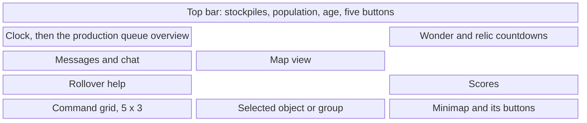

# The interface

In the original game the battlefield sits between two pieces of carved art: a
thin top bar with the stockpiles, the age and five buttons, and a bottom panel
with the command buttons, the selected object on a parchment, and the minimap
in its frame. Each civilisation has its own art, drawn for each of the three
screen sizes the game offers (800x600, 1024x768 and 1280x1024). Around the
game are the menus: the town of the main menu, the parchment of the game
setup, the in-game dialogs.

OpenAoK draws that same art from `interfac.drs` and puts every number, button
and line of text where the original puts it, at each size, in the CD's fonts
and LANGUAGE.DLL's words. This page covers the layouts, how each part of the
interface is sized and widened, the command grid and its hotkeys, the text,
the help, the minimap, the production queue overview, and the menus.

## A frame of the interface



The world is drawn first, filling the frame; the interface goes over it. In
`Renderer::Render`, once the terrain, the entities and the fog are down, come
the production queue overview, the message lines, the time panels and the
scores over the map view, then `UIRenderer::DrawInterface`: the bottom panel,
the top bar, and the rollover help. The cursor is drawn last of all, in
`Renderer::Finish`, just before the frame is shown.

The art is not a frame with a hole cut in it: it is drawn with its transparent
pixels, and the world shows through wherever the art is transparent.
`UIRenderer::PointOverHud` asks the art's own pixels whether a point is on the
interface, so a click on the map through a gap in the carving reaches the map.

## The layouts

`src/rendering/HudLayout.h` holds a `HudLayout` for each screen size: where
each stockpile's number ends, where the age is centred, where the five bar
buttons sit, the command grid's first button and its pitch, the selected
object's name, portrait, hit points and figures, the group cards' area, the
minimap's diamond and its eight buttons, and the help box.

| Size | Art (first civilisation) | Top bar rows | Panel from row | Command grid | Minimap's diamond |
|---|---|---|---|---|---|
| 800x600 | 51101 | 25 | 455 | from (5, 465) | 265x133 at (511, 465) |
| 1024x768 | 51121 | 25 | 593 | from (37, 624) | 322x163 at (690, 600) |
| 1280x1024 | 51141 | 32 | 806 | from (44, 845) | 390x197 at (870, 818) |

Each size's art is one SLP per civilisation, the first civilisation's at the
table's id and civilisation `n` at that id plus `n - 1`, so each
civilisation plays behind its own carving. The command buttons are
40 pixels square, 41 apart; the bar buttons and the minimap buttons come from
sheets of their own, each button followed by its pressed frame.

Every rectangle the interface uses comes from a function of `UIRenderer`
reading these tables, and the input code hit-tests against the same functions,
so a button is always where it is drawn.

## Each part at its own size

The Options screen sizes three things from 100% to 200%: the top bar, the
bottom panel (with the minimap and the help), and the text over the world. The
top bar and the panel are each laid out for a narrower frame and then scaled
up to the real one, the top bar from the frame's top-left corner and the panel
from its bottom-left. `UIRenderer::TopSpace` and `UIRenderer::PanelSpace`
describe each part as a `HudSpace`: the width it is laid out for, and its
scale.

```cpp
UIRenderer::HudSpace SpaceFor(int win_w, int win_h, int percent, bool bottom) {
    UIRenderer::HudSpace space;
    space.w = win_w;
    space.h = win_h;
    space.bottom = bottom;
    const HudLayout& base = LayoutForHeight(win_h);
    percent = std::clamp(percent, Core::Profile::kInterfaceSizeLeast, Core::Profile::kInterfaceSizeMost);
    const int narrowest = std::max(base.width, (win_w * 100 + percent - 1) / percent);
    if (narrowest >= win_w) return space;
    space.w = narrowest;
    space.scale = static_cast<float>(win_w) / static_cast<float>(narrowest);
    return space;
}
```

A part is never laid out narrower than its height's own screen size, so it
grows only as far as the frame has room for: in a frame of one of the three
sizes there is none, and both parts are drawn as they are. A part with a scale above one is drawn into
a texture of its own width and copied into the frame at its scale, with
nearest-pixel filtering when the scale is a whole number and linear filtering
otherwise. A point of the frame is mapped into a part's terms
(`HudSpace::ToSpace`) before any hit test, and the help's text is rasterised
afresh at the panel's scale rather than enlarged.

## Widescreen

With the Options' Widescreen on, the frame is as wide as the screen's own
aspect (never narrower than 4:3) at the height of the chosen size, and the
interface reaches its edges. The original art is 4:3, so it is carried out
rather than stretched: each part is cut at one column, what lies left of the
cut stays at the left edge, what lies right of it moves to the right edge, and
a plain stretch of the art's own is repeated across the gap.

```cpp
inline int BarCut(const HudLayout& base) { return base.age_right - 60; }
inline int PanelCut(const HudLayout& base) { return base.selection.x + base.selection.w + 2; }
inline SDL_Rect BarBand(const HudLayout& base) { return {BarCut(base), 0, 50, base.top_bar_h}; }
inline SDL_Rect PanelBand(const HudLayout& base) {
    return {base.grid.x + 60, base.panel_top, 40, base.height - base.panel_top};
}
```

The top bar is cut in the plain stretch beside the age and repeats it; the
panel is cut between the parchment and the minimap's frame and repeats a strip
of the carving behind the command grid. `Edged` moves what belongs to the right
(the bar's buttons, the right end of the age's box, the minimap and its
buttons) by the extra width, and `LayoutFor` keeps the few widths a frame asks
for, so a layout is worked out once rather than every frame. A row in the
transparent middle (`HudSplit`) divides what belongs to the bar from what
belongs to the panel.

## The command grid and its hotkeys

The command grid is fifteen buttons, five across and three down.
`UIRenderer::BuildCommands` makes the list for the current selection, and both
the drawing and the clicking use it. What a button offers, which slot it
takes and what it costs come from the dat: each unit and technology names its
button, and the first to claim a slot keeps it. A villager's build menu has two
pages, economic and military buildings, told apart by the dat's interface kind
(2 and 10), so a House and a Barracks can both be button 1. Only the list of
buildings that can be placed is the engine's own.

The hotkeys are the defaults read from `EMPIRES2.EXE` (see
[the game's data](/engine/data#hotkeys-from-empires2-exe)), filed in groups.
A key means one thing per group: B opens the economic build menu among a
villager's commands and is the Barracks inside that menu. So the question is
always whether a key press is a given item of a given group
(`Core::Hotkeys::Is`), and the grid on show says which groups are asked first:

- each button carries its hotkey's group and item; a building's buttons answer
  to that building's group, so S is the Militia at a Barracks and the Scout
  at a Stable;
- a trained unit finds its item by its name in the hotkey list's names, which
  name whole unit lines;
- Ctrl and Alt must be exactly as bound; Shift must be held when the binding
  has it and is otherwise free, because Shift with a training key queues five;
- what no button takes goes to the game commands (`kGameCommands`): going to
  buildings, the idle villager, the chat, the dialogs;
- the middle button, and the mouse wheel with Ctrl held, act as the keys the
  defaults bind them as; Ctrl on a Mac keyboard is either Control or Command.

The rollover help over a button ends with its key, in the DLL's words and with
the key's letter as the DLL spells it.

## Text in the CD's fonts

The original draws its text with Windows GDI, in fonts LANGUAGE.DLL names: from
string 110, three strings per font give a face, a size in points and a style.
The faces are on the CD in `SYSTEM/FONTS`, all but Arial, which comes from the
machine. `src/rendering/Text.cpp` opens them with FreeType and draws them as GDI
does on a 96 DPI screen with no smoothing:

- **The size.** A font of `points` points is GDI's `MulDiv(points, 96, 72)`
  pixels of em:

  ```cpp
  // GDI's MulDiv(points, 96, 72): rounds half away from zero.
  int PixelsForPoints(int points) { return (points * 96 + 36) / 72; }
  ```

- **The pixels.** Glyphs are hinted by FreeType's TrueType interpreter and
  rendered in monochrome, one bit a pixel. A face the CD has no bold for is
  emboldened as GDI simulates it, by drawing it again one pixel to the right.
- **The metrics.** A line is placed as GDI's `TextOut` places it: (x, y) is the
  top-left of its cell and the baseline is the ascent below. Layouts that space
  lines measure with what Windows reports for the face (`GdiHeight`,
  `GdiAscent`), the font's VDMX entry for its size where it has one, which is a
  pixel or two more than the scaled outline for most of the CD's faces.
- **The drawing.** Glyphs are rasterised on first use into one 2048x2048
  texture and a line is drawn as a single batch of quads; shadowed text (light
  text on art) and outlined text (text over the world) go in the same batch as
  the line itself.

The Options' Text size reaches `Text::Scaled`, which opens the same face at a
percentage of its size and rasterises it at that size, so larger text stays
crisp.

## Words from LANGUAGE.DLL

The interface's words come from LANGUAGE.DLL through `Core::Strings`: unit and
technology names and help, button labels, the bar's and the minimap's button
help, refusals (`UIRenderer::Refusal` answers with a string id), the age
names, the computer players' leader names, the messages. `Core::Strings::Id`
names the ids the code uses, and the DLL supplies the text in the language of
the CD.

## Rich text in the rollover help

The dat's help texts are templates. `ConfigManager::ExpandHelp` fills
`<cost>`, `<hp>`, `<attack>`, `<armor>`, `<piercearmor>` and `<range>` with the
player's own figures, after technologies, labelled in the DLL's words, and
keeps the `<b>` and `<i>` markup for the help box. `LayoutRich` then breaks the
text into lines of runs, each run in one font: a `<b>` or an `<i>` toggles bold
or italic, switching to the face of the same family and size in that style
(`Text::BoldOf`, `Text::ItalicOf`), and words wrap at spaces to the box's
width.

```cpp
if (text[i] == '<') {
    const size_t close = text.find('>', i);
    if (close != std::string::npos) {
        const std::string tag = text.substr(i + 1, close - i - 1);
        if (tag == "b" || tag == "i") {
            flush_word();
            if (tag == "b") bold = !bold;
            if (tag == "i") italic = !italic;
            i = close + 1;
            continue;
        }
    }
}
```

## The rollover help box

The help sits over the map's lower left, just above the panel: at 1024x768 a
box 540 pixels wide from x 4 whose bottom is row 590, and the same box in
proportion at the other sizes. It is as tall as its lines, 18 pixels apart,
and goes with the panel's size. Inside it the map is darkened as the
original's see-through panels darken it, every other pixel black in the
checkerboard of the fog of war, and the text is white with a black shadow.

What it says is, in order: the command button under the cursor, its help and
then its key; a top bar button; a minimap button; or else what a right-click
would do in the world, which the input code sets each frame
(`UIRenderer::SetWorldHint`). The minimap's help button turns it on and off,
along with the notification lines.

## The minimap

The minimap is the map turned into the diamond of the art's frame. One
projection is shared by the drawing and the clicking:

```cpp
SDL_FPoint UIRenderer::MinimapProject(const SDL_FRect& well,
                                      float wx, float wy, int grid_w, int grid_h) {
    const float dx = wx / static_cast<float>(grid_w);
    const float dy = wy / static_cast<float>(grid_h);
    return SDL_FPoint{
        well.x + well.w * 0.5f + (dx - dy) * (well.w * 0.5f),
        well.y + (dx + dy) * (well.h * 0.5f)
    };
}
```

The ground is rasterised once into a texture of the diamond's own size, each
tile in one of the three minimap shades the dat gives its terrain (sloping
towards the light, flat, sloping away), and again only when the ground
changes. Over it go the fog for this machine's player (black where it has
never been, dimmed where it does not see now, redrawn four times a second),
the map's own objects in the colours the unit table gives them, the notices
(an attack, a flare, a unit trained) as squares that draw in and fade, the
players' units as dots and their buildings as squares of their footprint's
size in the pure player colour, the buildings the player remembers in the fog,
the selection in white with a building's gather point as a small cross, the
flares, and the outline of the view.

The minimap has three modes, normal, combat and economic, chosen by its
buttons: combat leaves out buildings, workers and the map's objects; economic
shows only buildings, workers and the map's objects. The mode buttons and the
signal and statistics buttons show only with the advanced commands on.

## The production queue overview

The production queue overview is one of OpenAoK's
[additions](/guide/improvements): a row of icons at the map's top left showing
what the player's buildings are making. `UIRenderer::QueueOverview` gathers it
from the viewer's finished buildings with anything queued, oldest first. Each
kind of unit or technology shows once, with how many of it are queued:

- what leads each queue (its front item and those of the same kind straight
  behind it) comes first, then what waits behind something of another kind,
  technologies first in each;
- a queue held up for want of houses is all waiting;
- a leading entry keeps how far the one furthest along has got.

`UIRenderer::DrawQueueOverview` draws the entries as 36-pixel icons a pixel
apart, at the top bar's scale, below the clock when the clock shows, wrapping
after half the map's width. What is being made is greened from its left edge
as far as it has got (`ProgressFill`), what waits is yellowed, and a unit's
count is written on its top left. It returns how far down the map it reaches,
so the message lines move down below it. A click on an entry selects the next
building making it and brings the view there (`InputManager::GoToQueued`). The
Options' Production Queue turns it off.

## Menus and dialogs

The screens before and around a game live in `src/screens/`. Each is drawn on
its own background art from `interfac.drs`, in its own palette, with controls
styled by its `.sin` file (`Screens::LoadStyle`), and every menu is drawn at
800x600:

- `Screens`: the main menu and its Single Player menu, the options, history,
  credits and the loading screen, and which screen shows;
- `Setup`: the game setup screen, and in a network game the lobby;
- `Multiplayer`: the connection type, the games found, joining and creating;
- `Campaigns` and `Slides`: the campaigns' book and maps, the custom scenarios,
  a scenario's instructions and aftermath, and the narrated slide shows;
- `TechTree` and `TechTreeLayout`: the technology tree screen, laid out from
  the dat's own table for the civilisation shown;
- `Achievements` and `AchievementsTimeline`: the score pages and the timeline;
- `GameDialogs`: the screens over a game, the game menu, in-game options,
  objectives, diplomacy, chat, saving, the end of the game. In a
  single-player game an open dialog pauses it.

The controls are plain data and free functions (`screens/Widgets`): a button
is the screen's own background darkened by the `.sin`'s shade amount, in a
three-line bevel of the `.sin`'s six colours, with its label centred; a
disabled one is etched and its label greyed, and every colour is snapped to
the screen's palette. A screen never touches the simulation: it hands the
application a `Screens::Request` (start a game, load one, quit) and the
application carries it out.

## Where it lives in the code

- [`src/rendering/HudLayout.h`](https://github.com/Zaydme/openaok/blob/main/src/rendering/HudLayout.h): the layouts for the three sizes, and the widescreen cuts
- [`src/rendering/UIRenderer.h`](https://github.com/Zaydme/openaok/blob/main/src/rendering/UIRenderer.h): the interface's parts, commands, minimap and overview
- [`src/rendering/UIRenderer.cpp`](https://github.com/Zaydme/openaok/blob/main/src/rendering/UIRenderer.cpp): drawing and hit-testing them
- [`src/rendering/Text.cpp`](https://github.com/Zaydme/openaok/blob/main/src/rendering/Text.cpp): the CD's fonts, drawn as GDI draws them
- [`src/rendering/Messages.cpp`](https://github.com/Zaydme/openaok/blob/main/src/rendering/Messages.cpp): the lines written over the left of the map
- [`src/rendering/Alerts.cpp`](https://github.com/Zaydme/openaok/blob/main/src/rendering/Alerts.cpp): the notices on the minimap
- [`src/rendering/Renderer.cpp`](https://github.com/Zaydme/openaok/blob/main/src/rendering/Renderer.cpp): the order a frame is drawn in
- [`src/core/Hotkeys.cpp`](https://github.com/Zaydme/openaok/blob/main/src/core/Hotkeys.cpp): the default hotkeys and matching key presses
- [`src/core/InputManager.cpp`](https://github.com/Zaydme/openaok/blob/main/src/core/InputManager.cpp): keys and clicks on the interface
- [`src/core/Strings.cpp`](https://github.com/Zaydme/openaok/blob/main/src/core/Strings.cpp): LANGUAGE.DLL's strings
- [`src/core/ConfigManager.h`](https://github.com/Zaydme/openaok/blob/main/src/core/ConfigManager.h): help templates filled with a player's figures
- [`src/screens/Screens.cpp`](https://github.com/Zaydme/openaok/blob/main/src/screens/Screens.cpp): the menus
- [`src/screens/Widgets.cpp`](https://github.com/Zaydme/openaok/blob/main/src/screens/Widgets.cpp): the menus' controls
- [`src/screens/Sin.cpp`](https://github.com/Zaydme/openaok/blob/main/src/screens/Sin.cpp): a screen's look from its `.sin` file
- [`src/screens/GameDialogs.cpp`](https://github.com/Zaydme/openaok/blob/main/src/screens/GameDialogs.cpp): the dialogs over a game
