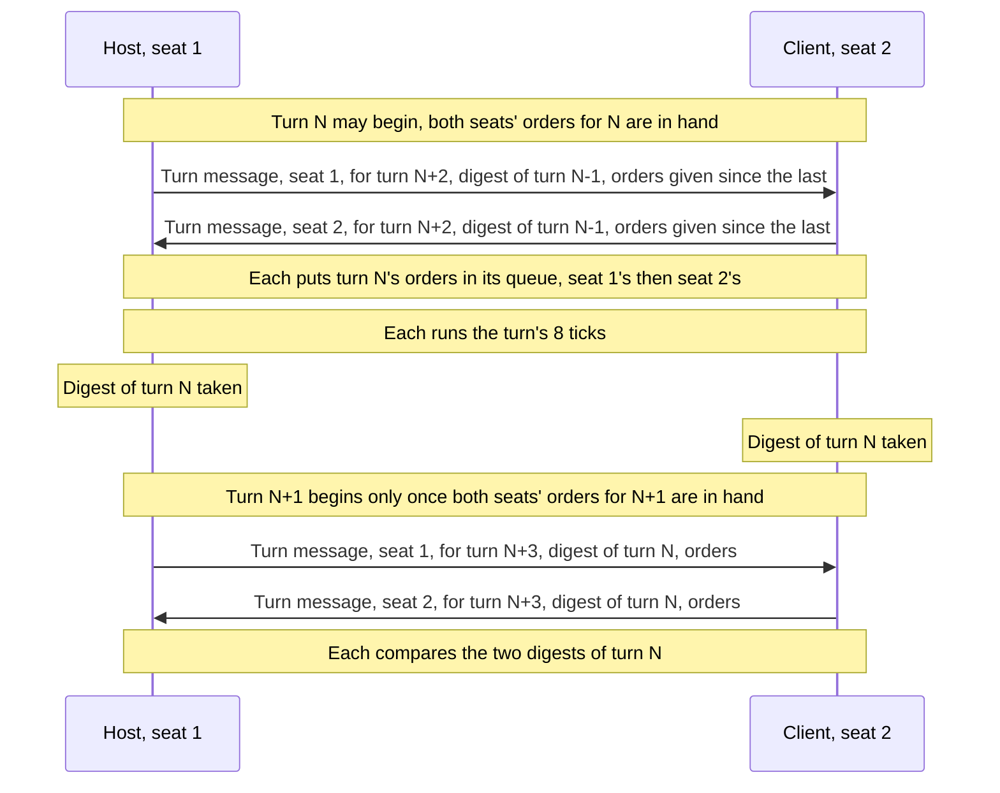

# Lockstep multiplayer

In a network game of Age of Kings every player's machine runs the whole game,
and only the players' orders cross the network. OpenAoK plays a network game
the same way: lockstep. This page covers how time is cut into turns, how
orders are batched and delayed so that every machine carries them out on the
same tick, how two machines that have drifted apart find out, the bytes on the
wire, and the lobby that comes before the game. How to host and join a game is
on [Multiplayer](/guide/multiplayer) in the guide.

## Why lockstep works

The simulation is deterministic: fixed point, a fixed 16 ms tick, seeded
randomness and a defined order (see [Fixed point and determinism](/engine/determinism)).
Two machines that start from the same setup and carry out the same orders on
the same ticks hold the same world, so nothing but the orders need travel. An
order is a few bytes, however many units are on the map.

Computer players run inside the tick on every machine, from the same seeded
generators, so they need no network at all; only the seats played by people
(`Session::humans`) send orders. Each machine knows its own seat
(`Core::LocalPlayer`), which only the interface ever asks.

## Turns and the turn delay

Time is cut into turns of 8 ticks, 128 ms of game time. An order is carried out
two turns after the turn in which it is sent:

```cpp
constexpr int kTicksPerTurn = 8;
constexpr uint32_t kDelayTurns = 2;
```

Orders given at a machine are not sent one by one. The frame loop hands each
command to `Net::Issue`, which puts it in the session's outbox. When the
machine begins a turn, it sends everything in the outbox as one turn message
for the turn `kDelayTurns` after the one it is beginning, and keeps a copy for
itself. A machine sends a turn message every turn, with no orders in it if
nobody gave any, so the others always know it has nothing more for that turn.
An order is therefore carried out between two and three turns after it is
given: 16 to 24 ticks, 256 to 384 ms of game time.

A turn may begin only once every person's orders for it are in. The first two
turns have nothing in them, and every seat's empty orders for them are taken
as given when the game starts. At the first tick of every turn after that,
`Net::NextTick` checks the inbox:

```cpp
bool NextTick(Session& session, std::vector<Core::Command>& due) {
    due.clear();
    if (!session.started || session.desynced || !session.failure.empty()) return false;
    if (session.tick_in_turn > 0) return true;

    // The start of a turn: everyone's orders for it have to be in.
    auto& orders = session.inbox[session.turn];
    for (Core::PlayerId seat : session.humans) {
        if (orders.find(seat) == orders.end()) return false;
    }
    for (Core::PlayerId seat : session.humans) {
        for (const Core::Command& c : orders[seat]) due.push_back(c);
    }
    session.inbox.erase(session.turn);

    // And this machine's orders since the last turn go out, for the turn
    // they can still reach, with the digest of the turn just finished.
    const uint32_t target = session.turn + kDelayTurns;
    // ...
```

The orders due come out in seat order, and the frame loop puts them in the
command queue for the tick to carry out through `ecs/Orders`, as in a game
offline (see [Entities and systems](/engine/simulation)):

```cpp
            // In lockstep: this machine's orders go to everyone, and a tick
            // runs only once every player's orders for its turn are in.
            Net::Pump(session);
            for (const auto& command : Core::CommandQueue::Get().PopAllCommands()) {
                Net::Issue(session, command);
            }
            std::vector<Core::Command> due;
            while (accumulator >= kTick) {
                if (!Net::NextTick(session, due)) {
                    if (accumulator > kTick) accumulator = kTick;   // waiting: do not bank time
                    break;
                }
                for (const auto& command : due) Core::CommandQueue::Get().PushCommand(command);
                // ...
                sim->Update(kTickMs);
                // ...
                Net::TickDone(session, sim->GetRegistry());
                accumulator -= kTick;
            }
```

A slow or silent machine holds the others back rather than letting them play
on without it: no machine can run further ahead than the turns already in
hand. While it waits, a machine banks no time beyond the one tick it is
waiting to run, so it does not race to catch up once the orders arrive.

## The host relays

Every client is connected to the host and to nobody else. A client sends its
turn messages to the host, and the host passes each one on to every other
client; the host's own go to all of them. The host checks that a turn message
speaks for the seat of the connection it came on, and orders from a client
for another seat stop the game. Every machine thus receives every person's
orders for every turn.

A turn between two players, the host at seat 1 and a client at seat 2:



## Desyncs

A desync is two machines holding different worlds. It should never happen, but
a bug that breaks determinism (a floating-point sum, an unseeded roll, a loop
over entities in an order one machine does not share) would cause one, and
playing on would only drive the two games further apart.

After each tick the frame loop calls `Net::TickDone`. At the end of a turn it
takes the world's digest (`ECS::Digest::Of`), files it under the turn and the
machine's own seat, and compares it with any other seat's digest for that turn
already received:

```cpp
void TickDone(Session& session, const entt::registry& registry) {
    if (++session.tick_in_turn < kTicksPerTurn) return;
    session.tick_in_turn = 0;
    session.digests[session.turn][session.seat] = ECS::Digest::Of(registry);
    Compare(session, session.turn);
    // Old digests are of no more use once compared.
    if (session.turn > 64) session.digests.erase(session.digests.begin(),
                                                 session.digests.lower_bound(session.turn - 64));
    ++session.turn;
}
```

The digest goes to the others in the turn message the machine sends at the
start of the next turn, and every machine compares every digest it receives
with those it holds for the same turn. The digest folds in every entity's
identity, position, hit points and owner, each player's stockpiles and
stances, and the Market's prices ([the world fingerprint](/engine/determinism#the-world-fingerprint)
has the details).

The first turn whose digests differ is the desync. A machine that finds one
stops: `NextTick` refuses every tick from then on. Because it stops sending
turn messages, the others would never receive its digest and see the mismatch
themselves, so it tells them with a desync message carrying the turn, and the
host passes that on to every other client. Every machine stops, and the game
shows its own out-of-sync message (LANGUAGE.DLL 2012,
`Core::Strings::Id::OutOfSync`).

A connection lost during the game, a garbled message or a message of an
unknown kind also stops the game on that machine, with the failure shown where
the out-of-sync message would be.

## The wire

`net/Wire` writes every command and the setup as explicit little-endian bytes:
fixed widths, fixed-point values as their raw 64 bits, entities as their
32-bit ids (which every machine shares, because every machine builds the same
world from the same setup), text as a 16-bit length and its bytes, and a list
of units as a 16-bit count and their ids.

A command is one byte, the index of its kind among the alternatives of
`Core::Command`, then its fields in a fixed order, then the byte of the player
who gave it:

```cpp
// Each command's fields, written and read in the same order below.
template <typename C>
void Put(Writer& out, const C& c) {
    using T = std::decay_t<C>;
    if constexpr (std::is_same_v<T, Core::MoveCommand>) {
        out.Entity(c.entity); out.Fixed(c.target_x); out.Fixed(c.target_y);
    // ...
    } else {
        static_assert(sizeof(T) == 0, "every command needs its bytes");
    }
    out.U8(c.player);
}
// ...
void Write(Writer& out, const Core::Command& command) {
    out.U8(static_cast<uint8_t>(command.index()));
    std::visit([&](const auto& c) { Put(out, c); }, command);
}
```

A move is thus 1 + 4 + 8 + 8 + 1 = 22 bytes. A command added to `Core::Command`
without its bytes does not compile. Since a command's kind travels as its place
in the variant, two machines can play together only if they agree on the list
of commands and how each is written. The lobby's version says which language a
machine speaks, and it must match:

```cpp
// The lobby's language: machines speaking another cannot play together.
constexpr uint8_t kVersion = 2;
```

A client says hello with its version, and a host turns away a hello of another
version (LANGUAGE.DLL 9699). The version also travels in the queries that find
games and in their answers.

The setup the host sends with each welcome holds everything a world is built
from: the seed, the map script and size, for each seat whether it is in the
game, its civilisation, team, name and colour and whether the computer plays
it, the starting resources, population limit and age, the reveal and victory
settings with the Wonder and relic years, Regicide, Death Match, the computer
players' difficulty, Lock Teams, all technologies, cheats, and for a scenario
its file, entry and each seat's own starting age.

`hal/Net` carries the messages over non-blocking TCP sockets with Nagle's
delay turned off, each framed by a four-byte little-endian length. A frame that
claims more than 64 MiB closes the connection. Every message begins with a
byte naming its kind:

| Message | From | Contents |
|---|---|---|
| `H` hello | client | the lobby's version, the person's name |
| `L` table | host | the client's row, whether it is a restored game, the settings, the eight rows |
| `R` row | client | its civilisation, player number, team and I'm Ready! |
| `C` chat | both | a line, to the host; its speaker and the line, from the host |
| `P` ping, `p` its answer | host, client | the host's clock, in milliseconds |
| `X` cancelled | host | the game called off |
| `E` ejected | host | the LANGUAGE.DLL message why |
| `W` welcome | host | the client's seat, the setup, and a restored game's save (empty for a new game) |
| `S` start | host | |
| `T` turn | both | the seat, the turn it is for, the turn of the digest, the digest, the orders |
| `D` desync | both | the turn it was found |

Finding games uses datagrams of their own, outside the connection:

| Datagram | Contents |
|---|---|
| `AoK?` query | the version, the port to answer to |
| `AoK!` answer | the version, the host's name, the game's port, how many people are seated, how many rows are open, whether it is a saved game hosted again |

## The lobby

The main menu's Multiplayer menu creates a game or joins one. The host keeps
the lobby (`net/Lobby`) and its table: eight rows, each open to a person,
closed, a computer player or a person's, with a civilisation (or random), a
player number (the colour and the place), a team, I'm Ready! and a ping. The
lobby listens for connections on port 27015 (`Net::kPort`).

A person who joins takes the first open row. The host sets the game and what
the other rows are; each person changes only their own row, by asking the
host, and the host sends the whole table to everyone after every change, and
once a second besides for the pings it measures. Chat goes the same way, so
every machine has its lines in the host's order; the last hundred are kept.
A client that leaves gives its row back; a host that leaves cancels the game
for everyone.

The host may start once everyone in a person's row is there and ready
(LANGUAGE.DLL 9665 otherwise) and there are two players or more (9670). It
draws the game's seed, the rows in use become the setup's seats in order, a
row left on random is given a civilisation drawn from the seed, and each
person's seat goes to them with the setup in the welcome message. Then the
host sends start, and every machine begins at turn 0.

## Finding games and joining by address

The Multiplayer menu's connection list has TCP/IP, under the name the CD's
DirectX gives it, and the local network (LANGUAGE.DLL 9620).

A host answers anyone looking for games: a datagram query on port 27015,
broadcast on the local network or sent to one machine, gets back the answer in
the table above. On the local network the menu broadcasts its query once a
second, so the games are found by themselves. Over TCP/IP, Show Games asks for
the host's address, with up to ten games last joined by address under Recent
Games, newest first; the menu then asks that one machine once a second. A game
that stops answering for three seconds drops off the list.

Joining connects to the game's address and port without blocking, says hello
once the connection is through, and waits up to fifteen seconds to be seated.
A host with no row free turns the hello away (LANGUAGE.DLL 9673), and the
client shows the message it was given.

## From the command line

`--host PORT --players N` opens a game, and `--join HOST:PORT` joins one (the
port is 27015 when it is left out). There is no lobby: each client says hello
with its version once it is through, and the host seats it, in seat order,
sends it its seat and the game's setup at once, and starts everyone when the
table is full. A client of another version is put out with the lobby's
message for it (LANGUAGE.DLL 9699), which it prints before it exits.

## Restoring a saved game

The Multiplayer menu's Restore hosts a saved game again. The host reads the
save's own lobby (`Save::ReadSetup`), whose seats become the table's rows and
stay as they were. Each person who joins takes the row in their name, or the
first still free. The host hands each client the whole save with its seat in
the welcome message (`Session::restore`); every machine then starts from
`Save::Read` instead of building a new world, and plays on in lockstep from
there.

## Checking it

The `lobby=` scenario plays a lobby over a loopback socket: the game found by
asking the host, a client seated in the first open row and shown the host's
settings, rows, ready checks and chat reaching both machines, a computer
player put in a row, a start refused until everyone is ready, a client that
leaves giving its row back, and the game started from the table in step.

The `net=` scenario plays a host and a client over a real loopback socket: a
sample of commands and the setup come back from the wire byte for byte, both
players' orders happen on both machines, an order for a unit the sender does
not own is refused on both, the worlds stay identical, a restored game is
handed over and played on in step, a silent client holds the host back, and a
world changed on one machine is caught by both. See
[Self-checks](/development/verification).

## Where it lives in the code

- [`src/net/Lockstep.h`](https://github.com/Zaydme/openaok/blob/main/src/net/Lockstep.h), [`src/net/Lockstep.cpp`](https://github.com/Zaydme/openaok/blob/main/src/net/Lockstep.cpp): turns, the delay, relaying, digests and desyncs
- [`src/net/Wire.h`](https://github.com/Zaydme/openaok/blob/main/src/net/Wire.h), [`src/net/Wire.cpp`](https://github.com/Zaydme/openaok/blob/main/src/net/Wire.cpp): the bytes of commands and the setup
- [`src/net/Lobby.h`](https://github.com/Zaydme/openaok/blob/main/src/net/Lobby.h), [`src/net/Lobby.cpp`](https://github.com/Zaydme/openaok/blob/main/src/net/Lobby.cpp): the lobby's table, its messages, `kVersion`, and finding games
- [`src/hal/Net.cpp`](https://github.com/Zaydme/openaok/blob/main/src/hal/Net.cpp): sockets, message framing and datagrams
- [`src/ecs/Digest.cpp`](https://github.com/Zaydme/openaok/blob/main/src/ecs/Digest.cpp): the world digest the machines compare
- [`src/screens/Multiplayer.cpp`](https://github.com/Zaydme/openaok/blob/main/src/screens/Multiplayer.cpp): the Multiplayer menu, Show Games and Recent Games
- [`src/screens/Setup.cpp`](https://github.com/Zaydme/openaok/blob/main/src/screens/Setup.cpp): the lobby's screen, where the host starts the game
- [`src/main.cpp`](https://github.com/Zaydme/openaok/blob/main/src/main.cpp): the frame loop in lockstep, and `--host` and `--join`
- [`src/verify/NetCheck.cpp`](https://github.com/Zaydme/openaok/blob/main/src/verify/NetCheck.cpp), [`src/verify/LobbyCheck.cpp`](https://github.com/Zaydme/openaok/blob/main/src/verify/LobbyCheck.cpp): the `net=` and `lobby=` scenarios
