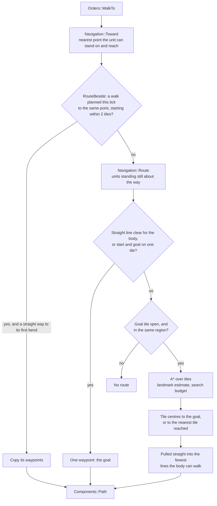
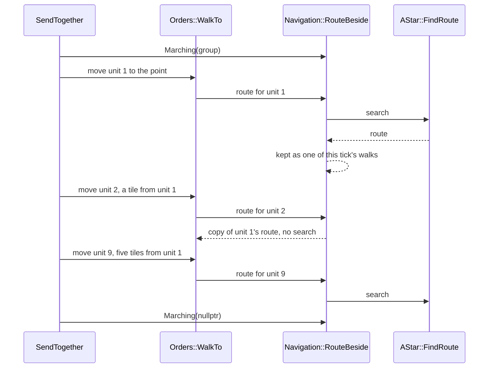
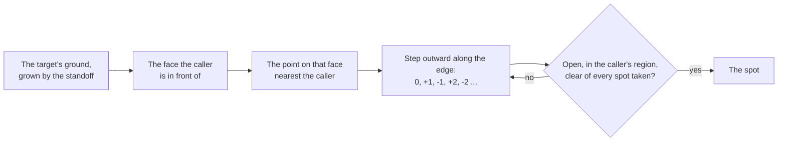

# Movement and routes

In the original game a unit does not hop from tile to tile. It walks at its own
pace in straight lines, goes round buildings, forests and water, slips through
a gap a body wide, stops short of whoever already stands where it was sent and
takes the place beside them. Soldiers sent at one enemy spread round it; a
group sent across the map arrives as a block; villagers at a mine stand along
its face rather than on top of one another.

This page covers how OpenAoK does the same: positions and the tile grid, how a
route is searched for and pulled straight, how units sent together share their
routes, how chases plan again, where a unit stands to work or fight, building
footprints, the walk itself, and formations. Everything here runs inside the
deterministic tick (see [fixed point and determinism](/engine/determinism)), so
every figure is fixed point or an integer.

## Positions and tiles

A unit stands at a continuous fixed-point position (`Components::Transform`),
never snapped to a tile, and keeps its `previous_position` so the renderer can
draw it between ticks. Its body is a box reaching its radius each way from its
middle: the dat's size for the unit (`Navigation::RadiusOf`).

The ground is a grid of tiles (`Physics::Grid`). A tile is one unit across and
centred on its whole-number coordinates, so the tile under a position is the
position rounded:

```cpp
// The tile a world position is on. Tiles are a unit across and centred on
// their whole-number coordinates, so a position rounds to the nearest whole
// number.
inline int TileOf(Core::Fixed32 v) {
    return (v + Core::Fixed32(1) / Core::Fixed32(2)).ToInt();
}
```

Each tile keeps its terrain and elevation and, stored apart because they
change apart, two facts: whether its ground lets a kind of mover on, and
whether something stands on it (a tree, a mine, a building). A felled tree frees
its tile; a dock stands on water. The grid is what route searches read. Nothing
a unit does is rounded to it: "in reach" is always a distance.

### Passability layers

The dat gives every unit a terrain restriction: for each terrain, whether a
unit of that restriction may go there. The grid keeps one passability layer for
each set of terrains the movers in the data allow, up to eight
(`Physics::kMaxLayers`). Restrictions that allow the same grounds share a
layer, so a fishing ship, a galley and a transport all move on one sea. Layer 0
is always land, the villager's.

`Navigation::LayerOf` says which layer a unit moves on, from the rules it plays
by. The layer it hands out carries the owner in its upper bits
(`Physics::Keyed`): a gate's tiles are blocked like any building's, but a land
layer keyed with a player finds the gate open when it is unlocked and belongs
to that player or an ally. Anything that asks without a key (placing a
building, spawning a unit) sees a gate as a wall.

Each layer counts its own changes (`Grid::WalkRevision`), so a tree felled on
land leaves what was worked out for the sea standing.

### Regions

For each layer the route search labels the connected stretches of passable
ground, four ways connected, so that a route which cannot exist is refused at
once without a search. An unlocked gate joins the land on either side of it:
for its owner the way through exists, and an enemy's search finds the gate
shut. The labels are worked out again only when the layer's walkability has
changed, and are kept for up to four grids at once, so worlds run side by side
(a host and its client) keep their own.

Regions answer three questions besides "is there a route": which region a unit
stands in (`Navigation::RegionOf`), whether something can be walked up to from
a region (`Pathfinding::Approachable`, the tile or one beside it is in the
region), and how big a body of water is (`Pathfinding::RegionSize`, which
computer players ask before putting a dock on it).

## Finding a route

Every route in play is asked for through `Navigation::Route`. It gathers the
units standing still about the way (see [who stands in the way](#who-stands-in-the-way)),
then calls `Pathfinding::AStar::FindRoute` with the unit's layer and radius.



### The search

The search is A\* over tiles, eight ways round, never cutting the corner of a
closed tile. Costs are integers so the search is exactly reproducible on every
machine:

| Constant | Value | Meaning |
|---|---|---|
| `kStraight` | 10 | a step along an axis |
| `kDiagonal` | 14 | a diagonal step |
| `kBesideClosed` | 4 | added for a tile beside closed ground, so routes keep a little off walls and trees |
| `kPastStanding` | 40 | added for each unit standing on the tile, so a route goes round a standing crowd when the way round is short and through it when it is not |

```cpp
            int32_t step = i < 4 ? kStraight : kDiagonal;
            if (beside_closed(neighbour, nx, ny)) step += kBesideClosed;
            step += kPastStanding * standing_on(neighbour);
```

Ties are broken the same way everywhere. Each open node is one 64-bit key, its
estimated total cost above its estimate above its tile index, so one integer
comparison orders the heap: the lowest total first, then the lowest estimate,
then the lowest index. Neighbours are visited straights first, in a fixed order.
The search's scratch (scores, parents, closed flags) is one array reused
between searches, cleared by a generation stamp rather than wiped.

### The estimate and landmarks

The plain estimate is the octile distance: the exact cost of an unobstructed
walk with diagonals. Across a lake or round a long cliff it is far too low, and
a search guided by it floods the near shore. So each layer also keeps
**landmarks**: eight tiles round the map's edge (the corners and the middles of
the edges, each moved to the nearest tile of the layer's terrain), and for each
one the distance of every tile from it over the terrain alone, at the search's
own step costs.

Buildings, trees and crowds only ever make a route longer than the terrain
alone, so the difference between a tile's and the goal's distances from a
landmark never overestimates the way between them, yet it knows about the water
and cliffs a straight line crosses. At the start of a search the three
landmarks whose bound is largest for that start and goal are chosen, and the
estimate for a tile is whichever is more, the octile distance or their bounds:

```cpp
    auto estimate = [&](int x, int y, int32_t index) {
        int32_t best = Heuristic(x, y, end_x, end_y);
        const uint16_t* from_here = &landmarks.distance[static_cast<size_t>(index) * kLandmarks];
        for (int c = 0; c < chosen_count; ++c) {
            const int k = chosen[c];
            if (from_here[k] == kFar) continue;
            best = std::max(best, std::abs(static_cast<int32_t>(from_here[k]) - static_cast<int32_t>(goal_from[k])));
        }
        return best;
    };
```

The landmarks are measured when a map is set up (`Pathfinding::Prepare`, also
called at the top of every tick, where it is cheap when nothing has changed)
and measured again only when a tile's terrain changes whether the layer may
cross it, which in play is as good as never. What stands on the ground does
not touch them.

### The budget

A route shorter than 16 tiles (`kShortRoute`, measured as the larger of the two
axes) is searched within 256 tiles plus 64 for each tile of its length
(`kShortBudget`, `kShortBudgetPerTile`); any other within 20,000
(`kMaxExpansions`). A short way blocked by a crowd is walked as far as the
search got, rather than searched round the whole crowd. When the goal is not
reached, the route ends at the tile the search found nearest the goal by its
estimate; when that is the start, there is no route.

### Pulling the route straight

The search gives a chain of tile centres. Starting from the unit's own
position, each point kept is joined to the furthest of the following points it
can see, one after another, so the route becomes the fewest straight lines the
body can walk; the last is the exact destination when it was reached.

"Can see" is `AStar::BodyClear`: the line's middle crosses no closed tile but
at either end, and a body of the unit's radius (at least an eighth of a tile),
tested every quarter of a tile along the line, touches closed ground only where
it already touches it at the start (a villager walking away from its tree) or
comes up against it at the end. The walk itself uses the cheaper
`AStar::MiddleClear`, which asks only about the line's middle.

## Who stands in the way

At the start of every tick, before any order is carried out,
`Navigation::Survey` files every unit's body (its middle, its radius, and
whether it is on its way somewhere) by the tile it stands on, then by entity.
Everything that asks who stands near a point reads a few runs of that one
array; routes, arrivals and the spacing of a walk all use it.

`Navigation::Route` takes in the units standing still within three tiles
(`kStandingReach`) of the box spanning the start and the goal, leaving out the
unit itself, its target, anyone on the move and anyone marching with it. The
search pays `kPastStanding` for each of them on a tile it steps onto. When the
route is pulled straight, a line may go through a standing unit only if the
search walked across its tile, or the unit stands where the walk starts or
ends; past any other, the line must keep half the walker's radius clear of
that unit's box.

### A crowd at the goal

Sending an army to where another army stands is common, and there is no way
round a crowd one is going into. Before the search, the tiles with someone on
them that join the goal's tile (or one beside it), eight ways round, are
gathered. If they cover more than 32 tiles (`kGoRoundCrowd`), they cost nothing
to cross: the route goes straight in, and on arriving each unit stops against
those it comes to. Round a smaller crowd (villagers at a mine), the costs stand
and the route still finds the open side.

## Units sent together

Units given the same order in the same tick all set off at once, so none
should plan round the others as though they stood still, and a block of them
should not each pay for a search across the same ground.

**Marching.** While a group is being sent, `Navigation::Marching` names its
members, and `Route` leaves them out of the standing units it goes round.

**Shared walks.** `Orders::WalkTo` asks for its route through
`Navigation::RouteBeside`. That remembers every walk planned this tick (its
start, goal, layer and body width) and hands a copy of one to a unit going to
exactly the same point, on the same ground, starting within two tiles of it
across and along (`kShareReach`), no wider than the body it was planned for,
and able to walk straight to its first bend. The list is forgotten at the next
survey.

```cpp
    for (const SharedWalk& s : walks) {
        if (s.to.x != to.x || s.to.y != to.y || s.layer != layer || s.radius < radius) continue;
        if (Core::FixedMath::Abs(s.from.x - from.x) > kShareReach ||
            Core::FixedMath::Abs(s.from.y - from.y) > kShareReach) {
            continue;
        }
        if (!Pathfinding::AStar::BodyClear(grid, from, s.path.waypoints.front(), layer, radius)) continue;
        Components::Path path;
        path.waypoints = s.path.waypoints;
        path.goal = s.path.goal;
        path.has_goal = s.path.has_goal;
        return path;
    }
    Components::Path path = Route(registry, grid, entity, from, to);
    if (!path.waypoints.empty()) walks.push_back({from, to, layer, radius, path});
    return path;
```

A computer player's attack group is sent this way. `SendTogether` in
`ai/Military` marks the group as marching and gives each member an ordinary
move order to the same point:

```cpp
void SendTogether(Turn& turn, const std::vector<entt::entity>& units, Vector2D at) {
    static std::vector<entt::entity> group;
    group.assign(units.begin(), units.end());
    std::sort(group.begin(), group.end());
    ECS::Navigation::Marching(&group);
    for (entt::entity u : units) Give(*turn.registry, *turn.grid, Core::MoveCommand{u, at.x, at.y, turn.player});
    ECS::Navigation::Marching(nullptr);
}
```

A block of a hundred soldiers sent this way costs a few searches rather than a
hundred:



A person's group move is a formation move instead (see
[formations](#formations)): each member goes to its own place, so their goals
differ and each plans its own route, but the group is marked as marching, so
none goes round the others.

## Walking a route

`Systems::MovementSystem` moves every unit with a route, once a tick. A unit
walks its speed from its owner's rules (the dat's tiles per second, raised by
technologies) times the tick's share of a second, capped by the route's
`speed_cap` when it marches with slower units. Within a step it lands on each
corner and goes on round it; within a tile of a corner (`kLookAhead`), with
the next one in sight for its body, it cuts the corner.

- **Ground that closes.** Each step's line is checked against the grid. Ground
  closed across it (a building put up, a gate shut) has the route planned again
  from where the unit stands, at most four times on one order (`kMostReplans`),
  after which the order is given up.
- **Walks to something.** A route with a target ends as soon as the unit's box
  is within the route's range of the target's box (`Combat::BoxOf`), less a
  fiftieth of a tile (`kInside`), wherever it has got to, so whoever measures
  the range next finds the walker within it.
- **Keeping apart.** Nobody standing is pushed. A walker bends its own step away
  from any body it would come nearer than three quarters of their two radii
  together (`kKeepApart`), by no more than the step's own length and only onto
  open ground. What would push it back the way it came turns it aside instead,
  so a crowd cannot hold it still for good.
- **Someone on the goal.** A unit sent to a point another already stands on
  stops as it comes up against them, then moves on to the nearest free place
  round the point that it can walk straight to: on square rings 0.7 of a tile
  apart (`kRingSpacing`, the spacing of a formation), out to four rings, at
  most four times. A villager walking to its work keeps the spot its work gave
  it.

### Sent where it cannot stand

A transport sent at the land, a villager sent into the sea, a soldier sent into
a pocket of open ground walled in by trees: `Navigation::Toward` turns the
point into the nearest one the unit can stand on and reach. The point itself
is kept when the unit can stand there and it lies in the unit's own region.
Otherwise the rings round it are searched outward, up to 32 tiles, for the tile
of the unit's region nearest the unit, and the approach planner is asked for the
point on that ring facing it, so the unit comes as near as the ground allows
rather than to a tile's middle.

## Chases

A soldier closing on a moving enemy has to plan again as the enemy moves.
[Combat](/engine/combat) decides when a chase starts and ends; the routing is
here. A chase plans as soon as it starts, then again about every half a second
(`kChaseReplanMs`, 500 ms), or at once when its walk has run out.

**Patch by patch.** The wait depends on where the chaser stands. The map is cut
into patches four tiles square (`kChasePatch`), each given one of eight places
in a cycle, and a patch's wait is 500 ms less a tick (16 ms) for each place:

```cpp
constexpr int kChasePatch = 4;
constexpr int32_t kChaseStaggerMs = 16;
int32_t ReplanWait(const Components::Vector2D& at) {
    const int px = Physics::TileOf(at.x) / kChasePatch;
    const int py = Physics::TileOf(at.y) / kChasePatch;
    return kChaseReplanMs - ((px + 3 * py) & 7) * kChaseStaggerMs;
}
```

A block standing together plans together and can share its routes, while an
army spread over many patches plans over eight different ticks rather than all
in one. The waits for the first four by four patches, in milliseconds:

| | px 0 | px 1 | px 2 | px 3 |
|---|---|---|---|---|
| **py 0** | 500 | 484 | 468 | 452 |
| **py 1** | 452 | 436 | 420 | 404 |
| **py 2** | 404 | 388 | 500 | 484 |
| **py 3** | 484 | 468 | 452 | 436 |

**Planning less.** A chaser more than five tiles from its target
(`kChaseNear`) keeps its walk while the target stays within a tile
(`kChaseDrift`) of where the walk is going, or is a building, which never
moves. When the target has strayed further, the walk's last leg is turned
straight to where the target is now, if the body can go straight there. Only
when neither holds is the chase searched again. Nearer than five tiles, it
plans as often as ever, to find its place round the target among the others.

**Shared chases.** A far chaser takes a route planned in this tick's combat
pass by another far chaser of the same target, on the same ground, for a body
at least as wide, starting within two tiles of it, when it can walk straight to
that route's first bend.

**Lanes.** A group of three or more set on one far target, within eight tiles
of each other (`kGroupReach`), marches abreast rather than in file
(`KeepLane`): each of a chaser's bends is laid off to the side by where the
chaser stands across the group, up to four tiles (`kWidestLane`), less and less
towards the target and not at all within six tiles of it (`kLanesClose`), and
only where the ground lets the body go straight to and from the moved bend.

**Places round the target.** Within three tiles of a unit it fights hand to
hand (`kSurroundNear`), a chaser makes for a place of its own round the
target's body rather than its middle: the approach planner's nearest spot,
clear of where the others set on it stand or are headed, or, every spot taken,
a body's width further out. A building, or a unit standing where the chaser
cannot go (a galley shooting at the shore), is reached the same way at its
edge, so a crowd at a wall spreads along it.

## Standing spots

`Pathfinding::FindStandingSpot` answers one question for every caller that has
to stand beside something rather than on it: where. The caller gives the
ground it is approaching (a building's footprint, a tree's tile, a target's
box), where it stands now, how far outside the ground to stand (its reach plus
its own half-width), how much room it needs, and the spots already spoken for:
where others at work there stand, and where those still walking are headed, so
the answer stays stable while they walk.



The caller's own face is searched first, finely (a quarter of the room a
worker needs per step), so a crowd fills the wall in front of it before anyone
is sent round a corner. Only when that face is full is the whole edge walked,
a worker's width at a step. The nearest point is kept half a worker's width
clear of the corners, so a spot always sits on a face with room beside it. The
answer says not only whether a spot was found but, when none was, whether that
is because the open ground is all spoken for (`full`): a spot will come free,
where a blocked edge never will. Callers then ask again a body's width further
out; a villager waits there for a spot at its work to come free, as the
original's do.

Its callers:

- villagers at a resource, a drop site or a foundation
  (`ApproachGround` in `ecs/systems/WorkerSystem`), each crew mate's spot taken;
- soldiers closing on a target (`PlanChase` in `ecs/Combat`);
- a packed trebuchet making for its range (`ecs/Packing`);
- a unit sent where it cannot stand (`Navigation::Toward`).

## Footprints

A building's footprint is worked out in one place, `ecs/BuildingGeometry`, for
blocking the grid when it is placed, freeing it when it falls, and telling a
villager where its wall is. The dat gives a building's clearance as a
half-extent on each of its own axes. Those axes lie a quarter turn from the
grid's: a piece the dat places at (dx, dy) from a building's middle stands at
(dy, -dx) here (`Buildings::FromDatAxes`), so the dat's x extent is the grid's y
extent. A gate is four tiles along its wall and one across.

The tiles on each axis are twice the half-extent, rounded, at least one. An
even footprint is anchored up and to the left of its origin tile: a two-tile
building covers offsets -1 and 0. The ground it occupies in world units
(`Buildings::Bounds`) is that span of tiles widened by half a tile on every
side, and `Bounds::DistanceFrom` measures how far outside it a point is. A tree
or a mine is the same rectangle round a single tile (`Buildings::TileBounds`),
so anything that approaches ground takes either without caring which.

## Formations

A person's group sent somewhere marches in the formation chosen in the
interface: the move is a `FormationMoveCommand`, carried out by
`MarchInFormation` in `ecs/Orders`. `Formations::Layout`
lays the group out about the point, facing the way it marches (from the
group's middle to the point; a group already there faces down the screen):
those that fight hand to hand in front, those that shoot behind, never sharing
a rank. Neighbours stand 0.7 of a tile apart (`kSpacing`), the spacing units
keep standing, so a formation arrives without anyone shuffling apart.

| Formation | Layout |
|---|---|
| Line | ranks a little wider than deep: the square root of twice the group, rounded up, across |
| Staggered | the same at twice the spacing, every other rank shifted half a gap, against arrows |
| Box | a square, the fighters round the outside and the rest within |
| Flank | two halves either side of the line of march, a gap between them |

Places are dealt out by where the units stand, so none cuts across the rest on
the way: those furthest forward take the front rank, and along each rank from
one side to the other. Every member's route is capped at the slowest member's
speed, so the group stays together. Villagers in the group take no part: they
are given places side by side about the point and walk at their own pace.

Choosing a formation for a group locks it (`Formations::Lock`,
`Components::InFormation`): wherever any of its members is sent, the whole
formation goes, in its own formation when it is the only one sent, until it is
disbanded or another is chosen. A unit that changes sides leaves its
formation; one left alone in a formation is no longer in one.

## Checks

The self-checks (see [verification](/development/verification)) that hold this
behaviour include `planner` (standing spots), `march` (soldiers keep their
width, do not stack, stand round a target and spread along a wall),
`sharedwalk` (a block sent to one point shares its routes), `crowdgoal` (a
route into a big crowd at its goal goes straight in), and `replanspread` (an
army round one enemy spreads its replanning over several ticks):

```sh
cd build && AOE_VERIFY_ONLY=planner,march,sharedwalk,crowdgoal,replanspread ./OpenAoK --verify 10
```

## Where it lives in the code

- [`src/physics/Grid.h`](https://github.com/Zaydme/openaok/blob/main/src/physics/Grid.h): tiles, passability layers, keys and gates
- [`src/pathfinding/Pathfinder.cpp`](https://github.com/Zaydme/openaok/blob/main/src/pathfinding/Pathfinder.cpp): regions, landmarks, `FindRoute`, `BodyClear` and `MiddleClear`
- [`src/pathfinding/ApproachPlanner.cpp`](https://github.com/Zaydme/openaok/blob/main/src/pathfinding/ApproachPlanner.cpp): standing spots round a target's edge
- [`src/ecs/Navigation.cpp`](https://github.com/Zaydme/openaok/blob/main/src/ecs/Navigation.cpp): a unit's layer and radius, the tick's survey, `Route`, `RouteBeside`, `Toward`
- [`src/ecs/systems/MovementSystem.cpp`](https://github.com/Zaydme/openaok/blob/main/src/ecs/systems/MovementSystem.cpp): the walk, replanning, keeping apart, places round a goal
- [`src/ecs/components/Path.h`](https://github.com/Zaydme/openaok/blob/main/src/ecs/components/Path.h): a route, its goal, target, range and speed cap
- [`src/ecs/Orders.cpp`](https://github.com/Zaydme/openaok/blob/main/src/ecs/Orders.cpp): `WalkTo` and `MarchInFormation`
- [`src/ai/Military.cpp`](https://github.com/Zaydme/openaok/blob/main/src/ai/Military.cpp): `SendTogether`, a computer player's group sent at once
- [`src/ecs/Combat.cpp`](https://github.com/Zaydme/openaok/blob/main/src/ecs/Combat.cpp): chase replanning, shared chases, lanes and places round a target
- [`src/ecs/systems/WorkerSystem.cpp`](https://github.com/Zaydme/openaok/blob/main/src/ecs/systems/WorkerSystem.cpp): `ApproachGround`, villagers' spots at their work
- [`src/ecs/BuildingGeometry.cpp`](https://github.com/Zaydme/openaok/blob/main/src/ecs/BuildingGeometry.cpp): footprints and their bounds
- [`src/ecs/Formations.cpp`](https://github.com/Zaydme/openaok/blob/main/src/ecs/Formations.cpp): formation layouts and locked formations
