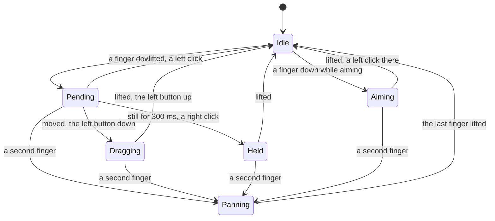
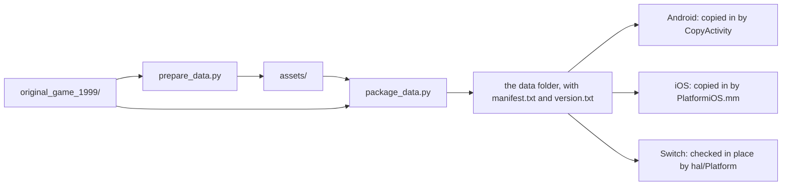

# Platforms

The original game is a Windows program, played with a mouse and a keyboard on
a screen of 800x600, 1024x768 or 1280x1024. OpenAoK plays the same game on
Windows, macOS, Linux, Android phones and tablets, iPhones and iPads, and the
Nintendo Switch, from the same sources in `src/`.

What differs between machines is kept in a few places: the hardware
abstraction layer over SDL 2 (`src/hal/`), a handful of lines per platform at
the top of `main()` in `src/main.cpp`, and each platform's own folder
(`android/`, `ios/`, `switch/`, `windows/`). This page covers the window and the
game's frame, the render driver, the texture limits, the platform layer, the
touch and controller input, and the data folder made for phones and the
Switch. How to build each one is in [Building from source](/development/).

## The window and the game's frame

The game draws into a frame of its own screen size, a render target texture,
and `HAL::Window` shows that frame scaled to fit the window, letterboxed.
Everything above this layer works in the frame's pixels: the interface art is
laid out on them one to one, the mouse is reported in them, and a screenshot
is the frame itself.

| Frame | Size |
|---|---|
| The three screen sizes (`HAL::kScreenSizes`) | 800x600, 1024x768, 1280x1024 |
| The menus | 800x600 (`Screens::kMenuWidth`, `kMenuHeight`) |
| A widescreen frame (`Window::WideWidth`) | The chosen height, as wide as the screen's aspect makes it, never narrower than 4:3 |

Fullscreen, the window is SDL's desktop fullscreen and the frame is scaled into
the display at its native resolution. Windowed, the window opens at the
frame's own size and shows it at one to one. The window asks for high-DPI, so
the frame is scaled into the display's real pixels, and the mouse is mapped
from window points separately. Each frame ends in `Window::Present`:

```cpp
void Window::Present() {
    SDL_SetRenderTarget(renderer, nullptr);
    SDL_SetRenderDrawColor(renderer, 0, 0, 0, 255);
    SDL_RenderClear(renderer);
    int out_w = 0;
    int out_h = 0;
    SDL_GetRendererOutputSize(renderer, &out_w, &out_h);
    SDL_Rect dest;
    Fit(out_w, out_h, dest);
    // A whole-number scale is drawn nearest-neighbour, keeping every pixel
    // square and sharp; any other scale is filtered.
    const bool whole = dest.w % game_w == 0 && dest.h % game_h == 0;
    SDL_SetTextureScaleMode(frame, whole ? SDL_ScaleModeNearest : SDL_ScaleModeLinear);
    SDL_RenderCopy(renderer, frame, nullptr, &dest);
    SDL_RenderPresent(renderer);
    GraphicCache::Get().EndFrame();
    // ...
    Pad::Update();
    TextInput::Update();
}
```

Input goes the other way. `Window::TranslateEvent` rewrites every mouse event
into the frame's pixels before anything else sees it, so no part of the game
deals in window coordinates. Fullscreen, the pointer is confined to the
picture: out of the letterbox bars, and off the strip beside a display's camera
notch, where the mouse is not heard. The same function hands fingers to
`hal/Touch` and controller buttons to `hal/Pad`, and turns Android's back
button into Escape.

## The render driver

SDL 2 picks a renderer by the hint it is given. `main()` sets it once per
platform, before the window opens:

| Platform | Render driver | Also set |
|---|---|---|
| Windows, macOS, Linux | `opengl` | |
| Android | `opengles2` | Landscape either way up, touch controls, the back button trapped |
| Nintendo Switch | `opengles2` | Touch controls, the controller |
| iPhone and iPad | None named: SDL picks its Metal renderer, or OpenGL ES | Landscape either way up, touch controls |

```cpp
#elif defined(__SWITCH__)
    // The Switch has OpenGL ES. Played with the touch screen as on a phone
    // (hal/Touch), and with the controller as a mouse and the game's keys
    // (hal/Pad); hal/Platform has already entered the game's folder.
    SDL_SetHint(SDL_HINT_RENDER_DRIVER, "opengles2");
    HAL::Touch::Enable();
    HAL::Pad::Enable();
#elif defined(__IPHONEOS__)
    // iOS has no desktop OpenGL: SDL picks its Metal renderer, or OpenGL ES,
    // by itself. Held sideways, either way up, and played with the fingers as
    // with a mouse (hal/Touch); hal/Platform has already entered the game's
    // folder in the app's Documents.
    SDL_SetHint(SDL_HINT_ORIENTATIONS, "LandscapeLeft LandscapeRight");
    HAL::Touch::Enable();
#else
    // Desktop: the OpenGL render driver.
    SDL_SetHint(SDL_HINT_RENDER_DRIVER, "opengl");
#endif
    SDL_SetHint(SDL_HINT_RENDER_BATCHING, "1");
```

Render batching is on everywhere, so sprites drawn one after another from the
same texture page go to the GPU together. The renderer is made accelerated,
able to draw into textures, and with vsync unless `--no-vsync` is given. On
start the log's `[HAL] Graphics Driver`, `[HAL] Hardware Accelerated` and
`[HAL] Max Texture Size` lines name the driver SDL chose, whether it is
hardware accelerated, and the largest texture it allows.

## Texture limits

Renderers differ in the largest texture they take: a desktop's GPU usually
allows far more than some phones, which stop at 2048 or 4096 on a side.
`HAL::GraphicCache` reads the renderer's limit when it starts, takes the
smaller of its two sides (16384 when it names none), and never asks for a
texture past it.

The art of the world's graphics goes on texture pages that many graphics
share. A page starts 1024 square and grows as it fills, up to 4096 for art and
2048 for shadows and outlines, but never past the renderer's limit:

```cpp
constexpr int kFirstPageSide = 1024;
constexpr int kPageSide = 2048;
constexpr int kLargestPageSide = 4096;
// ...
void GraphicCache::Sides(int most) {
    most_side = most;
    first_side = std::min(kFirstPageSide, most);
    page_side = std::min(kPageSide, most);
    largest_side = std::min(kLargestPageSide, most);
}
```

Growing a page copies it on the GPU through a render target; a renderer
without render targets gets pages made as big as they may grow from the
first. A graphic whose block of frames is taller than a page may be is placed
in bands of whole shelves, each band a block of its own on a page, and a frame
finds its band by its row (`ArtPlace::BandOf`). An interface or terrain graphic
drawn from a texture of its own is shelved wider instead, doubling its width
while it is too tall and the wider block still fits. The `smalltextures` check
holds a cache to 2048 and draws the tallest graphics from their bands frame
for frame, then to 4096 and draws the interface's tallest graphic shelved
within one texture. How the pages are packed and drawn
is in [Sprites and texture pages](/engine/rendering/sprites).

## The platform layer

`HAL::Platform` holds what differs between machines beyond what SDL covers:

| Function | Does |
|---|---|
| `Start` | Runs first thing in `main()`; false when the game must not go on |
| `WarmArt` | Whether the world's art is decoded before the first frame rather than as it first comes into view: everywhere but the Switch |
| `LogMemory` | What the game has in memory, in the log (Switch) |
| `PrefPath` | The folder for one kind of the player's files: `Profile`, `SaveGame`, `Scenario` and the like |

Every build plays from a folder laid out as the source tree is, with the
engine running in its `build/` and naming every file as `../assets/...`. What
each platform does to get there:

- **Windows, macOS, Linux.** `Start` does nothing: the game is run from
  `build/`. `PrefPath` is SDL's preference folder for OpenAoK.
- **Android.** The APK holds none of the game. Its launcher activity,
  `CopyActivity`, asks for the data folder with the system's folder picker,
  copies it into the app's own storage under `game/`, checking every file
  against the folder's manifest, and then starts `GameActivity`, SDL's activity
  running the engine as `libmain.so`. `main()` enters `game/build` in the app's
  internal storage, and sends what the engine prints to the system log, where
  `adb logcat -s OpenAoK` shows it. `GameActivity` also hands the back gesture
  to the engine as the back key (Escape) and tells it whether a mouse is
  plugged in.
- **iPhone and iPad.** `Start` calls `HAL::iOS::Start` in
  `ios/platform/PlatformiOS.mm`. Until the data is in the app's
  `Documents/OpenAoK-data/`, it shows a setup screen with the system's document
  picker, copies the chosen folder in with a CRC-32 check of every file, and
  then enters the folder's `build/`. `PrefPath` gives folders under
  `Documents`, which the Files app shows. The app uses the UIKit scene life
  cycle, which SDL 2 predates, so `Window::Init` calls
  `HAL::iOS::AttachWindowToScene` right after `SDL_CreateWindow` to put SDL's
  window in the app's scene.
- **Nintendo Switch.** `Start` refuses to run from the Album, which leaves the
  game too little memory, and stops when the data is not beside the `.nro`,
  saying why on the screen. After each copy of the data it reads every file
  once and checks it against the manifest, naming any that are missing or
  damaged; the manifest's time and size, kept in `game/build/checked.txt`, mark
  a copy already checked. What the engine prints goes to nxlink when that
  started the game, and otherwise to `openaok.log` beside the `.nro`. It then
  enters `game/build`. `PrefPath` gives folders beside the `.nro`, and a crash
  is logged as offsets into the `.nro` for `addr2line`.

## Touch controls

On Android, iOS and the Switch's touch screen, the fingers are played as a
mouse: `hal/Touch` turns them into the mouse SDL already reports, so
everything that reads the mouse works unchanged.

| Gesture | Does |
|---|---|
| Tap | A left click where the finger went down |
| Hold still for 300 ms | A right click there, with a short buzz of the phone or the Switch's controller |
| Drag one finger | A left drag: a box round units, a wall laid out |
| Drag two fingers | The map moves under them |
| Pinch | Zoom in and out about the point between the fingers |

A finger may wander 2% of the window's height and still be a tap or a hold.
Each touch goes through a few states:



While something is being aimed (a building waiting to be placed, or an order
waiting for its target) the finger moves the pointer instead and lifting it
clicks there, so a building can be seen and slid into place first. A wall is
not aimed: it is laid by a drag. Two fingers drag the map straight away rather
than eased, and a pinch zooms at once (`Renderer::ZoomBy`).

Some details keep the game playable by hand:

- SDL's own mouse made from the first finger is turned off
  (`SDL_HINT_TOUCH_MOUSE_EVENTS`), and only direct touch screens are taken,
  never a touchpad.
- Two taps on one unit land further apart than two clicks of a mouse, so the
  double-click radius is widened to 64 pixels.
- Edge scrolling waits for a real mouse or a stick: a finger leaves the pointer
  where it lifted, which may well be on an edge. On Android, `GameActivity`
  tells the engine whether a mouse is plugged in.
- On iOS, a finger the system lets go of without telling the app (when a
  system gesture takes the touch over) is forgotten once it has gone
  unreported for 200 ms, so it cannot hold a pan open.

`hal/Pointer` is how the made-up mouse reaches SDL. On Android it calls the
entry point SDL's Java side uses for a real mouse; on the Switch and iOS, where
SDL is linked into the game, it calls SDL's own `SDL_SendMouseMotion` and
`SDL_SendMouseButton`. SDL then keeps the pointer, the buttons and the
double-click count as it does for a real mouse.

## The Switch's controller

`hal/Pad` plays the Switch's controller as a mouse and the game's own hotkeys.
The left stick moves the pointer (at full lean, 1.4 screen heights a second,
with a dead zone of 15% and the lean squared, so a small push moves finely);
the right stick scrolls the map as the arrow keys do, and with ZL held zooms.

| Control | Does | As |
|---|---|---|
| Left stick | Moves the pointer | The mouse |
| Right stick | Scrolls the map; with ZL held, zooms | The arrow keys |
| A | Left button; held while the pointer moves, a drag | The mouse |
| B | Right click | The mouse |
| X | Next idle villager | `.` |
| Y | Escape | Esc |
| L | Go to the Town Center | `H` |
| R | Next idle military unit | `,` |
| ZL, held | Shift: add to a selection, queue orders, train five | Shift |
| ZR | Go to the last notification | Home |
| Plus | Game menu | F10 |
| Minus | Chat, or on a screen with a name to type, the system keyboard | Enter |
| D-pad up | Pause | F3 |
| D-pad down | Go to the selected unit | Space |
| D-pad left, right | Slower, faster | Keypad `-` and `+` |

The keys are pressed as though typed, through SDL's own `SDL_SendKeyboardKey`,
so the game's hotkey table answers them as it answers a keyboard. Text comes
from the system's keyboard (`hal/TextInput`): a chat line or a saved game's
name brings it up straight away, and what is typed on it arrives as though
typed, followed by Enter.

## The data folder for phones and the Switch

A desktop build plays from the data `build.sh` prepares in `assets/`. A phone
or a Switch plays from a folder made on a computer and copied to it, laid out
by `tools/data/package_data.py`, which `android/package.py`, `ios/package.py`
and `switch/package.py` all use:



The folder holds what the engine reads, in the layout of the source tree:

- `assets/`: the prepared tables (`extracted_data`), the installed game
  (`original`) and the terrain's blend masks;
- `original_game_1999/`: the CD's fonts, movies, music, campaigns and bonus
  scenario;
- `fonts/`: Arial, which the CD does not carry, taken from the computer, or
  Liberation Sans, which has Arial's metrics;
- an empty `build/` to run in;
- `version.txt`, the data's version: `STAMP_VERSION` in
  `tools/data/prepare_data.py`;
- `manifest.txt`, one line per file: its CRC-32 in hexadecimal, its size and
  its path, sorted by path.

The phone apps know the data version they play from: Android reads
`STAMP_VERSION` into `BuildConfig.DATA_VERSION` in its Gradle file, and iOS
into `OPENAOK_DATA_VERSION` in `ios/CMakeLists.txt`. They refuse a folder of
another version, and after an update to a build that plays from newer data
they ask for the folder again (Android also offers to play on with the data it
has). Files already in the destination with the same size and time (to within
two seconds, as FAT keeps it) are left alone, so running a package script
again copies only what changed. On a Mac the scripts remove the `._` files
macOS leaves beside each file on a FAT card.

## Windows

The Windows build is made on Linux with MinGW-w64's GCC (posix threads, for
`std::thread`), described to CMake by `windows/mingw-w64.cmake`. The C and C++
runtimes are linked in statically and the sockets come from `ws2_32`, so
`OpenAoK.exe` needs only `SDL2.dll` beside it. The executable also asks
laptops with two GPUs for the faster one, by exporting the symbols NVIDIA's
and AMD's drivers look for. The folder `windows/build.sh` lays out is the
source tree in small: `build\OpenAoK.exe`, the data tools and their dat
dumper, an empty `original_game_1999\`, and `OpenAoK.bat`, which prepares the
data with Python the first time and starts the game in `build\`. The
simulation is the same fixed-point code as on every other platform, so a
Windows build plays the determinism game to the same hash and can join the
others' network games.

## Where it lives in the code

- [`src/hal/Window.cpp`](https://github.com/Zaydme/openaok/blob/main/src/hal/Window.cpp): the window, the game's frame scaled into it, the mouse mapped back
- [`src/main.cpp`](https://github.com/Zaydme/openaok/blob/main/src/main.cpp): the render driver and hints per platform, the Android log
- [`src/hal/GraphicCache.cpp`](https://github.com/Zaydme/openaok/blob/main/src/hal/GraphicCache.cpp): the renderer's texture limit, pages, bands
- [`src/hal/Platform.cpp`](https://github.com/Zaydme/openaok/blob/main/src/hal/Platform.cpp): start-up and folders per machine, the Switch's data check
- [`ios/platform/PlatformiOS.mm`](https://github.com/Zaydme/openaok/blob/main/ios/platform/PlatformiOS.mm): the iOS data copy, the scene delegate, the player's folders
- [`android/app/src/main/java/org/openaok/game/CopyActivity.java`](https://github.com/Zaydme/openaok/blob/main/android/app/src/main/java/org/openaok/game/CopyActivity.java): the Android data copy
- [`android/app/src/main/java/org/openaok/game/GameActivity.java`](https://github.com/Zaydme/openaok/blob/main/android/app/src/main/java/org/openaok/game/GameActivity.java): SDL's activity, the back gesture, the mouse
- [`src/hal/Touch.cpp`](https://github.com/Zaydme/openaok/blob/main/src/hal/Touch.cpp): fingers played as a mouse
- [`src/hal/Pointer.cpp`](https://github.com/Zaydme/openaok/blob/main/src/hal/Pointer.cpp): the made-up mouse handed to SDL
- [`src/hal/Pad.cpp`](https://github.com/Zaydme/openaok/blob/main/src/hal/Pad.cpp): the Switch's controller as a mouse and hotkeys
- [`src/hal/TextInput.cpp`](https://github.com/Zaydme/openaok/blob/main/src/hal/TextInput.cpp): typed text and the system keyboard
- [`tools/data/package_data.py`](https://github.com/Zaydme/openaok/blob/main/tools/data/package_data.py): the data folder, its manifest and version
- [`windows/mingw-w64.cmake`](https://github.com/Zaydme/openaok/blob/main/windows/mingw-w64.cmake): the MinGW-w64 toolchain
