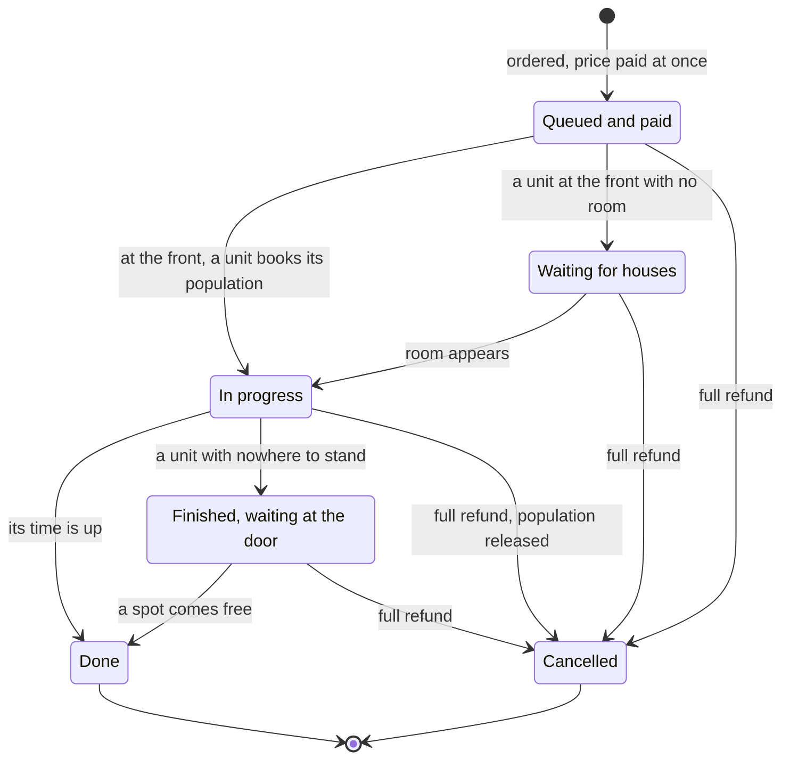
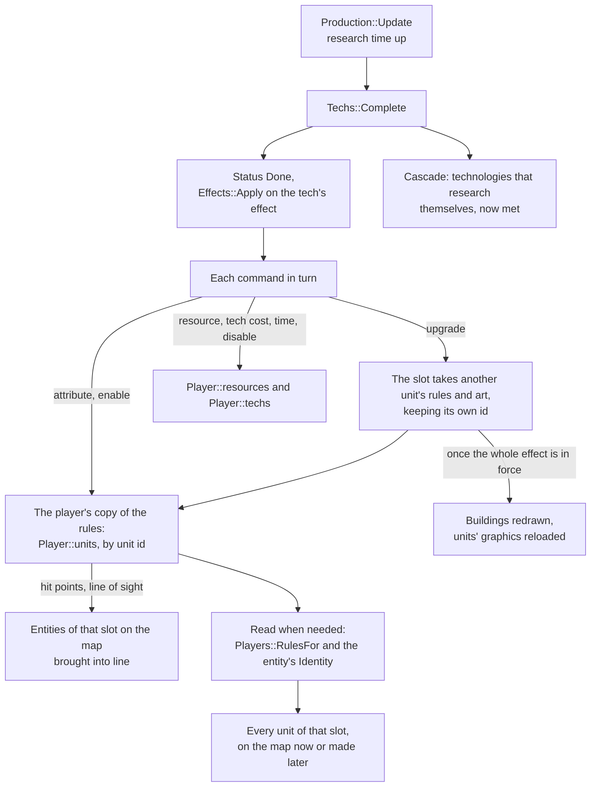

# Training and research

In the original game each building that makes something keeps a queue: a Town
Center trains villagers, a Barracks soldiers, a Blacksmith researches better
armour. A click on a button puts one more in the queue and takes its price at
once. Only the item at the front is worked on; a unit cannot start until its
player has room for it, and while it waits the game says more houses are
needed. A click on a queued item takes it out and gives the whole price back.
A finished unit steps out of the building and goes to its gather point.
Technologies share the same queue. They need the right age and sometimes other
technologies first, and once researched they change the numbers of every unit
they reach, those already in the field among them. The four ages are
technologies too, researched at the Town Center, and each civilisation has its
own bonuses and a tech tree that shuts off what it never gets.

This page covers the production queue and an item's life in it, population
booked as a unit starts, cancelling, the gather point, buildings sharing out
what is ordered at several of them, technologies and their requirements, how
effects change each player's own copy of the rules, the ages, and the
civilisations. Placing and raising buildings is on
[Buildings and construction](/engine/construction); the row of icons at the
map's top left showing what every building is making is described on
[the interface](/engine/interface#the-production-queue-overview).

## The queue

A building's queue is a component, a fixed array inline with the building,
created the first time anything is queued there:

```cpp
// One thing a building has been told to make: a unit to train or a
// technology to research. Both share the one queue, so a Town Center
// researching Loom trains no villagers until it is done.
struct QueueItem {
    int id = -1;          // dat unit id, or dat tech id when `tech`
    bool tech = false;
};

// ...
struct ProductionQueue {
    // How many items one building's queue holds.
    static constexpr int kCapacity = 15;

    QueueItem items[kCapacity] = {};   // front first
    int count = 0;
    // ...
    int32_t progress_ms = 0;
    // ...
    bool training = false;

    // The front unit is waiting for population room: "you need more houses".
    bool housed = false;
};
```

`progress_ms` is how far the front item is through, in milliseconds of
simulation time; the dat states train and research times in whole seconds.
`training` says the front item has started, and `housed` that a unit at the
front is waiting for room.

## Queueing

An order to train is a `TrainCommand` naming the building, the unit and the
player; an order to research is a `ResearchCommand`. `ecs/Orders` hands them to
`Production::Enqueue` and `Production::EnqueueTech`, which decide inside the
tick whether the item may be queued. Nothing in the module names a unit, a
building or a technology: what a building makes is in the player's own copy of
the rules.

```cpp
    const R::UnitRules* rules = Players::UnitOf(registry, player, unit_id);
    if (rules == nullptr || rules->train_loc != here) return Refusal::NotProducedHere;
    if (!rules->enabled) return Refusal::Unavailable;

    auto& queue = registry.get_or_emplace<Components::ProductionQueue>(building);
    if (queue.count >= Components::ProductionQueue::kCapacity) return Refusal::QueueFull;
    Players::Player* p = Players::Find(registry, player);
    if (p == nullptr || !Players::CanPay(*p, rules->costs, rules->cost_count)) {
        return Refusal::CannotAfford;
    }

    Players::Pay(*p, rules->costs, rules->cost_count, -1);
    queue.items[queue.count++] = Components::QueueItem{unit_id, false};
    return Refusal::None;
```

| `Refusal` | Why |
|---|---|
| `NoSuchBuilding` | The entity is not a building |
| `NotOwned` | The building is not the player's |
| `NotFinished` | The building is still going up |
| `NotProducedHere` | The unit's train location, or the technology's location, is not this kind of building |
| `Unavailable` | The unit is not enabled for the player, or the technology is not available (below) |
| `QueueFull` | Fifteen items are queued already |
| `CannotAfford` | The player does not hold every paid slot of the price |

The price is paid when the item is queued, so a queue only ever holds what the
player could afford at the time. A technology queued is marked as being
researched, so it cannot be queued a second time anywhere. A refused order
changes nothing.

## A queue item's life

`Production::Update` runs at step 23 of the tick. For each finished building
with anything queued, it advances the front item by the tick's 16 ms.



A technology never waits: it needs no room and no doorstep, and goes straight
from the front of the queue to being researched.

### Population is booked when a unit starts

A unit's population cost is the unpaid headroom slot of its price
(`Population::CostOf`); how the player's room is kept is on
[houses and population room](/engine/construction#houses-and-population-room).
Room is checked when a unit starts, not when it is queued, and from then on
it is booked: `Population::Used` counts every unit in training at the front of
one of the player's queues along with the units it has, so two buildings can
never each start a unit into the same last free slot. `Production::Update`
takes each player's population once at the start of its pass and books
against it as units start:

```cpp
        // Starting needs a free population slot, and takes it.
        if (!queue.training) {
            const int p = population_of(owner);
            const int cost = Population::CostOf(*rules);
            if (used[p] + cost > capacity[p]) {
                // ...
                queue.housed = true;
                continue;
            }
            used[p] += cost;
            queue.training = true;
            queue.housed = false;
        }
```

A unit with no room waits at the front of its queue, `housed`, and starts in
the first tick there is room: a House finished, a unit lost. The first of a
player's buildings to start waiting while none of its others is waiting tells
the player, through a `Halted` event: the interface prints that more houses are
needed, or that the population limit is reached when the player's room is
already at the lobby's limit, and plays the sound for it. The rest say nothing
until all have gone on. The selected building's panel also shows the want of
houses under its queue.

### Finishing a unit

A unit takes its train time from the owner's rules, which technologies may
have changed. When its time is up it steps out beside the building
(`Buildings::Doorstep`): against the front wall, the side towards the bottom of
the screen, beside anyone already standing there, on the ground of its own
layer, so a ship launched from a Dock comes out on the water side. If every
bit of wall is blocked, it waits, finished, until there is somewhere to stand.

Units that come out and technologies that complete change the world, so they
are collected during the pass and carried out after it. Each unit is spawned
with `Units::Spawn`; a villager comes out male or female at one chance in two
from the world's seeded generator, the female being a unit of her own. A
`Born` event goes into the log, and the unit sets off for the building's
gather point, if it has one.

### Finishing a technology

A technology finished at a building is completed by `Techs::Complete`, named
with the building that researched it (see [Researching](#researching)). With
the `aegis` cheat whatever a building makes is done at once.

## Cancelling

A `CancelTrainCommand` names the building and the slot. `Production::Cancel`
refunds the item's full price, takes it out and closes the queue up behind it.
A technology taken out becomes available again. Taking out the item at the
front starts the next one from nothing, and releases the population a unit
had booked, since only a started unit counts as in training:

```cpp
    Refund(registry, player, queue.items[slot]);
    for (int i = slot; i + 1 < queue.count; ++i) queue.items[i] = queue.items[i + 1];
    --queue.count;

    // Taking out the item in progress starts the next one from nothing, and
    // releases the population a unit had booked.
    if (slot == 0) {
        queue.progress_ms = 0;
        queue.training = false;
        queue.housed = false;
    }
```

`Production::Abandon` cancels everything in a queue, from the back, when its
building is torn down (`Buildings::Destroy`) or changes hands, so a building
lost in battle gives back what it was making.

## The gather point

A `RallyCommand` sets where a building sends what it trains, kept on the
building as a `RallyPoint`: a point on the map, and whatever was under the
cursor there. Set on the building itself, it is taken away. A unit coming out
goes to it through `Orders::FollowRally`: a unit rallied onto something it can
gather goes and gathers it, so a villager rallied onto a tree cuts it; a trade
unit rallied onto a foreign Market or Dock starts trading with it; anything
else walks to the point.

## Several buildings at once

With several buildings of a kind selected, OpenAoK shares out what is ordered
among them, one of its [additions](/guide/improvements) to the original. The
interface commands a finished building of the selection
(`Selection::Commanded`; a foundation only when nothing finished of its kind
is selected with it) and sends the others with the order, oldest first
(`Selection::Alike`). Each order then goes to whichever of them all may take it
with the fewest items queued:

```cpp
entt::entity FewestOfKind(const entt::registry& registry, entt::entity first,
                          const std::vector<entt::entity>& others, int location, Core::PlayerId player) {
    entt::entity best = entt::null;
    int fewest = Components::ProductionQueue::kCapacity;
    auto consider = [&](entt::entity building) {
        int here = -1;
        if (CheckBuilding(registry, building, player, here) != Refusal::None || location != here) return;
        const auto* queue = registry.try_get<Components::ProductionQueue>(building);
        const int count = queue != nullptr ? queue->count : 0;
        if (count < fewest) {
            fewest = count;
            best = building;
        }
    };
    consider(first);
    for (entt::entity building : others) consider(building);
    return best;
}
```

`Production::Fewest` calls it with the unit's train location and
`Production::FewestForTech` with the technology's location. A building must be
the player's, finished and of the right kind; a full queue is never chosen, and
on a tie the earliest considered wins, the commanded building first. Units
ordered one at a time at three Barracks therefore go one to each in turn, and
three technologies ordered at three Blacksmiths one to each. When none may
take it, the order goes to the commanded building, which refuses it in the
usual way.

## Technologies

In the original a technology is researched at a building, for a price and a
time; its button shows only once the player could research it, and it is
never researched twice.

### Where each technology stands

Each player keeps a `TechStatus` for every technology: its state, and its own
copy of the price and the research time, since effects change those per player
(a civilisation's bonus can make technologies cheaper). They start as the
dat's:

```cpp
            std::copy(std::begin(tech.costs), std::end(tech.costs),
                      std::begin(status.costs));
            status.cost_count = tech.cost_count;
            status.time = tech.time;
            // Another civilisation's own technology is never this one's.
            if (tech.civ >= 0 && tech.civ != chair.civ) {
                status.state = TechState::Disabled;
            }
```

| `TechState` | Meaning |
|---|---|
| `Locked` | Not researched; whether it is available is its requirements' answer |
| `Researching` | Queued at a building and paid for |
| `Done` | Researched |
| `Disabled` | The civilisation's tech tree, or another effect, forbids it |

### Requirements

The dat gives a technology a list of required technologies and a count of how
many of them must be done:

```cpp
bool RequirementsMet(const Players::Player& player, const R::TechRules& tech) {
    int done = 0;
    for (int i = 0; i < tech.required_listed; ++i) {
        const int required = tech.required[i];
        if (required >= 0 && required < static_cast<int>(player.techs.size()) &&
            player.techs[required].state == Players::TechState::Done) {
            ++done;
        }
    }
    return done >= tech.required_count;
}
```

A technology is available (`Techs::Available`) when it is `Locked` and its
requirements are met. One that no building researches (its location is -1) is
researched by itself the moment its requirements are met: after every
technology completed, `Cascade` looks for such technologies and researches
them, over and over until nothing more completes, since one completing can
satisfy another. That one rule builds the whole progression out of the data:

- a finished building researches its own technology, if it has one
  (`Techs::BuildingFinished`): a Mill researches its "shadow" technology;
- the node for the Feudal Age needs two of those shadow technologies, so it
  completes itself when the second qualifying building stands;
- the Barracks is made available by a technology that needs only the Dark Age,
  so it completes at the start and its effect enables the Barracks;
- a technology with nothing listed and a count of zero has nothing to wait for
  and completes at the start: the Dark Age itself, and most of each
  civilisation's own bonuses;
- one with nothing listed and a count of one can only be triggered, as a
  building's own technology is.

### Researching

What a building offers is `Techs::ResearchableAt`: every technology the dat
places at that building that is available to the player now, in id order. The
command panel draws those buttons from it, and queueing asks the same. The
next age is the one exception: the Town Center shows its button from the
start, greyed until its requirements are met (`Techs::NextAgeTech`).

A queued technology takes the research time in the player's `TechStatus`.
When it is up, `Techs::Complete` marks it done and applies its effect, puts a
`Researched` event into the log, and cascades. Every technology done, by a
building or by itself, is counted by the score after its effect is applied.

## Effects on the rules

In the original a technology changes a player's units: Loom gives villagers
more hit points, an armour technology more armour, and an upgrade turns every
Militia into a Man-at-Arms, those already in the field too. All of it is the
dat's effects: an effect is a list of commands, and every technology, age,
civilisation bonus and tech tree is some list of them.

### Each player's own copy

Each player plays from its own copy of the unit rules, made when the world is
built: the same numbers for every civilisation, enabled where its own table
enables them.

```cpp
        // The unit rules, as this civ starts them: the same numbers for every
        // civ, enabled where its own table enables them.
        player.units = rules.units;
        for (auto& unit : player.units) unit.enabled = false;
        for (int id : civ->enabled) {
            if (id >= 0 && id < static_cast<int>(player.units.size())) {
                player.units[id].enabled = true;
            }
        }
```

`Players::UnitOf` gives a player's current rules for a unit id. An entity's
rules are `Players::RulesFor`: its owner's table, or, for a unit converted from
another side, its maker's (the `RulesOf` component; see
[changing sides](/engine/combat#changing-sides)). A unit's speed, attack,
armour and range are not copied onto it: they are read from the table when
needed, so a technology researched later reaches every unit already on the
map.

```cpp
const R::UnitRules* DefendingRules(const entt::registry& registry, entt::entity entity) {
    const auto* identity = registry.try_get<Components::Identity>(entity);
    if (identity == nullptr) return nullptr;
    return Players::RulesFor(registry, entity, identity->unit_id);
}
```

### The commands

`Effects::Apply` runs an effect's commands in order. Each has the dat's four
fields A, B, C and D, meaning different things by type:

| Type | `Rules::EffectType` | What it changes |
|---|---|---|
| 0 | `SetAttribute` | Attribute C of unit A, or of every unit of class B when A is -1, set to D |
| 4 | `AddAttribute` | The same, D added |
| 5 | `MultiplyAttribute` | The same, multiplied by D |
| 1 | `Resource` | Resource A set to D when B is 0, else D added |
| 6 | `MultiplyResource` | Resource A multiplied by D |
| 2 | `EnableUnit` | Unit A enabled when B is not 0, else disabled |
| 3 | `UpgradeUnit` | Unit A's slot takes unit B's rules and art |
| 101 | `TechCost` | Technology A's cost in resource B set to D when C is 0, else D added |
| 103 | `TechTime` | Technology A's research time set to D when C is 0, else D added |
| 102 | `DisableTech` | Technology D disabled, unless it is done |

The attributes are hit points, line of sight, speed, armour and attack, reload
time, range, work rate, carrying capacity, the costs, the train time and the
rest of what a technology can change in `UnitRules`. Attack and armour pack a
class and an amount into D as class × 256 + amount. A result stored into a
whole-number field is cut towards zero: a multiplier of 0.33 on a price of 30
gives 9. Resources are the player's whole resource table, not only the four
stockpiles: the same table holds the population headroom, the current age and
the food a new Farm holds, so an effect raising a Farm's food is a resource
command.

### An upgrade keeps the identity

An upgrade does not change what the entities are. The player's slot for the
old unit takes the numbers and art of the new one, and keeps its own id, which
is what the rest of the data names: a Feudal Age Town Center is still the
Town Center's slot, so it still trains villagers, still takes their
deliveries and still researches the Castle Age.

```cpp
    const int old_max = player.units[from].hp;
    const bool enabled = player.units[from].enabled;
    player.units[from] = player.units[to];
    player.units[from].enabled = enabled;
    player.art[from] = player.art[to];

    auto& cfg = Core::ConfigManager::Get();
    for (auto entity : EntitiesOf(registry, player.id, from)) {
        RefreshVitals(registry, entity, old_max, player.units[from]);
        if (registry.all_of<Components::Building>(entity)) {
            if (upgraded == nullptr) Buildings::RefreshArt(registry, entity);
        } else if (auto* anim = registry.try_get<Components::Animation>(entity)) {
            Systems::AnimationSystem::LoadSet(*anim, cfg.GetUnitDatName(player.art[from]));
        }
    }
    if (upgraded != nullptr) upgraded->push_back(from);
```

Every entity keeps its `Identity`, the base unit id, for its whole life.
`Players::ArtOf` says whose art a slot wears now.

### Bringing the map into line

The rules change first; then whatever is already on the map that the change
reaches is brought into line. Only what an entity keeps of its own needs it:

- **Hit points** follow the change in the maximum: a villager at 10 of 25
  researching Loom stands at 25 of 40.
- **Sight** follows line of sight.
- **Buildings** of an upgraded slot are redrawn once the whole effect is in
  force, together with buildings drawn from pieces the effect upgraded, since
  an age upgrades a Town Center and then, separately, the units its pieces are
  drawn from.
- **Units** of an upgraded slot load the new unit's graphics.



## The four ages

The ages are technologies researched at the Town Center. Each civilisation's
table names which technology each age is, in a resource of its own, and the
player's age is its current age resource, which each age's effect sets:

| Age | `Techs::Age` | Civ table resource naming it |
|---|---|---|
| Dark Age | 0 | 58 (`Res::DarkAgeTech`) |
| Feudal Age | 1 | 25 (`Res::FeudalAgeTech`) |
| Castle Age | 2 | 23 (`Res::CastleAgeTech`) |
| Imperial Age | 3 | 24 (`Res::ImperialAgeTech`) |

The Dark Age has no requirements and completes at the start. The Feudal Age
needs the Dark Age and the node for age two, which two qualifying Dark Age
buildings complete; the Castle Age and the Imperial Age each need the age
before and a node of their own, met by buildings of the age before. An age's
effect also upgrades the player's buildings to the new age's (the Town Center
and the units its pieces are drawn from, the House and others), so they are
redrawn in its art, and a building placed later is placed as the upgraded
slot.

`Techs::Start` begins each player off. It applies the civilisation's tech tree,
researches everything that researches itself, then advances the player to the
lobby's starting age (or a scenario seat's own), researching each age in turn:

```cpp
    if (const R::CivRules* civ = R::Civ(player->civ); civ != nullptr) {
        if (!all_techs) {
            Effects::Apply(registry, player_id, civ->tech_tree);
        } else if (const R::Effect* own = R::EffectById(civ->tech_tree)) {
            for (const R::EffectCommand& command : own->commands) {
                if (!AllTechsLifts(command)) Effects::ApplyCommand(registry, player_id, command);
            }
        }
    }
    Cascade(registry, player_id);

    // Up to the lobby's starting age, researching each age in turn.
    for (int age = 0; age < kAges && age <= starting_age; ++age) {
        const int tech = AgeTech(registry, player_id, age);
        Players::Player* p = Players::Find(registry, player_id);
        if (p == nullptr || tech < 0 || tech >= static_cast<int>(p->techs.size())) break;
        if (p->techs[tech].state != Players::TechState::Disabled) {
            Research(registry, *p, tech);
            Cascade(registry, player_id);
        }
    }
```

A computer player at the Hardest difficulty is given 500 of each of food,
wood, stone and gold with every age it reaches, the Dark Age it starts in
among them (see [Computer players](/engine/ai)).

## Civilisations

A civilisation's differences are all in the dat:

- **Its tech tree** is an effect applied first at the start. It disables the
  units and buildings the civilisation never gets and the technologies it
  never researches, including other civilisations' bonuses that would
  otherwise complete at the start.
- **Its bonuses** are technologies that no building researches, tied to it in
  the dat (`TechRules::civ`). Most have no requirements and complete at the
  start, such as the Teutons' cheaper Farms and the Franks' cheaper Castles;
  others wait on an age and complete themselves when it comes. Another
  civilisation's own technology is disabled for a player from the moment its
  table is made.
- **Its team bonus** is an effect its team-mates receive. After the starting
  technologies, `Diplomacy::ApplyTeamBonuses` gives each player on a team the
  team bonus of every civilisation on that team, its own among them, once
  each.

With the lobby's All Techs, the tech tree is not applied in full: what it shuts
of what a player chooses (a unit or a building to make, a technology a building
researches, the technologies that only make units available) is left open to
every civilisation. The commands that switch off other civilisations' bonuses
are kept, and the dat ties each civilisation's bonuses and unique technologies
to it (`TechRules::civ`), so those stay its own.

The technology tree screen shows the dat's own table for that screen, laid out
for the civilisation shown, with what the civilisation cannot have marked
(`screens/TechTree`, from `techtree.json`).

## In the interface

The command panel of a finished building offers every unit enabled for the
player whose train location is that building, the gather point when it trains
anything, and the technologies `Techs::ResearchableAt` gives, with the next age
greyed at the Town Center until it may be researched. A selected building's
panel shows its queue in place of its owner's name, with a bar under the first
item showing how far it has got against `Production::FrontDuration`, and a line
saying more houses are needed while it waits for room. The row of everything
the player's buildings are making is on
[the interface](/engine/interface#the-production-queue-overview).

## Where it lives in the code

- [`src/ecs/components/ProductionQueue.h`](https://github.com/Zaydme/openaok/blob/main/src/ecs/components/ProductionQueue.h), [`RallyPoint.h`](https://github.com/Zaydme/openaok/blob/main/src/ecs/components/RallyPoint.h): a building's queue and its gather point
- [`src/ecs/Production.h`](https://github.com/Zaydme/openaok/blob/main/src/ecs/Production.h), [`Production.cpp`](https://github.com/Zaydme/openaok/blob/main/src/ecs/Production.cpp): queueing and its refusals, the queue's advance, cancelling, `Fewest` and `FewestForTech`
- [`src/ecs/Population.h`](https://github.com/Zaydme/openaok/blob/main/src/ecs/Population.h), [`Population.cpp`](https://github.com/Zaydme/openaok/blob/main/src/ecs/Population.cpp): population cost, population used with units in training, room
- [`src/ecs/Techs.h`](https://github.com/Zaydme/openaok/blob/main/src/ecs/Techs.h), [`Techs.cpp`](https://github.com/Zaydme/openaok/blob/main/src/ecs/Techs.cpp): requirements, availability, completing and cascading, the ages, the start
- [`src/ecs/Effects.h`](https://github.com/Zaydme/openaok/blob/main/src/ecs/Effects.h), [`Effects.cpp`](https://github.com/Zaydme/openaok/blob/main/src/ecs/Effects.cpp): the effect commands, upgrades, bringing the map into line
- [`src/ecs/Players.h`](https://github.com/Zaydme/openaok/blob/main/src/ecs/Players.h), [`Players.cpp`](https://github.com/Zaydme/openaok/blob/main/src/ecs/Players.cpp): each player's resources, copy of the unit rules, art and technology statuses; `UnitOf`, `RulesFor`, paying
- [`src/ecs/Diplomacy.cpp`](https://github.com/Zaydme/openaok/blob/main/src/ecs/Diplomacy.cpp): team bonuses
- [`src/core/Rules.h`](https://github.com/Zaydme/openaok/blob/main/src/core/Rules.h): the dat's technologies, effect commands, attributes and civilisations
- [`src/core/Command.h`](https://github.com/Zaydme/openaok/blob/main/src/core/Command.h), [`src/ecs/Orders.cpp`](https://github.com/Zaydme/openaok/blob/main/src/ecs/Orders.cpp): the train, research, cancel and gather point orders; `FollowRally`
- [`src/ecs/Selection.h`](https://github.com/Zaydme/openaok/blob/main/src/ecs/Selection.h): the building commanded and the others of its kind selected with it
- [`src/rendering/UIRenderer.cpp`](https://github.com/Zaydme/openaok/blob/main/src/rendering/UIRenderer.cpp): the command panel's buttons and a selected building's queue
- [`src/screens/TechTree.cpp`](https://github.com/Zaydme/openaok/blob/main/src/screens/TechTree.cpp), [`TechTreeLayout.cpp`](https://github.com/Zaydme/openaok/blob/main/src/screens/TechTreeLayout.cpp): the technology tree screen
- [`src/verify/Production.cpp`](https://github.com/Zaydme/openaok/blob/main/src/verify/Production.cpp), [`QueueSplitCheck.cpp`](https://github.com/Zaydme/openaok/blob/main/src/verify/QueueSplitCheck.cpp), [`Techs.cpp`](https://github.com/Zaydme/openaok/blob/main/src/verify/Techs.cpp), [`PopulationCheck.cpp`](https://github.com/Zaydme/openaok/blob/main/src/verify/PopulationCheck.cpp): self-checks for training, sharing out orders, technologies and population
