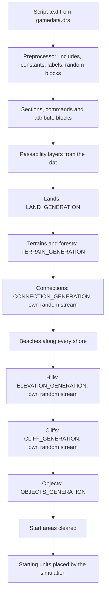
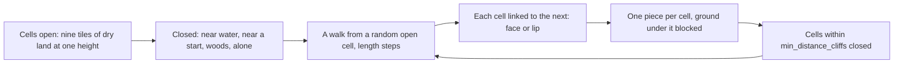

# Random maps

A random map in *The Age of Kings* is made fresh for every game by a random map
script: an `.rms` text file in `gamedata.drs` that says which lands to grow,
which terrains to lay over them, where hills and cliffs go and what to scatter
on the ground. The same script with another seed gives another map of the same
kind; Arabia always looks like Arabia, never twice the same.

OpenAoK reads the original scripts and carries them out itself. This page
covers the script language and its parser, the order in which a map is built,
each stage (lands, terrains, connections, shores, hills, cliffs, objects), and how the seed
makes the result the same on every machine.

## Where the scripts come from

The lobby's map name ("Arabia", "BlackForest", "TeamIslands") is looked up in
the list `random_map.def` opens with, which gives the script's entry in
`gamedata.drs` (`ConfigManager::RmsScriptId`). The text is read from the
archive and parsed with the lobby's seed; if it cannot be read, a built-in
noise generator stands in.

The map is square, its side the lobby's size. The game also defines a label for
the size, which scripts test with `if`:

| Lobby size | Tiles across | Label |
|---|---|---|
| Tiny | 120 | `TINY_MAP` |
| Small | 144 | `SMALL_MAP` |
| Medium | 168 | `MEDIUM_MAP` |
| Normal | 200 | `LARGE_MAP` |
| Large | 220 | `HUGE_MAP` |
| Giant | 240 | `GIGANTIC_MAP` |

From the command line, `--map NAME`, `--size SIZE` and `--seed N` choose the
script, the size and the seed.

## The script language

A script is plain text. Comments are `/* ... */`. Each line is a statement: its
first word is the command and the rest are its arguments. A word in angle
brackets on a line of its own starts a section, and a `create_*` command can be
followed by a block in braces whose lines are its attributes.

A preprocessor runs first:

| Directive | Effect |
|---|---|
| `#const NAME 12` | A named number; every later argument that is the name becomes the number |
| `#define NAME` | Sets a label |
| `#include_drs file 12345` | Reads the archive entry with that id in place (every script includes `random_map.def`'s constants this way) |
| `if NAME` ... `elseif NAME` ... `else` ... `endif` | Keeps the first branch whose label is set |
| `start_random` ... `percent_chance 30` ... `end_random` | Keeps exactly one branch, chosen by weight |

An illustration of the syntax, written for this page rather than taken from
the game's scripts (`WATER`, `GRASS` and `GOLD` are constants `random_map.def`
defines; `WIDE_SEA` is a label of the illustration's own):

```text
/* Illustration only. */
start_random
percent_chance 50
#define WIDE_SEA
end_random

<LAND_GENERATION>
base_terrain WATER
create_player_lands
{
  terrain_type GRASS
  land_percent 50
  base_size 10
  other_zone_avoidance_distance 8
}

<OBJECTS_GENERATION>
create_object GOLD
{
  number_of_objects 6
  set_gaia_object_only
  set_place_for_every_player
  set_tight_grouping
  min_distance_to_players 12
  max_distance_to_players 16
}
```

`RMSParser::Expand` walks the text once, keeping a stack of open conditions,
and emits only the lines that survive. A random block rolls once, from the
map's seed and how deeply the block is nested, so exactly one of its branches
is kept:

```cpp
        if (head == "if" || head == "start_random") {
            Frame frame;
            frame.random = (head == "start_random");
            if (frame.random) {
                // One roll for the whole block, so exactly one branch is taken.
                Random rng(pre.seed ^ (0x9E3779B97F4A7C15ULL * (stack.size() + 1)));
                frame.roll = static_cast<int>(rng.NextInt(100));
                frame.emitting = false;   // nothing until the first branch
            } else {
                frame.emitting = line.size() >= 2 &&
                                 pre.defines.count(line[1]) != 0;
                frame.taken = frame.emitting;
            }
            stack.push_back(frame);
            continue;
        }
```

`RMSParser::Parse` then groups the surviving lines into an `RMSScript`:
sections, each a list of `RMSCommand`s with their arguments and attribute
blocks. Constant names have already become numbers, so `RMSCommand::Value` and
`RMSCommand::Attribute` read integers; an attribute written with no value (a
flag such as `set_tight_grouping`) reads as 1.

## The sections

| Section | What OpenAoK does with it |
|---|---|
| `<PLAYER_SETUP>` | `random_placement`, the only setup the game's scripts use: the players' starts are placed round the map in a random order, from the player lands |
| `<LAND_GENERATION>` | `base_terrain`, `create_player_lands` and `create_land`, in `core/LandGenerator` |
| `<ELEVATION_GENERATION>` | `create_elevation`, in `core/Elevation` |
| `<CLIFF_GENERATION>` | The cliff figures, in `core/Cliffs` |
| `<TERRAIN_GENERATION>` | `create_terrain`, in `core/MapGenerator` |
| `<CONNECTION_GENERATION>` | `create_connect_all_players_land` and `create_connect_teams_lands`, in `core/Connections` |
| `<OBJECTS_GENERATION>` | `create_object`, in `core/MapGenerator` |


## The order of generation

`MapGenerator::GenerateFromScript` runs the stages in a fixed order, whatever
order the script writes its sections in:



Hills come before cliffs because a cliff runs only over ground of one height,
and both come before the objects so nothing is placed on a cliff.

## Lands

The land pass gives the map its shape. Every tile starts as `base_terrain`.
Each land is a blob of one terrain grown from an origin:

- **Player lands** (`create_player_lands`): one per player. A `land_percent`
  is shared between them; a `number_of_tiles` is each one's.
- **Other lands** (`create_land`): at `land_position` (in percent of the map)
  if the script gives one, otherwise anywhere inside their borders. A land can
  be given to a player (`assign_to_player`) and an id objects can ask for
  (`land_id`; a player land's id is its player's number).

Every land first takes a square of `base_size` tiles out from its origin each
way. Then all of them grow together, a tile at a time each in turn, until each
has its share of the map or nowhere left to go:

```cpp
    // Takes the base square about each origin, then grows every land in turn.
    void Run(Random& rng) {
        for (size_t l = 0; l < lands_.size(); ++l) Seed(static_cast<int>(l));
        bool growing = true;
        while (growing) {
            growing = false;
            for (size_t l = 0; l < lands_.size(); ++l) {
                if (Step(static_cast<int>(l), rng)) growing = true;
            }
        }
    }
```

Each step draws a few candidates from the land's frontier (one, and one more
for every four of `clumping_factor`) and takes the one most surrounded by the
land's own tiles, so a high clumping factor gives compact lands and a low one
ragged ones. A land stays inside its borders (`left_border` and the rest, in
percent of the map); within four tiles of a border the script set, a tile is
taken only by chance, likelier the higher `border_fuzziness` and the further
in.

A land also keeps `other_zone_avoidance_distance` tiles from any land of
another zone. That is what makes islands: each player land is a zone of its
own unless the script puts them together (`zone`, `set_zone_by_team`,
`set_zone_randomly`), and the base terrain (water, on an island map) stays
between them.

| Attribute left out | Default |
|---|---|
| `base_size` | 3 |
| `clumping_factor` | 8 |
| `border_fuzziness` | 20 |

The players' origins are spaced evenly round an ellipse inside the player
lands' borders (`PlaceSeats`), in seat order from a random starting bearing.
The bearings come from a sixteen-step table of integer sines and cosines, so
there is no floating point and the same seed always gives the same starts.
Finally every tile is painted with the terrain of the land that took it, or
the base terrain if none did.

## Terrains

`create_terrain` lays clumps of one terrain over another: forests on grass,
desert patches, ponds. The terrain replaced is the attribute `base_terrain`,
or the map's base terrain if the attribute is left out.

- The size is `land_percent` of the map or `number_of_tiles`, broken into
  `number_of_clumps` blobs of equal budget.
- `set_scale_by_size` and `set_scale_by_groups` scale the tiles or the clumps
  against a 100 by 100 map: a figure is multiplied by the map's tiles over
  10,000.
- `spacing_to_other_terrain_types` keeps every tile that many tiles from any
  ground that is neither the one replaced nor the one laid, which keeps deep
  water off a coast.
- `set_avoid_player_start_areas` keeps clumps out of a circle round each
  start: the player lands' `base_size` (9 if the script gives none) plus four
  tiles.

Each clump starts from a random tile of the replaced terrain (24 tries) and
grows by taking a random tile from its frontier, so it follows the shape of the
ground it replaces. A terrain whose art carries a tree on every tile (a forest)
has a tree planted on each tile it took, holding the wood the Gaia unit table
gives that tree.

Painting a tile sets its terrain and whether it can be walked; the cell of the
terrain's tiling pattern it draws follows from its place when it is drawn (see
[terrain](/engine/rendering/terrain)).

## Connections

A map's lands are made to grow apart: forest closes round each clearing on
Black Forest, rivers part the players on Rivers. The connections then lay a
path between every two lands that are to be joined, so they can be reached:

- `create_connect_all_players_land` joins every player's land to every
  other's, `create_connect_teams_lands` the lands of players on one team.
- The path runs from one land's origin to the other's the way that costs
  least, eight ways a step: each tile entered costs its terrain's
  `terrain_cost`, 1 for a terrain the script names no cost for, and one of 0
  or less cannot be crossed. So a script that makes water dear and grass cheap
  gets a path that goes round a lake and fords a river where it is narrow.
- Round each tile of the path, out to its terrain's `terrain_size` radius
  (give or take up to the size's variance), every tile whose terrain a
  `replace_terrain` names becomes the terrain it names after it: forest cut
  back to grass, water turned to shallows. Each tile's reach comes from its
  terrain before the path is laid, so a forest keeps its own width even where
  the tile before has already cut it back.
- A tree standing on ground turned into one that carries none is felled with
  it, and its tile freed.

```cpp
        for (size_t a = 0; a < starts.size(); ++a) {
            for (size_t b = a + 1; b < starts.size(); ++b) {
                if (team) {
                    const int ta = a < teams.size() ? static_cast<int>(teams[a]) : 0;
                    const int tb = b < teams.size() ? static_cast<int>(teams[b]) : 0;
                    if (ta == 0 || ta != tb) continue;
                }
                Lay(grid, f, Way(grid, f, starts[a], starts[b]), rng, cleared);
            }
        }
```

The search breaks ties by tile index and the variances come from a stream of
their own, so the same seed lays the same paths on every machine, and laying
them moves none of the other stages' draws. The connections are laid before
the beaches, so a ford's shallows meet the land with no beach between.

## Shores and water

Water is any ground a land unit cannot cross, by the villager's terrain
restriction in the dat. Before any land is laid, `MapGenerator::SetUpLayers`
builds the grid's passability layers: land first, then one for each other set
of grounds the dat's movers are allowed (the sea, the wild animals'). Two
restrictions that allow the same grounds share a layer.

After the terrains, `LayBeaches` turns every land tile that touches water (in
any of its eight neighbours) into beach, except where a forest stands: forests
keep their trees to the waterline. Deep water on a sea map stays off the coast
by the script's own `spacing_to_other_terrain_types`. Fish and other water
objects find their ground by their own terrain restriction (see
[objects](#objects)).

## Hills

`create_elevation H` raises hills up to height H. It grows clumps over the base
terrain it names (anywhere, if it names none), the same way terrains grow, and
then gives every tile in a clump a level equal to its distance from the
nearest tile outside the clumps, counted eight ways and capped at H:

```cpp
        for (int y = 0; y < height; ++y) {
            for (int x = 0; x < width; ++x) {
                const int level = std::min(top, distance[index(x, y)]);
                Physics::Tile& tile = grid.GetTileMut(x, y);
                tile.elevation = std::max(tile.elevation, level);
            }
        }
```

So hills climb one level a tile and level off in plateaus. Where two hills
overlap the higher level stands. Ground within ten tiles of a start stays
flat. `number_of_clumps`, `number_of_tiles` and the two scaling flags work as
they do for terrains.

## Cliffs

Cliffs are laid on a lattice of 3 by 3 tile cells, in the original map frame:
the dat's axes, a quarter turn from the grid's (the turn
`BuildingGeometry::FromDatAxes` makes for buildings). The cliff art joins only
in that frame, so a cliff is laid out in it and each piece is then turned onto
the grid.



1. **Open cells.** A cell is open when its nine tiles are dry land of one
   elevation with nothing standing on them. Water (of any depth, or shallows)
   closes every cell within `min_terrain_distance` of it; each start closes
   the cells within seven of its own; a cell with no open neighbour is closed
   too.
2. **How many.** Between `min_number_of_cliffs` and `max_number_of_cliffs`,
   whatever the map's size. Each cliff's length is between
   `min_length_of_cliff` and `max_length_of_cliff`; one shorter than three
   cells is not laid.
3. **The walk.** From the next open cell of a shuffled list, one cell a step
   into an open cell of the same elevation. At every step the heading turns a
   quarter one way or the other with a chance of `cliff_curliness` percent;
   where it cannot go on it tries the turns either side.
4. **The pieces.** Each cell the cliff passes holds one of twenty pieces
   (ends, corners and straights), chosen by which of its four sides link to
   the cells before and after it, and whether each link shows the cliff's face
   or only its lip. A straight has two drawings, taken half the time each.
   The piece stands at the cell's corner plus its own offset, so neighbouring
   pieces are exactly three tiles apart, where the art joins.
5. **The ground under it.** Each piece is a Gaia entity with its cliff unit's
   identity and graphic frame, and blocks the tiles its dat size covers, so
   nothing walks or is placed there. The terrain under it is left as it was.
6. **Room.** Once a cliff is laid, every cell within `min_distance_cliffs` of
   it is closed to the next.

| Figure left out | Default |
|---|---|
| `min_number_of_cliffs` | 3 |
| `max_number_of_cliffs` | 9 |
| `min_length_of_cliff` | 5 |
| `max_length_of_cliff` | 9 |
| `cliff_curliness` | 36 |
| `min_distance_cliffs` | 2 |
| `min_terrain_distance` | 2 |

## Objects

`create_object` places what stands on the map: gold and stone mines, forage
bushes, sheep, deer, boar, wolves, relics, trees. A script places the players'
own Town Center, villagers and scout through the same command. An object
placed once for every player belongs to that player unless the script forces
it to Gaia; those are left to the simulation, which places each player's
starting units itself:

```cpp
            const bool belongs_to_a_player =
                command.HasAttribute("set_place_for_every_player") &&
                !command.HasAttribute("set_gaia_object_only");
            if (belongs_to_a_player) continue;
```

### Groups and counts

- An object is grouped only when the script says so (`set_tight_grouping`,
  `set_loose_grouping`, `group_placement_radius` or `number_of_groups`):
  `number_of_groups` groups of `number_of_objects` each. Otherwise each of
  the `number_of_objects` stands alone.
- `set_scaling_to_map_size` scales the number of groups against a 100 by 100
  map; `set_scaling_to_player_number` gives one lot per player.
- `group_variance` varies each group's count by up to that many (one less
  upward), never below one.
- A tight group fills the tiles nearest its centre, ring by ring; a loose one
  takes random tiles within `group_placement_radius` (3 if left out).

### Where an object may stand

An object stands only on ground its own terrain restriction in the dat allows
(a fish on water, a tree on land but not on the beach), on
`terrain_to_place_on` if the script names it, and never on a tile something
already stands on. A group's centre must also be:

- outside the room kept by objects placed earlier with
  `min_distance_group_placement` (kept from everything after them) and, within
  the same command, `temp_min_distance_group_placement`;
- at least `max_distance_to_other_zones` tiles from any ground the object may
  not stand on (gold off the coast, deep-water fish off the beach).

The centre itself is found by up to 200 random tries, in one of three ways:

| The script says | The centre is tried |
|---|---|
| `place_on_specific_land_id N` | Anywhere on each land with that id, at least `min_distance_to_players` from every start |
| `set_place_for_every_player` | Round each player's start, between `min_distance_to_players` and `max_distance_to_players` from it |
| neither | Anywhere on the map, between the two distances from the nearest start |

Each object placed gets its art (one of a graphic's interchangeable shapes,
or an animation started part-way in), and what it is worth from the Gaia unit
table. A tree, a mine or a bush blocks its tile; a living thing has hit points
from the dat, belongs to Gaia, and blocks nothing.

### Clearing the starts

Last, every Gaia object within six tiles of a start is removed and those tiles
are made treeless and walkable, so the Town Center and the units round it have
room.

## Starting units

The simulation then places each player's own units (`SpawnStartingUnits` in
`ecs/Simulation.cpp`):

- the Town Center, at the player's start;
- the villagers, as many as the player's starting villagers in the dat (a
  civilisation bonus can give more), men and women alternately, round the
  Town Center on four bearings, each standing spot asked of the
  [approach planner](/engine/pathfinding);
- the scout, at the Town Center's doorstep;
- in Regicide, a Castle at the nearest spot 7 to 16 tiles out from the Town
  Center, and a King.

Team-mates see one another's starts from the beginning, as far as each Town
Center sees.

## The seed and determinism

The lobby's seed decides the whole map. In a single-player game it is taken
from the clock; in a network game the host's seed travels with the game's
setup, so every machine generates the same map without sending any of it.

The generator draws from several random streams (`Core::Random`, a
xorshift64* generator), each seeded from the game's seed:

| Stream | Draws |
|---|---|
| The map's own (`seed`) | Lands, terrains, forests, objects and their art |
| Each random block's (`seed` and the block's depth) | Which `percent_chance` branch is kept |
| The hills' (`seed` with a salt of its own) | Hill clumps |
| The cliffs' (`seed` with another) | Cliff count, walks, pieces |
| The connections' (`seed` with a third) | Each path tile's variance |

```cpp
    if (const RMSSection* cliffs = script.GetSection("CLIFF_GENERATION")) {
        Random cliff_rng((static_cast<uint64_t>(seed) ^ 0xC11FF5EEEull) | 1u);
        Cliffs::Generate(grid, registry, *cliffs, player_starts, cliff_rng);
    }
```

Because hills and cliffs have streams of their own, adding a hill or a cliff
does not shift the draws of anything else; what they block still changes where
later objects can go. All of the arithmetic is integer, positions round a
circle come from a fixed table, and every loop runs in a defined order, so the
same seed, script, size and players give the same map on every machine. The
simulation's own random streams are seeded from the same seed with other
offsets (see [fixed point and determinism](/engine/determinism)).

The map self-check generates the original scripts and checks what a player
would notice: islands that are islands, continents that are one, a beach along
every shore, every start on its own ground, fish in the water, no two objects
on one tile, and cliffs whose pieces join (see
[self-checks](/development/verification)).

## Where it lives in the code

- [`src/core/RMSParser.h`](https://github.com/Zaydme/openaok/blob/main/src/core/RMSParser.h), [`RMSParser.cpp`](https://github.com/Zaydme/openaok/blob/main/src/core/RMSParser.cpp): the preprocessor and the parser, scripts into sections and commands
- [`src/core/MapGenerator.cpp`](https://github.com/Zaydme/openaok/blob/main/src/core/MapGenerator.cpp): the stages in order, passability layers, terrains, beaches, objects, clearing the starts
- [`src/core/LandGenerator.cpp`](https://github.com/Zaydme/openaok/blob/main/src/core/LandGenerator.cpp): lands, zones and the players' origins
- [`src/core/Connections.h`](https://github.com/Zaydme/openaok/blob/main/src/core/Connections.h), [`Connections.cpp`](https://github.com/Zaydme/openaok/blob/main/src/core/Connections.cpp): the paths between lands
- [`src/core/Elevation.cpp`](https://github.com/Zaydme/openaok/blob/main/src/core/Elevation.cpp): hills
- [`src/core/Cliffs.h`](https://github.com/Zaydme/openaok/blob/main/src/core/Cliffs.h), [`Cliffs.cpp`](https://github.com/Zaydme/openaok/blob/main/src/core/Cliffs.cpp): cliffs, their pieces and the original map frame
- [`src/core/Random.h`](https://github.com/Zaydme/openaok/blob/main/src/core/Random.h): the random number generator
- [`src/core/GameSetup.h`](https://github.com/Zaydme/openaok/blob/main/src/core/GameSetup.h): map sizes and their labels, the seed
- [`src/ecs/Simulation.cpp`](https://github.com/Zaydme/openaok/blob/main/src/ecs/Simulation.cpp): choosing and running the script, the starting units
- [`src/verify/MapsCheck.cpp`](https://github.com/Zaydme/openaok/blob/main/src/verify/MapsCheck.cpp): the map self-check
- [`src/verify/ConnectionsCheck.cpp`](https://github.com/Zaydme/openaok/blob/main/src/verify/ConnectionsCheck.cpp): every start reachable from every other on Black Forest and Rivers
