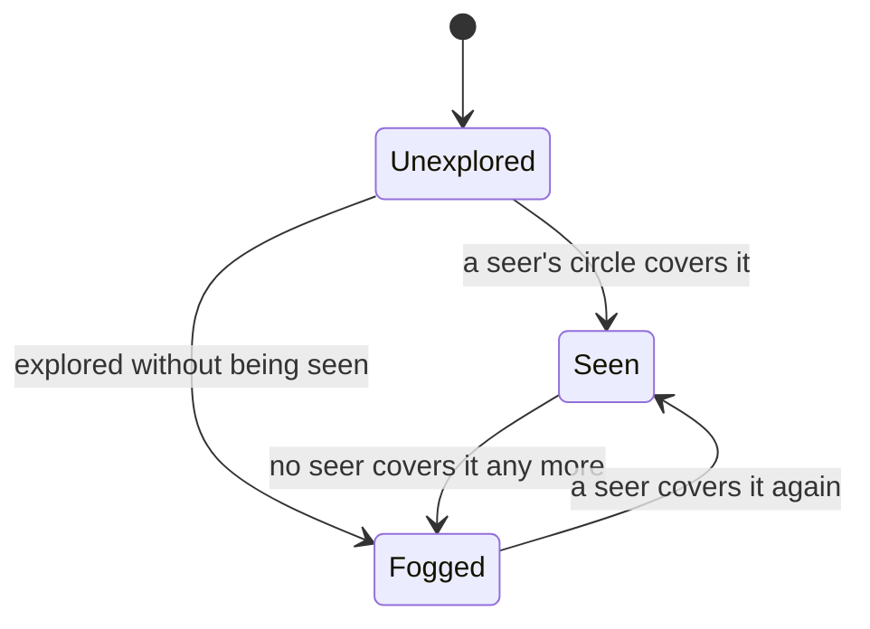
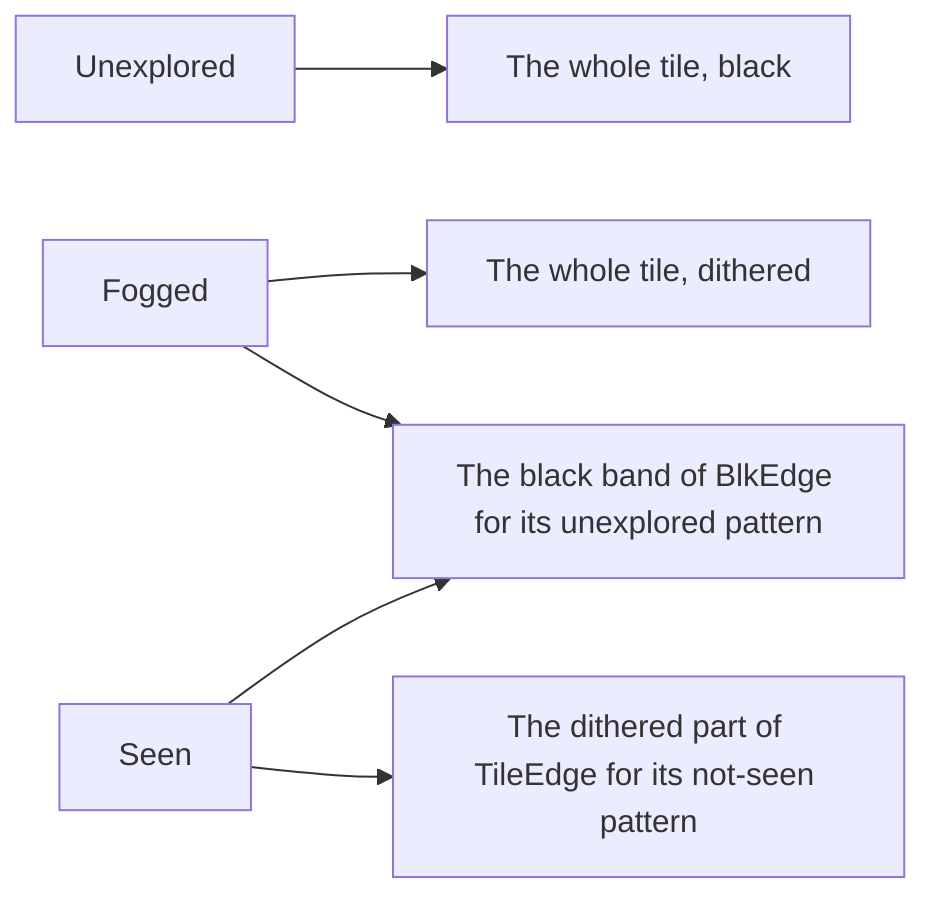

# Fog of war

In the original game a player sees only what its own units and buildings see.
Ground it has never explored is black. Ground it has explored but does not
see now is shown darkened, every other pixel turned black, with the trees,
mines and cliffs it found there and the buildings as it last saw them. Ground
in sight is clear. The edges between the three are soft: shaped masks from
`TileEdge.Dat` and `BlkEdge.Dat` rather than whole tiles.

This page covers what each player sees, kept in the simulation, and how
`Rendering::FogRenderer` draws it for the player at this machine: the edge
masks, the neighbour patterns that pick them, the screen-fixed dither, and how
objects in the fog are dithered whole. Where the fog fits into the frame is on
[The frame](/engine/rendering/).

## What a player sees

`ECS::Vision` keeps, for every tile, one bit per player for **visible** (seen
now) and one for **explored** (seen at some time). Every unit and building
with sight sees a circle of tiles round it, of its line of sight; a building
not yet finished sees only the ground under itself. A tile inside any of a
player's circles is visible to it, and a tile once visible stays explored.
`Vision::Update` runs near the end of every tick and stamps a seer's circle
again only when it has moved a tile or changed.

A player with Cartography also sees what its allies see and knows what they
have explored; one with Spies sees what its enemies see. The lobby's choice
can start the map explored or all of it visible (`Core::Reveal`), and cheats
can show one player the whole map.

What a player can see is part of the game: the computer players play from it,
and every machine in a network game has to agree on it. So it is kept in the
simulation, in fixed order and without floating point (see
[Fixed point and determinism](/engine/determinism)), and the renderer only
reads it, for whoever sits at this machine.

Which objects are drawn at all is `Vision::Shows`:

- the viewer's own things always;
- anything on a tile it sees now;
- on a tile it has only explored, what the dat keeps shown in the fog (trees,
  mines, cliffs, never a building or another player's unit), unless the viewer
  keeps a picture of it;
- a picture of the fog's, only to the player who keeps it;
- a foundation not yet begun, only to its owner's allies.

The pictures are `ECS::Fog`'s. When a player stops seeing a building that has
been begun, it keeps a picture of it as it stood, every piece of it in its
owner's colour, until it sees any tile of the building's ground again; a tree
felled or a mine used up out of its sight leaves it a picture of how it was. The ground likewise: a farm or a foundation
laid out of a player's sight is drawn, for that player, as the ground it last
saw (see [Terrain](/engine/rendering/terrain#keeping-and-dropping-chunks)).

## Three states



A tile is explored without being seen when the map starts explored, when an
ally explores it for a player with Cartography, or when a team-mate's start is
marked explored for the player as the game begins (`Vision::Explore`).

For the player at this machine each tile of the view is one of these, or off
the map. Each draws differently:



## The edge masks

`TileEdge.Dat` and `BlkEdge.Dat`, in the game's `Data` folder, hold the masks.
`HAL::EdgeMasks` reads both; they share one layout:

```cpp
//     uint32 set_offset[17]           one set per ground shape: flat, then the
//                                     16 slopes
//     at each set_offset:
//         uint32 mask_offset[count]   absolute file offsets
//     at each mask_offset:
//         { uint8 y, x0, x1 } ...     pixels x0..x1 inclusive of row y are set
//         uint8 255                   ends the mask
```

A flat mask covers one 97 by 49 tile diamond.

- **TileEdge** holds 94 masks a set, read as 47 pairs. For pattern k, mask
  2k is the part of a seen tile drawn clear and mask 2k + 1 the part drawn
  dithered; together they split the tile exactly in two. Mask 0 is the whole
  tile.
- **BlkEdge** holds 47: for each pattern of unexplored neighbours, the band
  left black between explored ground and unexplored. It always lies inside
  the dithered part, and is cut out of both.

Only the flat set is used. On a hill, the flat mask is laid onto the tile's
own raised corners with the same fan of triangles the terrain uses for a
hillside tile (see [Terrain](/engine/rendering/terrain#hills)), so the fog's
edges follow the ground as drawn.

## Neighbour patterns

Two patterns are taken for each tile: which of its eight neighbours are not
seen now, and which are not explored. The bits, and where each neighbour lies
on the grid:

| Bit | Neighbour | Tile |
|---|---|---|
| `0x01` | left corner | (x - 1, y + 1) |
| `0x02` | bottom corner | (x + 1, y + 1) |
| `0x04` | right corner | (x + 1, y - 1) |
| `0x08` | top corner | (x - 1, y - 1) |
| `0x10` | lower left edge | (x, y + 1) |
| `0x20` | lower right edge | (x + 1, y) |
| `0x40` | upper right edge | (x, y - 1) |
| `0x80` | upper left edge | (x - 1, y) |

Off the map, an edge neighbour counts as unexplored but as seen, so the black
closes along the map's border while the dither does not; a corner off the map
counts as neither.

Of the 256 patterns, a corner that lies beside a set edge adds nothing, since
the edge's mask already covers that corner. Folding those away leaves 47
shapes, numbered in order of first appearance; the folded patterns take the
number of the pattern with those corners cleared:

```cpp
void BuildPatternTable(uint8_t table[256]) {
    std::fill(table, table + 256, uint8_t{0xff});
    int next = 0;
    for (int c = 0; c < 256; ++c) {
        const bool redundant =
            ((c & kUpperLeft) && (c & (kLeftCorner | kTopCorner))) ||
            ((c & kUpperRight) && (c & (kRightCorner | kTopCorner))) ||
            ((c & kLowerRight) && (c & (kBottomCorner | kRightCorner))) ||
            ((c & kLowerLeft) && (c & (kLeftCorner | kBottomCorner)));
        if (!redundant) table[c] = static_cast<uint8_t>(next++);
    }
    // ...
}
```

Pattern 0 is no neighbour at all.

## Composing the fog

At its first use, `FogRenderer` paints the masks it needs into one atlas
texture, each 97 by 49 mask in a cell with a clear pixel all round, so that a
scaled draw never picks up its neighbour's edge. Cell 0 is the whole tile
(`TileEdge[0]`), cell k for patterns 1 to 46 the dithered part
(`TileEdge[2k + 1]`), and cell 47 + k the black band (`BlkEdge[k]`). If the
mask files cannot be read, cell 0 is a plain diamond, so the fog still hides
what it must, with stepped edges.

Each frame, `FogRenderer::Draw` takes the tiles under the view (the world
rectangle under the view's corners, widened for hills raised into view from
below) and each tile's state once, with a ring of neighbours round them. For
each tile it adds a mask to one of two lists of triangles:

- **unexplored**: the whole tile, to the black list;
- **seen**: the dithered part for its not-seen pattern, to the dither list
  (nothing when the pattern is 0);
- **fogged**: the whole tile, to the dither list;
- and for any tile that is not unexplored, unless the map is all explored,
  the black band for its unexplored pattern, to the black list.

A flat tile's mask is a quad of the tile's image box. At 1:1 the masks meet
their neighbours exactly; at any other zoom each box is let out by a pixel of
the frame, which closes the pinholes rounding would leave where four tiles
meet.

The two lists are drawn into a layer the size of the frame, and the layer is
laid over the frame:

```cpp
    SDL_SetRenderTarget(sdl_r, g.layer);
    SetZoom(sdl_r, 1.0f);
    SDL_SetRenderDrawBlendMode(sdl_r, SDL_BLENDMODE_NONE);
    SDL_SetRenderDrawColor(sdl_r, 0, 0, 0, 0);
    SDL_RenderClear(sdl_r);
    if (!g.dither_indices.empty()) {
        SDL_RenderGeometry(sdl_r, g.atlas, g.dither_vertices.data(),
                           static_cast<int>(g.dither_vertices.size()), g.dither_indices.data(),
                           static_cast<int>(g.dither_indices.size()));
        // Keep every other pixel of the dithered shapes, fixed to the screen.
        SDL_RenderCopy(sdl_r, g.checker, nullptr, nullptr);
    }
    if (!g.black_indices.empty()) {
        SDL_RenderGeometry(sdl_r, g.atlas, g.black_vertices.data(),
                           static_cast<int>(g.black_vertices.size()), g.black_indices.data(),
                           static_cast<int>(g.black_indices.size()));
    }
    SDL_SetRenderTarget(sdl_r, frame);
    SetZoom(sdl_r, 1.0f);
    SDL_RenderCopy(sdl_r, g.layer, nullptr, nullptr);
```

The dithered shapes go in as solid black. The checkerboard is a texture the
size of the frame, opaque where x + y is even, drawn with a blend mode that
multiplies the layer's alpha by its own and leaves colour alone: every other
pixel of the dithered shapes is kept, black, and the rest cleared. The black
shapes go in after, solid. The fog over the ground is two batches of
triangles and two copies a frame, and nothing is allocated once the vertex
lists are warm.

The fog's vertices are placed in the frame's own pixels (the world position
less the camera, times the zoom), and the checkerboard is the frame's own size,
so the dither is one pixel of the frame at any zoom and is fixed to the screen,
not to the tiles.

## Objects in the fog

Objects are drawn either side of the fog (see
[The frame](/engine/rendering/#two-passes-either-side-of-the-fog)):

- Whatever the dat draws on layer 5 or under (farms, rubble, cliffs and most
  shadows) is drawn before the fog, so it is fogged exactly as the ground under
  it: clear, dithered, or not at all where the ground is black.
- Everything else is drawn whole, over the fogged ground: clear if its tile is
  seen, even where it reaches over fog or black, so a tree at the edge of sight
  stands over the black beyond it; and dithered all over, with the same screen
  checkerboard, if its tile is only explored.

The objects to dither use the same layer. After the standing sprites are
drawn, `FogRenderer::BeginObjects` clears the layer. In the same back-to-front
order, each object standing in the fog is drawn into it as a black silhouette
(its own texture with a black colour mod), and each seen object drawn after
the first of them, within their bounds, wipes the layer where it is opaque, so
a unit in sight in front of a fogged building is not dithered with it.
`FogRenderer::EndObjects` multiplies in the checkerboard and lays the layer
over the frame. The wipe is a blend mode of its own:

```cpp
SDL_BlendMode FogRenderer::EraseBlend() {
    static const SDL_BlendMode erase = SDL_ComposeCustomBlendMode(
        SDL_BLENDFACTOR_ZERO, SDL_BLENDFACTOR_ONE, SDL_BLENDOPERATION_ADD,
        SDL_BLENDFACTOR_ZERO, SDL_BLENDFACTOR_ONE_MINUS_SRC_ALPHA, SDL_BLENDOPERATION_ADD);
    return erase;
}
```

It leaves the layer's colour and multiplies its alpha by one less the
source's: wherever the wiping sprite is opaque, the layer's coverage is gone.
The building being placed is masked the same way, with patterns of its own
(`Rendering::Stipple`).

## The edge of the map

Drawn zoomed, the ground's outermost tiles can reach a pixel or two past the
map's edge, where no tile of the map lies to cover them. So unless the map is
all explored, a ring of tiles one tile out past the edge is drawn black too.

With the map all explored (the lobby's choice, or a cheat for this player),
nothing counts as unexplored and no black is drawn, not even at the border.
With everything visible, `FogRenderer::Draw` draws nothing at all.

## Forget

The atlas, the checkerboard and the layer are textures of the renderer they
were made with. `FogRenderer::Forget` destroys them and resets the fog's state,
to be called before that renderer is destroyed; the next `Draw` makes them
again. The self-checks that make a renderer of their own call it.

## Where it lives in the code

- [`src/rendering/FogRenderer.h`](https://github.com/Zaydme/openaok/blob/main/src/rendering/FogRenderer.h), [`FogRenderer.cpp`](https://github.com/Zaydme/openaok/blob/main/src/rendering/FogRenderer.cpp): the masks' atlas, neighbour patterns, the layer and its dither, objects in the fog, the ring past the edge
- [`src/hal/EdgeMasks.h`](https://github.com/Zaydme/openaok/blob/main/src/hal/EdgeMasks.h), [`EdgeMasks.cpp`](https://github.com/Zaydme/openaok/blob/main/src/hal/EdgeMasks.cpp): reads `TileEdge.Dat` and `BlkEdge.Dat`
- [`src/ecs/Vision.h`](https://github.com/Zaydme/openaok/blob/main/src/ecs/Vision.h), [`Vision.cpp`](https://github.com/Zaydme/openaok/blob/main/src/ecs/Vision.cpp): what each player sees and has explored, shared sight, which objects are drawn
- [`src/ecs/Fog.h`](https://github.com/Zaydme/openaok/blob/main/src/ecs/Fog.h): the pictures and the ground each player keeps of what it does not see
- [`src/rendering/EntityRenderer.cpp`](https://github.com/Zaydme/openaok/blob/main/src/rendering/EntityRenderer.cpp): the passes either side of the fog, and objects in the fog drawn into its layer
- [`src/verify/FogCheck.cpp`](https://github.com/Zaydme/openaok/blob/main/src/verify/FogCheck.cpp), [`FogEdgeCheck.cpp`](https://github.com/Zaydme/openaok/blob/main/src/verify/FogEdgeCheck.cpp), [`VisionCheck.cpp`](https://github.com/Zaydme/openaok/blob/main/src/verify/VisionCheck.cpp): self-checks for what is seen and remembered, and for the black past the map's edge
