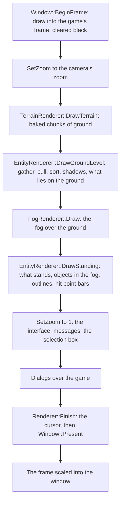

# The frame

The original game draws its view as a painter would: the ground first, then
everything on it from the back of the map to the front, the fog of war over
what the player cannot see, and the interface on top, all at one fixed screen
size. OpenAoK draws each frame the same way, from the simulation's state as it
stands, and never writes anything back into it.

This page follows one frame from start to finish: the order of the passes, the
camera and its zoom, how the frame reaches the window, how sprites are placed
between simulation ticks, culled, sorted and batched, and how selection marks
and hidden units' outlines are drawn. The art itself is on
[Sprites and texture pages](/engine/rendering/sprites), the ground on
[Terrain](/engine/rendering/terrain) and the fog on
[Fog of war](/engine/rendering/fog).

## The passes

`Renderer::Render` draws the world and the interface into the game's frame.
Dialogs come next, and `Renderer::Finish` puts the cursor on top and shows the
frame.



The world's part of `Render`, trimmed:

```cpp
    window.BeginFrame();
    window.Clear(0, 0, 0);   // black beyond the map's edge

    SetZoom(sdl_r, camera_zoom);
    // ...
    TerrainRenderer::DrawTerrain(sim, *this, sdl_r);
    // ...
    // The fog goes over the ground and what lies on it; what stands on seen
    // ground is drawn whole over the fog, even where it reaches over fog or
    // black.
    EntityRenderer::DrawGroundLevel(sim, *this, sdl_r, alpha);
    // ...
    FogRenderer::Draw(sim, *this, sdl_r);
    // ...
    EntityRenderer::DrawStanding(*this, sdl_r);
    // ...
    SetZoom(sdl_r, 1.0f);
    const int overview = UIRenderer::DrawQueueOverview(sim, sdl_r, win_w, win_h);
    Messages::Draw(sdl_r, win_w, win_h, overview);
    UIRenderer::DrawTimePanels(sim, sdl_r, win_w, win_h);
    UIRenderer::DrawScores(sim, sdl_r, win_w, win_h);
    UIRenderer::DrawInterface(sim, *this, sdl_r, win_w, win_h);
```

Everything before the second `SetZoom` is in the world's pixels at the
camera's zoom; everything after it is in the frame's own pixels, so the
interface art lies 1:1 on the frame whatever the zoom. The box drawn while
dragging a selection is drawn there too, so zooming never thickens it.

Two debugging aids sit in the same function: `--show-grid` outlines every
tile the simulation counts as blocked, and `--perf` reports what each stage
cost (`Renderer::Cost`: terrain, ground, fog, standing, interface and
finish, in microseconds of the drawing thread's time).

Before the first frame of a game, `Renderer::Warm` decodes the art of
everything in the world (its art in its owner's colour, its outline and its
shadow), so nothing is decoded as it first comes into view. Every platform
does this but the Switch (`HAL::Platform::WarmArt`), which decodes art as it
is first drawn.

## The camera and zoom

The camera is the top left corner of the view, in the world's unzoomed screen
pixels (`camera_x`, `camera_y`). The input moves a target (`target_camera_x`,
`target_camera_y`, `target_camera_zoom`) and the camera follows it with
exponential smoothing, `1 - exp(-12 * dt)` of the way each frame, which gives
the same curve at any frame rate. Each frame the camera is held so that the
middle of the view stays within the map's diamond: between its left and right
corners across, its top and bottom corners down.

The original game has no zoom. OpenAoK's is a scale on everything drawn in the
world:

| Constant | Value | Meaning |
|---|---|---|
| `Renderer::kZoomOut` | 0.4 | the furthest out |
| `Renderer::kZoomIn` | 1.25 | the furthest in |
| `Renderer::kZoomStep` | 1.1 | one wheel notch or key press |

`Renderer::ZoomBy` changes the zoom by a factor and keeps the world point
under a given frame point where it is:

```cpp
void Renderer::ZoomBy(float factor, float x, float y, bool at_once) {
    const float from = target_camera_zoom;
    const float to = std::clamp(from * factor, kZoomOut, kZoomIn);
    if (to == from) return;
    // The world point under (x, y) stays under it.
    target_camera_x += x / from - x / to;
    target_camera_y += y / from - y / to;
    target_camera_zoom = to;
    if (at_once) {
        camera_x += x / camera_zoom - x / to;
        camera_y += y / camera_zoom - y / to;
        camera_zoom = to;
    }
}
```

`Core::InputManager` calls it from four places:

- **The mouse wheel** zooms about the pointer when it is over the map, else
  about the middle of the view, eased. With Ctrl held the wheel acts as two
  hotkeys instead.
- **The = and - keys** zoom about the middle of the view, eased, unless the
  hotkeys have them; held, they go on zooming.
- **A pinch** on a touch screen zooms about the point between the two fingers
  at once (`HAL::Touch::TakeZoom`).
- **The controller's right stick** with ZL held zooms about the middle at once,
  up to a factor of 2.5 a second leaning all the way (`kStickZoomPerSecond`).

Scrolling moves the view 800 frame pixels a second (800 divided by the zoom in
the world's pixels), so it feels the same at any zoom.

### SetZoom

`Rendering::SetZoom` applies a zoom to whatever is being drawn into:

```cpp
void SetZoom(SDL_Renderer* sdl_r, float zoom) {
    SDL_RenderSetScale(sdl_r, zoom, zoom);
    int w = 0, h = 0;
    if (SDL_Texture* target = SDL_GetRenderTarget(sdl_r)) {
        SDL_QueryTexture(target, nullptr, nullptr, &w, &h);
    } else {
        SDL_GetRendererOutputSize(sdl_r, &w, &h);
    }
    const SDL_Rect whole{0, 0, static_cast<int>(std::ceil(w / zoom)), static_cast<int>(std::ceil(h / zoom))};
    SDL_RenderSetViewport(sdl_r, &whole);
}
```

The viewport is given in the scale's units, so at a zoom of 0.5 it must be
twice the target's size to cover all of it. Setting both together gives the
same result on SDL 2 and on SDL 3 through sdl2-compat. The terrain, the fog
and the texture pages all switch render targets in the middle of a frame;
each puts the zoom back with `SetZoom` (or keeps and restores the whole draw
state) before the world goes on drawing.

## From the frame to the window

`HAL::Window` keeps the game's frame as a render target texture of the game's
own screen size: 800x600, 1024x768 or 1280x1024, or a widescreen frame of
that height (`Window::WideWidth`, the screen's aspect, never narrower than
4:3). Everything above the platform layer works in the frame's pixels: the
interface is laid out on them, the mouse is reported in them
(`Window::ToGame`), and `--screenshot` saves the frame itself.

`Window::Present` sets the window back as the target, clears it black and
draws the frame into the largest rectangle of the frame's aspect that fits,
centred, so the bars either side are black:

```cpp
    SDL_Rect dest;
    Fit(out_w, out_h, dest);
    // A whole-number scale is drawn nearest-neighbour, keeping every pixel
    // square and sharp; any other scale is filtered.
    const bool whole = dest.w % game_w == 0 && dest.h % game_h == 0;
    SDL_SetTextureScaleMode(frame, whole ? SDL_ScaleModeNearest : SDL_ScaleModeLinear);
    SDL_RenderCopy(renderer, frame, nullptr, &dest);
    SDL_RenderPresent(renderer);
    GraphicCache::Get().EndFrame();
```

The window asks for high-DPI output, so on a dense display the frame is scaled
into the display's real pixels. Fullscreen, the display stays at its native
resolution and the frame is scaled into it; windowed, the window is the
frame's size and shows it 1:1.
After the present, `GraphicCache::EndFrame` frees the textures of any texture
page that grew during the frame (see
[Sprites and texture pages](/engine/rendering/sprites#growing-a-page)).

## Between ticks

The simulation runs on a fixed 16 ms tick; frames come at their own rate. The
main loop keeps the time not yet simulated in an accumulator, runs
whole ticks out of it, and hands the renderer the fraction left over:

```cpp
        // How far this frame falls into the next tick.
        const float alpha = static_cast<float>(accumulator.count()) / static_cast<float>(kTick.count());
        renderer.Render(*sim, window, alpha);
```

Everything that moves keeps its `previous_position` in its `Transform` beside
its `position`, and `DrawGroundLevel` draws it between the two:

```cpp
        float lx = t.previous_position.x.ToFloat() + (t.position.x.ToFloat() - t.previous_position.x.ToFloat()) * alpha;
        float ly = t.previous_position.y.ToFloat() + (t.position.y.ToFloat() - t.previous_position.y.ToFloat()) * alpha;
```

The simulation's positions are fixed point (see
[Fixed point and determinism](/engine/determinism)); the renderer turns them
into floating point here, which it may, since nothing it works out goes back
into the simulation. Units therefore move smoothly at any frame rate, drawn at
most one tick behind the simulation.

## Gathering and culling

`DrawGroundLevel` walks every entity with a `Transform` and a `Sprite` and
builds one `RenderEntry` for each that is to be drawn: its texture, source and
destination rectangles, depth, shadow, outline and selection mark. The list is
kept between frames, so it never reallocates once warm. Each entity goes
through three tests, cheapest first:

1. **Roughly off screen.** Before its building offset or the ground's height
   is worked out, an entity whose point lies further off to either side or
   above than any building's art is ever set off (`kMostArtOffset`, four
   tiles each way) is dropped. Nothing is dropped for being below the view
   here, since a hill only lifts what stands on it.
2. **Off screen.** Its point on the screen, standing on the ground's height
   there (`Ground::HeightPx`), must lie within the view, at the camera's zoom,
   with a margin of 200 pixels all round.
3. **Not seen.** `ECS::Vision::Shows` must say the player at this machine sees
   it drawn (see [Fog of war](/engine/rendering/fog)).

The same list takes what is drawn by graphic rather than as an entity: the
arrows played where a move is ordered, the flags at a selected building's
gather point and at a selected unit's waypoints, the building waiting to be
placed (`Rendering::Placement`), and the fire and flags laid over damaged and
garrisoned buildings from the dat's damage and garrison graphics. A composite
graphic, such as a ship's hull, sails and wake (`SpritePieces`), adds one entry
per piece.

The terrain and the fog cull for themselves: only the chunks of ground and
the fog's tiles under the view are drawn.

## Two passes either side of the fog

The dat gives every graphic a layer. Whatever is drawn only on layer 5 or
under lies on the ground: farms, rubble, cliffs and most shadows. OpenAoK
reads this once into a table by SLP (`GroundLevel`; an SLP any graphic uses on
a higher layer counts as standing).

- `DrawGroundLevel` gathers and sorts the frame's entries, draws every shadow
  (a pass of its own, beneath all sprites), then every entry lying on the
  ground.
- `FogRenderer::Draw` lays the fog over the ground and what lies on it, so a
  farm in the fog is dithered exactly as the ground under it is.
- `DrawStanding` draws every standing entry whole over the fog. A tree at the
  edge of sight stands over the black beyond it. What
  stands on ground the player has explored but does not see now is then
  dithered all over.

In order, `DrawStanding` decides which outlines are needed, draws the standing
sprites, lays the masks of the building being placed over its pieces
(`Rendering::Stipple`), dithers the objects in the fog, draws the outlines,
and last of all the hit point bars and control group numbers.

## Depth order

The world is drawn back to front. An entry's depth is the world x plus the
world y of the point it stands on (a building's middle, for its art), and
depths are compared exactly. Ties fall to the entry's sort bias, then its
texture, then its entity id:

```cpp
    // Depth sort (back-to-front painter's algorithm), depth compared exactly.
    // ...
    std::sort(entries.begin(), entries.end(), [](const RenderEntry& a, const RenderEntry& b) {
        if (a.depth != b.depth) return a.depth < b.depth;
        if (a.sort_bias != b.sort_bias) return a.sort_bias < b.sort_bias;
        if (a.tex_ptr != b.tex_ptr) return a.tex_ptr < b.tex_ptr;
        return a.ent < b.ent;
    });
```

- **Exact depth.** Depths are never rounded into bands. Within a band the
  order would fall to the texture, which says nothing about what is in front,
  and a unit truly in front of a tree could be drawn behind it.
- **Sort bias.** A building is several graphics stacked back to front on one
  tile (back piece, body, centre, front piece), so units can walk between
  them; depth alone cannot order pieces that share a tile. `Sprite::sort_bias`
  does. The fire and flags laid over a building take a bias of 1000 and a
  depth 3 greater than the building's, in front of every piece.
- **Texture.** Map objects standing on whole tiles tie exactly, and the
  texture tie-break puts those on one texture next to each other, which is
  what lets them batch.
- **Entity id.** Last, so the order is the same from frame to frame and
  nothing flickers.

## Batching

Render batching is on (`SDL_HINT_RENDER_BATCHING`): SDL queues the frame's
draws rather than sending each at once, and a run of copies from the same
texture with the same blend can go to the GPU as one draw. A texture change
ends the run. Two things keep changes few:

- A graphic's art lies on a texture page that many graphics share
  ([Sprites and texture pages](/engine/rendering/sprites)), so neighbouring
  entries in the sorted list often come from one texture.
- Shadows and outlines, which draw with their own alpha and colour mods, are on
  pages of their own and drawn in passes of their own.

The ground is one copy for each baked chunk in view, and the fog two batches
of triangles. On the desktop SDL draws through OpenGL, on Android and the Switch
through OpenGL ES 2, and on iOS through whichever of Metal and OpenGL ES SDL
picks.

## Selection marks and hit point bars

A selected unit or building is marked with:

- a one-pixel white outline on the ground under it, an ellipse or a diamond
  (round or square, from the dat's obstruction type) of the dat's outline
  radii in tiles;
- a hit point bar 24 pixels wide and 2 high, green for the share of hit points
  left over red, floating the dat's bar height above it;
- its control group's digit to its left.

What an order was given at flashes its outline green for a second and a half,
off every other 256 ms. The ground outline is drawn just before its own
sprite, so whatever stands in front of it, the unit itself included, covers
it; the bars and digits are drawn after everything else in the world.

All of these are drawn in the world's pixels under the camera's zoom. Zoomed
out, a world pixel is smaller than a pixel of the frame, so a one-pixel line
would thin and break up. `FramePixel` gives the size of one frame pixel in
world pixels:

```cpp
// One pixel of the frame in the world's pixels at the view's zoom, never less
// than one: a mark this thick stays a pixel wide however far out the view is
// zoomed, where a world pixel would thin to nothing.
float FramePixel(SDL_Renderer* r) {
    float zoom = 1.0f, unused = 1.0f;
    SDL_RenderGetScale(r, &zoom, &unused);
    return zoom < 1.0f ? 1.0f / zoom : 1.0f;
}
```

Below a zoom of 1, the outline's pixels are drawn as squares that size
(`DrawDots`), the bar is two frame pixels high, and each colour of the bar
that shows is at least one frame pixel wide. At the furthest zoom out (0.4) a
frame pixel is two and a half world pixels. `EntityRenderer::DrawMarks` draws
the marks alone, for the self-check that measures them.

## Outlines behind cover

In the original, a unit hidden behind a building or a tree shows through it as
a silhouette in its player's colour. The shape is in the art: an SLP frame can
carry outline pixels, a class of their own (see
[the SLP format](/engine/rendering/sprites#pixel-classes)). Units, animals,
mines and relics have them; trees and buildings have none. So the art decides
what can show an outline, and `GraphicCache::Outline` gives no page at all for
a graphic without outline pixels.

`DrawStanding` tests every standing entry that has outline pixels for cover,
however tall it is. Only entries drawn later can cover it, so the search runs
forward through the sorted list from the candidate. An occluder must be taller
than a tile and its box must overlap the candidate's; it counts only where its
own art is opaque at one of three points down the middle of the candidate (at
a quarter, a half and 85% of its height), since a tree's box reaches far past
its leaves. The search stops once the depth gap is wide enough that nothing
further on could reach back over it:

```cpp
    constexpr float kOccluderHeight = 64.0f;   // taller than one tile
    constexpr float kDepthWindow = 12.0f;      // tiles ahead worth testing
    // ...
        for (size_t j = i + 1; j < entries.size() && !covered; ++j) {
            const RenderEntry& o = entries[j];
            if (o.depth - e.depth > kDepthWindow) break;
            if (!o.tex_ptr || o.ground || o.dest.h <= kOccluderHeight) continue;
            // ...
            for (float py : probe_y) {
                int fx = static_cast<int>(mid_x - o.dest.x);
                const int fy = static_cast<int>(py - o.dest.y);
                if (o.flip_h) fx = static_cast<int>(o.dest.w) - 1 - fx;
                if (o.atlas->Covers(o.frame, fx, fy)) { covered = true; break; }
            }
        }
```

An occluder whose graphic has no coverage bits counts by its box alone. An
entry found in the open draws no outline. Those found covered are drawn after
everything else in the world but the bars, from the outline pages, where the
pixels are white, each tinted by a colour mod to its owner's colour
(`GraphicCache::GetPlayerColor`).

## Where it lives in the code

- [`src/rendering/Renderer.h`](https://github.com/Zaydme/openaok/blob/main/src/rendering/Renderer.h), [`Renderer.cpp`](https://github.com/Zaydme/openaok/blob/main/src/rendering/Renderer.cpp): the frame's passes, the camera, the zoom limits, `ZoomBy`, `SetZoom`, `Warm`
- [`src/rendering/EntityRenderer.h`](https://github.com/Zaydme/openaok/blob/main/src/rendering/EntityRenderer.h), [`EntityRenderer.cpp`](https://github.com/Zaydme/openaok/blob/main/src/rendering/EntityRenderer.cpp): gathering, culling, the depth sort, shadows, the two passes, selection marks, outlines
- [`src/rendering/Placement.h`](https://github.com/Zaydme/openaok/blob/main/src/rendering/Placement.h), [`src/rendering/Stipple.h`](https://github.com/Zaydme/openaok/blob/main/src/rendering/Stipple.h): the building waiting to be placed, and the masks drawn over it
- [`src/rendering/Ground.h`](https://github.com/Zaydme/openaok/blob/main/src/rendering/Ground.h): the ground's height under a point, which lifts what stands on hills
- [`src/hal/Window.h`](https://github.com/Zaydme/openaok/blob/main/src/hal/Window.h), [`Window.cpp`](https://github.com/Zaydme/openaok/blob/main/src/hal/Window.cpp): the game's frame, scaling it into the window, mouse coordinates
- [`src/core/InputManager.cpp`](https://github.com/Zaydme/openaok/blob/main/src/core/InputManager.cpp): the wheel, keys, pinch and stick that move and zoom the camera, and its easing
- [`src/main.cpp`](https://github.com/Zaydme/openaok/blob/main/src/main.cpp): the fixed tick, the accumulator and `alpha`, the render driver and batching hints
- [`src/verify/MarksCheck.cpp`](https://github.com/Zaydme/openaok/blob/main/src/verify/MarksCheck.cpp), [`OutlineCheck.cpp`](https://github.com/Zaydme/openaok/blob/main/src/verify/OutlineCheck.cpp), [`ZoomCheck.cpp`](https://github.com/Zaydme/openaok/blob/main/src/verify/ZoomCheck.cpp): self-checks for the marks zoomed in and out, the outlines and the zoom
