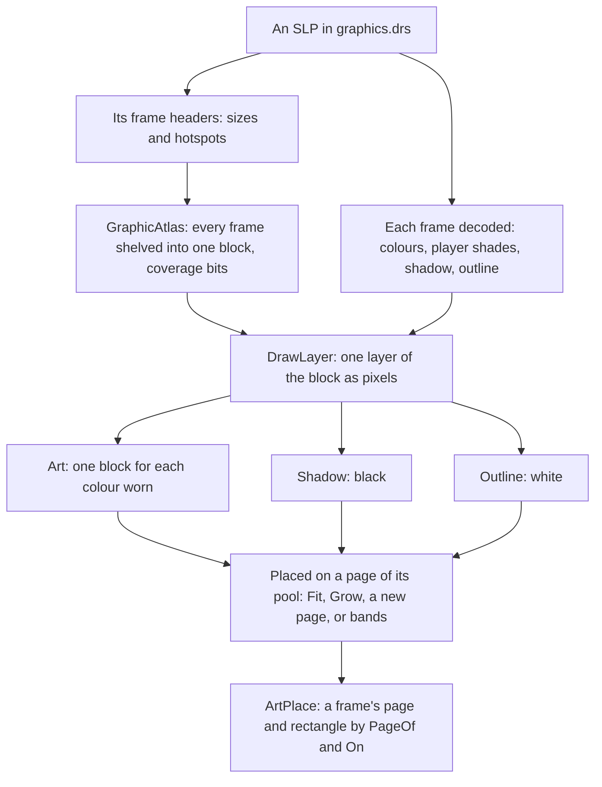

# Sprites and texture pages

All of the original game's art is in SLP files: run-length coded frames of
8-bit palette pixels, kept in the DRS archives on the CD (`graphics.drs` for
the world, `interfac.drs` for the interface, `terrain.drs` for the ground).
Besides its colours, a frame marks some pixels as a player's colour, some as
shadow and some as the outline shown when a unit is hidden behind something.

OpenAoK reads the SLPs itself while it runs. This page covers the format,
how `HAL::GraphicCache` lays a graphic's frames out as one block, how it bakes
each player's colour into its own copy, and how the blocks of many graphics
share a few large textures, so that the sprites on screen draw in few batches.
How the frame then uses them is on [The frame](/engine/rendering/).



## The DRS archive

A DRS archive is a 64-byte header (a copyright string, a version, a type, the
number of tables and the offset of the first file), then a table record of 12
bytes for each file type (its type, offset and file count), and in each table
one 12-byte entry per file: its id, offset and size. `HAL::DrsOpen` reads an
archive whole into memory (`graphics.drs` is about 70 MB) and indexes its
entries by id. SLPs are found by those ids: a `Sprite` names `slp_id` and
`slp_frame`, never a file. See [The game's data](/engine/data) for where the
archives come from.

## The SLP format

An SLP starts with a 32-byte header: a 4-byte version, the frame count
(16 bits), properties (16 bits) and a 24-byte comment. Versions that mark a
compressed or 32-bit SLP are refused; the game's own data has none. Then
comes one 32-byte header per frame:

| Field | Meaning |
|---|---|
| `cmd_table_offset` | where the row command offsets start |
| `outline_table_offset` | where the row edges start |
| `palette_offset`, `properties` | not used by the engine |
| `width`, `height` | the frame's size in pixels |
| `hotspot_x`, `hotspot_y` | the pixel that sits on the object's tile (signed) |

`HAL::SlpReadHeaders` reads these alone, without decoding any pixels; that is
all a graphic's layout needs.

### Rows

Each row of a frame has an entry in two tables. The edge table (at
`outline_table_offset`) holds two 16-bit numbers per row, the transparent pixels at its left and its right end;
`0x8000` in either marks a row with nothing drawn. The command table holds a
32-bit offset per row to the row's first command byte. Decoding a row starts
as many pixels in as its left edge says and runs commands until the end-of-row
byte.

### Commands

| Command byte | What it does | Count |
|---|---|---|
| low two bits `00` | copies the next bytes as palette indexes | the top six bits |
| low two bits `01` | skips transparent pixels | the top six bits |
| low nibble `0x2` | copies, as above, a long run | the high nibble times 256, plus the next byte |
| low nibble `0x3` | skips a long run | the same |
| low nibble `0x6` | copies the next bytes as player-colour shades | the high nibble, or the next byte when it is 0 |
| low nibble `0x7` | fills with one palette index | the same, then the index |
| low nibble `0xA` | fills with one player-colour shade | the same, then the shade |
| low nibble `0xB` | marks shadow pixels | the same |
| `0x4E` | marks one outline pixel | 1 |
| `0x5E` | marks a run of outline pixels | the next byte |
| `0x6E`, `0x7E` | a shield outline, one pixel or a run: skipped | 1, or the next byte |
| `0x0F` | ends the row | |

Any other extended command (low nibble `0xE`) makes `HAL::SlpDecodeFrame` give
up on the frame. The player-colour copy, as decoded:

```cpp
            case 0x6: // Copy, player colour
                count = PixelCountFromData(blob, data, p);
                for (uint32_t i = 0; i < count && col < w && p < blob.size(); ++i, ++col) {
                    const uint8_t idx = blob[p++];
                    out.indexes[row_base + col] = idx;
                    out.alpha[row_base + col] = 255;
                    // 0 would read as "not player colour", so clamp it up.
                    out.player[row_base + col] = idx ? idx : 1;
                }
                break;
```

### Pixel classes

A decoded frame keeps every class of pixel apart rather than flattening the
frame to colours:

```cpp
// A decoded frame. The four masks are parallel to `indexes`, one byte per
// pixel: `alpha` marks drawn pixels, `player` carries the palette index of a
// player-colour pixel so its shade survives, `shadow` and `outline` are flags.
struct SlpFrame {
    uint32_t width = 0;
    uint32_t height = 0;
    int32_t hotspot_x = 0;
    int32_t hotspot_y = 0;
    std::vector<uint8_t> indexes;
    std::vector<uint8_t> alpha;
    std::vector<uint8_t> player;
    std::vector<uint8_t> shadow;
    std::vector<uint8_t> outline;
};
```

- **Colour** pixels are palette indexes: into the game's 256-colour palette
  for the world, into a menu's own palette for some interface art.
- **Player colour** pixels hold a shade: a step along a player's colour ramp,
  not a palette entry. The same frame is every player's unit; only the ramp
  changes (see [Player colour](#player-colour)).
- **Shadow** pixels are where the graphic's shadow falls. A graphic whose
  frames hold nothing else is a shadow graphic (see [Shadows](#shadows)).
- **Outline** pixels trace the silhouette drawn when the thing is hidden
  behind a building or a tree. Units, animals, mines and relics have them;
  trees and buildings have none.

The hotspot anchors the frame: it is the pixel that stands on the object's
point on the map. A hotspot need not lie at the frame's bottom middle, and
hotspots differ from frame to frame, so each frame is placed by its own. A graphic with
facings stores the first half of them and one more, clockwise from south, and
draws the rest as mirror images; a mirrored frame anchors at its width less
the hotspot's x.

The data tools have the same reader in Python, `tools/data/slp.py`, used while
preparing the data (to find which graphics are shadow graphics, for one). The
engine decodes its sprites from the archives themselves, not from extracted
images.

## A graphic's block

`GraphicCache::GetAtlas` gives a world graphic's geometry, built on first use
and kept: every frame shelved, in order, into one block, so a frame index maps
straight to a rectangle. The shelves run `across` pixels wide, with a pixel's
gap between frames so that filtering can never bleed one frame into the next:

```cpp
    // Shelf-pack the frames in order, so a frame index maps straight to a
    // rect, `across` wide: the height they take.
    atlas.frames.resize(headers.size());
    auto shelve = [&](int across) {
        int shelf_x = 0;
        int shelf_y = 0;
        int shelf_h = 0;
        for (size_t i = 0; i < headers.size(); ++i) {
            const int fw = static_cast<int>(headers[i].width);
            const int fh = static_cast<int>(headers[i].height);
            // ...
            if (shelf_x + fw > across) {
                shelf_x = 0;
                shelf_y += shelf_h + kPadding;
                shelf_h = 0;
            }
            atlas.frames[i].rect = {shelf_x, shelf_y, fw, fh};
            // ...
            shelf_x += fw + kPadding;
            shelf_h = std::max(shelf_h, fh);
        }
        return shelf_y + shelf_h;
    };
```

The resulting `GraphicAtlas` holds each frame's rectangle and hotspot, the
block's size, whether any frame has player-coloured pixels (`coloured`), and
one bit per pixel where the art is opaque (`opaque`). The coverage bits answer
what a click lands on (`Covers` for a building or a tree; `Holds`, which
allows a few pixels round a unit and the gaps inside its outline) and whether
a tree really covers a unit behind it. Geometry, not pixels, decides whether a
graphic is valid: a shadow graphic decodes to no colour pixels at all, but its
frames and hotspots are still needed.

The frames are shelved 2,046 pixels wide (`kAtlasWidth`), so that a block of
them with a pixel of border all round fits a page 2,048 wide; on a device
whose pages must be smaller, narrower.

Interface and terrain graphics are drawn from a texture of their own, the
atlas's `base`, rather than from shared pages. Some interface graphics are
very tall shelved 2,046 wide, so for these the shelves are made wider,
doubling, while the block would be taller than the device's largest texture:

```cpp
    int across = page_side > 0 ? std::min(kAtlasWidth, page_side - 2 * kPadding) : kAtlasWidth;
    int high = shelve(across);
    while (texture && high > most && across * 2 <= most) {
        across *= 2;
        high = shelve(across);
    }
```

An interface graphic's atlas is built per palette, since each menu names its
own palette; a terrain's holds the whole terrain set on one texture (see
[Terrain](/engine/rendering/terrain)).

## Layers

`GraphicCache::DrawLayer` draws one class of a graphic's pixels laid out as its
block, a frame at a time from the decoder:

| Layer | Pixels drawn | Used for |
|---|---|---|
| `Art` | colour and player colour together, in one player's colours | world sprites |
| `Shadow` | shadow pixels, opaque black | the shadow pass |
| `Outline` | outline pixels, opaque white | silhouettes behind cover |
| `Base` | colour pixels, player colour left out | interface and terrain graphics |
| `Player` | player colour only | an interface icon's player layer |
| `None` | nothing: coverage bits and the `coloured` flag only | a world graphic's geometry |

A block for a page is only as wide as its frames reach, with a pixel of clear
border all round. A layer with no pixels at all gives no block, and then no
page: a tree has no outline page, and the frame's outline test never looks
at it.

## Player colour

The palette holds a ramp of eight entries for each player colour, dark to
light. The ramps do not start at evenly spaced entries, so where each starts
is read from the dat (`ConfigManager::PlayerRamps`, handed to
`GraphicCache::SetPlayerRamps` at start-up). The entries after a ramp are
unrelated colours, so a shade past the ramp's end is clamped to its last
entry rather than read beyond it:

```cpp
size_t GraphicCache::PaletteIndexForPlayer(int player, uint8_t shade) const {
    const size_t step = std::min<size_t>(shade, kPlayerRampSize - 1);
    // The colour the player wears: its seat's own, or the lobby's choice.
    const int index = ColourSlot(player);
    if (index >= 0 && index < static_cast<int>(player_ramps.size())) {
        return static_cast<size_t>(player_ramps[index]) + step;
    }
    return static_cast<size_t>(player) * kPlayerRampStride + step;
}
```

The fixed stride of 16 entries is only used until the dat's table has been
supplied. Which ramp a player wears is `ColourSlot`: the colour chosen in the
lobby, else its seat's (player n wears colour n - 1); Gaia wears the grey ramp.

`GraphicCache::Art(slp, player)` draws the `Art` layer with the player's ramp
baked in: one block for each colour worn, built the first time it is asked
for. The key is the SLP id with the colour slot in its low byte, or 0 for a
graphic with no player-coloured pixels, which is then one block shared by
every player:

```cpp
    // Keyed by the colour the player wears, which the lobby may change from
    // game to game.
    const uint64_t key = (static_cast<uint64_t>(slp_id) << 8) |
                         (geometry->coloured ? static_cast<uint8_t>(ColourSlot(player) + 1) : 0);
```

Baking gives the exact palette colours of the original, where tinting a grey
layer would only come close, and each sprite is drawn with a single copy.
Where one flat colour stands for a player (the tint of an outline),
`GetPlayerColor` gives the ramp's entry at shade 4. Interface icons keep their
player colour as a separate layer instead (`GetInterfacePlayerLayer`), drawn
over the icon in the owner's colour.

## Texture pages

A texture of its own for each graphic would make every change from one
graphic to another a change of texture, and SDL could join no two neighbouring
sprites into one draw. So the blocks are placed on texture pages, a few large
textures that many graphics share.

```cpp
// Padding between packed frames so bilinear sampling cannot bleed one frame
// into its neighbour.
constexpr int kPadding = 1;
// A texture page starts kFirstPageSide square and grows, a side at a time,
// as it fills: to kLargestPageSide for art, so the art on screen together
// mostly shares one page, and to kPageSide for shadows and outlines, which
// are few or seldom drawn. Unless the renderer allows less.
constexpr int kFirstPageSide = 1024;
constexpr int kPageSide = 2048;
constexpr int kLargestPageSide = 4096;
```

There are three pools of pages: art, shadows and outlines. Shadows draw with
an alpha mod and outlines with a colour mod, and a texture's mods hold for
everything on it, so the three never share a texture. At start-up
`GraphicCache::Init` reads the largest texture side the renderer allows (the
smaller of its maximum width and height) and lowers every side above to it.

### Placing a block

`GraphicCache::Place` puts a block's pixels on a page of its pool:

1. On the first page of the pool with room for it (`Fit`).
2. Else the pool's last page is grown, as often as it can be, until the block
   fits. A pool fills its last page before it starts another: the more on one
   page, the more sprites draw in one batch.
3. Else on a new page, 1,024 square or doubled until the block fits. Where the
   renderer cannot draw into textures, pages cannot grow, and a new page is as
   large as the pool's pages may be from the first.
4. Else, for a block larger than a page may be but within the renderer's
   limit, on a texture of its own.

The pixels go up with `SDL_UpdateTexture`, and the place is returned as an
`ArtPlace`: the page, and the offset of the block's first pixel inside its
border.

### The skyline

`GraphicCache::Fit` packs a page by its skyline: a list of spans across the
page, each the depth to which it is filled. A block goes at the lowest place
along the skyline where its width fits, the leftmost of equals; the block's
bottom edge then replaces the skyline under it, and neighbouring spans of one
height are joined into one.

### Growing a page

`GraphicCache::Grow` doubles a page's width, or once it is wider than high its
height, up to 4,096 for art and 2,048 for shadows and outlines (or the
renderer's limit). It makes a texture of the new size as a render target,
clears it, and copies the old page to its top left with blending off. Every
`ArtPlace` and band on the old page is moved to the new texture. The old
texture is kept until the frame that may still have drawn from it is shown,
and freed by `GraphicCache::EndFrame` after the present. A new right half joins
the skyline as an empty span from the top; into a new bottom half the skyline
simply goes on down.

A page may grow in the middle of a frame, while the world is being drawn at
the camera's zoom. SDL resets the viewport, clip and scale to the whole of a
new target at 1:1 whenever the target changes, so `Grow` keeps the draw
state (`Keep`) and puts it back afterwards:

```cpp
void PutBack(SDL_Renderer* renderer, const DrawState& s) {
    SDL_SetRenderTarget(renderer, s.target);
    // The viewport is given in the scale's units, so the scale goes first.
    SDL_RenderSetScale(renderer, s.scale_x, s.scale_y);
    SDL_RenderSetViewport(renderer, &s.viewport);
    SDL_RenderSetClipRect(renderer, s.clipped ? &s.clip : nullptr);
    SDL_SetRenderDrawColor(renderer, s.r, s.g, s.b, s.a);
}
```

SDL's Metal renderer, used on iOS, writes a texture's first update straight
into its memory, ahead of any drawing already queued for it. Once the clear
and the copy are queued, `Grow` gives the new page that first update itself,
one clear pixel in its last corner, so that every block written onto the page
later is queued behind the copy:

```cpp
    const uint32_t clear = 0;
    const SDL_Rect corner{w - 1, h - 1, 1, 1};
    SDL_UpdateTexture(grown, &corner, &clear, static_cast<int>(sizeof(clear)));
```

### Bands

A few graphics are very tall: shelved 2,046 wide, a trebuchet's attack takes
over two thousand rows. On a device whose largest texture is smaller than
that, no page can hold the block. `GraphicCache::PlaceBands` then cuts the
block into bands of whole shelves, each with its border no taller than the
pool's pages may be, and places each band as a block of its own. The
`ArtPlace` keeps the list of bands, and each frame finds its band by its row
in the block:

```cpp
struct ArtPlace {
    SDL_Texture* page = nullptr;
    int x = 0;
    int y = 0;
    const std::vector<ArtBand>* bands = nullptr;
    SDL_Rect On(const SDL_Rect& r) const {
        const ArtBand* band = BandOf(r);
        return band != nullptr ? SDL_Rect{r.x + band->x, r.y + band->y, r.w, r.h}
                               : SDL_Rect{r.x + x, r.y + y, r.w, r.h};
    }
    SDL_Texture* PageOf(const SDL_Rect& r) const {
        const ArtBand* band = BandOf(r);
        return band != nullptr ? band->page : page;
    }
    // ...
};
```

So a frame's texture is always `PageOf(rect)`, never `page`, which for a
banded graphic is only its first band's. `GraphicCache::LimitTextureSide`
makes the cache behave as on a device allowing smaller textures, for the
self-check that draws the tallest graphics from their bands.

## Drawing a frame

Taking a frame from its page and anchoring it by its hotspot, as
`EntityRenderer` does for each sprite:

```cpp
            const HAL::GraphicFrame& gf = atlas->frames[sprite.slp_frame];
            e.tex_ptr = art.PageOf(gf.rect);
            // ...
            e.src = art.On(gf.rect);
            // The hotspot is the texel that sits on the tile, from the SLP
            // frame header. Mirroring a frame mirrors its hotspot too, so a
            // flipped frame anchors at (width - hotspot_x).
            const int anchor_x = e.flip_h ? (gf.rect.w - gf.hotspot_x) : gf.hotspot_x;
            e.dest.x = sx - static_cast<float>(anchor_x);
            e.dest.y = sy - static_cast<float>(gf.hotspot_y) -
                       static_cast<float>(sprite.lift_px);
```

`sprite.lift_px` raises a missile in flight above its track on the ground.
The pieces of a building are placed from its composition, made from the
dat's annex table: each piece is an entity of its own at the position the
composition gives it, its frame anchored there by its own hotspot like any
other sprite.

## Shadows

The original computes no shadows. Trees, buildings and missiles each have a
separate shadow graphic, an SLP whose frames are made of shadow pixels alone.
`tools/data/extract_slp_shadows.py` finds them while the data is prepared: it
marks every SLP in `graphics.drs` that holds shadow pixels, then matches each
graphic to the shadow graphic whose name is its own with the part marker (an
N near the end of the name) turned to 0. The result,
`assets/extracted_data/shadows.json`, maps a graphic's SLP id to its shadow's;
it is generated from the user's own files and is not in the repository.

`ConfigManager::GetShadowSlp` reads the map, and a sprite looks up its shadow
once (`Sprite::shadow_slp`, `shadow_resolved`). A building's shadow is one of
the pieces of its composition instead: a sprite marked `is_shadow`, which
draws its graphic's shadow layer and nothing else, sometimes only a part of
the frame (`sub_x`, `sub_y`, `sub_w`, `sub_h`) where one shadow graphic covers
two separate pieces.

Shadows are drawn black from the shadow pages, in a pass of their own before
any sprite, each at an alpha of 110, so one piece's shadow never lands on
another piece drawn at the same depth. A graphic with no shadow graphic casts
no shadow.

## Where it lives in the code

- [`src/hal/SlpFile.h`](https://github.com/Zaydme/openaok/blob/main/src/hal/SlpFile.h), [`SlpFile.cpp`](https://github.com/Zaydme/openaok/blob/main/src/hal/SlpFile.cpp): the DRS archive, SLP frame headers and decoding, the palette
- [`src/hal/GraphicCache.h`](https://github.com/Zaydme/openaok/blob/main/src/hal/GraphicCache.h), [`GraphicCache.cpp`](https://github.com/Zaydme/openaok/blob/main/src/hal/GraphicCache.cpp): blocks, layers, player colour, texture pages, growing and bands
- [`src/rendering/EntityRenderer.cpp`](https://github.com/Zaydme/openaok/blob/main/src/rendering/EntityRenderer.cpp): frames chosen, anchored and drawn; the shadow pass
- [`src/ecs/components/Sprite.h`](https://github.com/Zaydme/openaok/blob/main/src/ecs/components/Sprite.h): what an entity draws, its facings and its shadow
- [`tools/data/slp.py`](https://github.com/Zaydme/openaok/blob/main/tools/data/slp.py): the same format read in Python, for the data tools
- [`tools/data/extract_slp_shadows.py`](https://github.com/Zaydme/openaok/blob/main/tools/data/extract_slp_shadows.py): writes the map from graphics to their shadow graphics
- [`src/verify/PagesCheck.cpp`](https://github.com/Zaydme/openaok/blob/main/src/verify/PagesCheck.cpp), [`SmallTexturesCheck.cpp`](https://github.com/Zaydme/openaok/blob/main/src/verify/SmallTexturesCheck.cpp): self-checks that frames drawn from pages and from bands are the frames the SLPs hold
