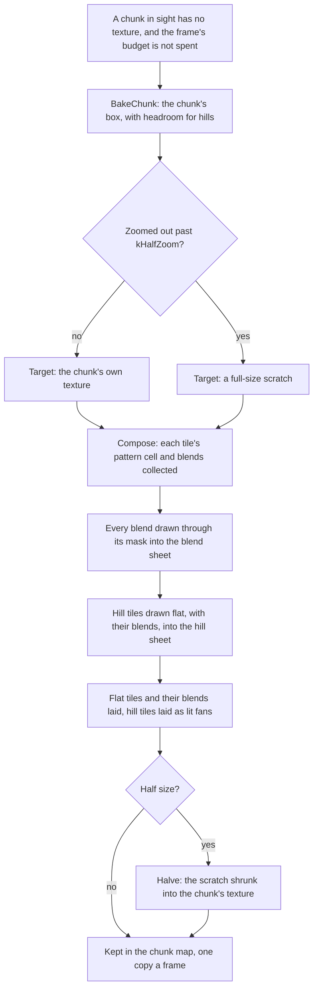

# Terrain

The original game draws its ground from `terrain.drs`: each kind of ground is
a set of diamond tiles 97 pixels wide and 49 high. Where two kinds meet, the
one of higher priority spills onto its neighbour through a soft-edged mask
from `blendomatic.dat`, so grass frays into dirt and sand into water instead
of meeting in a hard line. Hills lift the corners of tiles and shade the
slopes that face away from the light.

OpenAoK draws the same ground from the same files. Rather than drawing every
tile and blend every frame, it bakes the ground into chunks of 8 by 8 tiles,
each a texture of its own, and draws a frame's ground as one copy per chunk in
view. This page covers the terrain art, the tiling pattern, blending, the
chunks and their bakes, and hills. Where the ground fits into the frame is on
[The frame](/engine/rendering/).

## Terrain graphics

`GraphicCache::OpenTerrain` opens `terrain.drs`, and `GetTerrainAtlas` packs a
terrain's SLP like any other graphic (see
[Sprites and texture pages](/engine/rendering/sprites)), except that its block
is a texture of its own: the whole terrain set lies on one texture, so a chunk
bakes from one texture per kind of ground. Which SLP a terrain uses, and its
blend priority and blend type, come from the dat's terrain table; its frame
count from the SLP in the archive. `tools/data/extract_terrain_data.py`
gathers them when the data is prepared, and the renderer reads them through
`ConfigManager::GetTerrainArt`.

A tile on the grid is 96 by 48 screen pixels (`IsometricMath::TILE_WIDTH`,
`TILE_HEIGHT`); its image is a pixel larger each way, so neighbouring tiles
overlap by a pixel where they meet. Water is a terrain like any other and is
baked into the chunks with the rest.

## A square tiling pattern

The frames of a terrain set are not interchangeable variations. They are the
cells of one square pattern: every set has a square number of frames (100, 64,
36 or 9), 10 by 10 for most terrains and 3 by 3 for farms. Each tile draws the
cell for its position, so the pattern runs on unbroken from tile to tile and
the ground shows no seams.

The cell is worked out when a tile is painted as the map is made, by
`VariantFor` in `core/MapGenerator`, and kept on the tile as
`texture_variant`:

```cpp
uint8_t VariantFor(int x, int y, int frame_count) {
    if (frame_count <= 1) return 0;
    int period = 1;
    while ((period + 1) * (period + 1) <= frame_count) ++period;

    const int column = ((x % period) + period) % period;
    const int row = ((-y % period) + period) % period;
    return static_cast<uint8_t>(column * period + row);
}
```

The column counts up with the tile's x, the row counts down as its y counts
up. `TerrainRenderer::GetTerrainTile` takes the cell modulo the terrain's own
frame count and returns the cell's rectangle on the terrain's texture.

## Blending

Every terrain has a blend priority in the dat. Over each tile, every distinct
terrain of higher priority among its eight neighbours is drawn through masks,
the lowest priority first, so the strongest ground ends on top. The neighbours
are numbered round the tile:

```cpp
// Neighbour bit layout the mask table is indexed by:
//     0 1 2
//     7 . 3
//     6 5 4
// so the edge-adjacent neighbours are the odd bits and the corners the even.
constexpr int kNeighbourDx[8] = {-1,  0,  1, 1, 1, 0, -1, -1};
constexpr int kNeighbourDy[8] = {-1, -1, -1, 0, 1, 1,  1,  0};
```

### The masks

`blendomatic.dat` holds, for each blend mode, 31 alpha masks the shape of a
tile: one for each pattern of neighbours. When the data is prepared,
`tools/data/extract_blendmasks.py` lays them out as one sheet,
`assets/sprites/terrain/blendmasks.png`: a row 49 pixels high for each mode,
31 masks of 97 pixels across. `BlendMasks()` loads the sheet once and counts
its rows to know how many modes there are.

For one higher-priority terrain, the masks are chosen from where it lies
round the tile (`CollectBlends`, `AdjacentMask`):

| Where the terrain lies | Masks |
|---|---|
| along one edge | one of four interchangeable masks for that edge (0 to 15), by `(x * 7 + y * 13) & 3`, so a long border does not repeat one shape |
| along two or more edges | one mask for each combination (20 to 30) |
| at a corner, with neither edge beside it blending | a corner mask (16 to 19) for each such corner, besides any edge mask |

The mode, which set of masks to use, comes from the two terrains' blend types
through an 8 by 8 table (`GetBlendMode`): the ground drawn over picks the row,
the ground spilling onto it the column. A mode the sheet does not hold falls
back to the ordinary edge, mode 0.

### Drawing a blend

A `Blend` is the neighbour's art, at the cell of this tile's own pattern
position, and a mask. Each is drawn into a slot of a blend sheet: the tile
copied in, then the mask copied over it with a blend mode that keeps the
tile's colour and multiplies its alpha by the mask's.

```cpp
void MaskBlends(SDL_Renderer* sdl_r, SDL_Texture* masks, const std::vector<Blend>& blends) {
    static const SDL_BlendMode multiply_alpha = SDL_ComposeCustomBlendMode(
        SDL_BLENDFACTOR_ZERO, SDL_BLENDFACTOR_ONE, SDL_BLENDOPERATION_ADD,
        SDL_BLENDFACTOR_ZERO, SDL_BLENDFACTOR_SRC_ALPHA, SDL_BLENDOPERATION_ADD);
    for (size_t i = 0; i < blends.size() && i < static_cast<size_t>(kBlendSlots); ++i) {
        const Blend& b = blends[i];
        const SDL_Rect slot = BlendSlot(i);
        SDL_SetTextureBlendMode(b.tile.atlas, SDL_BLENDMODE_NONE);
        SDL_RenderCopy(sdl_r, b.tile.atlas, &b.tile.src, &slot);
        const SDL_Rect msrc = {b.mask * kMaskW, b.mode * kMaskH, kMaskW, kMaskH};
        SDL_SetTextureBlendMode(masks, multiply_alpha);
        SDL_RenderCopy(sdl_r, masks, &msrc, &slot);
        SDL_SetTextureBlendMode(masks, SDL_BLENDMODE_BLEND);
        SDL_SetTextureBlendMode(b.tile.atlas, SDL_BLENDMODE_BLEND);
    }
}
```

A tile has at most eight blends, one per neighbour, so the sheet has room for
every blend of a chunk (8 by 8 tiles, eight each). All of a chunk's blends are
drawn into it before the chunk itself, so the renderer changes target a few
times a chunk rather than twice for every blend. Laying the tile then copies
its run of slots over it.

## Chunks

A chunk is 8 by 8 tiles (`TerrainRenderer::CHUNK_SIZE`), small so that little
texture goes to the empty corners of its diamond's bounding box. Its box
(`ChunkBox`, from `BoxOf`) covers its tiles' images on the screen, with room
above for hills, since ground on a hill is drawn higher up the screen than its
flat position.

```cpp
constexpr uint64_t kBakeBudgetUs = 4000;
// The view counts as jumped when more than one in this many of the chunks in
// sight have nothing baked.
constexpr int kJumpedShare = 4;
constexpr size_t kMaxLiveChunks = 64;
// Zoomed out further than this, chunks are baked at half their size: a
// quarter of the memory and the drawing, at no cost to what shows.
constexpr float kHalfZoom = 0.6f;
// Room above a chunk for hills: a tile on high ground is drawn higher up the
// screen than its flat position.
constexpr float kHeadroomPx = 8.0f * Ground::kLevelPx;
```

### A chunk's bake

`BakeChunk` makes the chunk's texture, a render target the size of its box,
and `Compose` draws the chunk into it in four steps:

1. For each tile: the cell of its terrain's pattern, whether it lies flat, and
   its blends, collected.
2. Every blend drawn through its mask into the blend sheet.
3. Each tile on a hill drawn flat, with its blends, into a slot of a hill
   sheet.
4. The target cleared, then each flat tile copied to its place with its blends
   over it, and each hill tile laid onto the ground's shape (see
   [Hills](#hills)).

Every tile gets an opaque base, water included, so blends always paint onto
something. Bakes save and restore the renderer's target, scale and blend mode,
since a chunk is baked at the scale of its own pixels in the middle of a frame
drawn at the camera's zoom.



### Each frame

`TerrainRenderer::DrawTerrain` looks at every chunk whose box meets the view
widened by a chunk's width (768 pixels) each way:

- Chunks **in sight** (the view, and the hills a chunk just below it raises
  into it) that have no texture are baked as they are met, while the frame's
  budget lasts: 4 ms (`kBakeBudgetUs`), doubled when more than a quarter of the
  chunks in sight have nothing baked, as after a jump across the map by the
  minimap.
- Chunks in the **margin** are baked after them with what is left, so they are
  ready as they scroll in.
- Whatever is still left fills in the [overview](#the-overview).

Each chunk in sight is drawn with one copy. A chunk is baked with each tile's
image box starting at the tile's world point, so it is drawn half a tile
higher to centre every tile's diamond on its world position, the convention
the rest of the engine uses for a tile.

### Keeping and dropping chunks

Live chunks are kept in a map by chunk position (and size), each with the frame
it was last used in. Once there are more than `kMaxLiveChunks` (64), or half as
many again as are in view when that is more, the least recently used are
destroyed, never one used this frame.

The ground can change during play: a farm planted, a foundation laid.
`Physics::Grid::SetTerrain` records each change in a log the grid keeps (up to
1,024 of its most recent changes, and a revision number). Each frame the renderer
reads the log, never writing back, and drops every chunk a change touches
along with its neighbours, whose blends reach a tile over. A reader fallen
further behind than the log reaches throws every chunk away
(`InvalidateChunks`). The player's memory of the ground works the same way:
the renderer draws each tile as the player at this machine last saw it
(`ECS::Fog::GroundSeen`), and the fog's memory keeps a log of its own.

## Half-size chunks

Zoomed out past `kHalfZoom` (0.6), the ground is shown at less than 0.6 of its
size, and chunks are baked at half their size: a quarter of the memory and of
the pixels drawn. A chunk not yet baked at the size wanted is drawn from its
other size meanwhile, if it has one.

A half-size chunk is composed whole at full size into a scratch texture, with
a clear column and row to spare, then shrunk into its own texture:

```cpp
void TerrainRenderer::Halve(SDL_Renderer* sdl_r, SDL_Texture* full, int w, int h) {
    // The pixel a plain shrink keeps is drawn last, over the three beside it:
    // a chunk's pixels are clear or solid, so it shows exactly where it is
    // ground.
    static const SDL_Point kSamples[4] = {{1, 1}, {1, 0}, {0, 1}, {0, 0}};
    SDL_SetTextureBlendMode(full, SDL_BLENDMODE_BLEND);
    for (const SDL_Point& at : kSamples) {
        const SDL_Rect src{at.x, at.y, w, h};
        SDL_RenderCopy(sdl_r, full, &src, nullptr);
    }
}
```

Each of the four copies takes one pixel of every 2 by 2 square of the full
image, shifted by a pixel across, down, or both. So a pixel of the half-size
chunk is ground wherever any of the four it stands for is. A plain shrink would
keep only one of the four, and the pixel of overlap where two chunks' edges
meet could fall away, opening a gap between them. With `Halve`, neighbouring
chunks still overlap and no gap opens at any zoom.

## The overview

Beneath the chunks lies the whole map drawn once at an eighth of its size
(`kOverviewShrink`, halved again while it would be larger than the renderer's
largest texture), drawn with filtering. It is what shows where a chunk in sight
is not yet baked, and is drawn only when one is missing. It is filled in a
chunk at a time with whatever is left of each frame's bake budget, each chunk
composed at full size into the scratch and drawn into it shrunk, and a chunk of
it is drawn again where the ground changes.

## Hills

`Rendering::Ground` turns the simulation's elevation, one level per tile, into
a surface. A tile corner's height is the average of the four tiles that meet
there, and a tile's middle is its own level, so a hill climbs smoothly rather
than in steps. A level is 12 screen pixels (`Ground::kLevelPx`). The terrain,
the fog, sprites and the mouse all go through it: `HeightPx` gives the height
under any world point (between its four corners), which lifts whatever stands
there, and `Pick` finds the world point under a screen point on a hill in a few
rounds of correction.

A tile with all four corners and its middle at level 0 is copied flat. Any
other tile is first drawn flat, with its blends, into its slot of the hill
sheet, then laid into the chunk as a fan of four triangles about its middle:
each corner raised to its height, the middle to the tile's own level, and the
outer corners pushed out a pixel so neighbouring tiles overlap as flat ones do.

```cpp
        static const int kFan[12] = {0, 1, 4, 1, 2, 4, 2, 3, 4, 3, 0, 4};
        SDL_RenderGeometry(sdl_r, hill_sheet, corners, 5, kFan, 12);
```

`Ground::Light` gives each corner how the light falls on it, from the slope of
the four tiles round it: 0 on flat ground, up to +1 on a slope facing the
light, down to -1 on one facing away, the light falling from the upper left of
the screen. The fan's vertex colours darken the slopes facing away, and a
second pass, added on top, brightens the slopes facing the light:

```cpp
        constexpr float kDeepestShade = 0.45f;
        constexpr float kBrightestLight = 70.0f;
        auto shade = [](float light) {
            const float dark = light < 0.0f ? 1.0f + light * kDeepestShade : 1.0f;
            const Uint8 v = static_cast<Uint8>(std::clamp(dark, 0.0f, 1.0f) * 255.0f);
            return SDL_Color{v, v, v, 255};
        };
        auto glow = [](float light) {
            const Uint8 v = static_cast<Uint8>(
                std::clamp(light, 0.0f, 1.0f) * kBrightestLight);
            return SDL_Color{v, v, v, 255};
        };
```

The fog of war lays its masks onto hills with the same fan, so its edges
follow the ground as drawn (see [Fog of war](/engine/rendering/fog)).

## Where it lives in the code

- [`src/rendering/TerrainRenderer.h`](https://github.com/Zaydme/openaok/blob/main/src/rendering/TerrainRenderer.h), [`TerrainRenderer.cpp`](https://github.com/Zaydme/openaok/blob/main/src/rendering/TerrainRenderer.cpp): terrain tiles, blending, chunk bakes, half-size chunks, the overview, hill fans
- [`src/rendering/Ground.h`](https://github.com/Zaydme/openaok/blob/main/src/rendering/Ground.h), [`Ground.cpp`](https://github.com/Zaydme/openaok/blob/main/src/rendering/Ground.cpp): the ground's surface, its height under a point, its light, picking on hills
- [`src/core/MapGenerator.cpp`](https://github.com/Zaydme/openaok/blob/main/src/core/MapGenerator.cpp): `VariantFor`, each tile's cell of its terrain's pattern
- [`src/hal/GraphicCache.cpp`](https://github.com/Zaydme/openaok/blob/main/src/hal/GraphicCache.cpp): the terrain archive and each terrain's atlas
- [`src/physics/Grid.h`](https://github.com/Zaydme/openaok/blob/main/src/physics/Grid.h): tiles, their terrain and elevation, the log of changes to the ground
- [`src/ecs/Fog.h`](https://github.com/Zaydme/openaok/blob/main/src/ecs/Fog.h): the ground as each player last saw it
- [`tools/data/extract_blendmasks.py`](https://github.com/Zaydme/openaok/blob/main/tools/data/extract_blendmasks.py): the blend masks from `blendomatic.dat`, as one sheet
- [`src/verify/HalveCheck.cpp`](https://github.com/Zaydme/openaok/blob/main/src/verify/HalveCheck.cpp): self-check that halved chunks still overlap where they meet
