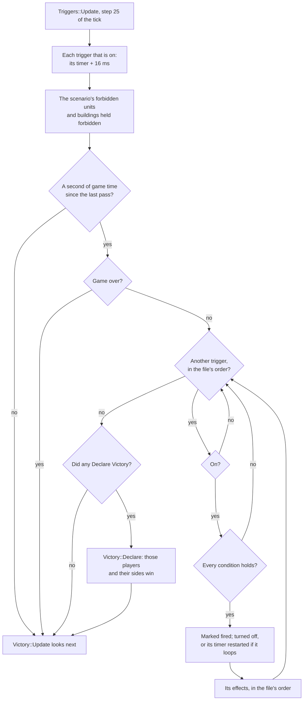
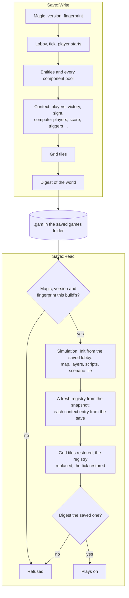

# Scenarios, campaigns and saves

A scenario is a map made by hand in the game's editor: its ground, every unit
and building placed where its author wanted, who the players are and how they
stand with each other, and triggers, small rules of the form "when this
happens, do that", which tell the story and decide who wins. A campaign is a
run of scenarios played in order, each won opening the next. A saved game is
a game stopped part way and taken up again later; a recorded game is one kept
so it can be watched again.

This page covers the scenario file and how OpenAoK builds a world from it,
how triggers run inside the tick and what they show, campaigns and the
player's progress through them, the scenario editor, and saved and recorded
games. How a game ends once a trigger declares a victory is on
[Victory and diplomacy](/engine/victory).

## The scenario file

A scenario file (`.scn`) is a short plain header, which the game's lists read
without unpacking anything, then everything else compressed: the players, the
texts, the map, the units, the players' settings and the triggers. The byte
layout, part by part, is on
[The game's data](/engine/data#scenarios-and-campaigns); this section is
about how the engine holds and handles it.

`src/scenario/` reads and writes the file as plain data. `Scenario::Read`
takes the bytes; `Scenario::Load` takes a lone `.scn`, or the `entry`th
scenario of a campaign file. The reader knows the layouts of versions 1.14 to
1.22 and refuses others, and it refuses a file with bytes left over at the
end, so every file it accepts has been read to its last byte. The writer lays
a file out as version 1.18, with player data 1.20 and triggers 1.6, the
version of every scenario on the CD, and labels it so; a file read at an
older version is written, and labelled, at this one.

The result is a `Scenario::File`:

| Field | Holds |
|---|---|
| `version`, `player_data_version`, `trigger_version` | `"1.18"`, 120 (hundredths), 16 (tenths) |
| `texts[6]` | Instructions, hints, victory, loss, history and scouts, each a `Text`: its own words and a LANGUAGE.DLL string id |
| `pregame_cinematic`, `victory_cinematic`, `loss_cinematic`, `background`, `bitmap` | What plays before and after, and the instructions screen's map picture |
| `players[9]` | Gaia (its units only) and players 1 to 8: name, civilisation, human or computer, stockpiles, starting age, stances, allied victory, colour, camera, what is disabled, the computer player's script, and every unit placed |
| `victory` | The Global Victory settings: the mode, the score or the time to reach, and a custom victory's conquest, relics and map explored, any or all |
| `width`, `height`, `terrain`, `elevation` | The map, a dat terrain and an elevation level per tile, row by row |
| `camera_x`, `camera_y` | The tile player 1's view opens on |
| `triggers` | Every trigger, with its conditions and effects |
| `kept` | Everything the game does not play by, as read |

A unit placed is its position (x, y and z), the id the editor gave it, which
the triggers name it by, its dat unit, a state, a rotation, its first frame,
and the id of whatever it is garrisoned in. Positions are kept in the file's
own frame, where a tile `t` spans `[t, t + 1)`, so a unit in the middle of
tile 10 is at 10.5. Floats become fixed point once, exactly, from their bits
(`Encoding::FixedFromBits`), and text is Windows-1252 in the file and UTF-8
in the engine (`Encoding::Utf8`, `Encoding::Cp1252`).

A text names a LANGUAGE.DLL string when there is one. `Scenario::Show` gives
the DLL's string when the scenario names one the DLL has, and the file's own
words otherwise; the game's own campaigns name a string for nearly everything,
while a custom scenario names none.

### Written back as it was read

What the game does not play by (the editor's own copies of things, the last
eight slots of the file's sixteen-player tables, fields nobody has named, the
exact bytes after a name's terminating NUL) is held in `File::kept`. A unit's
floats are kept as written too, and written back while the value they stand
for is unchanged. So `Scenario::Write` gives back the file it read, byte for
byte once inflated; for a new file, `kept` holds what the editor writes for a
new scenario.

### The compressed body

Everything after the plain header is raw deflate: zlib's compression without
its header or checksum. Reading uses the inflater of the vendored stb_image
(`stbi_zlib_decode_noheader_malloc`). Writing uses the engine's own encoder,
`Scenario::Deflate`: LZ77 over a 32 KB window with hash chains (a 15-bit hash
of three bytes, up to 256 steps down a chain), coded with deflate's fixed
Huffman tables in one final block. A match of 128 bytes or more is taken at
once; a shorter one is worth giving up for a longer one starting a byte later:

```cpp
    int at = 0;
    while (at < n) {
        int distance = 0;
        const int length = longest(at, distance);
        if (length == 0) {
            Symbol(bits, data[at]);
            insert(at);
            ++at;
            continue;
        }
        // One step of lazy matching: a longer match starting at the next byte
        // is worth a literal first.
        insert(at);
        int next_distance = 0;
        const int next_length = length < kNiceMatch ? longest(at + 1, next_distance) : 0;
        if (next_length > length) {
            Symbol(bits, data[at]);
            ++at;
            continue;
        }
        Match(bits, length, distance);
        for (int i = 1; i < length; ++i) insert(at + i);
        at += length;
    }
    Symbol(bits, 256);   // the end of the block
```

The compressed bytes are not those of the CD's files, so a file read and
written back is compared with the one read by their inflated forms
(`Scenario::Expand`), which are the same byte for byte.

## A scenario's world

When a scenario is played, the file decides the game: the map, the players,
their stockpiles and ages, where everything stands and who is whose ally.

`Scenario::SetupFor` turns the file into a lobby (`Core::GameSetup`): the
map's size; for each seat in use its civilisation, its name (through
`Scenario::Show`), its colour, its starting age, and whether the computer
plays it (any seat the file does not mark human). Teams are left empty,
because the stances come from the file, and Lock Teams is off so the triggers
can change them. Regicide is off, All Techs is the file's, and the victory is
standard for a file whose mode is Standard and conquest for any other. What
the scenario does not decide, the seed, the difficulty and the reveal setting,
is kept from whoever started the game.

`Simulation::Init` then builds every seat's tables, technologies and ages as
for any game, and hands over to `Simulation::InitScenario`
(`ecs/ScenarioWorld.cpp`) instead of running a map script:

1. **The file is turned.** The file's axes are a quarter turn from the grid's
   (the same turn `BuildingGeometry::FromDatAxes` makes for the dat's
   offsets), so `ScenarioWorld::Turned` makes a copy in the grid's frame:
   ground, units, cameras and every trigger's areas and locations. Everything
   after this, the triggers and a save of the game included, sees the turned
   file.
2. **The players' starts.** Each seat gets the file's stockpiles; a seat in
   the editor's Post-Imperial Age has every technology its buildings offer
   researched; the technologies the file forbids are marked disabled unless
   already done.
3. **The stances.** The file's stances and allied victory choices are set
   straight into the diplomacy table. They are where the game starts, not
   changes anyone made, so nobody is told of them.
4. **The ground.** Each tile gets its terrain (`ScenarioWorld::TerrainOf`) and
   elevation. A dat terrain the engine has no terrain of its own for is laid
   as the one the dat draws it as; the Water Bridge, which draws as water but
   which land units cross, is laid as Shallows, the one ground that does both.
5. **Everything on it**, Gaia's first, then each player's in the file's order,
   through `ScenarioWorld::Place`; then each unit the editor put inside
   something is put inside it.
6. **Vision and the views.** Player 1's view opens on the tile the editor was
   last looking at; the others' on their own cameras.
7. **The triggers** are set up (`Triggers::Setup`), and the turned file goes
   into the registry's context, for the triggers, whose definitions it holds,
   and for the interface, which shows its texts and objectives.

A point of the file becomes a point of the grid like this, half a tile back
because the engine's tiles are centred on whole numbers:

```cpp
Components::Vector2D FromFile(Core::Fixed32 x, Core::Fixed32 y, int file_width) {
    const Core::Fixed32 half = Core::Fixed32(1) / Core::Fixed32(2);
    return {y - half, Core::Fixed32(file_width) - x - half};
}
```

`ScenarioWorld::Place` builds each thing the way the rest of the engine
builds it:

| The file's unit | Becomes |
|---|---|
| A cliff (dat class 34) | A cliff piece drawing the frame the editor chose, blocking the tiles under it |
| A building with ground of its own | A finished building (`Buildings::Place`) on the tile its centre is in |
| A unit, or a trebuchet packed or set up | A unit (`Units::Spawn`) facing the way the file says |
| Anything else: a tree, a mine, a rock, a flag, an animal, a bridge, a ruin | A map object, with its stock and in the shape the editor chose, blocking its tile if it holds a resource or the dat makes it solid |

Gaia's animals, birds, relics and livestock are map objects, placed as a
random map places them. Gaia's villagers, soldiers and buildings are whole
units, and the first player to see one takes it (`ecs/Allegiance`). A
computer player that the file gives a script of its own plays that script;
see [Computer players](/engine/ai#scenarios).

The scenario editor builds its world through the same code
(`Simulation::InitFromFile`, from a file in memory), so what the editor shows
is what a game of the file starts with.

## Triggers

A trigger is on or off. While it is on, its conditions are asked; when all of
them hold (at once, for a trigger with none), its effects are carried out, in
the file's order, and it turns itself off, unless it loops. A trigger can be
an objective, listed with its text in the Objectives dialog. Its timers count
from when it was last turned on.

```cpp
struct Trigger {
    bool enabled = true;       // on when the game starts
    bool looping = false;
    int32_t string_id = -1;    // LANGUAGE.DLL, for the objective's text
    bool objective = false;    // listed among the objectives
    int32_t objective_order = 0;
    int32_t start_time = 0;
    std::string description;   // the objective's own text
    std::string name;
    std::vector<Effect> effects;
    // Each list as the editor showed it: the indices in display order.
    std::vector<int32_t> effect_order;
    std::vector<Condition> conditions;
    std::vector<int32_t> condition_order;
    // ...
};
```

A condition is the sixteen fields the file carries for it, and an effect its
twenty-three, a message and a sound file, each named by its meaning
(`Scenario::Condition`, `Scenario::Effect`); a field the type does not use is
-1. The definitions stay in the file; what changes in play is
`Triggers::State`, in the registry's context: each trigger's `Run` (on, fired
at least once, the time since it was last turned on), the file's units mapped
to the entities they became, the computer players' signals and goals, what
each player has selected, the gates locked, and the time to the next pass.

### In the tick

`Triggers::Update` runs at step 25 of the tick, just before victory is judged.
Every tick it moves the timers of the triggers that are on and keeps the units
and buildings the scenario forbids forbidden (a technology researched in play
could enable one again). Once a second of game time (`kCheckMs`), starting on
the first tick, it asks the triggers, in the file's order:



```cpp
    for (size_t i = 0; i < count; ++i) {
        if (!state->runs[i].on) continue;
        const Scenario::Trigger& trigger = file->triggers[i];
        bool all = true;
        for (const auto& condition : trigger.conditions) {
            if (!Holds(registry, *state, state->runs[i], condition)) {
                all = false;
                break;
            }
        }
        if (!all) continue;
        // Off before its effects, so one of them may turn it on again; a
        // looping one starts its timers over.
        state->runs[i].fired = true;
        if (trigger.looping) {
            state->runs[i].active_ms = 0;
        } else {
            state->runs[i].on = false;
        }
        for (const auto& effect : trigger.effects) {
            Carry(registry, grid, *state, static_cast<int>(i), effect);
        }
    }
```

Some consequences of that order:

- A trigger turned on by an earlier one in the file is asked in the same pass;
  one turned on by a later one waits for the next.
- A trigger is off before its effects run, so one of its own effects may turn
  it on again.
- A looping trigger fires at most once a second.
- The players named by Declare Victory effects are gathered through the pass
  and handed to `Victory::Declare` together at its end, so one pass can
  declare several winners, and victory is judged right after, in the same
  tick.

Because the triggers run inside the tick, on every machine, from the same
state, they need no network of their own. What a player has selected, which
the Object Selected condition asks about, reaches them as a
`SelectionCommand`, sent by the interface each time the selection changes, and
only while the scenario has such a condition.

### Conditions

| Condition | Holds when |
|---|---|
| Bring Object to Area | The named unit is in the game and stands in the area |
| Own Objects | The player has at least the amount of things passing the filters (in the area, if one is set) |
| Own Fewer Objects | The player has at most the amount |
| Objects in Area | The player has at least the amount in the area |
| Destroy Object | The named unit, one the file placed, is gone, dying or a body |
| Accumulate Attribute | The player's dat resource is at least the amount |
| Research Technology | The player has researched the technology |
| Timer | The trigger has been on for at least the seconds given |
| Object Selected | Some player has the named unit selected |
| AI Signal | A computer player's script has raised that signal (`Triggers::RaiseSignal`) |
| Player Defeated | The player is out of the game |
| Object Visible | The named unit stands on a tile visible to the first seat a person plays, or to player 1 |
| Researching Technology | The player is researching the technology now |
| Units Garrisoned | The named unit holds at least the amount, relics in a Monastery counting |
| Difficulty Level | The game is at the difficulty named or an easier one |

The counting conditions count living things, buildings only once finished.
The filters are a dat unit, a dat class, and the editor's object type
(building, civilian, military), which is the dat's combat level; the class and
the type are read from the owner's own rules.

### Effects

An effect acts on the units it names, those of them its source player owns
(any owner's, when it names no player); or, naming none, on the source
player's things in its area, through its filters. One that gives orders
(Task Object, Unload, Patrol) gives them only to units, through
`Orders::Execute` as the unit's owner, with the checks any player's orders
have.

| Effect | Does |
|---|---|
| Change Diplomacy | Sets the source player's stance toward the target player |
| Research Technology | Completes the technology for the source player at once |
| Send Chat | A chat line to the source player (to everyone, naming none), with its narration |
| Play Sound | A scenario sound for the source player |
| Send Tribute | Moves a resource from the source to the target player, free, no more than the giver has; from Gaia, out of nothing |
| Unlock Gate, Lock Gate | Locks or unlocks the gates, as their owner's Lock button would, and keeps the trigger's locks |
| Activate Trigger, Deactivate Trigger | Turns another trigger on (its timers from nothing) or off |
| AI Script Goal | Sets a goal the source player's computer player takes as an event |
| Create Object | Places a dat unit for the source player at the location, as the world was built |
| Task Object | Sends the units at a named unit as a right-click would (to fight it, gather from it, trade with it, shelter in it, fetch it, or walk to it), or to the location |
| Declare Victory | Names the source player a winner |
| Kill Object | A building destroyed, a unit killed where it stands; a thing with no life to lose taken away |
| Remove Object | Taken out of the world with no death, whoever it carries with it |
| Change View | Moves the source player's view to the location |
| Unload | Transports unload at the location |
| Change Ownership | The things pass to the target player |
| Patrol | Units patrol to the location |
| Display Instructions | Text on one of three instruction lines, for its time, with its narration |
| Clear Instructions | Empties an instruction line |
| Use Advanced Buttons | Logged for the interface |

The conditions Bring Object to Object, Capture Object, Object Has Target and
Object Not Visible, and the effect Freeze Unit, are read and kept but never
hold and never act. `Triggers::Setup` names each one a file uses, once, in
the log as the world is built.

The computer players and the triggers talk both ways: a script's signal
(`RaiseSignal`) is what an AI Signal condition waits for, and an AI Script
Goal effect sets a bit the computer player takes, once, as an event the next
time it thinks (`TakeGoal`).

## What triggers show

What is only for the screen and the speakers, the instructions, chat, sounds,
moving the view and the advanced buttons, a trigger writes to a display log
(`Triggers::Display`, the last 256 lines kept), each line stamped with the
pass's tick. The simulation never reads it; presentation does, as it reads the
event log:

- `Rendering::Messages` puts instructions on their line (0, 1 or 2) for the
  number of seconds the effect gives, or until cleared when that is 0, and
  prints a trigger's chat line: to everyone in plain text, or, sent to one
  player, to that player alone in its colour;
- `Audio::Notices` plays the narration an instruction or a chat line carries,
  and a Play Sound's file, each an MP3 of `Sound/scenario` (see
  [Sound, music and movies](/engine/audio));
- the frame loop moves the camera for a Change View sent to everyone or to
  this machine's player.

A loaded game catches up with its log first, so nothing already shown is
shown again.

The Objectives dialog lists the objectives `Triggers::Objectives` gives
(every trigger the file marks as one, in its objective order, with its text
and where it stands) that are on now or done, the done ones struck out. With
none to show, it shows the scenario's instructions; the hints have a tab of
their own.

### Before and after

Before a scenario of one of the game's campaigns comes its slide show, and
after one won, its closing slides; the learning campaign then goes straight
back to its map. Any other scenario opens on its instructions screen (the
Mission dialog: its name, its map picture, and its Instructions, History and
Hints in tabs), when it has instructions, and ends on its victory or loss
text, when it has one. Every game of a scenario but the learning campaign's
then goes on to the
[Achievements screen](/engine/victory#the-achievements-screen). The screens
before the game are shown only for a single-player game started afresh, not
for a loaded game, a network game or a recording being watched.

## Campaigns

A campaign file (`.cpn`) is a table of contents followed by its scenarios end
to end, each an ordinary scenario file in the order they are played (the
table's layout is on [The game's data](/engine/data#scenarios-and-campaigns)).
`Scenario::LoadCampaign` reads the table; `Scenario::ReadCampaignScenario`
cuts one scenario's bytes out of the file. Each of the game's five campaigns
is named `cam` and a number inside its file (`cam1` to `cam4`, and `cam8` for
the learning campaign), and that number finds its name, its scenarios' names
and its description among LANGUAGE.DLL's strings (`Scenario::StringsOf`). Any
campaign file named otherwise is a custom campaign.

`Scenario::CampaignBytes` and `Scenario::WriteCampaign` make a campaign file
from scenarios, in order; the Campaign Editor screen of the Map Editor uses
them to put the player's scenarios into a campaign of its own.

### Progress

The player's progress is kept between runs, per player name and campaign, in
`campaigns.txt` in the profile's folder: one tab-separated line each, with the
player, the campaign's own name, how many of its scenarios are open, and which
have been won, a bit each. Each campaign's first scenario is open from the
start. When a campaign's scenario is won, the game marks it and opens the next:

```cpp
void MarkWon(Book& book, const std::string& player, const std::string& campaign, int entry,
             int count) {
    if (entry < 0 || entry >= 32) return;
    Record* r = Find(book, player, campaign);
    if (r == nullptr) {
        book.records.push_back(Record{player, campaign, 1, 0});
        r = &book.records.back();
    }
    r->won |= 1u << entry;
    r->unlocked = std::max(r->unlocked, std::min(entry + 2, std::max(count, 1)));
}
```

The campaign screens (`screens/Campaigns`) read the same record to show, on
each campaign's map and in the list of custom campaigns, the scenarios opened
so far.

## The scenario editor

The original's Map Editor edits a scenario in ten tabs. OpenAoK's editor
(`src/editor/`) has the same tabs:

| Tab | Edits |
|---|---|
| Map | A new map: blank, of one ground, or made by a random map script, with or without a seed, at a size |
| Terrain | Brushes for terrain, elevation (the ground round eased so no two neighbours differ by more than one), cliffs, copying a piece of the map, and erasing, in five sizes |
| Players | The number of players; each one's name, human or computer, civilisation, colour, starting age, stockpiles and personality |
| Units | Placing, deleting, moving, turning and selecting units, buildings, heroes and other objects, for a player or Gaia, and what is inside them |
| Diplomacy | How each player regards each other, and allied victory |
| Global Victory | The victory: standard, conquest, a score, a time limit, or custom conditions |
| Options | All Techs, each player's disabled buildings, units and technologies, and the difficulty to test at |
| Messages | The six texts, each with its LANGUAGE.DLL string id |
| Cinematics | The cinematics before and after, and the instructions screen's map |
| Triggers | The triggers, their conditions and effects, and the fields each type uses |

The Triggers tab shows only the fields each condition and effect type uses
(`kConditionUse`, `kEffectUse`: unused, needed or optional, per field), and a
field that is a place, an area or a unit is picked by clicking in the map view.

### The document

`Editor::State` holds the scenario as it will be saved (`doc`, a
`Scenario::File`) and a world that shows it (`sim`), built from the file by
`Simulation::InitFromFile` with every seat filled, so every player's units
show in their own colours, and with all the map in sight. The world is never
run: nothing in the editor calls the simulation's tick, and only the
animation steps on, so flags fly and units stand idle. Every edit goes to both,
the file and the world, through the modules a game uses (`ecs/ScenarioWorld`,
`ecs/Buildings`); a map entity is tied to the file's unit it stands for by the
ids the triggers use (`refs`).

The file stays in its own frame and the world in the grid's, a quarter turn
apart, as in a game of it. Whatever the editor takes from the world for the
file, a click, the view, a tile painted, is turned back (`FileOf`,
`FileTile`); whatever of the file it shows is turned (`WorldOf`, `GridTile`).

The panels are immediate mode (`editor/Ui`): each is one function that names
every control where it stands, run once to draw and once per event to test
for hits, so a control is always where it is drawn.

### Saving and testing

`Editor::SaveTo` brings what the header and the editor keep in step up to
date (the header's copy of the instructions, the number of players, the file
name, the time, and the tile the view is centred on, where player 1's view
will open), then writes the file with `Scenario::Save`. `scenario/Writer.cpp`
is the reader's inverse, field for field in the same order: what the game
plays is written from the file's fields, the rest from `kept`. A new scenario
(`Editor::NewFile`) is eight players on 144 by 144 tiles of grass, every
player an enemy of every other.

Test saves a copy and plays it as a game, at the difficulty the Options tab
chose; back from the game, the editor opens where it was left:

```cpp
            case 9286: {  // Test
                s.dialog = State::Dialog::None;
                const std::string test = ScenarioDir() + "editor-test.scn";
                if (SaveTo(s, test, false)) {
                    Core::GameSetup setup = Core::DefaultSetup();
                    std::string why;
                    if (Scenario::SetupFor(test, -1, setup, &why)) {
                        setup.difficulty = s.test_difficulty;
                        s.request.kind = Request::Kind::Test;
                        s.request.setup = setup;
                    } else {
                        Notice(s, why);
                    }
                }
                break;
            }
```

The Global Victory tab's score, time limit and custom victories are written
to the file as set, but a game of the file plays them as conquest (see
[Victory and diplomacy](/engine/victory#time-limits-and-score)).

## Saved games

The game can be saved at any moment from the game menu and taken up again
later exactly where it stopped. OpenAoK saves the whole simulation, so a
loaded game goes on as the one that never stopped, tick for tick.

`Save::Write` lays the file out as follows. Plain data goes out as it lies in
memory, so the bytes are this build's own: a fingerprint of the sizes of
everything written raw comes first, and a build that lays things out
differently refuses the save rather than misread it.

| Part | Holds |
|---|---|
| Magic, version | `AOKCSAVE`, then the format's version (`kVersion`, 10) |
| Fingerprint | A hash of the sizes of the components and tables written raw |
| Lobby | The `GameSetup` the game was started from, in the network's encoding (`net/Wire`) |
| Tick | The ticks run |
| Player starts | Where each player starts on the map |
| Entities | Every entity with its id and version, then each component pool in its own order (EnTT's snapshot) |
| Context | The random streams; the formation groups; each player's resources, unit rules, art and technology statuses, and the population limit; the victory state; the cheats left on; sight and the explored ground; the computer players' state; the Market's prices; diplomacy; chat; flares; the fog's memory; the score table; the histories; the event log; a scenario's triggers and display log |
| Grid | Every tile |
| Digest | The world's digest, which the restored world must match |

Keeping each pool's own order matters: views walk the restored world in the
order they walked the saved one, which the simulation's determinism rests on
(see [Fixed point and determinism](/engine/determinism)). The components
written are one list (`EachComponent`), and the `save=` self-check fails on any
component pool in a running world that the list does not name, so a new
component cannot slip past the save.

Some things are not in the file, because starting the game again rebuilds
them identically from the lobby: the map's own tables and the grid's
passability layers, the computer players' compiled scripts, and a scenario
game's file, which is read again from where the lobby says it is.



`Save::Read` checks the magic, the version and the fingerprint, reads the
lobby, and builds a world from it with `Simulation::Init`, as starting the
game did. It loads the saved entities and pools into a fresh registry, puts
each context entry in from the save (starting from what `Init` built where an
entry has parts the save does not carry), restores the grid's tiles, replaces
the simulation's registry with the new one (`Simulation::ReplaceRegistry`) and
sets the tick. Last, it takes the restored world's digest:

```cpp
    sim.ReplaceRegistry(std::move(registry));
    sim.RestoreTick(tick);
    sim.player_starts = std::move(starts);
    if (ECS::Digest::Of(sim.GetRegistry()) != digest) {
        Fail(error, "the restored world is not the one saved");
        return false;
    }
    return true;
```

Saves are `.gam` files in the saved games folder. The list of saved games
shows them and the recordings beside them, and restarting a loaded game starts
it over from its lobby. A network game is restored by the host handing every
client the whole save (see
[Restoring a saved game](/engine/multiplayer#restoring-a-saved-game)).

## Recorded games

A recorded game holds only the lobby and the orders given in each tick.
Because the simulation is deterministic, playing those orders back into a
world built from the same lobby plays the same game; the computer players
think again and decide the same.

Recording is on when the lobby's Record Game box (or `--record`) asks for it,
and never for a loaded game or a recording being watched. Before each tick
`Save::TakeTurn` copies the orders waiting in the command queue, those the
lockstep session delivered in a network game, and puts them back in the order
they came. After the tick, every 256 ticks (`kCheckEvery`), `Save::Witness`
notes the world's digest. Playing back, `Save::Replay` empties the queue of
anything the watcher's own input put there and puts in the orders recorded
for the tick:

```cpp
void TakeTurn(Recording& recording, uint64_t tick) {
    auto& queue = Core::CommandQueue::Get();
    std::vector<Core::Command> commands = queue.PopAllCommands();
    if (!commands.empty()) recording.turns.push_back(Recording::Turn{tick, commands});
    for (const auto& command : commands) queue.PushCommand(command);
}
// ...
void Replay(const Recording& recording, size_t& cursor, uint64_t tick) {
    auto& queue = Core::CommandQueue::Get();
    queue.PopAllCommands();
    while (cursor < recording.turns.size() && recording.turns[cursor].tick < tick) ++cursor;
    if (cursor < recording.turns.size() && recording.turns[cursor].tick == tick) {
        for (const auto& command : recording.turns[cursor].commands) queue.PushCommand(command);
        ++cursor;
    }
}
```

The world is built from the recording's lobby, and this machine takes the seat
it was recorded from. After each tick `Save::StillTheGame` compares the digest
where the recording noted one; the first time they differ, the log says at
which tick the playback has parted from the game recorded. A scenario's
selections are already among the orders recorded, so a playback sends none of
its own.

When the game ends, a recording with any orders in it is written to the saved
games folder, named after the player and the date and time
(`<player> - <date> <time>.mgl`):

| Part | Holds |
|---|---|
| Magic | `AOKCREC1` |
| Lobby | The `GameSetup`, in the network's encoding |
| Viewer | The seat it was recorded from |
| Turns | A count, then for each tick with orders: the tick, a count, and the commands, each in the network's encoding |
| Checks | A count, then each noted tick and its digest |

`--play FILE` watches one from the command line, as `--load FILE` loads a
saved game and `--scenario FILE` plays a scenario (see
[Command line](/guide/command-line)).

## Checking it

- `scenario=` reads every scenario on the CD to its last byte and counts its
  triggers, conditions and effects against totals taken from the files
  independently; checks the campaign files and their names; plays the bonus
  scenario, its ground, units and positions turned onto the grid, its
  triggers firing; and saves and loads it part way, running on as the game
  that never stopped. It also checks the campaign progress record.
- `editor=` reads, writes and reads again every scenario of the CD, comparing
  field by field and, inflated, byte by byte; checks that edits survive a write
  and a read; writes a new scenario; and makes the editor's own edits through
  its document code, checking that each reaches both the file, in the file's
  frame, and the world, in the grid's, and that a Test game stands everything
  where the editor showed it.
- `save=` records a game and plays it back, the same at every digest noted
  and not the same without its orders; saves a game part way, loads it into a
  fresh world and runs both on, digest for digest; and refuses a save whose
  world does not match its digest, one cut short and one from elsewhere.

See [Self-checks](/development/verification).

## Where it lives in the code

- [`src/scenario/Scenario.h`](https://github.com/Zaydme/openaok/blob/main/src/scenario/Scenario.h), [`src/scenario/Scenario.cpp`](https://github.com/Zaydme/openaok/blob/main/src/scenario/Scenario.cpp): the scenario file as plain data, reading it, `Show`, `SetupFor`
- [`src/scenario/Writer.cpp`](https://github.com/Zaydme/openaok/blob/main/src/scenario/Writer.cpp): writing a scenario back, and `Expand`
- [`src/scenario/Deflate.h`](https://github.com/Zaydme/openaok/blob/main/src/scenario/Deflate.h), [`src/scenario/Deflate.cpp`](https://github.com/Zaydme/openaok/blob/main/src/scenario/Deflate.cpp): the raw deflate encoder
- [`src/scenario/Encoding.h`](https://github.com/Zaydme/openaok/blob/main/src/scenario/Encoding.h): Windows-1252 text and floats from their bits
- [`src/scenario/Campaign.h`](https://github.com/Zaydme/openaok/blob/main/src/scenario/Campaign.h), [`src/scenario/Campaign.cpp`](https://github.com/Zaydme/openaok/blob/main/src/scenario/Campaign.cpp): campaign files, their strings, and the player's progress
- [`src/ecs/ScenarioWorld.h`](https://github.com/Zaydme/openaok/blob/main/src/ecs/ScenarioWorld.h), [`src/ecs/ScenarioWorld.cpp`](https://github.com/Zaydme/openaok/blob/main/src/ecs/ScenarioWorld.cpp): the file turned onto the grid, each thing placed, and `Simulation::InitScenario`
- [`src/ecs/Triggers.h`](https://github.com/Zaydme/openaok/blob/main/src/ecs/Triggers.h), [`src/ecs/Triggers.cpp`](https://github.com/Zaydme/openaok/blob/main/src/ecs/Triggers.cpp): triggers in the tick, their conditions and effects, the display log and the objectives
- [`src/rendering/Messages.cpp`](https://github.com/Zaydme/openaok/blob/main/src/rendering/Messages.cpp): instructions and a trigger's chat on the screen
- [`src/screens/Campaigns.cpp`](https://github.com/Zaydme/openaok/blob/main/src/screens/Campaigns.cpp): the campaign screens, the Mission dialog, the aftermath and the Campaign Editor
- [`src/editor/Editor.cpp`](https://github.com/Zaydme/openaok/blob/main/src/editor/Editor.cpp), [`src/editor/EditorState.h`](https://github.com/Zaydme/openaok/blob/main/src/editor/EditorState.h): the editor's screen, its menu and its state
- [`src/editor/Document.cpp`](https://github.com/Zaydme/openaok/blob/main/src/editor/Document.cpp): the file and the world that shows it, every edit, saving
- [`src/editor/Panels.cpp`](https://github.com/Zaydme/openaok/blob/main/src/editor/Panels.cpp), [`src/editor/TriggerPanel.cpp`](https://github.com/Zaydme/openaok/blob/main/src/editor/TriggerPanel.cpp): the tabs
- [`src/editor/Ui.h`](https://github.com/Zaydme/openaok/blob/main/src/editor/Ui.h), [`src/editor/Ui.cpp`](https://github.com/Zaydme/openaok/blob/main/src/editor/Ui.cpp): the editor's immediate-mode controls
- [`src/save/Save.h`](https://github.com/Zaydme/openaok/blob/main/src/save/Save.h), [`src/save/Save.cpp`](https://github.com/Zaydme/openaok/blob/main/src/save/Save.cpp): saved games
- [`src/save/Recording.h`](https://github.com/Zaydme/openaok/blob/main/src/save/Recording.h), [`src/save/Recording.cpp`](https://github.com/Zaydme/openaok/blob/main/src/save/Recording.cpp): recorded games and their playback
- [`src/main.cpp`](https://github.com/Zaydme/openaok/blob/main/src/main.cpp): starting a scenario, the slides and screens round it, marking progress, recording and playback in the frame loop
- [`src/verify/ScenarioCheck.cpp`](https://github.com/Zaydme/openaok/blob/main/src/verify/ScenarioCheck.cpp), [`src/verify/EditorCheck.cpp`](https://github.com/Zaydme/openaok/blob/main/src/verify/EditorCheck.cpp), [`src/verify/SaveCheck.cpp`](https://github.com/Zaydme/openaok/blob/main/src/verify/SaveCheck.cpp): the self-checks
