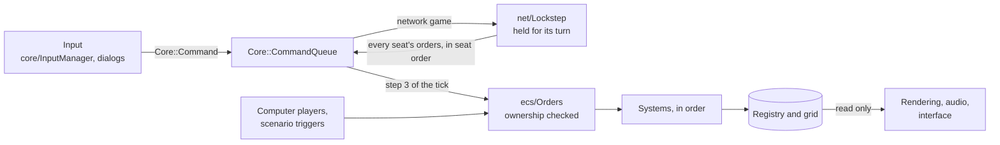

# Entities and systems

Everything on an Age of Kings map is a game object: a villager, a sheep, a
tree, a gold mine, an arrow in flight, a House. Each is one of the dat's units,
and the game moves all of them forward together in small, even steps of time.

OpenAoK keeps those objects as entities in one registry ([EnTT](https://github.com/skypjack/entt),
vendored in `third_party/entt`) and moves them forward in a fixed tick of
16 ms. This page covers how the world is laid out as data, what runs in a tick
and in what order, how the players' orders reach it, and how the screen, the
sound and the interface watch it without touching it.

## Entities are plain data

An entity is only an id. What it is and what it does are the components
attached to it, and every component is a plain struct in
`src/ecs/components/`, one concern per file:

```cpp
struct Health {
    int current_hp = 100;
    int max_hp = 100;
    // Damage taken below a whole hit point, carried to the next blow. Hit
    // points are kept as fractions: a blow struck down a hill does a quarter
    // more, 3.75 from a villager's 3, and the three quarters count.
    Core::Fixed32 wound{};
};
```

There are no entity classes, no virtual dispatch for game objects and no
getters wrapping fields. A few components tie the rest together:

- `Identity` holds the dat unit id. Everything the interface says about an
  entity (its icon, its stats, its costs) is a lookup keyed on it.
- `Owner` holds the player it belongs to; `RulesOf`, present only on a unit
  that changed hands, names whose unit table it still plays by.
- `Transform` holds where it stands. A unit garrisoned in a building has no
  `Transform`, which takes it out of every view of the world at once: drawing,
  sight, movement and targeting.

What belongs to the whole world rather than to one entity lives in the
registry's context (`registry.ctx()`): each player's resource table and copy of
the unit rules (`ecs/Players`), the seeded random generators, the lobby's
setup, the event log. Since the entities and the context together are the
world, a saved game is read back by building a world from the saved lobby and
then replacing its registry wholesale (`Simulation::ReplaceRegistry`).

## Behaviour is free functions

Behaviour lives in modules: a namespace of free functions per concern, each
taking the registry (and the grid, where it needs one) as arguments. A module
owns its rules and asks other modules for theirs; `ecs/Combat` asks
`ecs/Diplomacy` who is hostile, and `ecs/Production` asks `ecs/Population`
whether there is room. The three bulk systems in `src/ecs/systems/`
(movement, workers, animation) each run from a static `Update` function.

| Module | Concern |
|---|---|
| `Simulation` | Owns the registry, the grid and the tick count; builds the world from the lobby and runs the tick |
| `Orders` | Carries out commands inside the tick, once the giver is found to own what it orders about |
| `Units` | Assembles a unit's components (`Spawn`); turns one unit into another (`Become`) |
| `Players` | Each player's resource table, its own copy of the unit rules, its technology statuses |
| `Effects`, `Techs` | The dat's effects applied to a player's rules; each technology's status and the ages |
| `Buildings`, `BuildingGeometry` | A building's life from foundation to rubble; its footprint on the grid |
| `Production`, `Population` | Training and research queues; population and housing |
| `VillagerJobs`, `DropSites`, `Resources`, `Felling` | Which job unit a villager is now; which buildings take which load; what a used-up resource leaves; a tree felled before it is cut |
| `Navigation` | Which passability layer a unit moves on, and its routes (`Route`) |
| `Formations`, `Duties` | Where each member of a group stands; patrol, guard and follow |
| `Combat`, `Missiles`, `Mortality` | Attack and armour by class, reach measured edge to edge; missiles that fly to the ground; death, bodies and carcasses |
| `Search`, `Turning` | Which classes each kind of unit looks for round itself; turning to face a target at the dat's rotation speed |
| `Garrisons` | Units in buildings and aboard transport ships; the town bell |
| `Monks`, `Relics` | Conversion and healing; relics carried to monasteries and the gold they earn |
| `Animals`, `Allegiance` | Grazing, herdables and prey; an entity passing from one player to another |
| `Packing`, `Repairs` | Trebuchets packing and setting up; who may mend what, how fast, at what cost |
| `Walls` | Walls laid as dragged lines, each segment's piece chosen by its neighbours; gates and locking |
| `Market`, `Trade`, `Tribute` | Commodity prices; trade carts and cogs; tribute and its fee |
| `Diplomacy`, `Spies` | Stances between players and allied victory; Spies and Treason |
| `Vision`, `Fog` | What each player sees and has explored; what it remembers of what it no longer sees |
| `Victory`, `Score`, `Timeline` | How a game ends; the score and the Achievements figures; each player's history |
| `Chat`, `Flares`, `Cheats` | Chat lines and flares carried in lockstep and logged for the interface; cheat codes |
| `ScenarioWorld`, `Triggers` | A scenario's world built from its file; its triggers, asked once a second |
| `Events`, `Digest` | The log of what happened, for presentation to read; a digest of the world for desync detection |
| `Selection`, `Nearby` | What the player has selected, as "looking at" and "can order"; entities bucketed by map square for searches round a point |
| `systems/MovementSystem` | Walking a route at the unit's speed, taking corners, arriving, planning again when ground closes |
| `systems/WorkerSystem` | Gathering, carrying, building and repairing |
| `systems/AnimationSystem` | Animation frames, and a villager's graphic set changing with its job |

## The world and its tick

`ECS::Simulation` holds the registry, the grid (`Physics::Grid`) and the number
of ticks run. `Init` builds the world from the lobby (`Core::GameSetup`): every
seat's tables and starting technologies, the random generators, the map from
its script, and each player's starting units. `Update` runs one tick.

The tick is always 16 ms of game time. The frame loop in `src/main.cpp` banks
the time that has passed and runs as many whole ticks as it covers:

```cpp
    constexpr int32_t kTickMs = 16;                       // ~60 Hz simulation
    constexpr Micros kTick{kTickMs * 1000};
    // ...
        if (!paused) accumulator += frame_time * speed_percent / 100;
    // ...
            while (accumulator >= kTick) {
                // ...
                sim->Update(kTickMs);
                // ...
                accumulator -= kTick;
```

The game's speed (Slow, Normal and Fast are 100, 150 and 200 percent) changes
how much time is banked, never the length of a tick, so the same game runs the
same ticks at any speed and any frame rate. A frame counts for at most 250 ms
of real time. Offline, once a frame has spent 25 ms running ticks it lets the
rest of the banked time go, so a machine that cannot keep up plays the game
slower rather than showing it seldom.

`Simulation::Update` runs these steps, in this order, every tick:

| # | Call | What it does |
|---|---|---|
| 1 | `Events::BeginTick`, `Score::Advance` | Starts the event log's tick, forgetting what is stale; moves the game clock on, so whatever happens is stamped with its time |
| 2 | `Pathfinding::Prepare`, `Navigation::Survey` | Readies the route search's landmarks if the terrain changed; surveys where everyone stands, before anything plans a route or takes a step |
| 3 | `Orders::Execute` | Every command queued for this tick, in the order queued |
| 4 | `AI::Update` | The computer players decide, giving their orders through `ecs/Orders` |
| 5 | `Walls::SetAllies` | Whose gates open for whom, as the stances now stand |
| 6 | (in `Update` itself) | Every `Transform`'s `previous_position` set to its `position` |
| 7 | `Orders::WalkOnToWaypoints` | Units at the end of a walk with waypoints left set off for the next |
| 8 | `Packing::Update` | Trebuchets packing and setting up, and packed ones closing on a target |
| 9 | `Systems::MovementSystem::Update` | Every unit with a route walks it |
| 10 | `Systems::WorkerSystem::Update` | Gathering, carrying, building, repairing |
| 11 | `Trade::Update` | Trade carts and cogs on their routes |
| 12 | `Garrisons::Update` | Units on their way in go in; units inside heal |
| 13 | `Duties::Update` | Patrol, guard and follow |
| 14 | `Monks::Update` | Faith comes back; conversions and heals go on |
| 15 | `Relics::Update` | Relic errands; monasteries pay; a fallen carrier drops its relic |
| 16 | `Animals::Update` | Herdables change hands, grazers wander, the fleeing stop |
| 17 | `Combat::Update` | Targets found, closed on, struck or shot on the reload |
| 18 | `Missiles::Update` | Every missile flown one tick; those that arrive land |
| 19 | `Mortality::Update` | The dying and the dead advanced |
| 20 | `Buildings::Update` | Sites whose construction is complete finished; farm sites moved through their stages |
| 21 | `Walls::Update` | Each gate drawn raised while a unit it opens for is at it |
| 22 | `Spies::Update` | Each player's price for Spies, from the villagers it counts |
| 23 | `Production::Update` | Queues advanced; finished units brought out, finished technologies completed |
| 24 | `Systems::AnimationSystem::Update` | Animation frames advanced; a villager's graphic set follows its job |
| 25 | `Triggers::Update` | A scenario's triggers, before the victory they can declare is looked at |
| 26 | `Victory::Update` | Who is defeated and who has won |
| 27 | `CalculateVision` | Each player's visible and explored ground (`Vision::Update`) |
| 28 | `Fog::Update` | What each player stops seeing, remembered as it was |
| 29 | `Allegiance::Capture` | Gaia's things a player now sees, taken by the first to see them |
| 30 | `Score::Update` | Populations counted and the score worked out, last of all |

Each call runs inside a `Core::Costs::Scope`, which times it for the
performance report that `--perf` turns on. The order is part of the rules: a
scenario's triggers run just before victory is judged, so a victory a trigger
declares counts in the same tick, and the fog takes its pictures only once the
tick's sight has been worked out.

Every tick also writes the event log (`ecs/Events`): units born, blows struck,
buildings finished, technologies researched, deaths, conversions. The
simulation writes it; sound, the interface and the self-checks read it. Inside
the tick the computer players read it too, to learn who struck their town.

## Orders arrive as commands

A player's order is a command: a plain struct in `src/core/Command.h` that
names what is ordered and the player who gave it. `Core::Command` is a
`std::variant` of all 43 of them.

```cpp
// Move to a point. Destinations are continuous: routing is on the grid, but
// where a unit stops is a real position.
struct MoveCommand {
    entt::entity entity;
    Fixed32 target_x;
    Fixed32 target_y;
    PlayerId player;
};
// ...
using Command = std::variant<MoveCommand, GatherCommand, AttackCommand,
                             BuildCommand, DeleteCommand, TrainCommand,
                             // ...
                             DifficultyCommand>;
```

The interface (`core/InputManager` and the in-game dialogs) pushes commands
onto `Core::CommandQueue`, each stamped with `Core::LocalPlayer()`. At step 3
of the next tick the simulation takes everything in the queue and hands each
command to `ECS::Orders::Execute`. In a network game the queue is emptied into
the lockstep session first, and a command comes back into it on every machine
at the turn it is due (see [Lockstep multiplayer](/engine/multiplayer)).
Computer players and a scenario's triggers act inside the tick and call
`Orders::Execute` directly, through the same checks.

`ecs/Orders` is the only way an order reaches the world. It checks that the
giver owns what it orders about, then passes the order to the module whose
business it is:

```cpp
bool Owns(const entt::registry& registry, entt::entity entity, Core::PlayerId player) {
    if (!registry.valid(entity)) return false;
    const auto* owner = registry.try_get<Components::Owner>(entity);
    if (owner == nullptr) return false;
    if (owner->player_id == player) return true;
    // "natural wonders": nature's animals take the cheater's orders.
    // ...
}

// ...
bool Commands(const entt::registry& registry, entt::entity unit, Core::PlayerId player) {
    return Owns(registry, unit, player) && registry.all_of<Components::Transform>(unit);
}
// ...

// A unit in a locked formation takes the formation with it.
void Move(entt::registry& registry, Physics::Grid& grid, const Core::MoveCommand& cmd) {
    if (!Commands(registry, cmd.entity, cmd.player)) return;
    // ...
    WalkTo(registry, grid, cmd.entity, {cmd.target_x, cmd.target_y});
}
```

An order that fails its checks changes nothing. Some checks belong to the
module that carries the order out: the market checks the Market is the
player's and finished, tribute checks who may give to whom, diplomacy refuses a
change of stance while teams are locked. Because the check runs inside the
tick, an order for a unit the sender does not own is refused on every machine
alike.



## Presentation reads, never writes

Rendering, audio and the interface read the registry each frame
(`Rendering::Renderer::Render` takes the simulation and how far the frame falls
into the next tick). They never change the world: anything the player wants
done goes back in as a command. The simulation never asks which seat this
machine plays: nothing under `src/ecs`, `src/ai`, `src/pathfinding` or
`src/physics` calls `Core::LocalPlayer()`.

Two components are shared, and the tick never reads what presentation writes
in them. The selection and the control group in `Selectable` are the
interface's. In `Sprite`, the tick sets which graphic an entity shows and steps
its animation; the renderer works out the frame for its facing (`slp_frame`,
`flip_h`) and resolves its shadow graphic as it draws. When a scenario's
trigger needs to know what a player has selected, the interface sends a
`SelectionCommand`, so the selection reaches every machine's triggers in
lockstep like any order.

Logs carry the rest: the event log, the chat log (`ecs/Chat`) and the flares
(`ecs/Flares`) are written in the tick for the interface and the sound to
read.

## Decided once, at spawn

`Units::Spawn` assembles every unit, the starting villagers and every unit a
building trains alike. It reads the owner's rules once and gives the unit the
components that make it what it is, so the systems that act on workers,
fighters and monks walk views of those components instead of asking the data
each tick:

```cpp
    const bool villager = rules->cls == kVillagerClass;
    // ...
    bool gathers = false;
    for (int t = 0; t < rules->task_count; ++t) {
        if (rules->tasks[t].action == Core::Rules::TaskAction::Gather) gathers = true;
    }
    if (villager) {
        registry.emplace<Components::Worker>(unit);
    } else if (gathers) {
        auto& worker = registry.emplace<Components::Worker>(unit);
        worker.gatherer = unit_id;
        if (rules->carry > 0) worker.max_carry = rules->carry;
    }
    // ...
    if (rules->attack_count > 0 && rules->reload.value > 0) {
        registry.emplace<Components::Combat>(unit);
        Combat::FirstLook(registry, unit);
    }
    // Anything whose tasks convert or heal is a monk, with its faith.
    for (int t = 0; t < rules->task_count; ++t) {
        if (rules->tasks[t].action == 104 || rules->tasks[t].action == 105) {
            registry.emplace<Components::Monk>(unit);
            break;
        }
    }
```

The worker system then walks `registry.view<Components::Worker, Components::Transform>()`.
A unit's speed, attack, armour and range are not copied onto it: they are read
from its owner's copy of the rules when needed (`Players::RulesFor`), so a
technology researched later reaches every unit already on the map. An upgrade
keeps the entity's `Identity`, the base unit id; the owner's rules for that id
are what change. `Units::Become` is different:
it turns a unit into another of the dat's units (a Monk picking up a relic
becomes the Monk carrying one), keeping its owner, its place and its wounds in
proportion.

## Continuous positions, a grid for the ground

A unit stands at a fixed-point position (`Components::Vector2D`, two
`Core::Fixed32`) in tile units, and nothing it does is snapped to a tile. Tiles
are a unit across and centred on their whole-number coordinates
(`Physics::TileOf` rounds a position to its tile). Whether something is in reach
is a distance: `Combat::Gap` measures from edge to edge, so a swordsman hits a
building from its wall and an archer's range runs to its target's edge.

The tile grid (`src/physics/Grid.h`) holds what belongs to the ground: each
tile's terrain and elevation, whether something stands on it, whether each
kind of mover may be on it (one passability layer for each set of terrains the
data's movers may cross; layer 0 is land) and any gate on it. Buildings block
the grid through their footprints (`ecs/BuildingGeometry`), and the route
search runs over it, one layer at a time; every route is asked for through
`Navigation::Route`, which knows each unit's layer. Where a unit should stand
to work on something is asked of `pathfinding/ApproachPlanner`, which answers
with a continuous point. See [Movement and routes](/engine/pathfinding).

## Smooth drawing between ticks

The screen is redrawn far more often than the world moves, so the renderer
draws each unit between where it stood at the last tick and where it stands
now. Each tick, before anything moves (step 6), the simulation keeps the old
position:

```cpp
    // Cache previous positions for render interpolation, straight down the
    // storage's packed array.
    for (auto& transform : registry.storage<Components::Transform>()) {
        transform.previous_position = transform.position;
    }
```

The frame loop works out how far the frame falls into the next tick, and the
entity renderer blends the two positions, in floating point, on its own side of
the line:

```cpp
        const float alpha = static_cast<float>(accumulator.count()) / static_cast<float>(kTick.count());
        renderer.Render(*sim, window, alpha);
```

```cpp
        float lx = t.previous_position.x.ToFloat() + (t.position.x.ToFloat() - t.previous_position.x.ToFloat()) * alpha;
        float ly = t.previous_position.y.ToFloat() + (t.position.y.ToFloat() - t.previous_position.y.ToFloat()) * alpha;
```

Anything that moves keeps `previous_position`, and a new unit starts with both
set to the same point (`emplace<Components::Transform>(unit, at, at)` in
`Units::Spawn`), so it never slides in from elsewhere. Why the simulation
itself never uses floating point is on [Fixed point and determinism](/engine/determinism).

## Where it lives in the code

- [`src/ecs/Simulation.h`](https://github.com/Zaydme/openaok/blob/main/src/ecs/Simulation.h), [`src/ecs/Simulation.cpp`](https://github.com/Zaydme/openaok/blob/main/src/ecs/Simulation.cpp): the world, `Init` and the tick's order in `Update`
- [`src/ecs/components/`](https://github.com/Zaydme/openaok/tree/main/src/ecs/components): the components, one concern per file
- [`src/ecs/systems/`](https://github.com/Zaydme/openaok/tree/main/src/ecs/systems): the movement, worker and animation systems
- [`src/core/Command.h`](https://github.com/Zaydme/openaok/blob/main/src/core/Command.h), [`src/core/CommandQueue.h`](https://github.com/Zaydme/openaok/blob/main/src/core/CommandQueue.h): the commands and the queue they wait in
- [`src/ecs/Orders.cpp`](https://github.com/Zaydme/openaok/blob/main/src/ecs/Orders.cpp): ownership checks and handing each order to its module
- [`src/ecs/Units.cpp`](https://github.com/Zaydme/openaok/blob/main/src/ecs/Units.cpp): `Spawn` and `Become`
- [`src/ecs/components/Transform.h`](https://github.com/Zaydme/openaok/blob/main/src/ecs/components/Transform.h): position and `previous_position`
- [`src/physics/Grid.h`](https://github.com/Zaydme/openaok/blob/main/src/physics/Grid.h): the tile grid and its passability layers
- [`src/ecs/Events.h`](https://github.com/Zaydme/openaok/blob/main/src/ecs/Events.h): the event log presentation reads
- [`src/main.cpp`](https://github.com/Zaydme/openaok/blob/main/src/main.cpp): the frame loop, the fixed tick and the interpolation factor
- [`src/rendering/EntityRenderer.cpp`](https://github.com/Zaydme/openaok/blob/main/src/rendering/EntityRenderer.cpp): drawing entities between ticks
