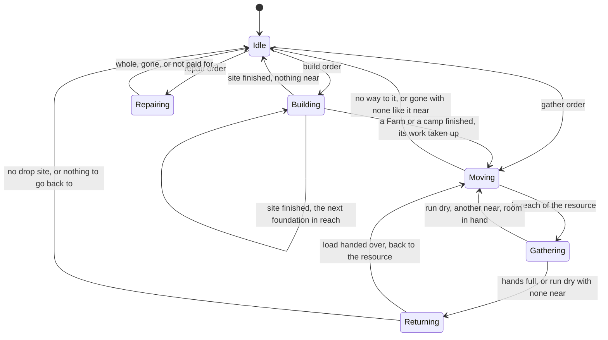
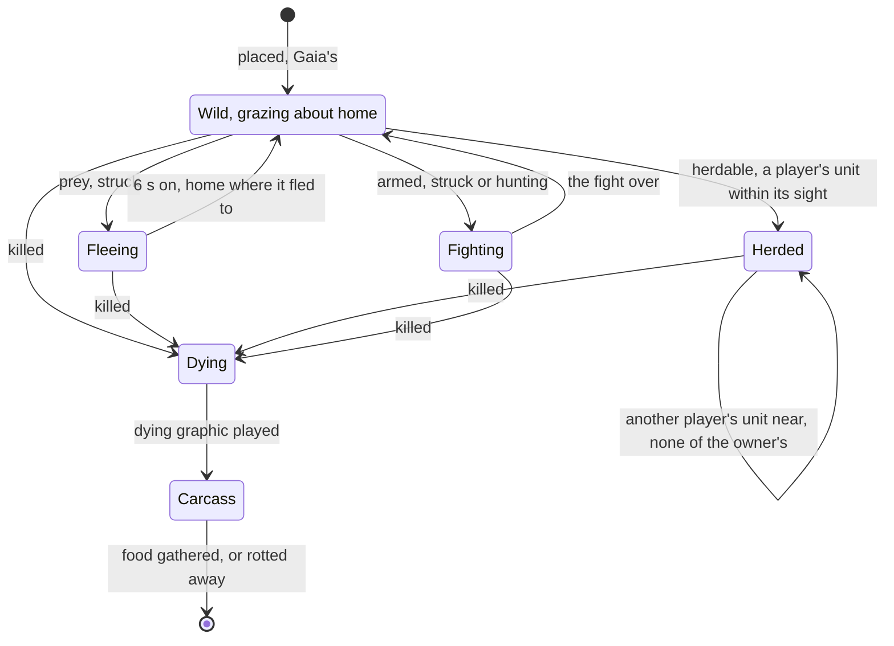

# Units and their tasks

In the original game a unit is always doing one thing. A villager sent to a
tree walks out with an axe, cuts until its hands are full, carries the wood to
the nearest camp and goes back to the same tree; when the tree is gone it
finds the next one nearby. A builder whose House is up moves on to the next
foundation. A soldier stands where it was left until an enemy comes into
view. A new order replaces whatever went before, and only waypoints, laid with
Shift, wait their turn. Ships and trebuchets turn visibly before they shoot;
the dead fall, lie a while and fade; a deer runs when struck, a boar turns on
its hunter, a sheep belongs to whoever finds it.

This page covers how OpenAoK keeps all of that: the components a unit is made
of, a worker's states and how one task follows another, how orders replace
one another, going back to work after a fight, idle units, waypoints, turning,
death and what it leaves, animals, and units changing sides. Routes are on
[movement and routes](/engine/pathfinding), fights on [combat](/engine/combat),
gather rates and drop sites on [gathering and the economy](/engine/economy),
foundations and repairs on [buildings and construction](/engine/construction).

## A unit is its components

Every player's unit (those it starts with, those its buildings train, a
scenario's) is put together by `Units::Spawn` (see
[decided once, at spawn](/engine/simulation#decided-once-at-spawn) for the
code). It reads the owner's own copy of the unit's rules once and gives the
entity these components:

| Component | Given to | What it holds |
|---|---|---|
| `Transform` | every unit | where it stands, and `previous_position`, both the spawn point |
| `Sprite`, `Animation` | every unit | its graphics from the dat, facing south-east; for a villager, its sex and its job |
| `Identity` | every unit | the dat unit id; for a villager the base villager's, never its job unit's |
| `Owner` | every unit | the player it belongs to |
| `Health` | every unit | hit points from the owner's rules (25, `kFallbackHitPoints`, when the dat gives none) |
| `Sight` | every unit | its line of sight (5 tiles, `kFallbackSight`, when the dat gives none) |
| `Selectable` | every unit | that a click or a box picks it |
| `Worker` | villagers (the dat's class 4), and anything whose tasks gather, such as a fishing ship | its job, its targets, what it carries |
| `Combat` | anything with an attack and a reload, villagers included | its fight: state, stance (aggressive to begin with), target, timers |
| `Monk` | anything whose tasks convert or heal | its faith |

`Spawn` also adds the unit to its owner's population and to the economy
score. Speed, attack, armour and range are not copied onto the unit: they are
read from the owner's rules when needed (`Players::RulesFor`), so a technology
researched later reaches every unit already on the map.

Other components come and go with what the unit is doing. Systems find the
units they act on by these, so a unit on patrol is simply one with a `Duty`:

| Component | While | Module |
|---|---|---|
| `Path` | walking a route; `sent` when a person's order sent it | `Navigation`, `systems/MovementSystem` |
| `Waypoints` | it has points left to walk on to | `Orders` |
| `Duty` | on patrol, guarding or following | `Duties` |
| `InFormation` | locked in a formation | `Formations` |
| `Interrupted` | a villager has broken off its job for a fight or a run | `Orders`, `Combat` |
| `Boarding`, `Garrisoned` | on its way into a building or a transport; inside one | `Garrisons` |
| `Landing` | a transport putting its load ashore | `Garrisons` |
| `RelicErrand`, `RelicBearer` | fetching a relic; carrying one | `Relics` |
| `Transforming`, `Assaulting` | a trebuchet packing or setting up; closing to set up | `Packing` |
| `Trader` | a trade cart or cog has been set trading: its route and its load | `Trade` |
| `RulesOf` | it has changed hands, and plays by its maker's table | `Allegiance` |
| `Grazer` | an animal that grazes | `Animals` |
| `Dying` | playing its death | `Mortality` |

A unit inside a building or aboard a transport has no `Transform` at all,
which takes it out of drawing, sight, movement and targeting at once.

### A villager's job

Each villager job is a unit of its own in the dat, with its own graphics,
icon and name: a lumberjack, a forager, a builder. The entity keeps the base
villager's identity, and the job it is on now is worked out from what its
`Worker` is doing (`Villagers::JobFor` in `ecs/VillagerJobs`). The animation
system asks it which graphic set to wear, and the interface which name and
icon to show:

```cpp
Components::VillagerJob JobFor(const Components::Worker& worker) {
    switch (worker.state) {
    case Core::UnitState::Building:
        return Components::VillagerJob::Build;
    case Core::UnitState::Repairing:
        return Components::VillagerJob::Repair;
    case Core::UnitState::Moving:
    case Core::UnitState::Gathering:
    case Core::UnitState::Returning:
        // The job its target called for, from the moment it was sent: a
        // villager sent to a tree picks up its axe on the way.
        if (worker.job != Components::VillagerJob::None) return worker.job;
        switch (worker.carry_type) {
        case Core::ResourceType::Wood:  return Components::VillagerJob::Lumber;
        case Core::ResourceType::Gold:  return Components::VillagerJob::Gold;
        case Core::ResourceType::Stone: return Components::VillagerJob::Mine;
        default:                        return Components::VillagerJob::Forage;
        }
    default:
        return Components::VillagerJob::Base;
    }
}
```

Which job a target calls for is the dat's too (`Villagers::JobForTarget`):
the first villager job unit with a gather or hunt task naming the target's
unit or class. A hunt task means the target has to be killed before it can be
gathered. When no task names it, the resource it holds decides. A fishing
ship works as itself, by its own rules and tasks (`Worker::gatherer` holds its
own unit id), and never changes job.

## Worker states

A worker's `state` is one of `Core::UnitState`: `Idle`, `Moving` (on its way
to a resource), `Gathering`, `Returning` (carrying a load to a drop site),
`Building` or `Repairing`. The state says what the job is; the `Path`, if any,
is the walk. A villager walking where a person sent it is `Idle` with a route.
Each state makes for one thing:

```cpp
entt::entity ActiveTarget(const Components::Worker& worker) {
    switch (worker.state) {
    case Core::UnitState::Building:  return worker.target_building;
    case Core::UnitState::Repairing: return worker.target_building;
    case Core::UnitState::Returning: return worker.target_dropoff;
    default:                         return worker.target_resource;
    }
}
```

`Systems::WorkerSystem::Update` moves every worker on once a tick (step 10 of
[the tick](/engine/simulation#the-world-and-its-tick)). The approach is the
same for every job: the worker asks for a spot beside the ground it works on,
clear of where the rest of its crew stands or is headed, and walks until it is
within the job's work range from the dat (see
[standing spots](/engine/pathfinding#standing-spots)). When every spot is
taken it waits a body's width further out for one to come free.



Any order, from any state, sets the state afresh (see
[orders replace one another](#orders-replace-one-another)).

**Moving.** The worker walks up to the resource's box. A living animal has to
be killed first: the worker sets its combat on it as an ordered target and
waits while the animal dies; the carcass the animal leaves becomes the target
and the walk goes on to it. A Farm someone else is farming sends it to the
next free Farm near it. With no ground beside the resource to stand on, or no
way there, it stands.

**Gathering.** The worker turns to face the resource (at once, or an angle at
a time for a ship, see [turning](#turning)) and only then works. A standing
tree is felled first (`ecs/Felling`), then cut. The amount comes in at the job
unit's work rate times its task's value for the target, carried as a fraction
from tick to tick, into a separate count for each resource, so a villager that
cut wood and then mined gold carries both. When it can carry no more of that
resource it goes home. When the resource runs dry it takes up the next one
like it (`NextResource`): the nearest within its search radius of where the
last one stood, on explored ground, the map's or its own player's, with open
ground beside it; a Farm only if finished and unworked. With room left it goes
straight there, otherwise by way of a drop site.

**Returning.** The worker takes its load to the nearest of its player's
buildings that takes something it carries and borders ground it can reach.
The building takes what it accepts; the rest stays in hand for the next one.
The worker then goes straight back to the same resource, or to the next of the
same near where it stood, so a villager stays on one job until that runs out.
A villager ordered to drop off at a building hands over everything, however
little, and then stands.

**Building.** The worker walks up to the foundation's wall and swings; the
first blow begins the building, and a crew shares the work (see
[buildings and construction](/engine/construction)). When the building is up,
its builder does not stand idle beside it:

- a Farm's builder farms it, unless another farmer has it;
- a Mill's, Lumber Camp's or Mining Camp's builder gathers the nearest of what
  that building takes in, within its search radius of the walls;
- anyone else takes up the nearest other foundation of its owner's whose
  nearest tile lies within about nine and a half tiles
  (`kKeepBuildingReachSquared`, 90 in squared tiles), which is how one order
  raises a whole line of wall.

A site it cannot get near after 40 tries (`kMaxBuildAttempts`) is given up.

**Repairing.** As building, at the repair rate, until the target is whole,
gone, changed to a side it may not mend, or its owner cannot pay for the next
hit point (`ecs/Repairs`).

## Orders replace one another

An order for a unit passes through `ecs/Orders` (see
[orders arrive as commands](/engine/simulation#orders-arrive-as-commands)).
Nearly every one begins with `DropCurrentJob`, which stops everything the unit
was doing:

```cpp
// Whatever the unit was doing stops: a new order replaces the old one.
void DropCurrentJob(entt::registry& registry, entt::entity unit) {
    registry.remove<Components::Boarding>(unit);
    // A job broken off for a fight is given up for whatever comes now.
    registry.remove<Components::Interrupted>(unit);
    // Any order but another waypoint forgets the route laid.
    registry.remove<Components::Waypoints>(unit);
    // A transport given another order keeps its load aboard.
    registry.remove<Components::Landing>(unit);
    registry.remove<Components::Duty>(unit);
    registry.remove<Components::RelicErrand>(unit);
    // ...
    if (auto* worker = registry.try_get<Components::Worker>(unit)) {
        worker->state = Core::UnitState::Idle;
        worker->working = false;
        worker->ordered_drop = false;
    }
    // ...
}
```

Its fight is dropped too, and a defensive unit forgets its post. Then the
order sets the unit on its new task:

| Order | What the unit does |
|---|---|
| Move | Walks to the nearest point it can stand on and reach (`Navigation::Toward`); a unit in a locked formation takes its formation with it |
| Gather | `Moving` to the resource, its job chosen from the dat's task lists at once, so it walks out as a lumberjack; a fishing ship only at what its own tasks name |
| Build | Joins a site of the same building already on that tile, at no cost; otherwise the site is placed and paid for, if the worker is one that builds it and the ground is open |
| Repair | A site of its own still going up is built; anything finished and damaged that the repairer's tasks name is repaired |
| Attack | Sets combat on the target as ordered; a monk converts instead, a packed trebuchet goes to set up in range |
| Drop off | `Returning` to that building, to hand over the whole load and stand |
| Garrison | Walks into the building or aboard the transport (see [armies and the navy](/engine/war)) |
| Patrol, Guard, Follow | A standing order, kept until another order (see [armies and the navy](/engine/war#patrol-guard-and-follow)) |
| Stop | Stands where it is; a trebuchet packing or setting up is left as it was |
| Delete | Dies where it stands, through the same death as a blow |

A unit sheltering in a building takes no orders until it comes out: there is
no place for it to walk from. A unit trained at a building with a gather point
follows it on its way out (`Orders::FollowRally`): a villager rallied onto a
resource gathers it, a trade unit rallied onto a foreign Market or Dock
trades, and anything else walks there (see
[training and research](/engine/production)).

## Breaking off and going back

A villager struck by a wolf fights it off, and one struck by another player's
unit runs (see [answering an attack](/engine/combat#answering-an-attack)).
Either way it keeps its job: `Orders::Interrupt` notes what it was working
in an `Interrupted` component before dropping the job, the building for a
builder or a repairer and the resource for anyone else. A repairer struck
keeps mending, so in practice the building kept is a builder's site. At the
end of each combat pass, every villager with an `Interrupted` that is no
longer fighting and has no walk left goes back:

```cpp
void GoBackToWork(entt::registry& registry, const Physics::Grid& grid, entt::entity unit,
                  entt::entity resource, entt::entity site) {
    (void)grid;
    if (!registry.valid(unit) || !registry.all_of<Components::Worker>(unit)) return;
    if (GatherFrom(registry, unit, resource)) return;
    if (!registry.valid(site) || !registry.all_of<Components::Building>(site)) return;
    if (registry.get<Components::Building>(site).state == Components::BuildingState::UnderConstruction) {
        PutToWork(registry, unit, site);
    } else if (Repairs::CanRepair(registry, unit, site)) {
        Mend(registry, unit, site);
    }
}
```

It gathers the resource if that is still there, builds the site if that is
still going up, or mends the building if it still needs it; otherwise it
stands. Setting a villager to build or mend forgets the resource it worked
before, so a builder never wanders back to an old tree. The town bell uses the
same call: a villager the bell sent for cover remembers its job in its
`Boarding` and `Garrisoned` components, its building if it was building or
mending, and goes back to it when the bell is rung again or the Back to Work
button turns the villagers out (see
[the town bell](/engine/war#garrisons-and-the-town-bell)). Any order given
meanwhile drops the kept job, since the player has decided what comes next.

## Idle units

An idle worker is one in the `Idle` state with no walk to finish. It does
nothing of its own accord: the gatherer's search for the next resource runs
only when the one it was on runs out, never from standing. The interface's
idle villager button picks out the player's idle workers in turn, in entity
order, starting after the one it found last. Its idle military button does
the same for the player's soldiers that stand with no target, nowhere to go
and no standing order (patrol, guard or follow).

An idle soldier is one whose combat is idle, with no target and nowhere to
go. It is not still: every half a second or so it looks about it for an enemy,
as far as its stance allows (see [choosing a target](/engine/combat#choosing-a-target)).
A villager also has `Combat`, so that it can punch and, as a hunter, throw
spears, but it never looks for a fight; it only answers one.

## Waypoints

A unit can be given points to walk on to, in order, with Shift and the right
button. Each is kept in its `Waypoints` component, at most ten
(`Waypoints::kMax`); a point past the tenth is not kept.

- A unit already walking a route of waypoints, or walking somewhere and doing
  nothing else, has the point added at the end. A unit with nowhere to go
  walks to the point now.
- A group of soldiers gets each member's place at the point in the group's
  formation (`Formations::Layout`), and every leg is walked at the slowest
  member's pace, so the group arrives in formation at each point. Villagers
  each get a place of their own side by side, and walk at their own pace.
- Any other order clears them.

Once a tick, before anything moves (step 7 of the tick),
`Orders::WalkOnToWaypoints` sets off every unit that has come to the end of
its walk with points left, in entity order:

```cpp
    for (entt::entity unit : routed) {
        const auto* path = registry.try_get<Components::Path>(unit);
        if (path != nullptr && path->has_goal) continue;   // still on its way
        Components::Waypoints route = registry.get<Components::Waypoints>(unit);
        if (route.count == 0) {
            registry.remove<Components::Waypoints>(unit);
            continue;
        }
        const Components::Vector2D next = route.points[0];
        // ...
        // Walking on drops the unit's job, the route with it: put it back.
        WalkTo(registry, grid, unit, next);
        if (auto* leg = registry.try_get<Components::Path>(unit)) leg->speed_cap = route.speed_cap;
        registry.emplace_or_replace<Components::Waypoints>(unit, route);
    }
```

Waypoints are the only orders that queue. A building's production queue is a
different thing (see [training and research](/engine/production)).

## Turning

A unit's facing is its sprite's `heading`, in 256ths of a turn; the tick sets
it, and the renderer picks the graphic's frame for it. Walking, building and
repairing set it at once. Before it shoots or gathers, though, a unit calls
`Turning::Toward`, and true means it faces its target.

Most units turn at once. One whose rules give a rotation speed (a ship, a
trebuchet) turns one of its graphic's angles at a time, the shorter way round,
waiting the rotation speed in seconds between steps, and acts only once it
faces its target to within half an angle. A turn is reckoned in at least eight
angles (`kLeastAngles`), whatever the graphic has:

```cpp
    const int step = 256 / std::max(kLeastAngles, sprite->angles);
    auto off = [&]() {
        const int d = (static_cast<int>(want) - static_cast<int>(sprite->heading) + 256) % 256;
        return d > 128 ? d - 256 : d;
    };
    if (sprite->turn_wait_ms > 0) sprite->turn_wait_ms = std::max(0, sprite->turn_wait_ms - dt_ms);
    if (std::abs(off()) * 2 <= step) return true;
    if (sprite->turn_wait_ms > 0) return false;
    const int turned = static_cast<int>(sprite->heading) + (off() > 0 ? step : -step);
    sprite->heading = static_cast<uint8_t>((turned + 256) % 256);
    sprite->turn_wait_ms = (rules->rotation * Core::Fixed32(1000)).ToInt();
    return std::abs(off()) * 2 <= step;
```

Combat calls it before every swing or volley, and the worker system before
every tick of gathering, so a fishing ship comes about to its fish before it
fishes.

## Death and what it leaves

`Mortality::Kill` is how a unit dies, whether from a blow, a missile, a
sinking transport, a scenario's trigger, a defeat or the player's own Delete.
A building is handed to its own module, which leaves rubble
(`Buildings::Destroy`). A unit leaves its formation and the economy score,
writes a `Died` event, and is taken out of everything at once:

```cpp
    // Out of everything at once: its place in the population given back, and
    // not something to select or order, nor that fights or works.
    if (const auto* identity = registry.try_get<Components::Identity>(victim)) {
        Players::Contribute(registry, OwnerOf(registry, victim), identity->unit_id,
                            R::StorageMode::WhileAlive, -1);
    }
    registry.remove<Components::Path, Components::Combat, Components::Worker,
                    Components::Selectable, Components::Sight>(victim);

    int32_t dying_ms = kDefaultDyingMs;
    if (const auto* anim = registry.try_get<Components::Animation>(victim)) {
        const int die = static_cast<int>(Components::AnimState::Die);
        if (anim->slp[die] >= 0 && anim->frames[die] > 0) {
            dying_ms = anim->frames[die] * anim->frame_ms[die];
        }
    }
    registry.emplace<Components::Dying>(victim, dying_ms);
```

A transport that sinks kills everyone aboard: a ship has no door to turn them
out at.

The `Dying` unit plays its dying graphic once through (a second,
`kDefaultDyingMs`, when it has none). `Mortality::Update` then destroys it and
lays down its **dead unit**, the one the dat names for it, by the table it
played by:

- **A body.** A still sprite of the dead unit's standing graphic, facing the
  way the unit fell, that lies for the dead unit's corpse decay time (a figure
  the dat stores among its resources) and is then gone. It lies in its owner's
  colour: a converted unit's body is its new owner's, though its dead unit is
  its maker's.
- **A carcass.** An animal with food left keeps it: the carcass takes the
  animal's `Resource`, the dead unit's `Identity` and a `Selectable`, so it
  can be clicked and gathered. It loses food at the animal's decay rate each
  second, carried as a fraction, and is gone when nothing is left. Any worker
  that was after the animal now makes for the carcass; one still on its way to
  a carcass that rots away has nothing to go to.

`Mortality::PlayOnce` uses the same `Dying` timer for graphics that play once
and are gone: a building's fall in dust, a stone bursting where it lands.

## Animals

The dat's task lists say what an animal is. OpenAoK sorts them into three
kinds:

| Kind | From the dat | What it does |
|---|---|---|
| Herdable | an auto-convert task (`Animals::Herdable`) | belongs to whoever is near it: a sheep |
| Prey | a graze task, no attack, not herdable (`Animals::Prey`) | grazes, and runs when struck: a deer |
| Armed | an attack and a reload, so a `Combat` | fights through [combat](/engine/combat): a boar answers its hunter, a wolf hunts |

A wild animal on the map is Gaia's and has hit points from the dat.



### Grazing

Anything whose rules have a graze task is given a `Grazer`, with its home
where it stands, on the first tick after it appears (the module looks again
whenever something gains an identity, a place, or a new identity). To keep
that look cheap, which unit ids could ever graze, as they are or after an
upgrade, is worked out once from the dat's tables and upgrade effects
(`MayGraze`). Every 4 to 12 seconds a wild grazer
takes a step of three quarters of a tile in one of sixteen directions, drawn
from the world's seeded generator; a step that would take it more than two
tiles from home goes halfway back towards home instead. Only Gaia's wander: a
sheep a player has taken stands where it is put.

| Constant | Value | Meaning |
|---|---|---|
| `kLeastWaitMs`, `kWaitSpreadMs` | 4000, 8000 | a grazer waits 4 s plus up to 8 s more between steps |
| `kStep` | 0.75 tiles | one step |
| `kWanderReach` | 2 tiles | how far from home a step may end |
| `kFleeSights`, `kFleeMs` | 3, 6000 | prey runs three times its sight, and stops grazing for 6 s |
| `kHerdCheckTicks` | 8 | how often a herdable looks round, staggered by entity |

### Herding

Every eighth tick (each herdable on its own tick, by its entity) a herdable
looks within its line of sight for a living unit of a player's that fights or
works: not a building, a body or another herdable. If one of its owner's is
there, it stays. Otherwise the nearest unit of another player takes it; the
lowest entity wins a tie. A sheep changing hands stops wherever it was being
led and writes a `Claimed` event. A Gaia sheep is thus taken by the first
scout to find it, and an unguarded one changes hands when an enemy comes by.

### Prey and the hunt

Prey struck by anyone runs (`Animals::Flee`): three times its line of sight
straight away from the attacker, and where it fled to is its home from then on.
A villager sent at a deer walks out as a hunter, sets its combat on the deer,
kills it, and gathers from the carcass. A boar struck by its hunter turns on
it, and a villager hunting a boar keeps at it when struck back. A wolf looks
for villagers on its own slower clock, by difficulty (see
[choosing a target](/engine/combat#choosing-a-target)). A shepherd kills its
own sheep the same way: its job unit's task names the sheep as something to
hunt.

## Changing sides

Anything passing from one player to another goes through
`Allegiance::Change`, the same for a converted soldier, a converted building
and one of Gaia's taken in a scenario: what it gives its owner moves with it,
it leaves its formation, it goes on playing by its maker's table
(`Components::RulesOf`), whatever it was doing stops, and a transport takes
those aboard with it. The details are on
[changing sides](/engine/combat#changing-sides).

In a scenario, Gaia's units and buildings are marked `Capturable` as the map
is built, all but what the dat classes as an animal, a bird, a relic or
artifact, a heap, terrain or a miscellaneous object (`Allegiance::Takeable`).
Once a tick, after sight has been worked out (step 29), each goes to the
lowest-numbered player who sees it, and stays theirs:

```cpp
    for (auto entity : gaia) {
        if (gaia.get<Components::Owner>(entity).player_id != Core::PLAYER_GAIA) continue;
        const auto& at = gaia.get<Components::Transform>(entity).position;
        const int x = Physics::TileOf(at.x);
        const int y = Physics::TileOf(at.y);
        for (Core::PlayerId player = 1; player < Core::kMaxPlayers; ++player) {
            if (Players::Find(registry, player) == nullptr) continue;
            if (!Vision::Visible(registry, player, x, y)) continue;
            taken.emplace_back(entity, player);
            break;
        }
    }
```

A herdable changing hands is simpler: only its owner changes, and it plays by
its new owner's rules for the animal.

## Checks

The self-checks (see [verification](/development/verification)) that hold
this behaviour include `gathering`, `dropoff` and `felling` (the work cycle),
`answer` (villagers fighting off or running from an attacker, and going back
to work), `waypoints`, `turning`, `animals` (herding, fleeing and grazing),
`herding` and `hunt` (shepherds and wolves) and `capture` (Gaia's taken by the
first to see them):

```sh
cd build && AOE_VERIFY_ONLY=gathering,dropoff,answer,waypoints,turning,animals,capture ./OpenAoK --verify 10
```

## Where it lives in the code

- [`src/ecs/Units.cpp`](https://github.com/Zaydme/openaok/blob/main/src/ecs/Units.cpp): `Spawn`, the components a unit is made of, and `Become`
- [`src/ecs/components/Worker.h`](https://github.com/Zaydme/openaok/blob/main/src/ecs/components/Worker.h): a worker's job, targets and load; `Interrupted`
- [`src/ecs/VillagerJobs.cpp`](https://github.com/Zaydme/openaok/blob/main/src/ecs/VillagerJobs.cpp): which job unit a villager is now, and which a target calls for
- [`src/ecs/systems/WorkerSystem.cpp`](https://github.com/Zaydme/openaok/blob/main/src/ecs/systems/WorkerSystem.cpp): the worker's states, the next resource, the next site
- [`src/ecs/Orders.cpp`](https://github.com/Zaydme/openaok/blob/main/src/ecs/Orders.cpp): `DropCurrentJob`, each order, `Interrupt`, `GoBackToWork`, waypoints
- [`src/ecs/components/Waypoints.h`](https://github.com/Zaydme/openaok/blob/main/src/ecs/components/Waypoints.h): the points a unit walks on to
- [`src/ecs/Turning.cpp`](https://github.com/Zaydme/openaok/blob/main/src/ecs/Turning.cpp): turning to face a target at the dat's rotation speed
- [`src/ecs/Mortality.cpp`](https://github.com/Zaydme/openaok/blob/main/src/ecs/Mortality.cpp): death, bodies and carcasses
- [`src/ecs/components/Mortal.h`](https://github.com/Zaydme/openaok/blob/main/src/ecs/components/Mortal.h): `Dying` and `Corpse`
- [`src/ecs/Animals.cpp`](https://github.com/Zaydme/openaok/blob/main/src/ecs/Animals.cpp): grazing, herding and fleeing
- [`src/ecs/Allegiance.cpp`](https://github.com/Zaydme/openaok/blob/main/src/ecs/Allegiance.cpp): changing sides, and Gaia's taken by the first to see them
- [`src/core/Types.h`](https://github.com/Zaydme/openaok/blob/main/src/core/Types.h): `Core::UnitState`
- [`src/verify/Gathering.cpp`](https://github.com/Zaydme/openaok/blob/main/src/verify/Gathering.cpp), [`AnswerCheck.cpp`](https://github.com/Zaydme/openaok/blob/main/src/verify/AnswerCheck.cpp), [`WaypointsCheck.cpp`](https://github.com/Zaydme/openaok/blob/main/src/verify/WaypointsCheck.cpp), [`TurningCheck.cpp`](https://github.com/Zaydme/openaok/blob/main/src/verify/TurningCheck.cpp), [`AnimalsCheck.cpp`](https://github.com/Zaydme/openaok/blob/main/src/verify/AnimalsCheck.cpp), [`CaptureCheck.cpp`](https://github.com/Zaydme/openaok/blob/main/src/verify/CaptureCheck.cpp): the self-checks that hold this behaviour
