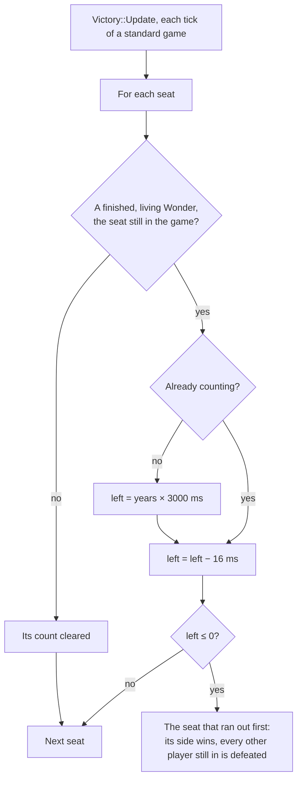

# Victory and diplomacy

An Age of Kings game ends when one side is left standing, or when a side
finishes a Wonder or gathers every relic and holds on to it long enough. Along
the way the players choose who is their ally, send each other resources, chat,
taunt and signal on the map; when it is over, the Achievements screen tells
how each of them played.

This page covers how OpenAoK decides who is defeated and who has won, what
becomes of a defeated player's things, stances and allied victory, shared
sight and tribute, chat, flares and the cheat codes, and the score, the
statistics and the timeline the Achievements screen shows. A scenario's own
victory, declared by its triggers, is on
[Scenarios, campaigns and saves](/engine/scenarios).

## How a game is won

The lobby offers two victory settings. Standard victory is won by conquest,
by a Wonder that stands finished for a number of years, or by holding every
relic on the map for as long. Conquest is won by conquest alone. The game type
adds Regicide, where a player loses with its King, and Death Match, which
starts everyone rich.

`ecs/Victory` keeps its state in the registry's context (`Victory::State`):
the outcome so far, the lobby's setup, and the dat ids of the Wonder, the
relic and the King, looked up by name (`WNDR`, `RELIC`, `KINGX`) when the
world is built. The outcome is what the interface and the other modules read:

```cpp
struct Outcome {
    bool over = false;
    uint16_t defeated = 0;   // a bit per seat
    uint16_t winners = 0;
    // Each seat's Wonder counting down, from when its first finished Wonder
    // stood: a bit per seat counting, and what each has left.
    uint16_t wonders = 0;
    int32_t wonder_ms[Core::kMaxPlayers] = {};
    // The relics counting down for the side holding them all: which of its
    // players, and what is left.
    Core::PlayerId relic_holder = 0;
    int32_t relic_ms = 0;
    // ...
};
```

`Victory::Update` runs once a tick, at step 26, just after a scenario's
triggers (see [the tick](/engine/simulation#the-world-and-its-tick)), so a
victory a trigger declares counts in the same tick. Once the game is over it
does nothing more. In each tick it looks, in this order:

1. in a Regicide game, for players without their King;
2. in a standard game, at the Wonder and relic countdowns, every tick;
3. once a second of game time (`kCheckMs`, 1000 ms), at who still has
   something standing.

### Sides

Players win together when they are allied each way and both have chosen
allied victory. Everything that asks who wins with whom asks this one
function:

```cpp
bool SharesVictory(const entt::registry& registry, Core::PlayerId a, Core::PlayerId b) {
    if (a == b) return true;
    return Allied(registry, a, b) && AlliedVictory(registry, a) && AlliedVictory(registry, b);
}
```

A side is a set of players who all share victory with each other: team-mates
from the lobby, or allies made in play. A player who has not chosen allied
victory is a side of its own.

### Conquest

A player stays in the game while it has a living unit or building. Some things
do not count, by their dat class:

```cpp
constexpr int kExempt[] = {
    27,   // wall
    39,   // gate
    2,    // trade cog
    19,   // trade cart
    20,   // transport ship
    21,   // fishing ship
    49,   // farm, fish trap
};
```

A unit sheltering in a building or aboard a transport counts while what holds
it lives. Once a second `Standing` walks every entity with an owner and marks
whose things are still up; each seated player who is not among them is out.
Of the players left:

- none at all: the game is over, and nobody has won;
- all on one side, in a game that began with more than one seat: that side
  wins.

A game that begins with a single seat, such as a scenario played alone, is
never won by being the last one standing; its triggers end it.

### Wonders and relics

Under standard victory a finished Wonder starts a countdown for its owner,
and so does one side holding every relic on the map in its Monasteries. The
countdown is in years of game time, three seconds each (`kYearMs`), for
`GameSetup::wonder_years` and `relic_years` years: 200 unless the setup says
otherwise, which is ten minutes of game time.

Every player has a Wonder countdown of its own. Every tick `CountWonders`
finds the players with a finished, living Wonder who are still in the game:
one that has just begun to hold one starts its count at the full number of
years, one still holding counts on, and one that holds none any more has its
count cleared. Two players' Wonders count side by side, and the first to run
out wins:

```cpp
        if (!o.CountingWonder(seat)) {
            o.wonders |= static_cast<uint16_t>(1u << p);
            o.wonder_ms[p] = state.setup.wonder_years * kYearMs;
        }
        o.wonder_ms[p] -= dt;
        if (o.wonder_ms[p] <= 0 && (first == 0 || o.wonder_ms[p] < o.wonder_ms[first])) first = seat;
```



A Wonder that is destroyed, or whose owner is defeated, stops its owner's
countdown, unless the owner has another standing; a Wonder finished after
that starts again from the full number of years.

`RelicHolder` looks for a side whose Monasteries hold as many relics as there
are relics in the world (and at least one), and the relics have one countdown,
for that side (`CountRelics`). It starts when a side takes them all and starts
again when another side does, or when they are lost; passed from one player's
Monastery to an ally's, the count goes on.

The interface shows each countdown at the top right of the view, every
player's Wonder nearest to winning first and then the relics, in the holder's
colour and in whole years rounded up (`UIRenderer::DrawTimePanels`), marks the
holders in the score list, and posts
a message when the relics change hands. As soon as anyone starts work on a
Wonder's site, the tiles under it are explored for every player
(`Victory::Begun`), so everyone can see where it is going up.

### Regicide

In a Regicide game each player also starts with a King and a Castle: the
Castle on the nearest spot it may stand, ring by ring out from a little way off
the Town Center, and the King at the Town Center's door. Every tick
`Victory::HasKing` asks whether each player still has a living King of its own,
in the world or sheltering in a living building. A player whose King is dead,
or has been converted, is out at once and everything it has is destroyed. The
other victory settings still apply.

### Death Match

Death Match is a random map game in which every stockpile opens at 20,000
(`StartingResources::DeathMatch`). It is a game type as well as a stockpile
setting: the computer players' scripts read it, and Spies is not offered in
it, as in Regicide. It is won as the lobby's victory setting says.

### Time limits and score

A scenario file can also ask for a score to reach, a time limit, or custom
conditions (`Scenario::VictoryMode`). They are read, kept and written back,
and the scenario editor's Global Victory tab sets them, but a game of such a
file is played as conquest: `Scenario::SetupFor` maps every mode other than
Standard to `VictoryKind::Conquest`. Nothing in the simulation ends a game on
the clock or on the score.

## When a player is out

A player leaves the game in one of four ways, and what happens to its things
depends on which:

| How | What its things do |
|---|---|
| Nothing left standing (conquest) | The exempt ones (walls, gates, farms, trade carts, ships) stay where they are, still its own |
| Its King lost (Regicide) | All destroyed |
| It resigns, or a cheat destroys it | All destroyed |
| Another side wins (a Wonder, the relics, a trigger's Declare Victory, the winning cheat) | Stay where they are; the game is over |

Destroying everything is `Eliminate`, which takes the player's entities in id
order so every machine does the same: buildings come down
(`Buildings::Destroy`) and living units die (`Mortality::Kill`).

```cpp
    std::sort(owned.begin(), owned.end());
    for (auto e : owned) {
        if (!registry.valid(e)) continue;
        if (registry.all_of<Components::Building>(e)) {
            Buildings::Destroy(registry, grid, e);
        } else if (const auto* health = registry.try_get<Components::Health>(e);
                   health != nullptr && health->current_hp > 0) {
            Mortality::Kill(registry, grid, e);
        }
    }
```

Resigning comes from the game menu as a `ResignCommand`, carried out in the
tick like any order. Either way the player's bit is set in `defeated` and a
`Defeated` event is logged; a player who is out other than by resigning also
has the defeat noted on its timeline. From then on:

- it may not chat, send flares or give or receive tribute;
- its score sheet says it did not survive (resource 45 set to 0);
- it is struck through in the in-game score list;
- the computer players' scripts see it as out of the game;
- a scenario's Player Defeated condition holds for it.

When the outcome changes for the player at this machine, the game shows the
victory or defeat message and plays its sound and music
(`GameDialogs::GameOver`), and the Achievements screen follows.

## Diplomacy

In Age of Kings every player regards every other as an ally, neutral or an
enemy, and the two need not agree. Units attack an enemy's units and
buildings on sight; they leave a neutral's alone unless ordered, and defend
themselves if attacked; they never attack an ally's, and defend them as their
own. The lobby makes team-mates allies and everyone else an enemy; Lock Teams
fixes that for the whole game.

`ecs/Diplomacy` keeps one table in the registry's context:

```cpp
enum class Stance : uint8_t { Ally = 0, Neutral = 1, Enemy = 3 };

struct Table {
    // stance[from][to]: how `from` regards `to`.
    Stance stance[Core::kMaxPlayers][Core::kMaxPlayers] = {};
    // Whether each player pursues an allied victory: wins with its allies.
    bool allied_victory[Core::kMaxPlayers] = {};
    // Lock Teams: no stance, nor allied victory, changes during the game.
    bool locked = false;
};
```

A player is always its own ally, and Gaia is everyone's enemy and everyone
Gaia's (which of Gaia's things are actually fought, a wolf but not a deer, is
the combat module's business). The table is set up in two ways:

- **From the lobby** (`Diplomacy::Setup`): seats on the same team (team 0
  being none) are allies with allied victory chosen, everyone else is an
  enemy, and Lock Teams is the lobby's box, on by default.
- **From a scenario**: the file's stances and allied victory choices are set
  straight into the table as the world is built, with no news of them, and
  teams are never locked, so the triggers may change them.

Everything else that depends on who stands where asks this table:
`Combat::Hostile` and `Combat::Friendly` for whom to fight, `Walls::SetAllies`
once a tick for whose gates open to whom, chat and flares for who hears and
sees, tribute, shared sight, the sides that win together, and the score's team
average.

### Changing stance

The Diplomacy dialog shows a row per player: its civilisation, how it regards
the viewer, the viewer's stance toward it in three buttons, and a tribute
button per stockpile; a box below sets allied victory. It sends
`DiplomacyCommand` and `AlliedVictoryCommand`, which reach
`Diplomacy::SetStance` and `Diplomacy::SetAlliedVictory` in the tick. Both
refuse, changing nothing, while teams are locked; a stance is also refused
toward oneself, Gaia, or a seat nobody plays. A change is logged as a `Stance`
event only when it is one, so the interface tells the players.

### Team bonuses

Each civilisation's dat entry names a team bonus effect.
`Diplomacy::ApplyTeamBonuses` applies them once, as the game starts: every
member of a lobby team receives each distinct bonus of its team's
civilisations, its own among them, once. A team of two players of the same
civilisation gets that bonus once. The bonuses stay if a member later
changes stance or is defeated.

## Shared sight

A player with Cartography (the dat's "reveal ally", resource 50) sees what its
allies see and knows what they have explored, allies being allied each way;
one with Spies sees what every player it is not allied with sees. In a random
map game each team-mate's starting town is explored from the start, as far as
its Town Center sees. How sight is kept and drawn is on
[Fog of war](/engine/rendering/fog).

## Tribute

A player with a finished Market may give food, wood, stone or gold to another
player, paying a fee on top: the dat's "tribute inefficiency" (resource 46),
30 percent, which Coinage lowers to 20 and Banking to nothing. With teams
locked, tribute goes only to allies. It is refused, changing nothing, to
oneself, to Gaia, to or from a defeated player, or when the giver cannot pay
the amount and its fee. `ecs/Tribute` and the economy around it are on
[Gathering and the economy](/engine/economy); the score counts what is given
and received.

## Chat and taunts

A chat message is an order like any other (`ChatCommand`): it travels in
lockstep, so every machine has the same conversation, and it is carried out
inside the tick by `Chat::Post`, which writes it to a log in the registry's
context. Nothing in the simulation reads that log back; the interface prints
what its player is sent and the sound plays the taunts. It is not part of the
world's digest.

Who hears a line is decided as it is carried out, from the sender's stances:
everyone, the players the sender regards as allies, or one player, and the
sender always. A private line to a player the sender does not regard as an
ally is refused while teams are locked:

```cpp
    case Audience::Player:
        if (player == from || player == Core::PLAYER_GAIA || player >= Core::kMaxPlayers ||
            Players::Find(registry, player) == nullptr) {
            return false;
        }
        if (Diplomacy::Locked(registry) &&
            Diplomacy::StanceOf(registry, from, player) != Diplomacy::Stance::Ally) {
            return false;
        }
        to = static_cast<uint16_t>(to | Bit(player));
        break;
```

A line from a player who is out, or one with nothing but spaces in it, is
refused too. A line is cut to 65 characters (`kMostCharacters`) and the log
keeps the last 128.

The chat line Enter opens speaks to everyone. The Chat dialog has a box per
player and buttons for the allies, the enemies or everyone; if the boxes
ticked are everyone, or exactly the allies, it sends one message to them, and
otherwise one to each player ticked.

A message that is a number from 1 to 30 and nothing else (spaces round it
aside, or after a `/` or a `!`) is a taunt: `Chat::TauntOf` gives its number,
and whoever hears it hears that recorded line, with the number shown as
typed (see [Sound, music and movies](/engine/audio)).

## Flares

A flare marks a point for one's allies: it flashes on the minimap of the
sender and of every player the sender regards as an ally, with a sound. It is
an order too (`FlareCommand`), carried in lockstep and written to a log
(`ecs/Flares`) that the minimap and the sound read. A flare from a player who
is out is refused.

How long a flare shows is the dat's: its flare unit holds an amount of the
decay resource (12) and spends it at its decay rate, which comes to seven
seconds in the 1999 data. `Flares::Lifetime` works it out from the unit, and
spent flares are let go as new ones go up. Treason's marks (`ecs/Spies`) are
put up through the same log with `Flares::Mark`; they also give sight round
themselves to the players shown them.

## Cheat codes

Cheat codes are typed into chat. When the game allows cheats, the interface
checks each line with `Cheats::Recognise` before sending it; a line that is a
code goes out as a `CheatCommand` instead of chat, and `Cheats::Apply` carries
it out inside the tick for the player who typed it. Case and the spaces round
the line do not matter; the words do.

Whether cheats are allowed is `GameSetup::cheats`. A single-player lobby game
always allows them, a network lobby has a box for them, and a scenario's game
allows them only when `--cheats` is given on the command line. `Apply` checks
it again, so a code from a game that does not allow cheats does nothing on any
machine.

| Typed | What it does |
|---|---|
| `cheese steak jimmy's` | 1,000 food |
| `lumberjack` | 1,000 wood |
| `robin hood` | 1,000 gold |
| `rock on` | 1,000 stone |
| `marco` | The whole map explored; again to undo |
| `polo` | No fog of war; again to undo |
| `aegis` | Buildings go up, villagers fill their loads and buildings finish what they make, at once; again to undo |
| `natural wonders` | Nature's animals take the player's orders; again to undo |
| `i r winner` | The player's side wins (`Victory::Win`) |
| `black death` | Every other player the player does not regard as an ally resigns, everything it has destroyed |
| `wimpywimpywimpy` | The player resigns |
| `torpedo1` to `torpedo8` | That player resigns |
| `how do you turn this on` | A Cobra car (the dat's `COBRA`) at the player's first Town Center |
| `to smithereens` | A Saboteur (`HDSQD`) at the same place |

Each code carried out is logged as a `Cheat` event. The two gifts step out of
the player's first Town Center, or beside its first building if it has none.
The codes that stay on until typed again, `aegis` and `natural wonders`, are a
bit per player in `Cheats::Toggles`, in the registry's context, which a saved
game carries and the network digest covers.

## The score

The score is worked out at the end of every tick (`Score::Update`, the last
step) from counters kept in each player's own resource table, the dat's
resources by number, so that a saved game carries them with it. Each counter is
written by the module where its event happens, at the moment it happens:
`Score::UnitCreated` and `Score::BuildingFinished` add a thing's value,
`Score::Removed` takes it away, `Score::Killed` and `Score::Converted` count
what was destroyed and taken, `Score::Researched` the technologies and the ages,
`Score::Collected` and `Score::RelicGold` what was brought in, and
`Score::Tributed` what was given.

A thing's value is the sum of the paid slots of its price in its owner's own
table at that moment. Seven elements make the four categories, each a counter
truncated to a whole number, divided with integer division, never below zero:

```cpp
    s.military = Ratio(Whole(p, Res::MilitaryValue), 5, 1);
    s.economy = Ratio(Whole(p, R::Res::Food), 10, 1) + Ratio(Whole(p, R::Res::Wood), 10, 1) +
                Ratio(Whole(p, R::Res::Stone), 10, 1) + Ratio(Whole(p, R::Res::Gold), 10, 1) +
                Ratio(Whole(p, Res::ValueOwned), 5, 1) +
                Ratio(Whole(p, Res::TributeGiven) - Whole(p, Res::TributeReceived), 10, 1);
    s.technology = Ratio(Whole(p, Res::ResearchValue), 5, 1) +
                   Ratio(Whole(p, Res::MapExplored), 1, 10);
    s.society = Ratio(Whole(p, Res::MonumentValue), 5, 1);
    s.total = s.military + s.economy + s.technology + s.society;
```

| Category | Made of |
|---|---|
| Military | A fifth of the value of everything the player has killed, razed and converted (resource 170) |
| Economy | A tenth of each stockpile; a fifth of the value of its units and finished buildings while they stand (98); a tenth of the tribute it has given beyond what it has received |
| Technology | A fifth of the price of the technologies researched at its buildings (99); ten points per percent of the map explored (22) |
| Society | A fifth of the value of its finished Castles and Wonders (184) |

A few rules decide what counts:

- **Walls are never razed** for the score, and the pieces of a building made
  of several count as nothing.
- **Siege engines that are buildings count as units.** The dat makes the
  Trebuchet a building, packed or set up; destroyed, it counts as a unit killed
  rather than a building razed, as do the two unique siege engines made the
  same way.
- **Castles and Wonders are monuments.** They go to society rather than to
  the value owned.
- **Only technologies from a building's button count.** Each adds one to the
  research count (21) and its price to resource 99, the price taken through
  the player's research cost modifier (85) except for the three ages. Reaching
  an age records its game time.
- **The map explored** is counted once a game second, as whole percent, and
  is 100 for every player when the lobby reveals the map.
- **The populations** (civilians, 37, and soldiers, 40, by dat class) are
  counted afresh from what exists every tick; a unit still dying counts, as
  does one in a building.

The in-game score list shows each player's total and its team average
(`Score::TeamAverage`): its own total averaged with those of every player it
shares allied victory with, allied each way.

## The Achievements screen

The Achievements screen (`screens/Achievements`) opens from the game menu, or
at the end of the game. It reads the score sheets (`Score::Of`) and the
histories, and nothing else of the game's state but names, colours and teams.
It has six pages in tabs:

| Page | Columns |
|---|---|
| Score | Military, Economy, Technology, Society, Total |
| Military | Units killed and lost, buildings razed and lost, conversions, the largest army ever held |
| Economy | Food, wood, stone and gold collected, trade profit, tribute sent and received |
| Technology | When the Feudal, Castle and Imperial Ages were reached, map explored, technologies researched, and their share of what the civilisation can research |
| Society | Wonders and Castles built, relics captured, relic gold, the most villagers ever held, survival to the finish |
| Timeline | The players' histories, below |

A star marks the best in each column: the most, when it is more than
nothing, every player who ties it starred; for the ages, the earliest. At the
end of the game a crown marks each winner. A medal marks a team's most
valuable player: the one whose killing and razing values together are the
highest on its team and above nothing, the first seat among equals. Opened
from the game menu, the screen's button goes back to the game; at the end, to
the main menu or the campaign's menu, with Play Again beside it after a
single-player game.

## The timeline

Each player keeps a history of the game for the Timeline page
(`ecs/Timeline`), saved with the game. It is two lists.

**Readings.** Every 25 game seconds (`kSampleSeconds`) each player's
civilian and military populations are read; the first reading is taken as the
game starts, once every seat's units are placed.

**Events**, newest first, each stamped with the game time and with how many
readings had been taken, so it is drawn at the next: an age reached, a Wonder
or Castle finished (on its owner's list), a Wonder or Castle destroyed (on the
list of whoever brought it down), a battle, and a defeat other than by
resigning. Nothing is noted before the first reading.

A battle is the readings' own business. At each reading the player's value
killed and razed since the last is compared with the value it owned at the
last; 12 percent or more and it is fighting. While it fights, each reading adds
what it destroyed and lost, over what it owned, to the battle's weight; the
first reading that is not fighting ends the battle:

```cpp
    // Destroyed over owned, 0.12 or more.
    bool fighting = false;
    Fixed32 share(0);
    if (owned > 0) {
        fighting = 25 * (static_cast<int64_t>(killed) + razed) >= 3 * owned;
        share = Fixed32(static_cast<int>(static_cast<int64_t>(killed) + razed + lost + buildings)) /
                Fixed32(static_cast<int>(owned));
    }
    if (fighting) {
        record.fighting = true;
        record.weight = record.weight + share;
    } else if (record.fighting) {
        // A battle that weighed 0.15 or more.
        if (record.weight * Fixed32(20) >= Fixed32(3)) {
            Note(registry, id, kBattle, time_ms, Enemy(record, player), record.weight);
        }
        record.fighting = false;
        record.weight = Fixed32(0);
    }
```

A battle that weighed 0.15 or more is kept, naming the enemy the player
destroyed the most value of since it began. Only three stay on a list: a new
one pushes out the weaker of the two before it, or goes itself. The weights
are fixed point, since the history is game state; the page itself
(`screens/AchievementsTimeline`) lays the bands and markers out in floating
point, in screen pixels, from it.

## Checking it

Self-check scenarios guard each part (see [Self-checks](/development/verification)):

- `victory=`: conquest, a Wonder standing its years and one destroyed first,
  every relic held for its years, resigning through the game menu's order,
  and a resignation in another's name refused;
- `modes=`: Regicide's King and Castle and the loss with the King, Death
  Match's stockpiles, and the other lobby settings taking effect;
- `diplomacy=`: the lobby's stances and team bonuses, Lock Teams, one-sided
  stances in play, how units treat neutrals and allies, Cartography, and
  allied victory;
- `tribute=`: the Market, the fee and its technologies, and every refusal;
- `chat=`: each audience, Lock Teams, the defeated, the length limit, taunts,
  and a flare's sight and lifetime;
- `cheats=`: every code recognised and carried out, and nothing done without
  the lobby's leave;
- `score=`: the elements against the formula, and the timeline's readings,
  events and battles.

## Where it lives in the code

- [`src/ecs/Victory.h`](https://github.com/Zaydme/openaok/blob/main/src/ecs/Victory.h), [`src/ecs/Victory.cpp`](https://github.com/Zaydme/openaok/blob/main/src/ecs/Victory.cpp): conquest, Wonders, relics, Regicide, resigning and declared victories
- [`src/core/GameSetup.h`](https://github.com/Zaydme/openaok/blob/main/src/core/GameSetup.h): the lobby's victory, game type, years and Lock Teams
- [`src/ecs/Diplomacy.h`](https://github.com/Zaydme/openaok/blob/main/src/ecs/Diplomacy.h), [`src/ecs/Diplomacy.cpp`](https://github.com/Zaydme/openaok/blob/main/src/ecs/Diplomacy.cpp): stances, allied victory, Lock Teams, team bonuses
- [`src/ecs/Vision.cpp`](https://github.com/Zaydme/openaok/blob/main/src/ecs/Vision.cpp): shared sight through Cartography and Spies
- [`src/ecs/Tribute.h`](https://github.com/Zaydme/openaok/blob/main/src/ecs/Tribute.h), [`src/ecs/Tribute.cpp`](https://github.com/Zaydme/openaok/blob/main/src/ecs/Tribute.cpp): tribute and its fee
- [`src/ecs/Chat.h`](https://github.com/Zaydme/openaok/blob/main/src/ecs/Chat.h), [`src/ecs/Chat.cpp`](https://github.com/Zaydme/openaok/blob/main/src/ecs/Chat.cpp): chat lines, who hears them, taunts
- [`src/ecs/Flares.h`](https://github.com/Zaydme/openaok/blob/main/src/ecs/Flares.h), [`src/ecs/Flares.cpp`](https://github.com/Zaydme/openaok/blob/main/src/ecs/Flares.cpp): flares and Treason's marks
- [`src/ecs/Cheats.h`](https://github.com/Zaydme/openaok/blob/main/src/ecs/Cheats.h), [`src/ecs/Cheats.cpp`](https://github.com/Zaydme/openaok/blob/main/src/ecs/Cheats.cpp): the cheat codes
- [`src/ecs/Score.h`](https://github.com/Zaydme/openaok/blob/main/src/ecs/Score.h), [`src/ecs/Score.cpp`](https://github.com/Zaydme/openaok/blob/main/src/ecs/Score.cpp): the score, its counters and the statistics
- [`src/ecs/Timeline.h`](https://github.com/Zaydme/openaok/blob/main/src/ecs/Timeline.h), [`src/ecs/Timeline.cpp`](https://github.com/Zaydme/openaok/blob/main/src/ecs/Timeline.cpp): each player's history, readings and battles
- [`src/screens/Achievements.cpp`](https://github.com/Zaydme/openaok/blob/main/src/screens/Achievements.cpp): the Achievements screen's pages, stars, crown and medal
- [`src/screens/AchievementsTimeline.cpp`](https://github.com/Zaydme/openaok/blob/main/src/screens/AchievementsTimeline.cpp): the Timeline page
- [`src/screens/GameDialogs.cpp`](https://github.com/Zaydme/openaok/blob/main/src/screens/GameDialogs.cpp): the Diplomacy and Chat dialogs, the end of the game
- [`src/rendering/UIRenderer.cpp`](https://github.com/Zaydme/openaok/blob/main/src/rendering/UIRenderer.cpp): the countdowns and the in-game score list
- [`src/verify/VictoryCheck.cpp`](https://github.com/Zaydme/openaok/blob/main/src/verify/VictoryCheck.cpp), [`src/verify/DiplomacyCheck.cpp`](https://github.com/Zaydme/openaok/blob/main/src/verify/DiplomacyCheck.cpp), [`src/verify/ScoreCheck.cpp`](https://github.com/Zaydme/openaok/blob/main/src/verify/ScoreCheck.cpp), [`src/verify/CheatsCheck.cpp`](https://github.com/Zaydme/openaok/blob/main/src/verify/CheatsCheck.cpp): the self-checks
