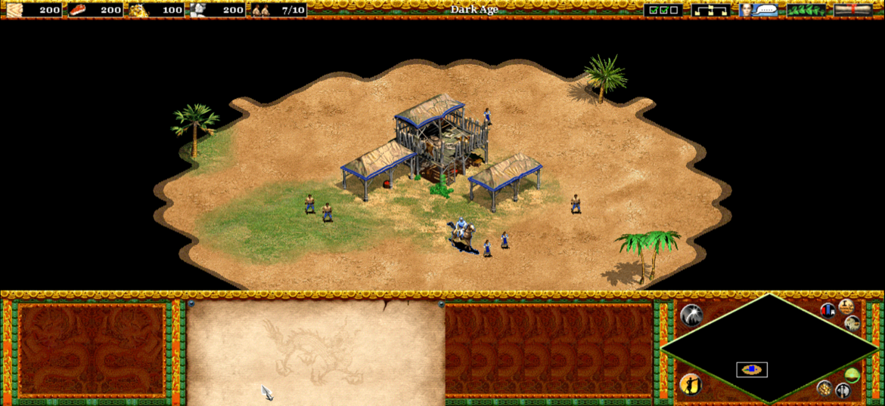

# iOS

OpenAoK as an app for iPhones and iPads running iOS 15 or later, built with
Xcode for `arm64`. The app holds none of the game: on its first start it asks
for a folder of the game's data, made on a computer from your own CD, and
copies it into its Documents folder.

The engine's sources are the same ones the desktop and Android builds use, with
one iOS hook: `src/hal/Window.cpp` tells the platform layer about SDL's window
so it can be put in the app's scene. `ios/platform/PlatformiOS.mm` is the
platform layer: the scene delegate, the document picker, the checked copy into
the sandbox, and the player's files' folder. Everything else -- SDL's
`SDL_main` entry point, the touch controls -- is the same code the desktop and
Android builds use, the touch controls with one part of their own on iOS (see
How it is built).

<p align="center">
  
</p>

## What you need

- A Mac with Xcode 15 or later, opened once so its licence is accepted.
  Xcode 27 and the iOS 27 SDK work: the app uses the UIKit scene life cycle,
  which that SDK requires.
- CMake 3.25 or later (`brew install cmake`).
- Python 3 and `cabextract` to prepare the game's data, as for the desktop
  build (`brew install cabextract`).
- An Apple ID for installing on a device: a free one works through Xcode, and
  AltStore with a free one too. A paid team is needed only for App Store
  distribution.
- For a device, use an Xcode whose iOS SDK matches or is newer than the iOS
  version the device runs. If the iPhone is newer than that SDK and Xcode
  refuses it as an unsupported OS, update Xcode; the "mismatched platform"
  message in Troubleshooting is a different thing.

## 1. Fetch SDL2 and FreeType

```sh
cd ios
./fetch_deps.sh
```

They are built from source into the app; nothing is installed system-wide.
`deps/` is not kept in git.

## 2. Make the game's data

On the Mac, with the CD copied into `original_game_1999/` in the repository (as
the main README says):

```sh
python3 ios/package.py
```

It writes `ios/data/OpenAoK-data/` (not kept in git): about 350 MB of the
game's data with `manifest.txt` (every file's checksum, size and path) and
`version.txt` (which version of the data it is). `--out DIR` writes
`DIR/OpenAoK-data/` instead.

## 3. Build

```sh
ios/build.sh               # simulator, no signing needed
ios/build.sh --project     # only write the Xcode project
```

It writes `ios/build-sim/OpenAoK.xcodeproj` and builds
`ios/build-sim/Release-iphonesimulator/OpenAoK.app`. It compiles four files at
a time; `OPENAOK_JOBS=8 ios/build.sh` compiles eight. With `OPENAOK_CCACHE=1` it
compiles through ccache (`brew install ccache`), so a file compiled before is
not compiled again.

For a device, whose project is `ios/build/OpenAoK.xcodeproj`:

```sh
ios/build.sh --device
```

and the app is `ios/build/Release-iphoneos/OpenAoK.app`. Without
`OPENAOK_TEAM_ID` set it is left unsigned, for AltStore to sign.

`ios/build-sim` and `ios/build` are not interchangeable. The simulator project
is built for `iphonesimulator`, and Xcode marks a connected iPhone or iPad as
"mismatched platform" when it is the open project. For a phone or iPad, open
`ios/build/OpenAoK.xcodeproj`, the one `--device` writes.

Both are ordinary Xcode projects: open one, choose the OpenAoK scheme and a
destination, and Run. To build from Xcode with signing, select the project's
target, Signing & Capabilities, and choose your team; or set the team for the
command line too:

```sh
OPENAOK_TEAM_ID=ABCDE12345 ios/build.sh --device
```

The project can also be written by hand:

```sh
cmake -G Xcode -S ios -B ios/build -DCMAKE_SYSTEM_NAME=iOS
```

`-DCMAKE_OSX_SYSROOT=iphonesimulator` configures a simulator build instead, and
`-DCMAKE_OSX_DEPLOYMENT_TARGET` picks another oldest iOS.

## 4. Run in the simulator

From Xcode: open `ios/build-sim/OpenAoK.xcodeproj`, choose an iPhone or iPad
simulator and Run.

From the terminal:

```sh
open -a Simulator
xcrun simctl install booted ios/build-sim/Release-iphonesimulator/OpenAoK.app
xcrun simctl launch booted org.openaok.game
```

The simulator's Files app cannot easily reach a folder on the Mac, so put the
game's data in the app's own folder and launch it:

```sh
xcrun simctl install booted ios/build-sim/Release-iphonesimulator/OpenAoK.app
DOCS="$(xcrun simctl get_app_container booted org.openaok.game data)/Documents"
mkdir -p "$DOCS"
cp -R ios/data/OpenAoK-data "$DOCS/"
xcrun simctl launch booted org.openaok.game
```

The app finds it there on start -- its `OpenAoK-data` folder, holding
`version.txt` and `assets/extracted_data/rules.json` -- and goes straight into
the game.

## 5. Install on an iPhone or iPad with Xcode

Use `ios/build/OpenAoK.xcodeproj`, the device project. The simulator project,
`ios/build-sim/OpenAoK.xcodeproj`, targets the iOS Simulator only and Xcode
will not run it on a connected iPhone or iPad.

1. `ios/build.sh --device`, or open `ios/build/OpenAoK.xcodeproj` and set your
   team under Signing & Capabilities.
2. Connect the device, trust the Mac on it, and choose it as the destination.
3. Run. The first launch asks for the game's data.

A free Apple ID's signing lasts seven days; the app then has to be installed
again from Xcode. A paid team's lasts a year.

## 6. Sideload with AltStore

AltStore installs an unsigned `.ipa` and signs it with your Apple ID. Make one
from the device build:

```sh
ios/build.sh --device --ipa
```

It writes `ios/build/OpenAoK.ipa`. A release's `OpenAoK-<version>.ipa` is the
same unsigned build, made by the iOS workflow (`.github/workflows/ios.yml`),
which builds the `.ipa` for every push to `main` and every pull request too.

Then, with AltStore on the device (and AltServer running on the Mac, the device
on the same network): My Apps, `+`, and choose `OpenAoK.ipa` -- from Files if it
was AirDropped or copied over, or through AltServer. AltStore signs it on the
device; a free Apple ID has to refresh it every seven days.

## 7. The game's data on the device

Copy `ios/data/OpenAoK-data` to the device in any way it can be reached:
AirDrop, the Files app, or Finder over USB with the device's Files sharing
(the app shows up in Finder's File Sharing list, and its Documents folder holds
it after the first launch).

Open OpenAoK. It says it needs the game's data and opens the system's document
picker: choose the `OpenAoK-data` folder itself (open the folder it is in, then
tap it, then Open). The app copies the data in, checking every file against
`manifest.txt`, and starts the game; the copy on the device can then be
deleted.

The data lives in the app's `Documents/OpenAoK-data/`, saved games and the
profile in `Documents/SaveGame/`, `Documents/Scenario/` and
`Documents/Profile/` beside it, all visible in the Files app under On My
iPhone/iPad, OpenAoK.

After an update that plays from newer data, the app asks for the folder again
on its first start. Make the folder with that release's source code and choose
it; saved games are kept.

## Controls

| Gesture | Does |
|---|---|
| Tap | Left click |
| Hold still for a moment | Right click |
| Drag one finger | Left drag: box-select units, lay a wall |
| Drag two fingers | Scroll the map |
| Pinch | Zoom in and out |

While a building is being placed, the finger slides it and lifting places it.
A hardware keyboard and a mouse or trackpad work as on a desktop, including
Escape for the game's menus; the software keyboard comes up whenever there is
a line to type.

## How it is built

- `ios/CMakeLists.txt` builds the engine's sources from `src/` and the
  platform files from `ios/platform/` into `OpenAoK.app`, against SDL2 and
  FreeType built from `ios/deps`. SDL2 is static, and its uikit `main` starts
  the app and calls the engine's `main` as `SDL_main` -- the standard SDL2
  entry point.
- `ios/Info.plist` keeps the app in landscape, hides the status bar, makes
  Documents visible to the Files app and Finder, and declares the app's single
  `UIWindowScene` with `OpenAoKSceneDelegate` as its delegate.
- `ios/platform/PlatformiOS.mm` implements `HAL::iOS`, which
  `src/hal/Platform.cpp` calls on iOS: it checks for the data, asks for it with
  `UIDocumentPickerViewController`, copies it with a CRC-32 check, enters
  `OpenAoK-data/build/` as the working directory (the engine names its files
  from `build/`, as `../assets/...`), and gives the player's files their
  folders under Documents. Its `OpenAoKSceneDelegate` also owns the setup
  screen's window and attaches SDL's game window to the app's scene, which
  `src/hal/Window.cpp` asks it to do after `SDL_CreateWindow`.
- The scene life cycle is required by apps built with the iOS 27 SDK, and SDL
  2.32.10 predates it: SDL still makes its `UIWindow` with `initWithFrame:`.
  The app adopts scenes itself, with no change to the vendored SDL, so the game
  launches on iOS 27 and still runs on iOS 15 and later.
- `ios/package.py` lays the data out with `tools/data/package_data.py`, the
  same layout the Switch and Android builds use.
- Touch controls are `src/hal/Touch.cpp`'s, as on Android, with one part of
  their own on iOS: a finger iOS lets go of without telling the app -- when a
  system gesture takes the touch over -- is forgotten once it has gone
  unreported a moment, so it cannot hold a pan open. `src/hal/Pointer.cpp`
  sends SDL the mouse it makes from the fingers, as its Switch port does.

Nothing of the simulation, the fixed-point maths or the determinism checks is
iOS-specific; `bash tools/check_determinism.sh` still passes on the Mac.

## Troubleshooting

- **A connected iPhone or iPad shows "mismatched platform"** -- you are
  looking at `ios/build-sim/OpenAoK.xcodeproj`, whose target is built for the
  simulator (`SDKROOT = iphonesimulator`). Run `ios/build.sh --device` and open
  `ios/build/OpenAoK.xcodeproj`; that project targets the device.
- **Xcode says the iPhone's iOS is unsupported** -- the device runs a newer iOS
  than the Xcode's iOS SDK, for example an iPhone on iOS 27.2 with Xcode 27.1.
  Install the Xcode release that ships with a matching iOS SDK (Xcode 27.2 for
  iOS 27.2), or run on a simulator of that version. This is not the
  "mismatched platform" message above.
- **`Application failed to launch: UIScene life cycle is required...`** -- the
  app was built without `ios/Info.plist`, which declares the scene that
  `PlatformiOS.mm` attaches SDL's window to. Build it with `ios/build.sh` or
  from `ios/CMakeLists.txt`.
- **`Could not find a package configuration file ... SDL2`** -- the project
  was configured outside `ios/CMakeLists.txt`. Use `ios/build.sh`, or pass
  `-S ios`.
- **`no such file ... deps/SDL2-2.32.10`** -- run `ios/fetch_deps.sh`.
- **The build stops on signing** -- choose a team in Xcode's Signing &
  Capabilities, or build unsigned (`ios/build.sh --device`) for AltStore.
- **"That folder is not the game's data"** -- the picked folder must be the
  `OpenAoK-data` folder itself, the one holding `manifest.txt` and
  `version.txt`, made by `ios/package.py`.
- **"game data of version N"** -- the folder was made by another release's
  source code. Run `python3 ios/package.py` with this release's.
- **The game starts and stops at "Failed to open graphics.drs"** -- the copy in
  Documents is incomplete or of the wrong version; choose the folder again.
- **The device build fails to link `libz.tbd` after installing a new Xcode** --
  the build folder still records the old Xcode's SDK path. Delete `ios/build`
  and run `ios/build.sh --device` again; likewise `ios/build-sim` after a
  Simulator update.
- **`ios/build-sim` and `ios/build` are stale after changing CMake options** --
  a different sysroot or deployment target needs its own build folder; delete
  the one in question and configure again.
