# AgeOfEmpire2-openaok — Worldcraft

[English version](readme.md)

## Ландшафт и земляные работы

Развитие [OpenAoK](https://github.com/Zaydme/openaok) на C++20: жители сажают
деревья по одному, линией или прямоугольной областью. Есть предварительный вид
при перетаскивании мышью, очередь через Shift, совместная работа, оплата,
отмена, рост и обычная рубка выросшего леса. Поддерживаются одиночная игра,
сетевые команды, сохранения и повторы. В Worldcraft 0.5.0 жители также создают
высокие горы со склонами, выкапывают сухие рвы, канавы и озёра и восстанавливают исходный рельеф.
Для каждой работы доступны линия и область; пологие склоны проходимы,
крутые склоны и рвы закрывают проход. Доступны три высоты горы. Препятствия
смещаются в свободное место, вода при сухих работах заменяется песком;
основания зданий сохраняются даже при строительстве вплотную к ним.

  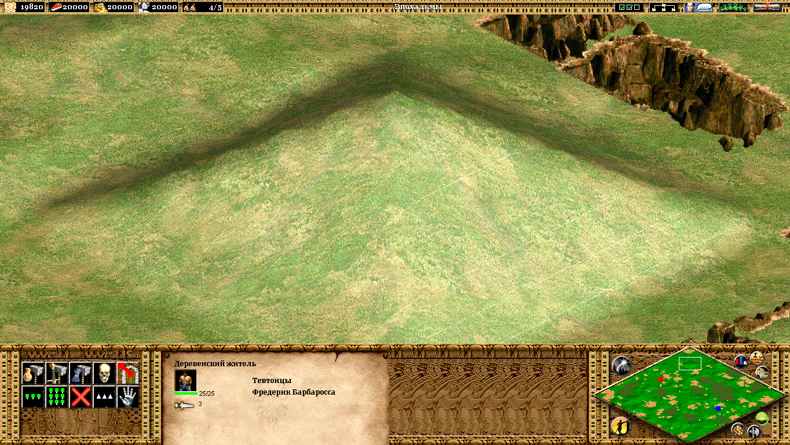

*Горы: жители поднимают рельеф и формируют склоны.*

  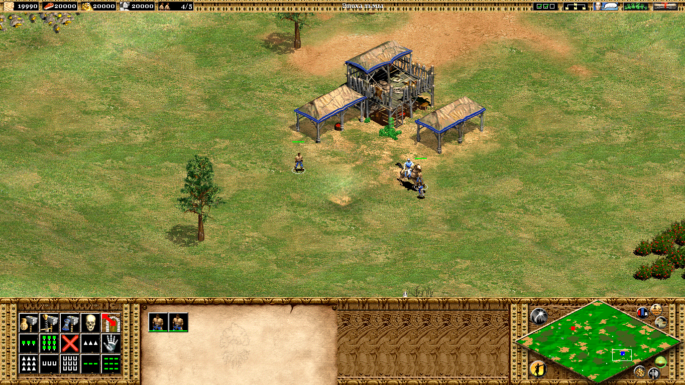

*Рвы: жители понижают рельеф и создают сухие препятствия.*

## Троянский конь

В комплект входит «Троянский конь»: житель строит наземный транспорт
на 12 жителей и пеших бойцов. Кнопка — третья в третьем ряду команд жителя;
посадка — правой кнопкой по своему коню, высадка — командой транспорта с выбором места.
Посаженные лучники и копейщики стреляют общим залпом с остановки; работают
автоматический огонь и приказ атаковать. Копья летят на 4 клетки без бонуса против конницы.
Параметры, ограничения и совместимость: [транспорт](mods/worldcraft/transport/README.txt).

  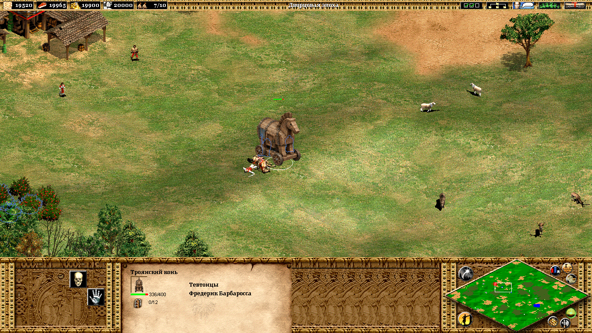

*Троянский конь: наземный транспорт для жителей и пеших бойцов.*

## Змей Горыныч

Змей Горыныч летает над препятствиями и обстреливает одну цель огнём трёх голов.
На новой случайной карте появляются 10 мирных драконов, приручаемых приближением
на 3 клетки. Житель выращивает Горыныча четвёртой кнопкой третьего ряда:
400 дерева, 300 золота, 120 секунд и 5 мест населения. Параметры и графика:
[Горыныч](mods/worldcraft/gorynych/README.txt).

  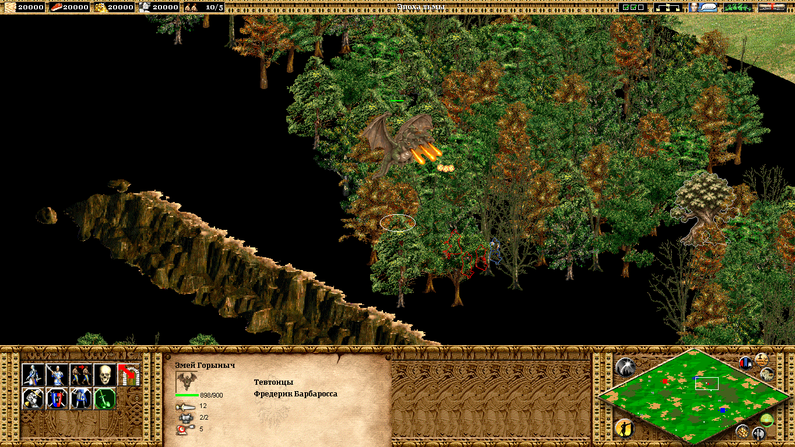

*Горыныч: полёт над препятствиями и огонь трёх голов.*

## Древень — ходячее дерево

Дополнение добавляет «Ходячее дерево»: житель выращивает управляемого
бойца ближнего боя. Кнопка — первая в третьем ряду команд жителя. Требуются
200 древесины, 50 золота, 60 секунд работы и 3 свободных места населения.
Есть собственные анимации ходьбы, атаки, гибели и останков; настройки находятся
в `mods/worldcraft/treeman/unit.json`.

На каждой новой случайной карте появляются 10 мирных диких древней.
Подведите своего жителя или бойца на расстояние трёх клеток: древень бесплатно
присоединится к вам и станет обычным бойцом. Приближением чужих юнитов его
больше не переманить. Приручённый древень занимает 3 места населения, даже
если текущий лимит уже заполнен. Выращивание жителем остаётся доступным.

  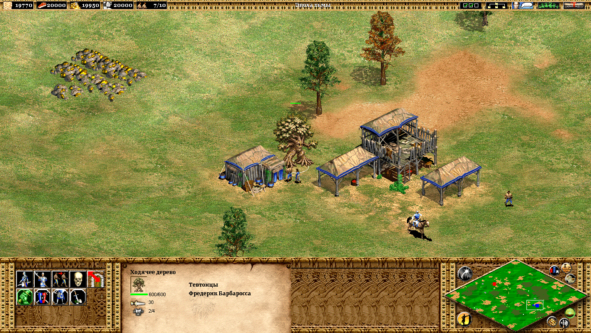

*Древень: боец ближнего боя, выращенный или приручённый игроком.*

## Реки и водяные рвы

Реки и водяные рвы доступны во второй кнопке третьего ряда команд жителя.
Выберите ширину линии 1/3/5 клеток, затем протяните реку, ров или область.
Готовые клетки заполняются водой; течение реки направлено от начала линии
к концу и отображается визуально. Реки доступны кораблям при достаточной
ширине, водяные рвы закрывают путь и сухопутным юнитам, и кораблям.
Восстановление возвращает исходный рельеф. Другие задуманные существа
пока не реализованы.

  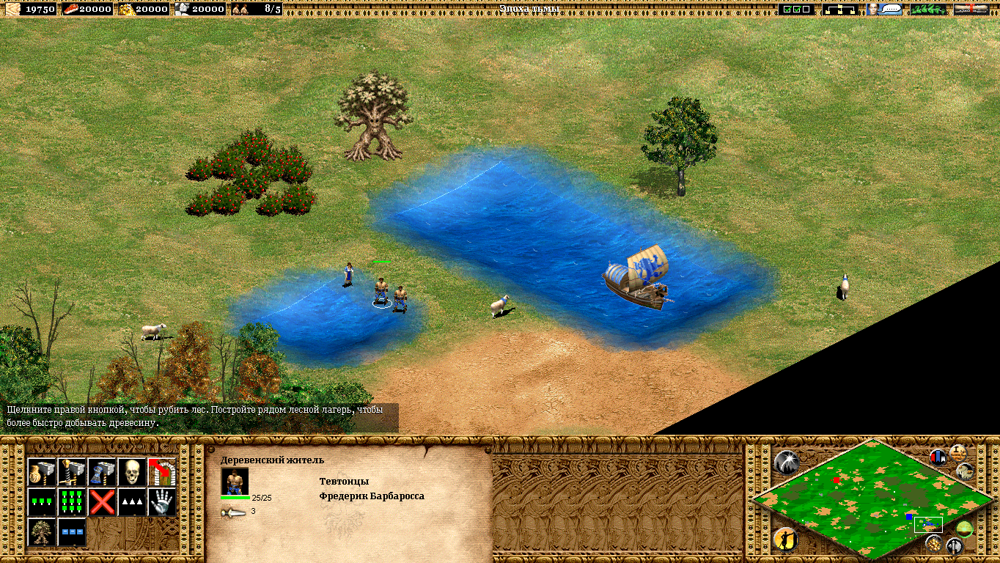

*Вода: судоходная река и водяной ров, созданные жителями.*

## Состояние проекта и упаковка

- [Управление и настройки дополнения](mods/worldcraft/README.txt).
- [Восстановление проверенного рабочего каталога Windows](local-support/README.txt).
- [Состояние проекта и результаты проверок](local-support/CHECKPOINT.txt).

Контрольная точка от 11 ноября 2026 года: целевые проверки **20/20**, общий
прогон **127/130**. Сохраняются три прежние неудачи: позднее развитие ИИ и две
проверки без `DEMO.SCN`. [Проверка рек](local-support/RIVERS-VERIFICATION.txt)
описывает строительство, плавание, засыпку, сохранения, повторы, TCP и
наблюдение о единичном сбое при автоматическом выходе после снимка.
[Проверка древней](local-support/TREEMAN-VERIFICATION.txt) охватывает их
приручение, выращивание и бой.
[Упаковка Windows](windows/installer/README.txt) создаёт локальный
установщик для запуска без средств разработки.

Для игры нужны собственные файлы **The Age of Kings (1999)**. Исходные данные
игры, извлечённые ресурсы, шрифты, сохранения и локальные сборки в репозиторий
не включены. У сетевых игроков должны совпадать сборка и пакет `mods/worldcraft`.
Сохранения предыдущей версии автоматически не преобразуются.

Ниже сохранено описание исходного проекта OpenAoK. Его ссылки на готовые
загрузки относятся к upstream, а не к сборкам этого дополнения.

---

  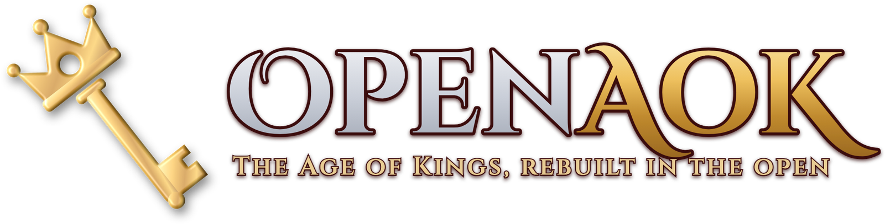

  <b>Свободный движок с открытым исходным кодом для Age of Empires II: The Age of Kings — на компьютере и в кармане.</b>

  <a href="https://zaydme.github.io/openaok/"><b>Документация</b></a> ·
  <a href="https://zaydme.github.io/openaok/guide/"><b>Начало работы</b></a> ·
  <a href="https://github.com/Zaydme/openaok/releases"><b>Скачать</b></a>

  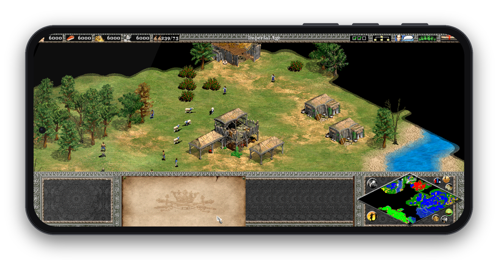

## Зачем

Играть в Age of Empires II на телефоне было моей мечтой с детства.
Microsoft не собиралась её воплощать, поэтому я сделал это сам.

OpenAoK — новый движок, написанный с нуля, который запускает оригинальную
игру 1999 года с вашей собственной копии компакт-диска: те же юниты, карты,
графика, звуки, музыка, видеоролики и кампании на Windows, macOS, Linux,
телефонах Android, iPhone, iPad и Nintendo Switch.

## Что это такое

- **Написан с нуля.** OpenAoK не содержит кода или данных оригинальной игры.
  Он написан на современном C++20 с SDL 2, использует архитектуру,
  ориентированную на данные (EnTT), и детерминированную симуляцию с числами
  с фиксированной точкой. Движок читает файлы данных из вашей копии игры
  и реализует заданные в них правила.
- **Верность оригиналу.** Характеристики каждого юнита, все технологии,
  цивилизации и скрипты карт берутся из данных 1999 года. Интерфейс использует
  оригинальную графику, расположение элементов, шрифты и тексты игры.
- **Ваша копия, ваши данные.** В репозитории нет файлов игры. Вы копируете
  свой компакт-диск в папку, и OpenAoK подготавливает из неё всё необходимое.

## Снимки экрана

<table>
  <tr>
    <td>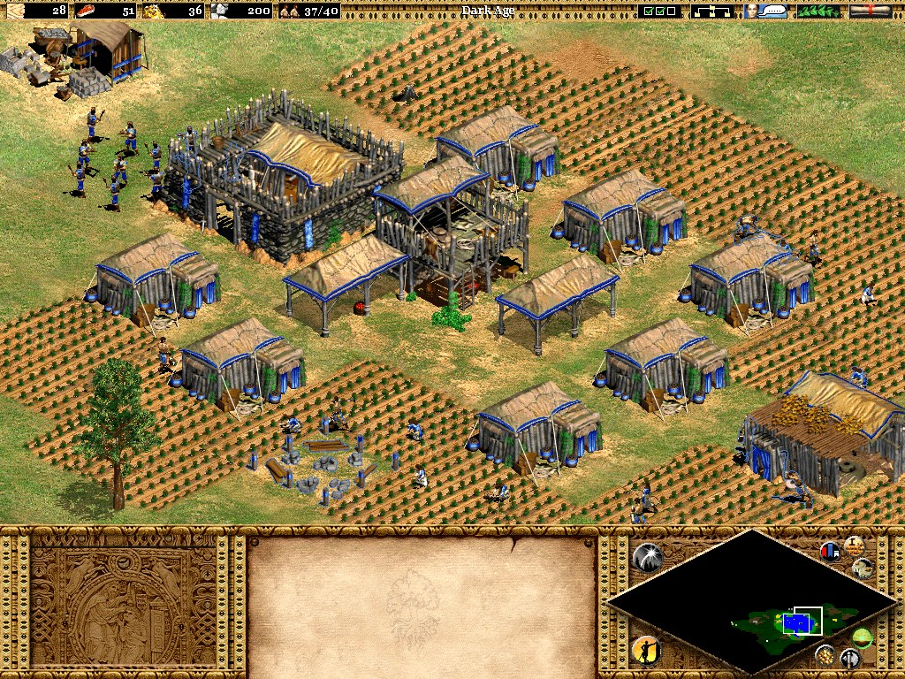</td>
    <td>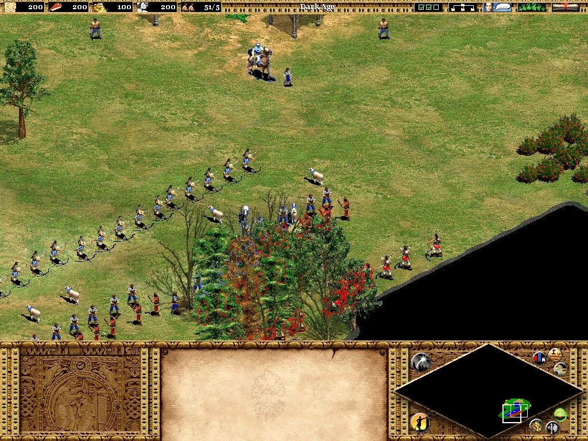</td>
  </tr>
  <tr>
    <td>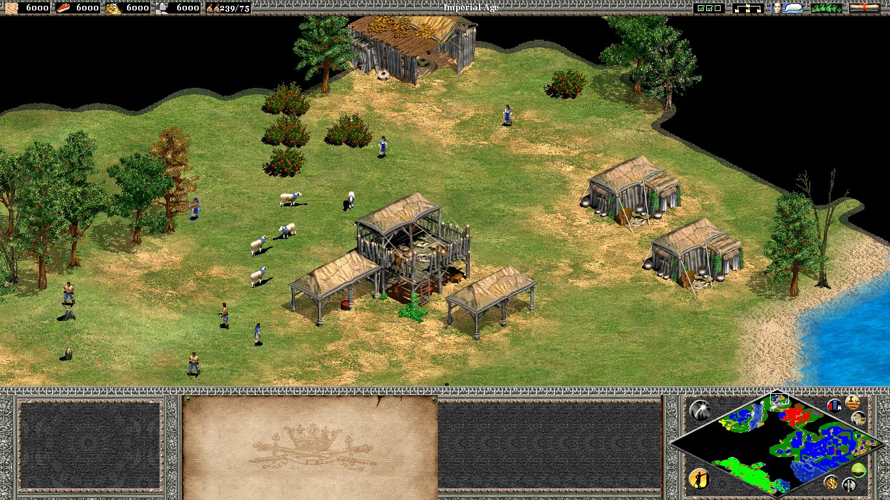</td>
    <td>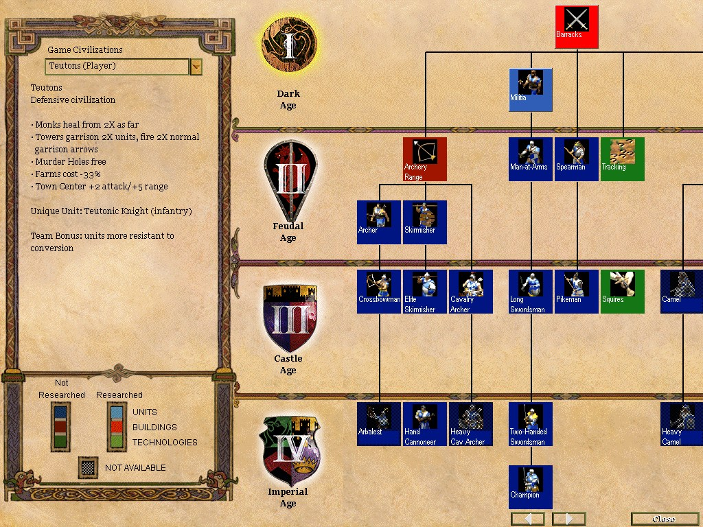</td>
  </tr>
  <tr>
    <td>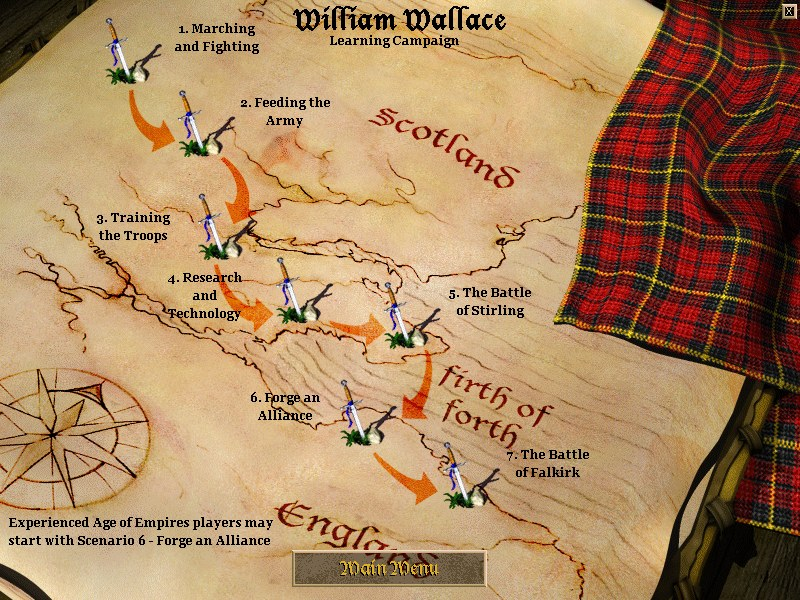</td>
    <td>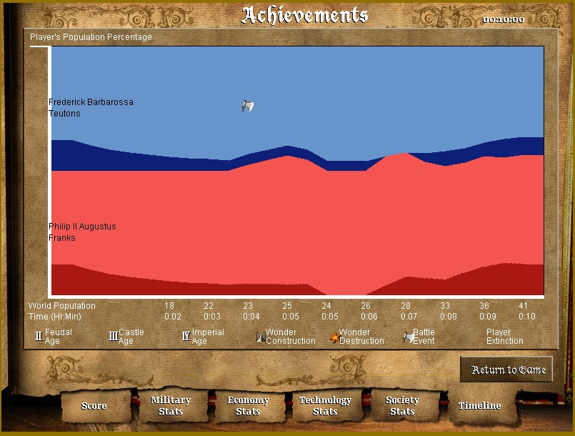</td>
  </tr>
</table>

### На телефоне

  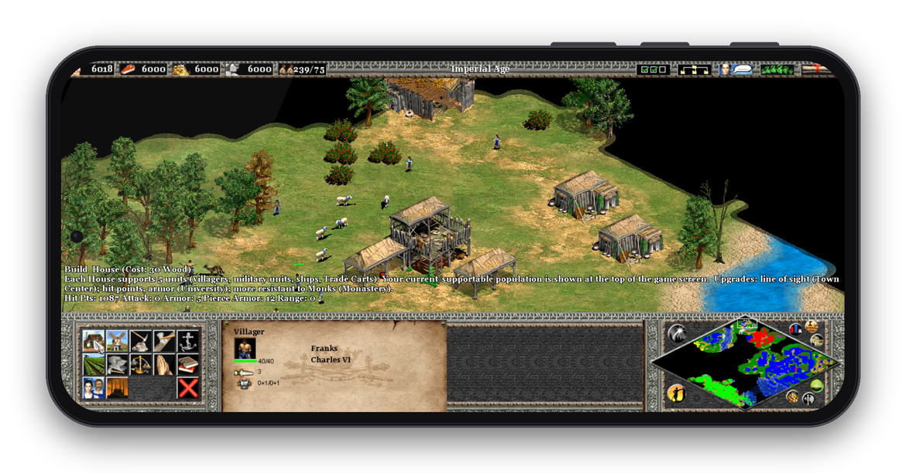
  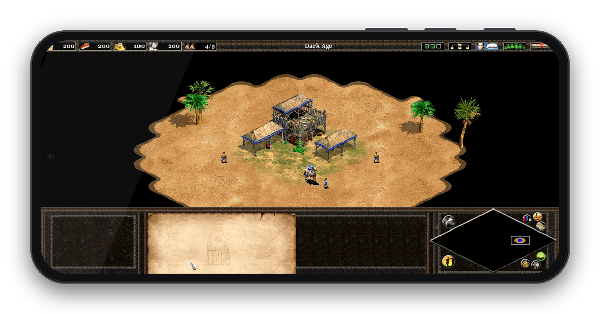

  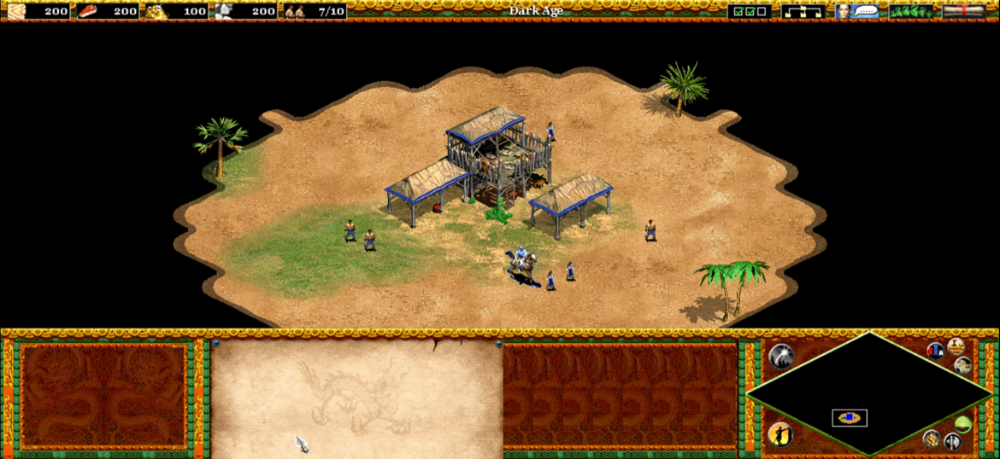

## Управление

При использовании мыши и клавиатуры управление соответствует оригиналу:
щелчок левой кнопкой и перетаскивание — выделение, правая кнопка — приказ,
панель команд и горячие клавиши — остальные действия. Колесо мыши также
меняет масштаб, чего не было в оригинальной игре.

На сенсорном экране игра управляется как мышью, и это на удивление удобно:
касание заменяет щелчок, удержание — правую кнопку, перетаскивание одним
пальцем выделяет юниты, двумя — перемещает карту, щипок меняет масштаб.
Такое управление работает на телефонах Android, iPhone и iPad. Верхнюю
панель, панель команд и текст можно увеличивать независимо друг от друга,
а на широком экране интерфейс растягивается до его краёв.

На Nintendo Switch контроллер заменяет мышь и горячие клавиши игры:

  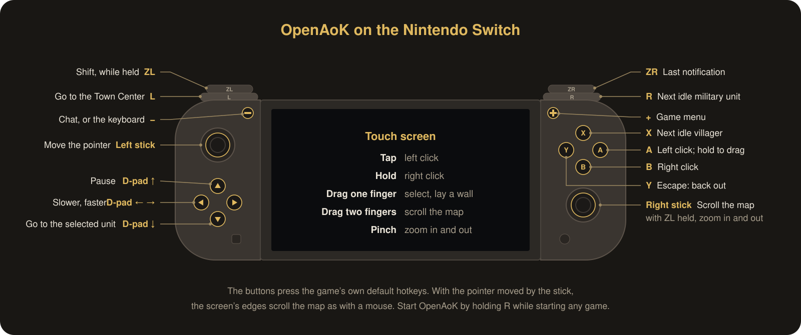

Все действия, настройки и дополнения OpenAoK к оригинальной игре описаны
в руководстве: [Управление](https://zaydme.github.io/openaok/guide/controls),
[Настройки](https://zaydme.github.io/openaok/guide/options),
[Улучшения оригинала](https://zaydme.github.io/openaok/guide/improvements).

## Что работает

- **Случайные карты** на основе оригинальных скриптов: суша, типы местности,
  высоты, обрывы, берега и объекты при любом размере карты.
- **Правила игры**: характеристики всех юнитов, все 426 технологий и их
  эффекты, дерево технологий и бонусы каждой цивилизации, четыре эпохи.
- **Экономика**: сбор ресурсов, пункты их сдачи, строительство, фермы, жильё,
  очереди производства и исследований, рынок, торговые повозки и корабли,
  передача ресурсов.
- **Война**: классы атаки и брони, снаряды, урон по области, построения и
  режимы поведения, гарнизоны и городской колокол, монахи и реликвии,
  осадные орудия, стены и ворота.
- **Вода**: порты, рыболовство, линейки боевых кораблей, высадка транспорта
  на любом берегу.
- **Компьютерные игроки**, выполняющие оригинальные скрипты ИИ
  в интерпретаторе языка скриптов на всех уровнях сложности.
- **Кампании и сценарии** с триггерами, озвучкой и иллюстрациями;
  редактор сценариев; сохранённые и записанные игры.
- **Победа** завоеванием, постройкой чуда света или сбором реликвий,
  а также по очкам, ограничению времени или особым условиям сценария;
  режимы «Цареубийство» и «Смертельная схватка»; дипломатия, союзная победа,
  чат, реплики, сигналы на карте и чит-коды.
- **Оформление**: спрайты напрямую из оригинальных SLP с цветами игроков
  и тенями, плавные переходы местности, туман войны, оригинальный интерфейс,
  звуки, музыка и вступительные видеоролики.
- **Сетевая игра** с синхронным выполнением команд (lockstep) по TCP
  и обнаружением рассинхронизации: автоматический поиск игр в локальной
  сети, подключение к другим играм по адресу, лобби с чатом
  и подтверждением готовности.

Планы развития и известные проблемы перечислены в
[дорожной карте](https://zaydme.github.io/openaok/development/roadmap).

## Как это устроено

Детерминированная симуляция использует числа с фиксированной точкой 32.32
и постоянную частоту 60 Гц: одинаковые приказы создают одинаковый мир
на любой машине. Рендерер читает её состояние и рисует оригинальные
спрайты прямо из архивов игры. Документация объясняет всё — от форматов
файлов компакт-диска до компьютерных игроков:

- [Устройство движка](https://zaydme.github.io/openaok/engine/)
- [Данные игры](https://zaydme.github.io/openaok/engine/data) и [случайные карты](https://zaydme.github.io/openaok/engine/random-maps)
- [Фиксированная точка и детерминизм](https://zaydme.github.io/openaok/engine/determinism) и [сетевая игра с синхронным выполнением команд](https://zaydme.github.io/openaok/engine/multiplayer)
- Игра: [юниты](https://zaydme.github.io/openaok/engine/units), [перемещение](https://zaydme.github.io/openaok/engine/pathfinding), [экономика](https://zaydme.github.io/openaok/engine/economy), [здания](https://zaydme.github.io/openaok/engine/construction), [обучение и исследования](https://zaydme.github.io/openaok/engine/production), [бой](https://zaydme.github.io/openaok/engine/combat), [армии и флот](https://zaydme.github.io/openaok/engine/war), [победа](https://zaydme.github.io/openaok/engine/victory), [сценарии](https://zaydme.github.io/openaok/engine/scenarios), [компьютерные игроки](https://zaydme.github.io/openaok/engine/ai)
- [Отрисовка](https://zaydme.github.io/openaok/engine/rendering/), [интерфейс](https://zaydme.github.io/openaok/engine/interface) и [звук](https://zaydme.github.io/openaok/engine/audio)

## Начало работы

Для OpenAoK нужна **ваша собственная, законно полученная копия**
*Age of Empires II: The Age of Kings* (1999 год, оригинальный компакт-диск),
а не The Conquerors, HD или Definitive Edition.
В разделе [Файлы вашей игры](https://zaydme.github.io/openaok/guide/game-files)
объясняется, что нужно скопировать. Готовые загрузки не содержат данных
игры: они подготавливаются с вашего компакт-диска.

| Платформа | | |
|---|---|---|
| **Windows** 10 и 11, 64-разрядная | Архив с папкой; данные подготавливаются при первом запуске | [Руководство](https://zaydme.github.io/openaok/guide/windows) |
| **macOS и Linux** | Сборка из исходного кода одной командой | [Руководство](https://zaydme.github.io/openaok/guide/desktop) |
| **Android** 10 или новее, arm64 | APK и папка данных, подготовленная на компьютере | [Руководство](https://zaydme.github.io/openaok/guide/android) |
| **iPhone и iPad**, iOS 15 или новее | IPA для установки вне App Store или сборка в Xcode | [Руководство](https://zaydme.github.io/openaok/guide/ios) |
| **Nintendo Switch**, homebrew | Файл `.nro` и папка данных на SD-карте | [Руководство](https://zaydme.github.io/openaok/guide/switch) |

Загрузки доступны на странице [релизов](https://github.com/Zaydme/openaok/releases).
Помощь при неполадках — в разделе
[Устранение проблем](https://zaydme.github.io/openaok/guide/troubleshooting).

## Сборка и участие в разработке

Раздел [Сборка из исходного кода](https://zaydme.github.io/openaok/development/)
описывает сборку для каждой платформы. Каждое изменение проверяется
самопроверкой без графического интерфейса, побитовым сравнением хеша
детерминизма и более чем сотней сценариев
([Самопроверки](https://zaydme.github.io/openaok/development/verification)).
В разделе [Участие в разработке](https://zaydme.github.io/openaok/development/contributing)
описано, как работать над проектом.

## Разработка с помощью ИИ

Я создал это не в одиночку, и утверждать обратное было бы неправдой.
Я работал над OpenAoK вместе с Claude: он написал значительную часть кода,
инструментов и этой документации. Моя роль заключалась в понимании того,
как должна ощущаться игра: я решал, что и как делать дальше, и позволял
Claude заниматься тем, что у него получается лучше всего.
[CLAUDE.md](CLAUDE.md) — инструкция, которой он руководствуется,
если вы хотите работать над проектом таким же образом.

## Лицензия и благодарности

OpenAoK распространяется по [лицензии MIT](LICENSE). Декодер видеороликов
Indeo 5 основан на реализации FFmpeg и распространяется по LGPL 2.1
или более поздней версии. Включённые сторонние библиотеки сохраняют
собственные лицензии: см.
[THIRD_PARTY_NOTICES.md](THIRD_PARTY_NOTICES.md).

Благодарность проекту [openage](https://openage.dev) за документацию
форматов файлов и механик игры, а также
[genieutils](https://github.com/sandsmark/genieutils) за чтение файлов dat.

## Отказ от ответственности

OpenAoK — свободный некоммерческий фанатский проект. Он не связан
с Microsoft или Nintendo, не одобрен и не спонсируется ими и не содержит
ресурсов игры: для игры нужна ваша собственная копия.

*Age of Empires II: The Age of Kings* © Microsoft Corporation. *Age of Empires*
— товарный знак Microsoft Corporation. Nintendo Switch — товарный знак
Nintendo. Снимки экрана в этом README созданы с использованием ресурсов
*Age of Empires II: The Age of Kings* в соответствии с
[правилами использования игрового контента Microsoft](https://www.xbox.com/en-US/developers/rules)
и не одобрены Microsoft и не связаны с ней.
