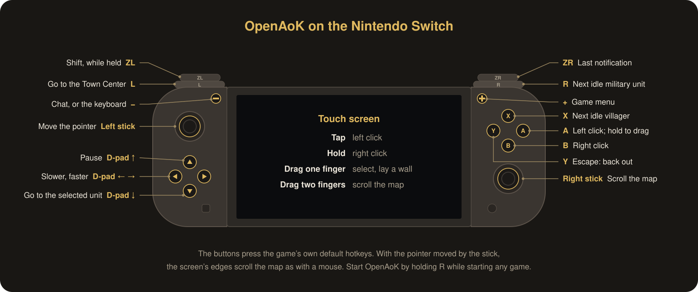

# Nintendo Switch

OpenAoK as Nintendo Switch homebrew: `OpenAoK.nro`, started from the Homebrew
Menu on a Switch that runs homebrew under custom firmware such as Atmosphère.

The `.nro` holds none of the game. The game's data is a folder you make on a
computer from your own CD and copy to the SD card beside it.

## What you need

- A Switch that runs homebrew.
- On a computer: your copy of the original CD in `original_game_1999/`, and
  the tools that prepare it (Python 3, CMake, a C++ compiler and `cabextract`;
  see the main README).
- To build the `.nro` yourself, one of:
  - Docker. On a Mac: `brew install colima docker && colima start`.
  - devkitPro's Switch toolchain: install
    [devkitPro's pacman](https://devkitpro.org/wiki/Getting_Started), then
    `sudo dkp-pacman -S switch-dev switch-sdl2 switch-freetype`.

## Build

```sh
switch/build.sh           # build
switch/build.sh --clean   # wipe build-switch/ first
```

writes `build-switch/OpenAoK.nro`. It uses devkitPro's toolchain when
`DEVKITPRO` is set, and otherwise devkitPro's Docker image
(`devkitpro/devkita64`). With the toolchain installed, the same is:

```sh
cmake -S . -B build-switch -DCMAKE_TOOLCHAIN_FILE=$DEVKITPRO/cmake/Switch.cmake
cmake --build build-switch
```

The build needs none of the game's data. GitHub Actions builds the `.nro` on
every push (`.github/workflows/switch.yml`), and a version tag (`v*`) publishes
it as a release: a zip of `switch/openaok/OpenAoK.nro` and the licenses.

## Make the SD card's folder

With the card in the computer (on a Mac, `/Volumes/` and the card's name):

```sh
python3 switch/package.py --out "/Volumes/SWITCH SD"
python3 switch/package.py --nro OpenAoK.nro --out "/Volumes/SWITCH SD"   # a released .nro
```

prepares the game's data from `original_game_1999/` as `build.sh` does, and
writes:

```
switch/openaok/OpenAoK.nro        the game
switch/openaok/game/              its data: 354 MB, about 390 MB on a FAT32 card
```

Write to the card through a good card reader, or through Hekate's USB mass
storage (Tools → USB Tools → SD Card), which writes through the Switch's own card
slot: some USB card readers damage what they write to large cards. Without
`--out` the folder is written to `build-switch/sd/`, to copy to the card's root
yourself. Run it again after an update: only what changed is
copied. On a Mac it removes the `._` files macOS leaves beside each file on a
FAT32 card. The folder holds your copy of the game, so keep it to your own
console.

## Play

Hold R while starting any game: the Homebrew Menu opens with all of the
console's memory, which OpenAoK needs. Choose OpenAoK. Started from the Album
instead, it says so and returns to the menu.

On its first start after a copy, OpenAoK reads every data file and checks it
against `game/manifest.txt`, which `package.py` writes: a few seconds, with the
progress on the screen. A file that is missing or damaged on the card is named,
and copying the folder again mends it, through another card reader or Hekate's
USB mass storage if it happens again.

The profile, saved games and scenarios are kept in `switch/openaok/` (`Profile`,
`SaveGame`, `Scenario`), beside the data rather than in it. What the engine
prints goes to `switch/openaok/openaok.log`.

## Controls

<p align="center">
  
</p>

In handheld mode the touch screen plays as on a phone:

| Gesture | Does |
|---|---|
| Tap | Left click |
| Hold still for a moment | Right click (the controller buzzes) |
| Drag one finger | Left drag: box-select units, lay a wall |
| Drag two fingers | Scroll the map |

The controller plays as a mouse and the game's own hotkeys:

| Control | Does |
|---|---|
| Left stick | Moves the pointer, the faster the further it is pushed |
| Right stick | Scrolls the map |
| A | Left mouse button; held while the pointer moves, a drag |
| B | Right click |
| X | Next idle villager |
| Y | Escape: backs out of whatever is half done |
| L | Go to the Town Center |
| R | Next idle military unit |
| ZL, held | Shift: add to a selection, queue orders, train five |
| ZR | Go to the last notification |
| + | Game menu |
| − | Chat |
| D-pad up | Pause |
| D-pad down | Go to the selected unit |
| D-pad left, right | Slower, faster |

With the pointer moved by the stick, the screen's edges scroll the map as with a
mouse.

Chat and a saved game's name bring up the system keyboard; OK finishes the
line, and backing out of the keyboard cancels it. On the Options and
Multiplayer screens and in the scenario editor, − brings up the keyboard for
the field being typed into.

## Running from a computer

`switch/send.py` sends a freshly built `.nro` over Wi-Fi and prints what the
game prints, as devkitPro's `nxlink` does. In the Homebrew Menu press Y for its
network loader, then:

```sh
python3 switch/send.py                        # finds the Switch on the network
python3 switch/send.py --host 192.168.1.28    # or names it
python3 switch/send.py -- --game --map Arabia # with the game's own options
```

The `.nro` replaces `switch/openaok/OpenAoK.nro` on the card, beside the data.

## Not yet

- Network games, which start from the command line.
